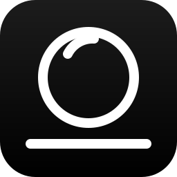

<p align="center">
  
</p>

<h1 align="center">Repackshot</h1>

<p align="center">
  <b>Product rendering the way a photographer thinks about it: product type, materials, light setup, render.</b>
</p>

<p align="center">
  <a href="https://github.com/Grohle-developer/Repackshot/releases/latest"></a>
  <a href="LICENSE"></a>
  
  
  
  
</p>

<p align="center">
  <a href="https://buymeacoffee.com/grohle"></a>
</p>

---

A free, source-available **KeyShot-style 3D product renderer**, free for
noncommercial use (see [License](#license)), that runs in the
browser and, later, on the desktop: import a model, pick a product type,
paint materials, pick a light setup, render. Written **from scratch as a
clean-room implementation**: a TypeScript interface with no framework and a
**render engine in Rust with zero dependencies**, compiled to WebAssembly
for the browser and to native binaries for the command line, that runs on
any operating system and any CPU architecture.

It is built around product-type studios, a catalogue of light setups
chosen by eye, materials with procedural wear, a Doctor panel, four-level
selection, and photographer's language everywhere. And around one more
idea: an interface in **black and white only**, so the only colour on
screen is the image.

 


## What it does

The list below is the product. The **Status** section says what is built
today.

- **Three columns and one button.** Left, what is in the scene (parts,
  cameras, lights, studios). Centre, the image. Right, an inspector that
  edits whatever is selected, and the scene when nothing is. Below,
  *Animation*, *Queue* and **Render…**, which opens a KeyShot-style render
  window: output name and folder, pixels or print size with DPI, finish by
  samples or time, *Render* or *+ Add to queue*. No ribbon, and only three
  windows in the whole app: Render, Settings and the material editor.
- **16 product types** (jewellery, watches, fragrance, cosmetics,
  electronics, appliances, indoor and outdoor furniture, footwear, textile,
  packaging, automotive, tools, eyewear, medical, generic). *Build studio*
  sets part size, focal length, aperture, exposure, background, floor,
  shadow, caustics, quality and a light rig suited to that category's
  reflectance, in one click.
- **72 light setups in 8 styles** (product, traditional, cinematic,
  creative, emotional, experimental, signature, spicy), picked from
  thumbnails with a one-line intent each: *one large source: one shadow,
  one highlight*. Exposure is normalised across setups, so switching from
  Rembrandt to a bright field does not change how bright the image is.
  Fine-tune every light in photographer's terms (softbox size, kelvin,
  spread), or place a light by pointing at where you want its reflection.
- **86 materials in 7 categories** (metals, plastics, woods, fabrics, glass,
  emitters, others), each with its physics: brushed and polished metals,
  ABS, SLS nylon, printed PLA, polycarbonate, acrylic, 13 procedural
  woods, 11 woven fabrics, clear and frosted glass, Edison filaments to
  sodium lamps and neon, car paint, carbon fibre, leather, ceramic, and
  translucent ones that light scatters inside: white HDPE, natural PP,
  frosted acrylic, wax, glycerine soap, milk, orange and apple juice,
  cream.
  **Procedural wear** on every one of them: worn edges, scratches,
  fingerprints, dust, dirt in crevices, patina, micro roughness, dents,
  with nine one-click looks from *fresh from the factory* to *aged*, and
  each material's own chemistry (copper takes verdigris, gold does not).
- **Four-level selection** for painting materials: model, group, part or
  faces. Assigning onto a group that already holds different materials asks
  first, with an inventory of what would change.
- **Camera** with lens presets (14 mm to 200 mm), f-stop, click to focus,
  perspective or orthographic, framing views, saved cameras. **Image**:
  exposure, Standard / Filmic / AgX, bloom, sharpen, vignette.
- **Environment without downloads**: a procedural studio dome lights and
  reflects (floor to horizon to zenith), a procedural sky for the sun
  setups, flat colour, transparent, or your own HDRI. A luminous panel
  behind the part paints a bright field into the background, never a
  rectangle with edges.
- **Animation in plain language**: shots and movements written as
  sentences (*the camera orbits 90° over 4 s, ease*), 16 presets, a
  three-question wizard, a timeline in three zones (what is animated,
  when, how) with snapping bars and the track drawn in the viewport,
  configurable exploded views (linear, radial, spherical, by levels,
  with parts that stay put), fades.
- **The viewport is the render.** The path tracer converges where you work;
  *Render* only saves it at full size with a budget of samples or seconds.
  A render queue, batches of cameras × studios, passes.
- **A Doctor** that watches scale, floor contact, smoothing, edge bevel,
  camera clipping, visible lights, fireflies and output format, and fixes
  each with one click.
- **Command palette** (`Ctrl K`) over every action, material, setup and
  camera; undo for everything; keyboard shortcuts in every tooltip; a guide
  with arrows that never hides the panel; English and Spanish; dark and
  light themes, both achromatic. Keyboard-first: Tab follows the layout,
  menus, dialogs and the palette keep the focus while open, every icon
  button has its name in both languages, and Settings ▸ Accessibility offers
  larger text, high contrast and reduced motion (which also stops smooth
  scrolling).
- **A render engine in Rust, from scratch**, with no external crates: BVH
  with SIMD traversal, physically based BSDFs, area lights with explicit
  sampling, Sobol sampling, deterministic across platforms (the same scene
  renders to the same pixels on x86_64, ARM64, RISC-V and wasm, with one
  thread or many). In the browser it runs in a pool of Web Workers; on the
  command line, `rt` renders a scene file with every core of the machine.
- **Projects in one file** (`.repack`, meshes embedded; the `.repack.json` of
  earlier versions opens too), and a
  procedural example part so you can see a finished result without
  bringing your own CAD.

## Requirements

- A current browser (Chromium, Firefox or Safari) for the interface.
- To build: Node 22 and a stable Rust toolchain
  ([rustup](https://rustup.rs)) with the `wasm32-unknown-unknown` target.
- No GPU is needed by the engine; the preview viewport uses WebGL.

## Build

```bash
npm ci
npm run dev            # http://localhost:5173
npm run qa             # typecheck + tests + build of the interface
npm run engine:test    # cargo test of the engine workspace
npm run engine:build   # builds rt.wasm into public/engine/
npm run screenshot     # screenshots dist/ with the local Chromium (build first)

# the native engine, from the command line
cargo run --manifest-path engine/Cargo.toml --release -p rt-cli -- --example -o out/example.png
cargo run --manifest-path engine/Cargo.toml --release -p rt-cli -- scene.rsb -o out/render.png --samples 256
```

The interface is TypeScript + Vite with no framework, no icon fonts and no
network fonts. The engine is a Cargo workspace under `engine/` (`rt-core`,
`rt-cli`, `rt-wasm`) whose `Cargo.lock` holds only its own crates; CI fails
if an external source ever appears, cross-compiles the engine to ARM64 and
RISC-V, and builds the wasm on every pull request. The interface talks to
the engine through one binary scene format, RSB, that both sides can read
and write.

`tools/screenshot.mjs` drives the local Chromium for the screenshots in
this README. `tests/ui-achromatic.test.ts` fails if any colour in the
interface's CSS has saturation. `tests/strings.test.ts` fails if a string
exists in only one language. `tests/ui-contrast.test.ts` measures the text
greys against their surfaces (WCAG ratio, 7:1), and `tests/a11y-browser.test.ts`
audits the button names, the focus and the reduced motion of the running
interface in Chromium.

## Status

**Alpha, under construction.** Built today:

- The documentation that drives the project: `CLAUDE.md`,
  [`docs/ROADMAP.md`](docs/ROADMAP.md) (phases, and which model executes
  each one), [`docs/SPEC.md`](docs/SPEC.md), [`docs/ARCHITECTURE.md`](docs/ARCHITECTURE.md),
  [`docs/UI.md`](docs/UI.md). Documentation is in Spanish; code and
  comments in English; the interface in both.
- The catalogues (studios, setups, materials, wear, lenses, animation
  presets, Doctor checks) with their photometry and 99 tests.
- The render engine in Rust: SIMD wide BVH, a Sobol / Owen path tracer
  with physically based materials, area lights and sun with MIS, studio
  dome, floor and shadow catcher, tone curves; deterministic across
  platforms; 182 tests, cross-compiled to ARM64, RISC-V and wasm.
- **The engine runs in the browser**: a pool of Web Workers renders the
  viewport in **Full** mode and every Render, with byte-exact parity with
  the native `rt` command line; **Fast** mode keeps a rasterised preview
  for editing.
- The interface: importers for glTF, OBJ, STL, FBX, 3DM, 3MF, PLY, DAE
  and USD, the move tool and part operations, the user library; 561 tests.

See the milestones in `docs/ROADMAP.md`: **v0.1** import, product types,
materials, light setups and the Rust path tracer rendering in the viewport
and from the command line; **v0.2** glass and emitters, wood and fabric,
place by reflection, bright field, sky, HDRI, CAD-face selection, queue and
passes; **v0.3** visible wear, textures and labels, animation and video,
STEP, native batches, desktop build.

## Clean-room rules

This is what keeps the project lawful and shippable. Non-negotiable:

1. **No KeyShot binaries in this repo.** No installers, no DLLs, no
   extracted resources. The `.gitignore` enforces this as a second line of
   defense (it also ignores any file name containing "keyshot", so never
   name a file that way).
2. **No disassembly or decompilation of KeyShot, ever.** No REA/Ghidra/
   Hopper/IDA sessions against KeyShot binaries, no pasted disassembly, no
   reconstructed algorithms from its code.
3. **Implementation sources are:** public rendering literature and
   open-source renderers with compatible licenses, plus black-box
   behavioral observation (using the product normally and writing down
   what it does: ideas and workflows, never code).
4. **All contributions must be original work** or from MIT/Apache-2.0/
   BSD-compatible sources, with attribution preserved, and are made under
   the project's licence terms (see [`CONTRIBUTING.md`](CONTRIBUTING.md)).
   The engine goes one step further: no external code at all.

Anyone who has studied KeyShot's internals writes the *behavioral spec*
(`docs/SPEC.md`); anyone who implements from the spec must not have seen
those internals.

## Acknowledgments

- **[three.js](https://threejs.org)** (MIT): the interactive preview
  viewport while the camera moves. It is not the engine.
- **Public literature** the engine cites in its modules: PCG random
  numbers (O'Neill), Sobol direction numbers (Joe and Kuo), the ACES
  tone-mapping fit, the GGX microfacet model, the sky models. Formulas and
  tables, never code. The physical sky (E5c) takes only the *functional
  form* of Hošek and Wilkie (ACM TOG 31(4), 2012); its coefficients are
  fitted by `engine/crates/rt-sky` to our own atmosphere simulation, built
  from textbook physics and public data: the U.S. Standard Atmosphere
  1976, Rayleigh scattering after Bodhaine et al. (1999) with the
  refractive index of Peck and Reeder (1972) and the King factors of Bates
  (1984), Linke's turbidity and Ångström's exponent, the Cornette–Shanks
  phase function (1992), Leckner's ozone absorption (1978) as tabulated by
  Bird and Riordan (1986), the IAU 2015 nominal Sun, the CIE colour-matching
  fit of Wyman, Sloan and Shirley (2013) and, for validation, the CIE
  standard general sky (ISO 15469 / CIE S 011).

## License

Repackshot is **source-available** under the
[PolyForm Noncommercial License 1.0.0](LICENSE). It is not open source in
the OSI sense, on purpose:

- **Allowed, for free:** any **noncommercial** purpose — education and
  teaching, personal study, research and experiments for public knowledge,
  hobby projects, and use by educational institutions, public research
  organisations, charities and government bodies. You may study, change and
  share the code for those purposes, keeping the licence and the
  `Required Notice` line.
- **Not allowed:** any **commercial** use of any kind, including inside a
  company, in a paid product or service, or to produce commercial work,
  without a separate licence.
- **The author** keeps every right: distributing Repackshot, selling it, or
  licensing it commercially to others is up to the copyright holder.
  Commercial licences are available on request.

Required Notice: Copyright 2026 Grohle (https://github.com/Grohle-developer/Repackshot)

Third-party components keep their own licences and notices: three.js
(MIT), rhino3dm (MIT), the AI models a user downloads (each with its own
licence, shown before download; see `docs/AI-POST.md`), and the public
literature the engine cites.

This is a summary for convenience; the [LICENSE](LICENSE) text is what
applies.
