# Screenshot gallery

The screenshots in `docs/ui/` gathered by what each version brought, to have at hand what exists and how it looks when it is time to take some to the `README.md`. There are 184 files: 182 spread by version (or unreleased) and phase, and 2 under “Orphans”.

**Where they come from.** They are made by the tools in `tools/` (the `*-check.mjs`) with headless Chromium and software rendering (SwiftShader) and, for the engine's renders, the `rt` binary (for example `rt --sheet`). They are not from a real Windows machine: what you see is the interface in Chromium on Linux, and Windows' own window (WebView2) is not captured.

**How they are ordered.**

- **Version.** The first git tag that contains the commit that added the file (`git log --diff-filter=A`). v0.1.1, v0.1.2 and v0.1.3 have no tag in the repository: the “Release v0.1.N” commit that bumps the version is taken, and it matches what `CHANGELOG.md` says for each. Dates are those of `CHANGELOG.md`.
- **Phase.** That of the commit subject's prefix; if it has none (or the ROADMAP counts the screenshot in another phase), the phase that cites it in `ROADMAP.md`, `UI.md` or `CHANGELOG.md`. The title is that of the ROADMAP heading.
- **Re-recorded.** Many screenshots are made again after landing. Here the first entry counts; if the last re-recording falls in another version, the line says so (“re-recorded in vX”) and what you see is the latest. The version read at the bottom right of the status bar in each screen capture (`v0.1.x`) is that of the build it was made with, and helps date it.
- **Pairs.** Light and dark theme, or Spanish and English, go together on one line. Each screenshot is an HTML image 480 px wide (440 px each in pairs; very wide strips and very tall columns are adjusted so they can be read). In front of each goes the commit that added it.

**How it is kept.** It is part of each phase's work (rule 2 of `CLAUDE.md`):

1. The PR of a phase that brings new screenshots adds its entry under “Unreleased”, in “By version”: the image with its description, grouped under the phase id and name as in the ROADMAP, and its line in “By feature”. If it is no longer in the “No screenshot” list, it is removed from there.
2. The version PR moves that block under the new version, with its date, and leaves “Unreleased” empty. The release notes (`docs/release-notes/`) carry the same screenshots with absolute URLs; the procedure is in `ROADMAP.md`, phase P1.
3. A re-recorded screenshot does not change place: “re-recorded in vX” is noted on its line.
4. This page does not touch the `README.md`. “By feature” is the list to choose from what to take there; the screenshot marked in each area is only a proposal.

---

## By version

From newest to oldest: Unreleased and 28 versions, 21 of the versions with new screenshots; the screenshots are spread over 65 ROADMAP phases and two groups with no phase. Within each version, by phase, in the order they landed.

### Unreleased

Cloth's second round (S9): the cap under silk, Cusick's drape tester.

#### S9 · Cloth with real physics

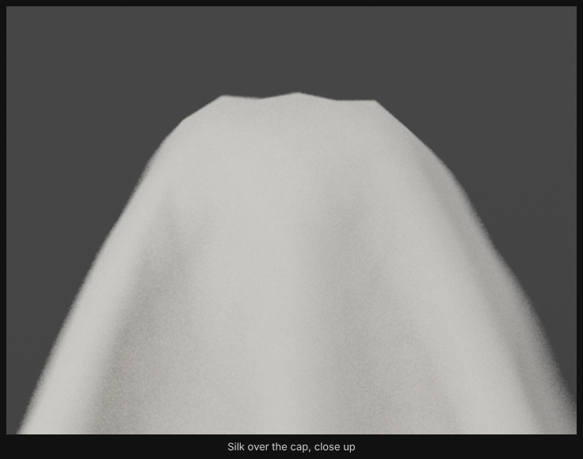 
`cloth-cap.png` · `1fa3b98` · The cap of the example bottle under silk, close up, rendered by the engine (*Full*): the cloth's surface keeps the cap's rim under it at its thickness (the first round's sheet, before v0.1.23, showed the rim through the silk between its vertices). `tools/cloth-sheet.mjs` and `tools/cloth-check.mjs`.

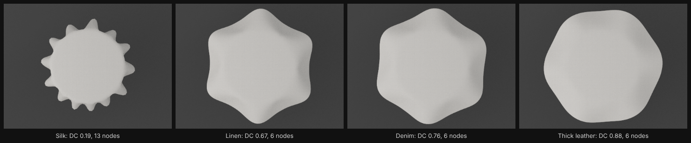 
`cloth-cusick.png` · `1fa3b98` · Silk, linen, denim and thick leather on Cusick's drape tester (a 300 mm disc held on a 180 mm one, BS 5058), from straight above, as the engine's test drapes them, with their drape coefficients (0.19, 0.67, 0.76, 0.88) and nodes (13, 6, 6, 6). `tools/cloth-sheet.mjs` and `tools/cloth-check.mjs`.

### v0.1.27 · 2026-10-20

The update window completed: what changed, the section's own options, Skip this version.

No new screenshots in this version; what it brought and has no screenshot is in “No screenshot”.

### v0.1.26 · 2026-10-20

A window asks about a newer version at startup.

No new screenshots in this version; what it brought and has no screenshot is in “No screenshot”.

### v0.1.25 · 2026-10-20

The connection test's result stays, a project file opens at startup, *Open project* in the empty state.

No new screenshots in this version; what it brought and has no screenshot is in “No screenshot”.

### v0.1.24 · 2026-10-19

API presets, the connection test, the partial image on stop, the render shortcuts.

No new screenshots in this version; what it brought and has no screenshot is in “No screenshot”.

### v0.1.23 · 2026-10-19

Dust motes, moving parts, the studio floor and the set's fine samples (S3e); the physics of each part in one place (U16). Cloth (S9).

#### S3e · Dust motes, moving parts, the studio floor and the set's fine samples (simulation)

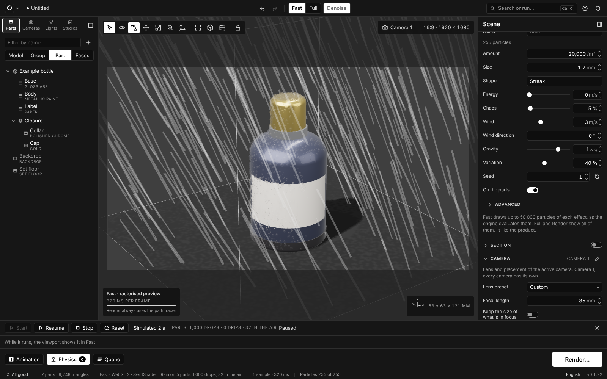 
`physics-rain-floor.png` · `5fda2be` · The example's rain with a 3 m/s wind and *On the parts* switched on, with the set's backdrop and floor switched off so the rain reaches the studio floor, paused at 2 simulated seconds (*Parts: 1,000 drops · 0 drips · 32 in the air*): *Fast* draws the studio floor's cells where the rain wet them, in the square under the effect's region around the bottle (S3e ◆2, ◆3), darker and glossier than the dry floor, and the drops on the bottle as caps. `tools/s3e-check.mjs --only floor`.

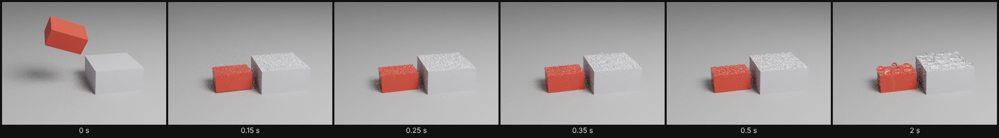 
`rain-moving.png` · `112c98e` · The S3e moving scene (`rt_phys::example::moving_scene_at`) rendered by the native engine at 0, 0.15, 0.25, 0.35, 0.5 and 2 s: the drop scene's box is a *Dynamic* part, which the engine steps with its body's poses, and it gets wet where it is: dry as it starts to fall, wet on its top and its sides once it has landed by the static block, the drops grown into beads at 2 s; the rain falls at 6.5 m/s with a 0.6 m/s wind across (S3e ◆1, ◆9). `tools/s3e-strip.mjs`.

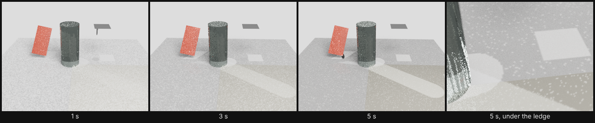 
`rain-floor.png` · `112c98e` · The S3e floor scene (`rt_phys::example::s3e_scene_at`) rendered by the native engine at 1, 3 and 5 s: the studio floor as a shadow catcher gets wet where the rain reaches it (darker, the drops on it as wet spots, S3e ◆4, ◆5, ◆6), stays dry under the ledge and on the side the wind keeps from the bottle, and the plate's drops run down its sloping side edge to gather at its lowest corner, dark at 5 s (◆10); the last frame, close on the dry patch under the ledge at 5 s, with the drips that fell from it. `tools/s3e-strip.mjs`.

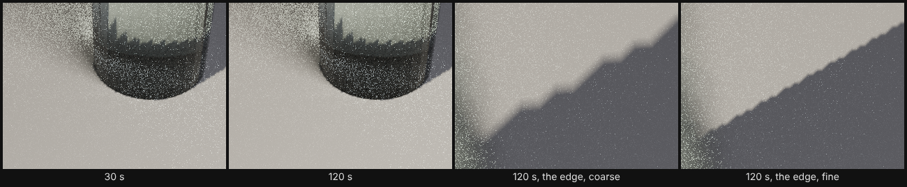 
`dust-motes.png` · `112c98e` · The S3e dust scene (`rt_phys::example::dust_scene_at`) rendered by the native engine: the bottle on a 700 mm card of the set under a dust cloud at 30 and 120 s, with the motes (grains of dust the engine scatters where the dust is thick, S3e ◆8); then close on the edge of the dust's shadow on the card at 120 s, coarse (the card's own samples: steps of about 7 mm) and with the fine samples (2 mm where the edge crosses, ◆7), where a 2 mm sawtooth remains. `tools/s3e-strip.mjs`.

#### U16 · The physics of each part in one place

 
`physics-inspector.png` · `1de5766` · The example bottle's *Body* (metallic paint, which wets as *Metal*) with a *Rain* whose *On the parts* is off: under the material's name, the pointer *Physics: Static · gets wet as Metal* (a click opens the section); the *Physics* section in its two groups, **Motion** (the role, the line that says what it does, and the fields a static part uses, friction and bounciness, ◆5) and **Weather** (*Gets wet*, *Gets dust and snow*, *Surface* naming the material's family, *Drops start to run at about 4.9 mm across on a vertical face*, computed with the engine's formula, ◆3), and the note that nothing leaves rain, dust or snow on the parts, with *Edit Rain*. `tools/u16-check.mjs`.

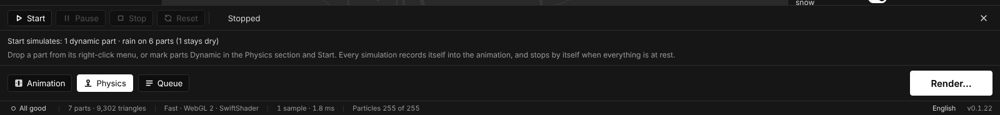 
`physics-drawer-summary.png` · `1de5766` · The physics drawer, stopped, with the rain *On the parts*, the *Body* Dynamic and the *Cap* kept dry: the line *Start simulates: 1 dynamic part · rain on 6 parts (1 stays dry)*, from the scene as it is (the five parts of the bottle and the set's pieces; ◆4). `tools/u16-check.mjs`.

#### S9 · Cloth with real physics

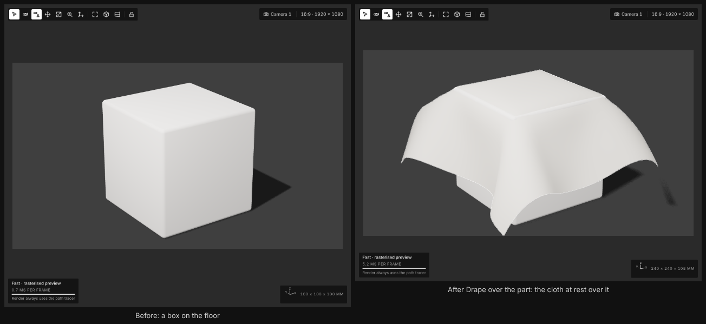 
`cloth-drape.png` · `87fe497` · *Drape over the part* on a box, before and after: a sheet of fine cotton laid over it falls, folds over its edges and settles by itself, drawn in *Fast* from the recorded frame. `tools/cloth-check.mjs`. *(re-recorded in Unreleased: S9's second round)*

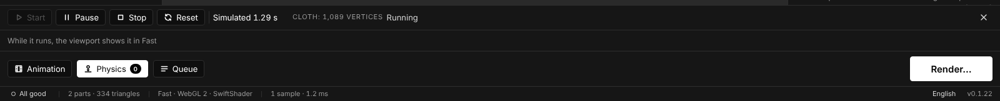 
`cloth-bar.png` · `87fe497` · The physics bar while the cloth runs: the simulated time and *Cloth: 1,089 vertices*, the vertices the simulator moves. `tools/cloth-check.mjs`. *(re-recorded in Unreleased: S9's second round, its slower step)*

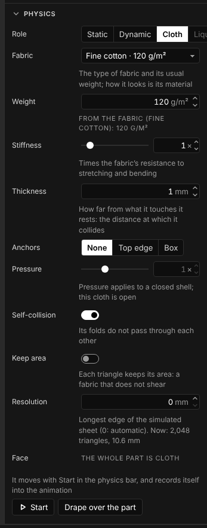 
`cloth-inspector.png` · `87fe497` · The *Physics* section of a cloth: the fabric preset, *Weight* (from the fabric), *Stiffness*, *Thickness*, the anchors, *Pressure* (disabled: the sheet is open), *Self-collision*, *Keep area*, *Resolution* (*Now: 2,048 triangles, 10.6 mm*), which of the part is cloth, *Start* and *Drape over the part*. `tools/cloth-check.mjs`. *(re-recorded in Unreleased: S9's second round, *Stiffness* on the stretch, shear and bending)*

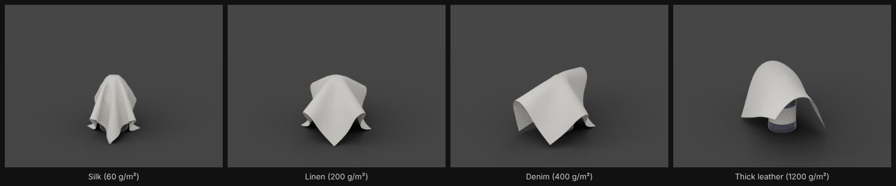 
`cloth-sheet.png` · `87fe497` · Four fabrics of the contact sheet `out/cloth-sheet.html` over the example bottle, rendered by the engine (*Full*): silk, linen, denim and thick leather, each as its simulation left it (S9 ◆1). `tools/cloth-sheet.mjs` and `tools/cloth-check.mjs`. *(re-recorded in Unreleased: S9's second round, the membrane with its shear, the calibrated bending and the sharp features under the cloth)*

### v0.1.22 · 2026-10-18

Drips and splashes that fall through the air, and the meter that says what is on the parts (S3d); the AI section's stored example and the preview of the job's own scene with the Full engine (X6), which re-records, without changing place, `ai-section-dark.png`, `ai-section-light.png` and `ai-section-prompt.png` (X4, X4b); organic drops (S3f); the AI model through an API (X7).

#### S3d · What remains of drops and dust on the parts (simulation)

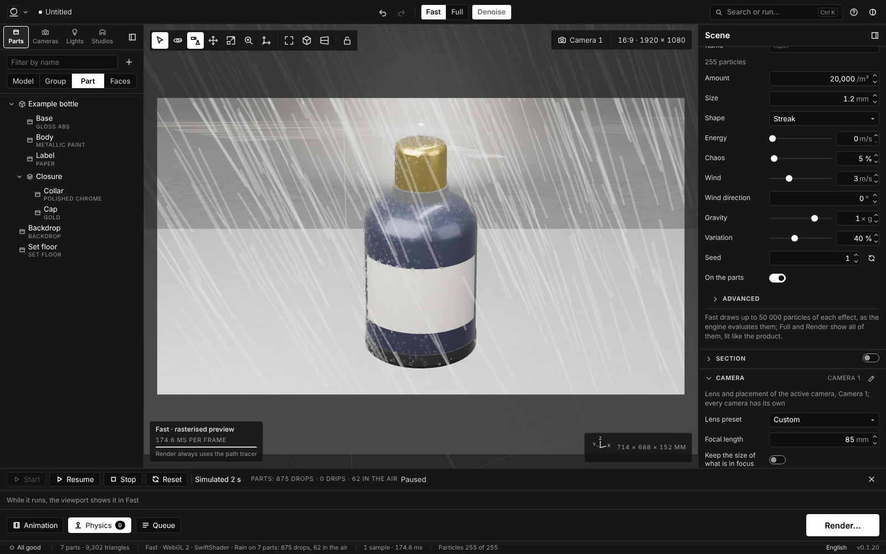 
`physics-rain-air.png` · `f36ca82` · The example's rain with a 3 m/s wind and *On the parts* switched on, paused at 2 simulated seconds with drops in the air (*Parts: 875 drops · 0 drips · 62 in the air*): *Fast* draws the frame's drops as caps and those in the air (the splashes that fly) as water spheres, small at this framing (S3d ◆1); the status bar says what is on the parts: *Rain on 7 parts: 875 drops, 62 in the air*. `tools/s3d-check.mjs --only air`.

#### X6 · The AI that shows and its stored preview

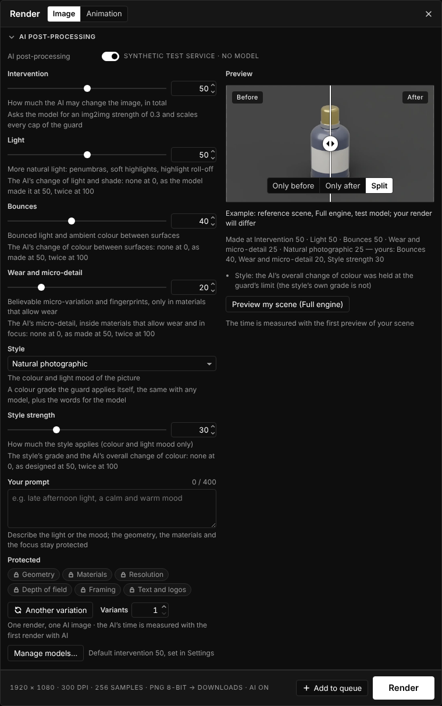 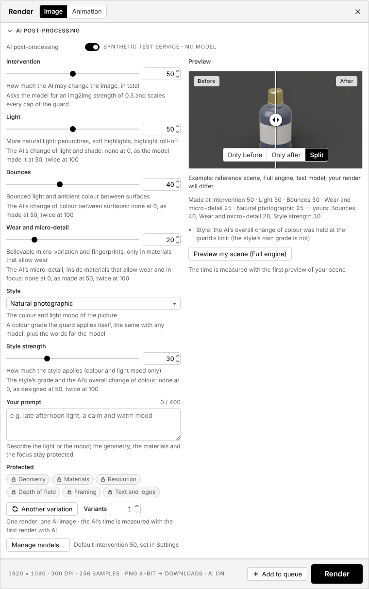 
`ai-x6-example-dark.png` and `ai-x6-example-light.png` · `0f52127` · The AI section as it opens: under each control's sentence, what it acts on (*Asks the model for an img2img strength of 0.3 and scales every cap of the guard* for Intervention); the **stored example** (the example bottle by the Full engine, through the guard with the test model) under the divider, *Example: reference scene, Full engine, test model; your render will differ*, *Made at Intervention 50 · Light 50 · Bounces 50 · Wear and micro-detail 25 · Natural photographic 25 — yours: Bounces 40, Wear and micro-detail 20, Style strength 30*, what the guard did and *Preview my scene (Full engine)*. Dark and light theme. `tools/ai-x6-check.mjs`.

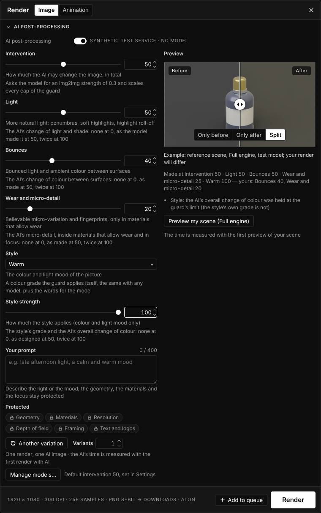 
`ai-x6-style.png` · `0f52127` · *Warm* at strength 100: the style's own grade in the stored example, which changed as the list did, without calling a model (decision X6 ◆4). `tools/ai-x6-check.mjs`.

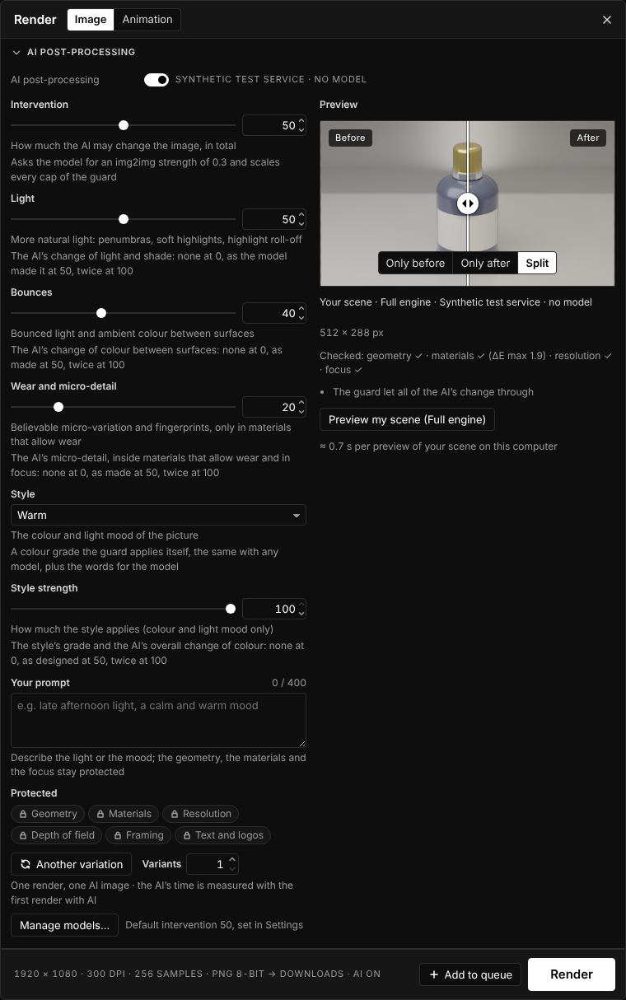 
`ai-x6-mine.png` · `0f52127` · After *Preview my scene (Full engine)*: the job's own scene drawn by the Full engine with the AI applied (here the synthetic service), *Your scene · Full engine · …*, its size, the guard's report line and its plain words, and the measured time. `tools/ai-x6-check.mjs`.

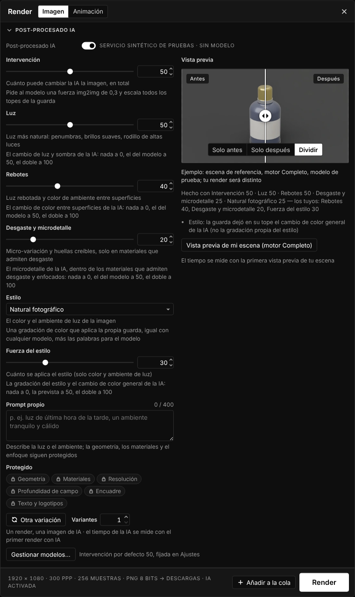 
`ai-x6-example-es.png` · `0f52127` · The same section in Spanish (*Ejemplo: escena de referencia, motor Completo, modelo de prueba; tu render será distinto*). `tools/ai-x6-check.mjs`.

#### S3f · Organic drops

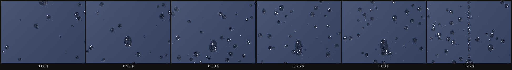 
`rain-organic.png` · `540471b` · The S3f parity scene (`rt_phys::example::s3f_organic_scene_at`) rendered by the native engine at 0, 0.25, 0.5, 0.75, 1 and 1.25 s, each frame aimed at the largest drop on the pane: a drop past its critical size slides down a vertical pane through smaller pinned drops, gathers those on its path (the path above it is clean), grows and runs faster, stretched along its motion with a rounder head (S3f ◆1), and once fast enough leaves the beads of a rivulet (◆5), which the last frame shows above it. `tools/s3f-strip.mjs`.

#### X7 · The AI through an API

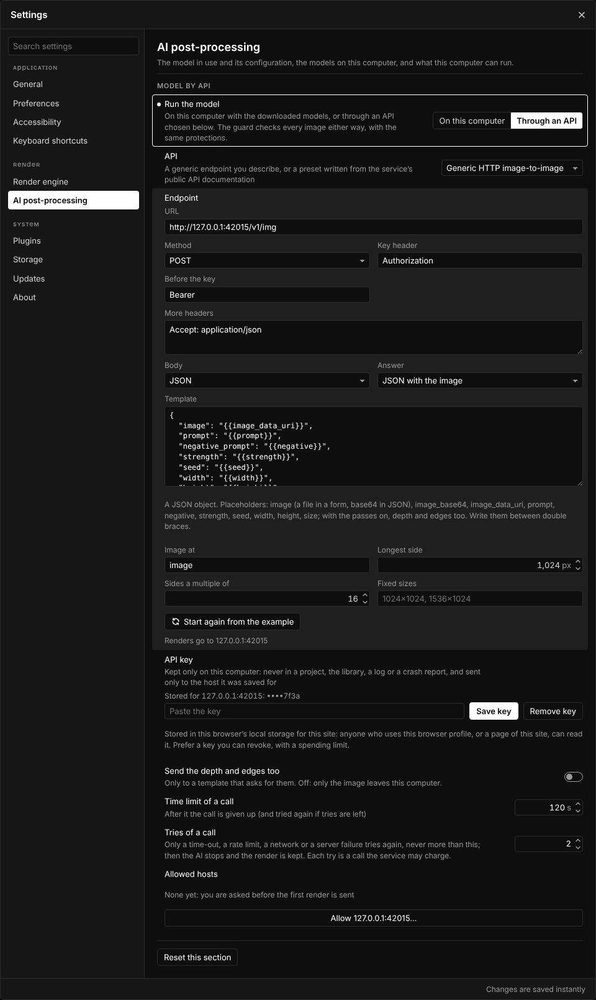 
`settings-ai-api.png` · `653b05a` · *Settings ▸ AI post-processing ▸ Model by API* with *Run the model ▸ Through an API* and the generic HTTP image-to-image endpoint pointed at a local test service: the form (URL, method, key header, template with its placeholders, where the image is in the answer, the sizes), *Renders go to 127.0.0.1:…*, the key stored and shown masked (*••••7f3a*) with the web's warning about local storage, *Send the depth and edges too* off, the time limit, the tries and *Allowed hosts*. `tools/ai-api-check.mjs`.

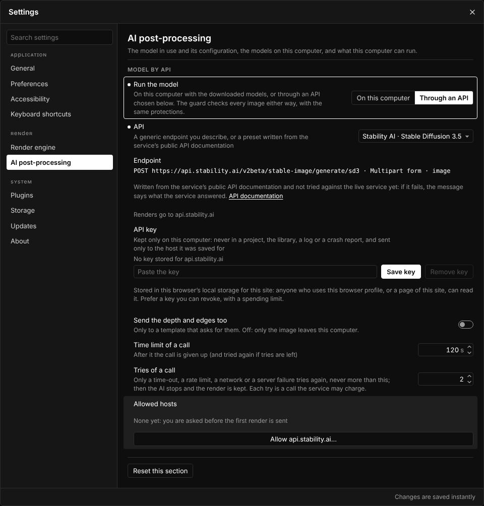 
`settings-ai-api-preset.png` · `653b05a` · The same block with the *Stability AI · Stable Diffusion 3.5* preset: the endpoint's summary in monospace, the note that it was written from the service's public API documentation and not tried against the live service, and no key stored yet for *api.stability.ai*. `tools/ai-api-check.mjs`.

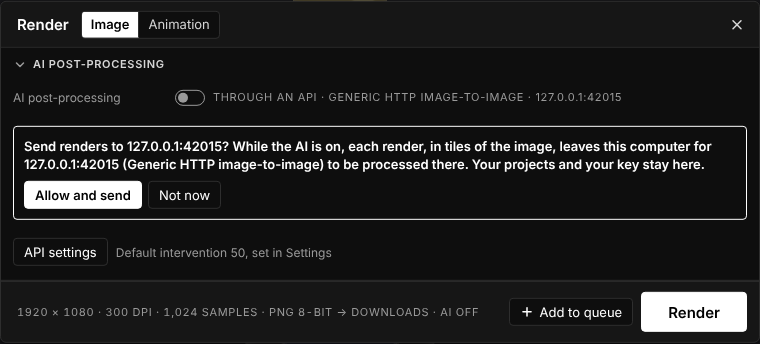 
`ai-api-consent.png` · `653b05a` · The render window's *AI post-processing* through an API: turning the switch on for a host never allowed asks first, in place under it and not in a window (*Send renders to 127.0.0.1:…? While the AI is on, each render, in tiles of the image, leaves this computer…*), with *Allow and send* and *Not now*; nothing has been sent yet. `tools/ai-api-check.mjs`.

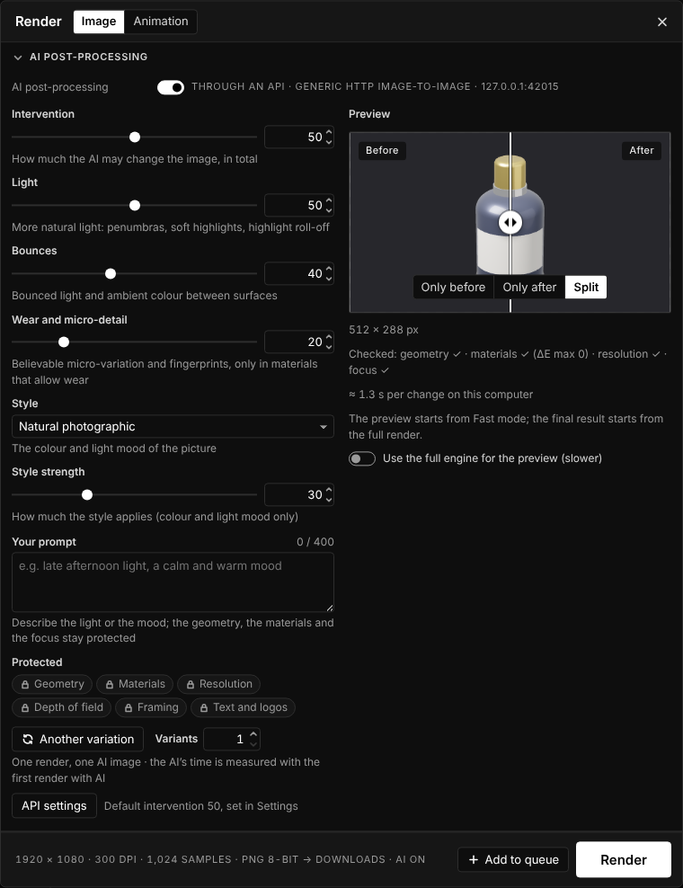 
`ai-api-section.png` · `653b05a` · After *Allow and send*: the preview went through the test service and the guard, with the same report line as a local model (*Checked: geometry ✓ · materials ✓ · resolution ✓ · focus ✓*). `tools/ai-api-check.mjs`.

### v0.1.21 · 2026-10-18

The *Shape* among the visible controls of *Ambient*, the front glass in *Fast* and the rain the scene leaves on the glass (S3b), which re-record, without changing place, `ambient-drops.png` and `ambient-mix.png` (S3); rain on the parts (S3c).

#### S3b · Rain and dust that settle, run down and fall on the lens (simulation)

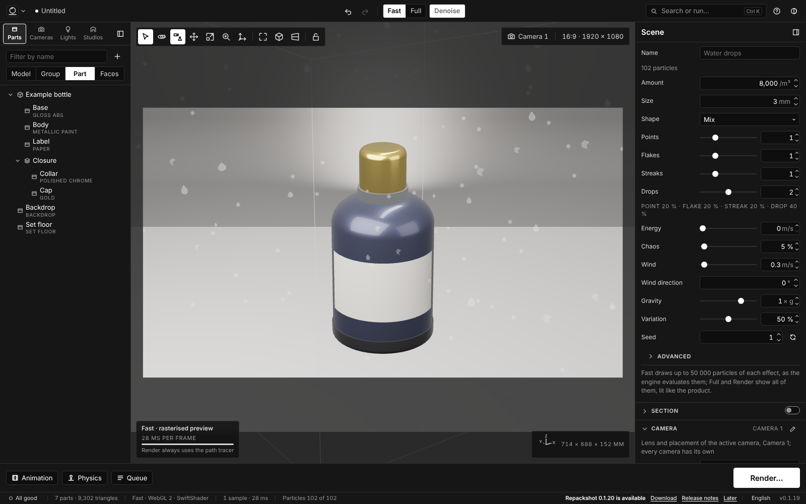 
`ambient-shape.png` · `fe3f101` · The bottle in *Fast* with *Water drops* in a mix of shapes; in the inspector, the effect's controls with the **Shape** (*Mix*) right after the *Size*, its four weights and the share each gives below, and *Advanced* folded (decision S3 ◆5). `tools/s3b-check.mjs --only shape`.

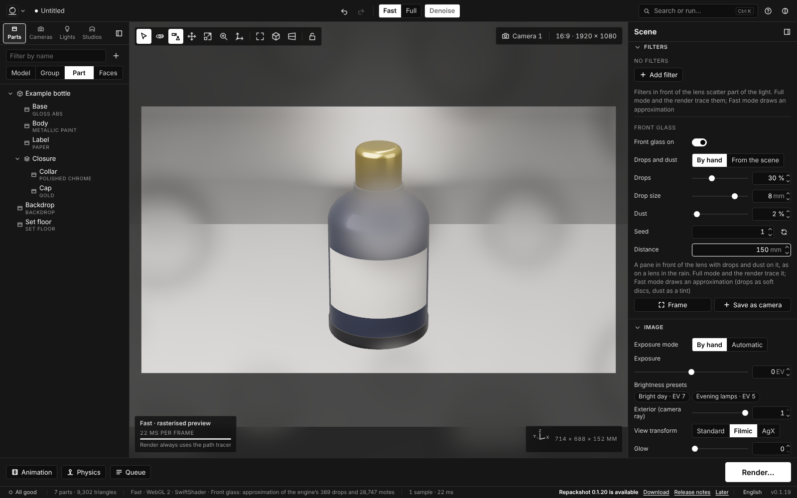 
`lens-glass-fast.png` · `fe3f101` · The same glass as `lens-glass.png` (8 mm drops at 150 mm, f/16) in *Fast*: the approximation with the drops and motes the engine places, soft discs with a dark edge defocused by each pixel's footprint on the glass and the dust as a tint; in the inspector, *Drops and dust ▸ By hand* and its controls; the status bar: *Front glass: approximation of the engine’s 389 drops and 28,747 motes* (decision S3 ◆9). `tools/s3b-check.mjs --only fast`.

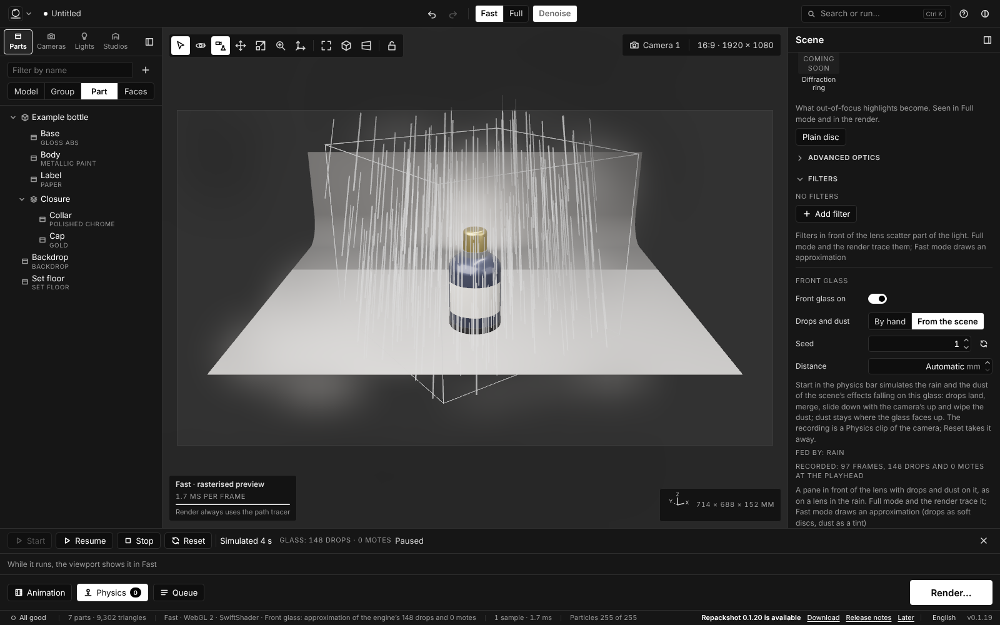 
`physics-rain.png` · `fe3f101` · Rain pushed towards the camera by a 6 m/s wind, at 35 mm f/11, with the front glass on *Drops and dust ▸ From the scene*: the physics bar paused at 4 simulated seconds (*Glass: 148 drops · 0 motes*), the inspector says the rain feeds it and what is recorded at the playhead, and *Fast* draws the glass's drops, which have slid downward. `tools/s3b-check.mjs --only rain`.

#### S3c · Drops and dust on the parts (simulation)

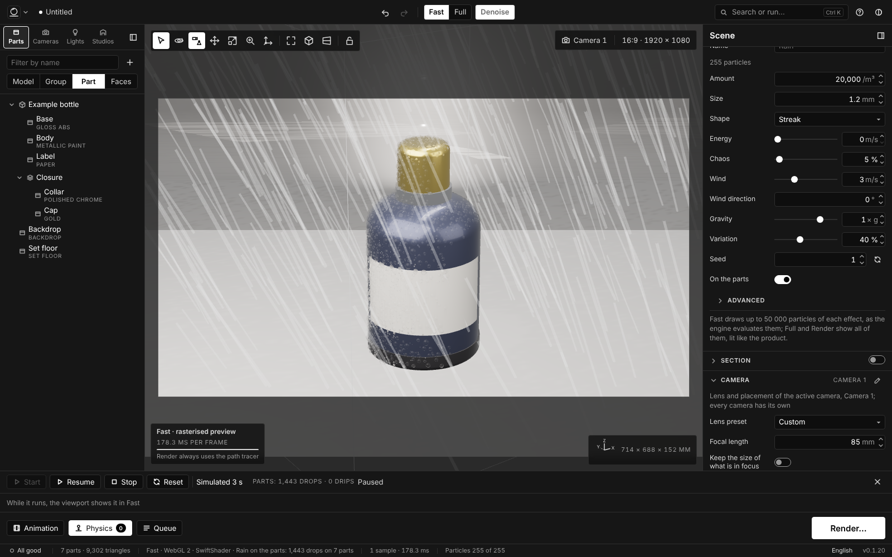 
`physics-rain-set.png` · `324bb1e` · The example's rain with a 3 m/s wind and *On the parts* switched on in its controls: the physics bar paused at 3 simulated seconds (*Parts: 1,443 drops · 0 drips*), and *Fast* draws the recorded frame: the engine's drops as caps on the body, the neck, the cap and the set, and the film of water where it has rained; the status bar: *Rain on the parts: 1,443 drops on 7 parts*. `tools/s3c-check.mjs --only rain`.

### v0.1.20 · 2026-10-18

The wood of the *Wood* family in *Fast* through the *Wood* node's path (M3d), with its knots where *Full* puts them, and the family's fabric woven in *Fast* when its threads can be read (M3e); the drop shape and the mix of shapes in *Ambient*, and the camera's front glass (S3).

#### M3d · The family's wood in *Fast* through the path of the *Wood* node

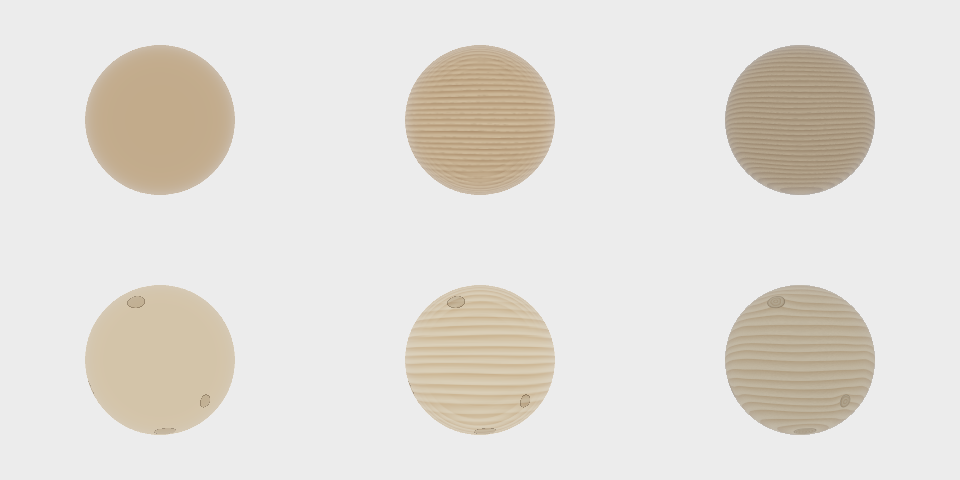 
`m3d-wood-fast.png` · `305db3e` · The family's wood on a 100 mm ball, oak (top) and knotty pine (bottom): on the left, *Fast* before M3d (its average colour and the knots of E6's layer); in the middle, *Fast* now, baked through the graph of *Simple → Nodes* like the *Wood* node (the same pixels as the wood switched to nodes), with its rings; on the right, *Full* (the `rt.wasm`). The background of the three columns is the same grey. `tests/wood-fast-browser.test.ts` with `REPACK_WRITE_CAPTURES=1`. *(re-recorded in v0.1.20: M3e, the pine's knots in *Fast*, now on top of the bake, fall where *Full* puts them; in M3d they were those of the bake, in another place)*

#### M3e · *Fast* knots where *Full* puts them and fabric baked when its threads are readable

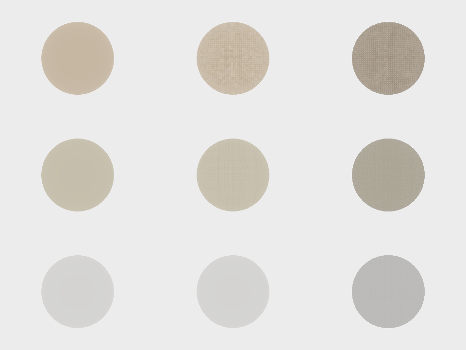 
`m3e-fabric-fast.png` · `8a5591a` · The family's fabric on a 100 mm ball, knit (top, 12.8 texels per thread), canvas (middle, 3.7) and cotton (bottom, 1.3): on the left, *Fast* before M3e (the average colour of its weave and its fuzz); in the middle, *Fast* now, the knit and the canvas baked by the *Fabric* node with the fuzz on top, the cotton, below 2.5 texels per thread, the same as before; on the right, *Full* (the `rt.wasm`). *Fast* comes out lighter than *Full* in the three columns, like any material under the white world. `tests/fabric-fast-browser.test.ts` with `REPACK_WRITE_CAPTURES=1`.

#### S3 · Rain and dust on the set and on the lens

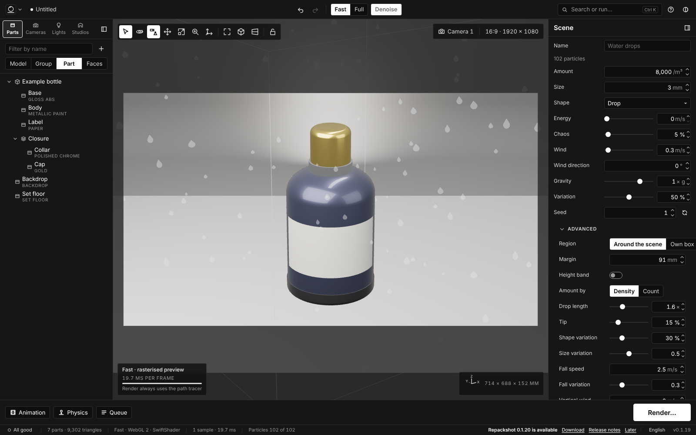 
`ambient-drops.png` · `ee18304` · The example bottle in *Fast* with the *Water drops* effect: transparent drops with their round body and the tip upward falling around the product; in the inspector, *Ambient ▸ Advanced* with the *Drop* shape chosen, its *Drop length*, its *Tip* and the *Shape variation*. `tools/s3-check.mjs --only drops`. *(re-recorded in v0.1.21: S3b, the *Shape* is now among the visible controls, above *Advanced*)*

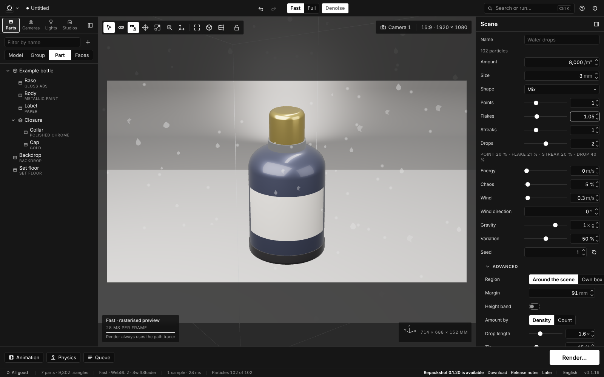 
`ambient-mix.png` · `ee18304` · The same effect with the *Mix* shape: points, flakes, streaks and drops in the viewport, each particle with the shape the engine gives it; in the inspector, a weight per shape (*Points*, *Flakes*, *Streaks*, *Drops*) and the line with the share each gives. `tools/s3-check.mjs --only mix`. *(re-recorded in v0.1.21: S3b, the *Shape* and the weights, among the visible controls)*

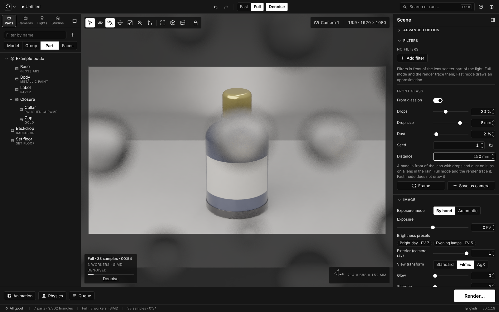 
`lens-glass.png` · `ee18304` · The bottle in *Full* through a wet glass at 150 mm from the lens, at f/16 and with 8 mm drops: soft discs with the scene upside down inside, each one a defocused drop of the glass; in the inspector, *Camera ▸ Lens ▸ Filters ▸ Front glass* with *Drops*, *Drop size*, *Dust*, *Seed* and *Distance*. `tools/s3-check.mjs --only glass`.

### v0.1.19 · 2026-10-17

A batch's studio that travels with the project (N2b), the focal-length switch, *Keep the size of what is in focus* (C2), the traced lens's element editor (O2c) and the *Wood* and *Fabric* nodes of the material editor (M3c), which re-record, without changing place, `m3b-wood.png` and `m3b-graphs.png` (M3b).

#### N2b · The studio travels with the project

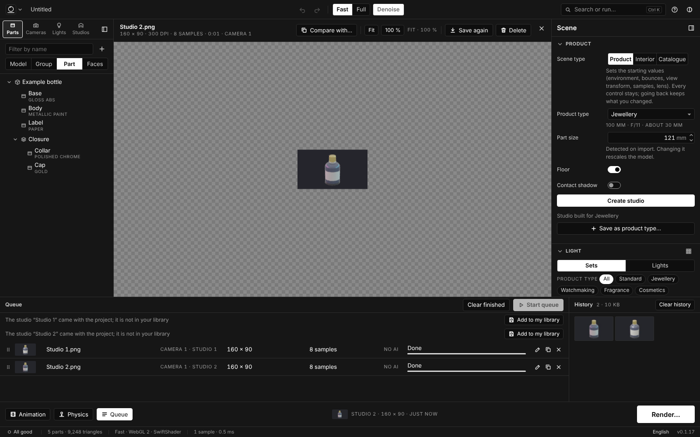 
`batch-queue-adopt.png` · `e5e3c11` · A project with a batch over two studios, opened in another browser profile with an empty library: the queue drawer with the two finished jobs, each rendered in the copy of its studio that the project carries, and above a line per studio, *The studio “Studio 1” came with the project; it is not in your library*, with **Add to my library**. `tools/batch-check.mjs` (g).

#### C2 · Focal-length switch

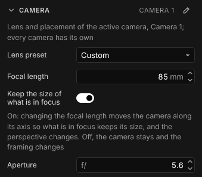 
`c2-focal-switch.png` · `bbf3c6b` · The inspector's *Camera* block with the new switch below the focal length (85 mm): *Keep the size of what is in focus*, on, and its helper line, which says what it does when on (the camera moves closer or farther along its axis so that what is in focus keeps its size; the perspective changes) and what it does when off (the camera stays and the framing changes). `tools/focal-check.mjs --shots docs/ui`.

#### O2c · Lens element editor

 
`o2c-lens-editor.png` · `5187dd7` · The lens editor open on the catalogue's double Gauss, floating over the application: the engine's cross-section with the six elements numbered and the first one chosen, the tools (*Add in front*, *Add behind*, *Turn 180°*, *Delete*, *Smaller*, *Larger*, *Automatic aperture*), the table with the radii, thickness, glass, diameter and air of each element and of the diaphragm, and on the right what the engine computes: the design and the camera's focal length, the flange distance, the aperture, the image circle and the curves. `tools/lens-editor-check.mjs --shots docs/ui`.

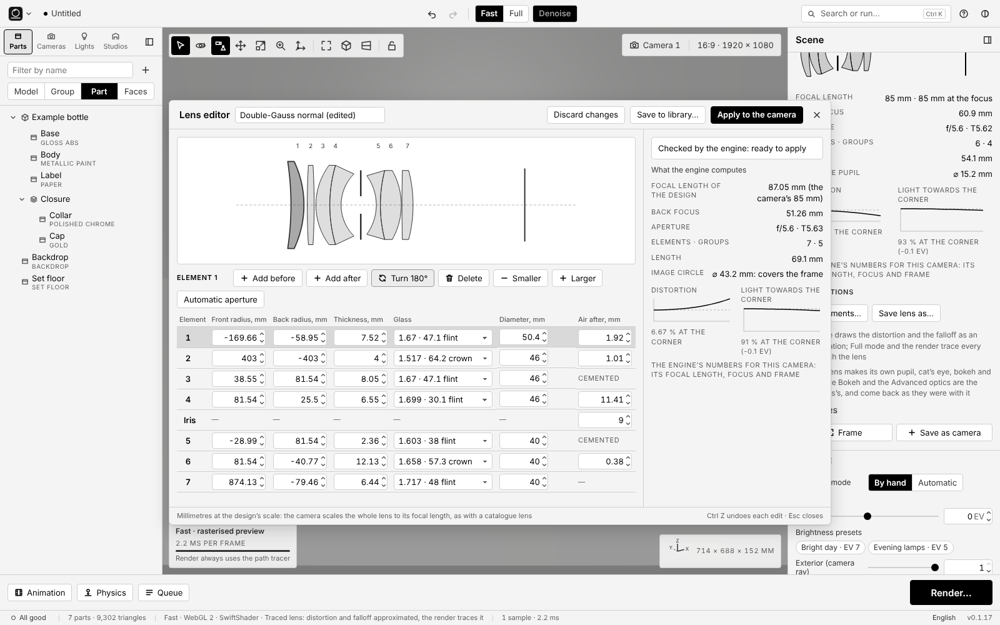 
`o2c-lens-modified.png` · `5187dd7` · The same lens modified: a new element behind the first (seven elements) and the front one turned 180° (its radii swapped and negated), checked by the engine and ready to apply: the design focal length shorter, another flange distance and another distortion, and the cross-section up to date. `tools/lens-editor-check.mjs --shots docs/ui`.

#### M3c · Wood and Fabric nodes

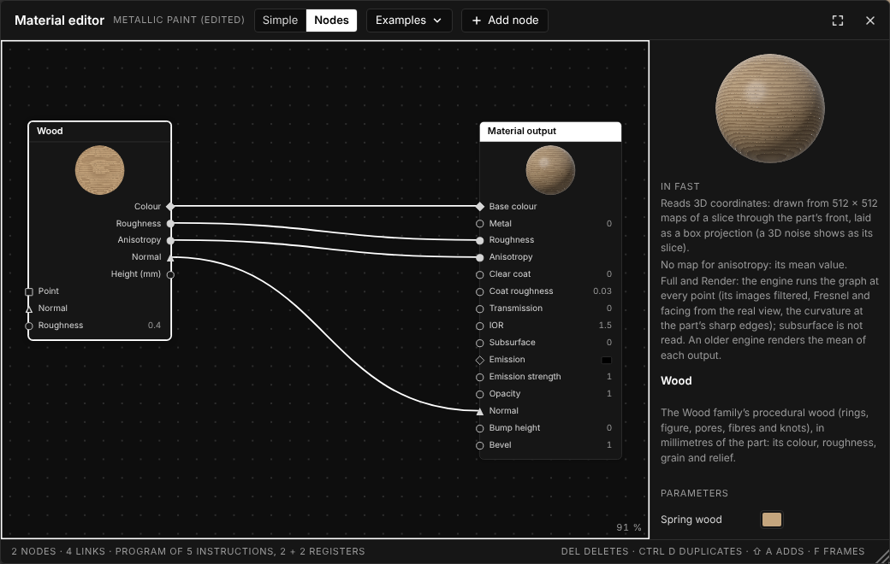 
`material-nodes-wood.png` · `f21ae73` · The material editor with the *Oak (Wood node)* example: the *Wood* node, with its sphere of rings, connected to the material output's base colour, roughness, anisotropy and normal; in the panel, the material's sphere, what *Fast* does (a cut through the front of the part) and the *Wood* node's parameters. `tools/material-nodes-check.mjs --only wood`.

### v0.1.18 · 2026-10-17

The simple and the traced lens, each with its own options: tilt with a dial, the plane of focus in the viewport and through two points, and the tilted traced lens. Re-recorded here, without changing place, those of the lens (`lens-editor.png`, `lens-section.png`, `camera-bokeh.png` and `camera-optics.png`). And F1's focus: the inspector's *Focus* block, the point marker in the viewport and renders before and after click-to-focus. C1 (judgement calls applied) re-records, without changing place: `scene-type-interior.png` (K1), `m3b-graphs.png` (M3b), `ai-section-light.png` and `ai-results-light.png` (X4).

#### F1 · Focus by point and by object

 
`f1-focus-inspector.png` · `1cb9f87` · The inspector's Camera block after click-to-focus: *Focus* on *Point* (*Distance · Point · Object*), the focus distance as a slider with its field and arrows beside it, with the distance that comes from the point (660 mm; moving it switches to *Distance*), and the *Point* row with the click-to-focus button and the part in focus. `tools/focus-click-check.mjs --shots docs/ui`.

 
`f1-focus-marker.png` · `1cb9f87` · The viewport in *Fast* around the point focused on the example bottle's label, with the camera selected: the point marker (a ring with four strokes and a dot in the centre) where the click landed. `tools/focus-click-check.mjs --shots docs/ui`.

 
`f1-focus-sheet.png` · `ed0e937` · Three clicks, before F1 on the left and after on the right (*before*: `319614b`), in 480 × 270 final renders of a 1.3 mm checkerboard tilted 45° seen with 135 mm at f/1.4 from 600 mm; a ring marks the click's pixel. Top and middle, the lens with 6° of tilt and the click in the corners: before, the sharp band passed about 35 pixels from the ring, after, it passes through it. Bottom, the traced double Gauss wide open and the click in the centre: before, the band was to the upper left of the ring, after, it crosses it. Made with `tools/focus-sheet.mjs` from the renders of `tests/focus-measure.test.ts` (`REPACK_FOCUS_MEASURE=1`, with `rt`).

#### O4 · Simple and traced lens: options for each

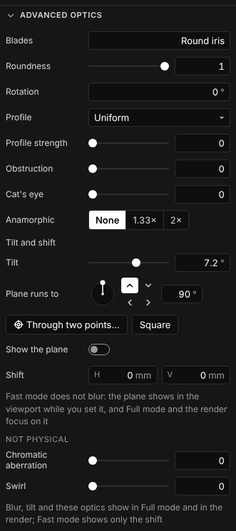 
`o4-simple-optics.png` · `f4f5e12` · The simple lens's advanced optics with the new Tilt and shift block: the tilt at 7.2°, the “Plane runs to” dial pointing up (like the floor) with its four shortcuts and the angle, Through two points…, Square, Show the plane and the H and V shift.

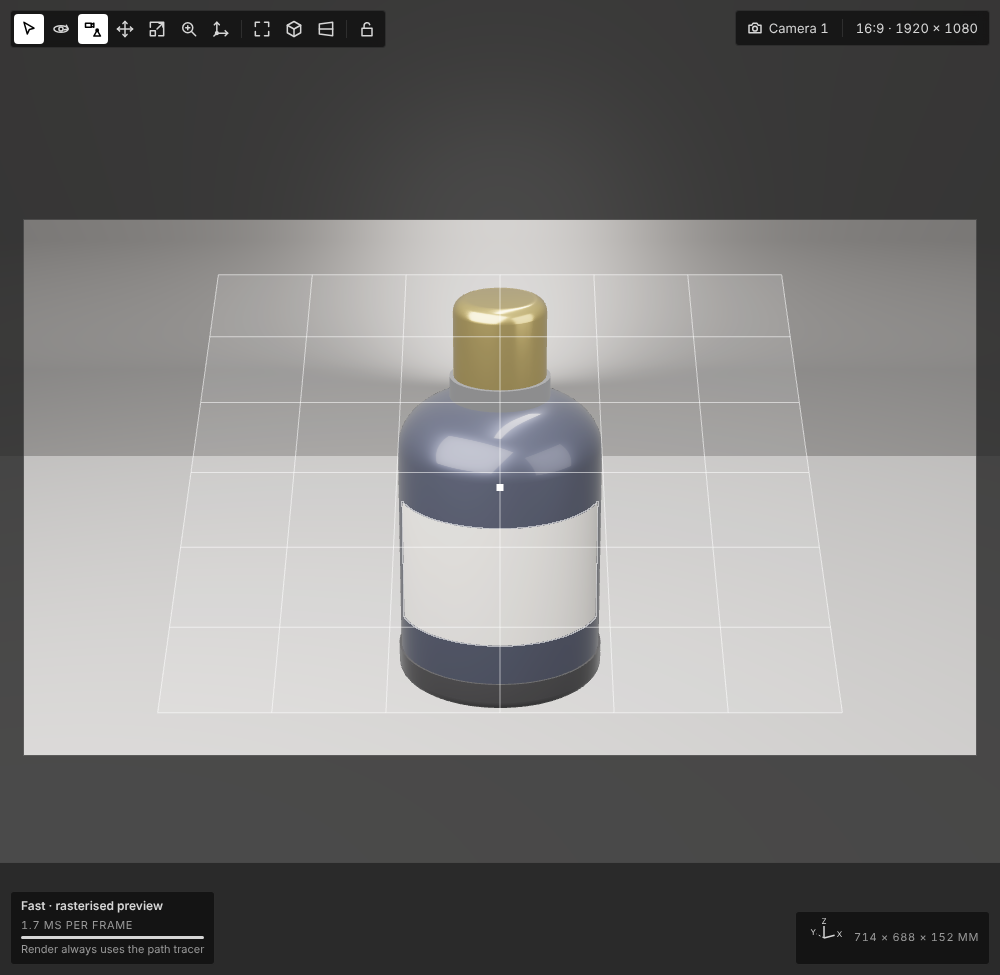 
`o4-tilt-overlay.png` · `f4f5e12` · The viewport in Fast mode with the plane of focus drawn: a translucent trapezoid with its grid, in greys, laid towards the floor behind the bottle, and the focus point at its centre.

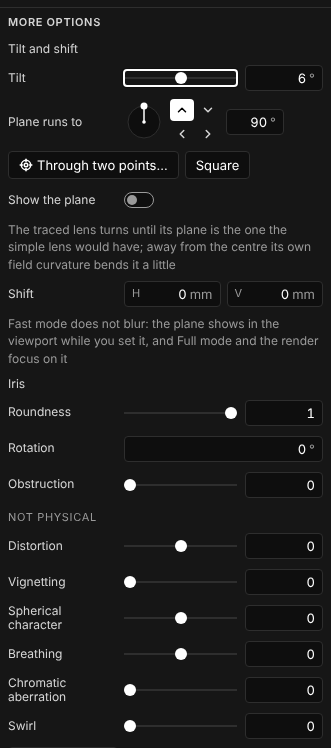 
`o4-traced-more.png` · `f4f5e12` · More options of the traced lens: its own tilt (6°, the plane upward), the note that the lens turns until it gives the simple lens's plane, the shift, the rest of the diaphragm (roundness, rotation, obstruction) and the non-physical settings.

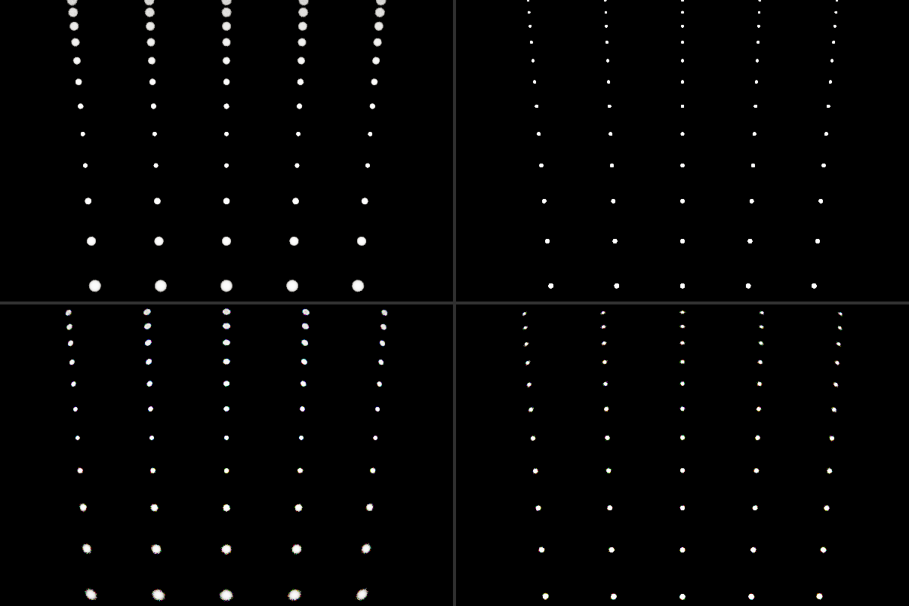 
`o4-traced-tilt.png` · `f4f5e12` · The `rt --tilt-sheet` sheet: small lights over a receding floor, a 50 mm at f/2 at 40 cm from the floor focused at 1.2 m. On the left the straight lens (only the 1.2 m row sharp; the near and far ones, discs); on the right tilted 6.8° to lay the plane on the floor (all sharp). Top the simple lens, bottom the traced double Gauss, with its own character in the corners.

### v0.1.17 · 2026-10-17

The light catalogue in Sets and Lights, with its filters, the question about the lights that are there and the thumbnail size; step arrows on every value and sliders where they fit; the interior camera: straight verticals, the plan with the ceiling hidden from camera and the 2:1 panorama. Re-recorded here, without changing place: the four of U5's render window and queue (`render-window-image.png`, `render-window-animation.png`, `queue-drawer.png` and `results-split.png`), with today's interface, and `sets-catalogue.png` (L6) and `scene-type-interior.png` (K1), with L7's *Light* section. N2: the render window with a cameras × studios batch and the queue with it finished.

#### L7 · Sets and Lights: reorganised catalogue

 
`light-sets.png` · `71fa0a1` · The *Light* section in the *Sets* group: the *Product type* and *Subject* filters, with *Bottle* chosen; *7 of 17 sets*, all the thumbnails the same size, and the product type's rig in force first, dimmed and marked *Outside the filters*.

 
`light-lights.png` · `71fa0a1` · The *Lights* group with the *Style* filter on *Cinematic*: *11 of 78 setups*, with thumbnails the size of the sets'.

 
`light-question.png` · `71fa0a1` · In Spanish: when choosing *Low key* with lights in the scene, the inline question “There are lights in the scene. What happens to them when Low key comes in?” with *Replace*, *Hide*, *Add*, *Cancel* and *Remember my choice*.

 
`light-thumb-sizes.png` · `71fa0a1` · The small thumbnails (four columns, image only) and large ones (two columns), chosen with the button to the right of the *Light* header; after *Hide* on a set, *In the set* keeps its background and floor.

#### U15 · Arrows and sliders on values

 
`u15-light-fields.png` · `84f0673` · An own light (Area) chosen: in the inspector, Width, Distance, Temperature and Power are fields with their ▲ ▼ arrows on the right; Azimuth, Elevation and Spread, sliders with their field and arrows beside them (Spread at 180°, its maximum, with ▲ switched off); the X, Y, Z Coordinates carry the compact pair.

 
`u15-part-triplets.png` · `84f0673` · The inspector column with the Part section: Position, Rotation and Scale in 102 px X, Y, Z triplets with the compact pair of arrows, the pointer over the ▲ of Position's X; below, the Edge bevel with the normal pair.

 
`u15-settings-sliders.png` · `84f0673` · Settings ▸ Preferences with Orbit speed, Zoom speed and Gizmo size turned into sliders with their field and arrows (100 %).

#### N2 · Queue, passes and batches

 
`batch-window.png` · `8816f19` · The Render window, Image tab, with a batch prepared: the name {project}_{camera}_{studio} with its chips, the Alpha, Depth and Part ID passes chosen in 32-bit EXR, All cameras (2) and All studios (2) with the notice “Batch of 4 images: cameras 2 × studios 2”, and the ZIP switch on.

 
`batch-queue.png` · `8816f19` · The queue drawer with the 2 × 2 batch finished: four jobs (each camera in each studio, in that order) with its studio next to the camera and “+3 passes · ZIP” at the end of the name, and the history with the four images.

#### K3 · Interiors camera

 
`k3-verticals.png` · `0082860` · The test room in Full with the camera at 1.5 m looking 10° down and straight verticals on: the corner of the walls comes out vertical. In the Camera section, the projection, the Straight verticals switch with its note (shift of −4.2 mm for 10° of tilt), the eye height with Standing and Seated and the 24, 28 and 35 mm interior lenses; the automatic exposure measured in the status bar.

 
`k3-plan-fast.png` · `0082860` · The Plan view (orthographic from above) in Fast with the ceiling chosen and Visible to camera off in the Part section: the floor, the sofa, the table and the ball are seen below the ceiling.

 
`k3-plan.png` · `0082860` · The same plan in Full: the ceiling is not seen and the room is still lit by the window with the ceiling giving its shadow and its bounces; the automatic exposure measured in the status bar.

 
`k3-panorama.png` · `0082860` · The Panorama 360° (2:1) projection in Full from inside the test room: the four walls, the floor and the ceiling in a single equirectangular image, with the window to one side.

 
`k3-verticals-fast.png` · `0082860` · The same correction in Fast: with *Straight verticals* the vertical edges come out parallel, and the inspector states the shift it applies (−4.2 mm for 10° of tilt), with the eye-height presets and the interior focal lengths.

 
`k3-panorama-fast.png` · `0082860` · The 360° panorama in Fast, drawn from the six faces of a cube with the same map as the engine; nothing is drawn on top of it (outline, gizmo).

### v0.1.16 · 2026-10-17

Animation and video: the three-step wizard with the grid of types, the custom curve, fades between shots and the encoded video in the render window.

#### N1 · Animation and video in the KeyShot style

 
`animation-n1-wizard.png` · `b2eeab6` · The timeline with three tracks (the camera with three shots and a fade to black at the second one's cut, the model that spins and the Gloss ABS material that changes colour with a custom curve) and the “+ Animate…” wizard at step 1 of 3, with “A part or a group” and the lid chosen. The animations also appear under their target in the scene tree.

 
`animation-n1-cards.png` · `b2eeab6` · Step 2 of the wizard for a material: the grid of cards of the Materials group (Material colour and Fade, each with its sentence), with Back and Next.

 
`animation-n1-curve.png` · `b2eeab6` · The properties of “Gloss ABS · Material colour · 0–3 s” with the Custom curve: the editor with its two handles, the first one dragged (x1 0.62, y1 0.4) and its fields below; in the viewport, the parts of that material marked.

 
`render-window-video.png` · `b2eeab6` · The Render window in Animation with Video output: WebM VP9 chosen and MP4 H.264 disabled (this Chromium does not encode it), the line “One file: Untitled_Camera 1_0001.webm, WebM VP9, 48 frames at 24 fps” and the summary with WEBM VP9. It is what render-window-animation.png (U5) still showed as “coming soon”.

### v0.1.15 · 2026-10-17

Scene type (Product, Interior, Catalogue), the Interior light style with seven recipes, the Interior Doctor and the Engine Doctor.

#### K1 · Scene type, interior lighting and interiors Doctor

 
`scene-type-interior.png` · `431e7b8` · The Interior scene type chosen (Product · Interior · Catalogue) and the Interior light style with its seven recipes: morning, midday and afternoon window, overcast, night lamps, blue hour and white studio room. The part looks small because Interior sets 28 mm. *(re-recorded in v0.1.17: Interior is a style of L7's Lights group)* *(re-recorded in v0.1.18: C1, *Interior* starts with the *Midday window* recipe; the product type's set decoration stays)*

#### D1 · Engine Doctor

 
`doctor-engine.png` · `e17f146` · The Doctor with the engine and scene checks in the popover: Engine, SIMD (with the Settings button), Light tree, Denoise (with Fix), Tone, scale, origin and smoothing, and Fix all.

### v0.1.14 · 2026-10-17

Section view (a plane that cuts the part and caps the cut) and IES lights.

#### L5 · IES lights

 
`ies-light.png` · `6d90dc9` · An IES light in the inspector: profile name, polar plot drawn from the file (C0–C180 and C90–C270 planes), peak, beam angle and the notice that Fast approximates it with a spot.

 
`ies-light-full.png` · `6d90dc9` · The IES light in Full mode: the engine uses the file's whole profile.

#### Q1 · Section view

 
`section-fast.png` · `3c51cd8` · The section view in Fast mode: a cutting plane removes one side of the bottle and caps the cut with the material's colour; the inspector warns of the two open parts without a cap.

 
`section-full.png` · `3c51cd8` · The same section view in Full mode: the tracer cuts and caps the solid, also in shadows and reflections.

### v0.1.13 · 2026-10-16

Adaptive sampling and “Finish by noise” in the render window.

#### E10 · Adaptive sampling and finish by noise

 
`render-window-noise.png` · `b4718c4` · Render ▸ Quality with “Finish by: Noise” at 1 %: the samples are the cap and the estimate comes from the viewport's passes.

 
`meter-adaptive.png` · `b4718c4` · The viewport meter in Full saying “Adaptive · 16–17 samples” next to “Denoised”.

### v0.1.12 · 2026-10-16

Node materials work in Full and in renders.

#### M3b · The engine evaluates graphs

 
`m3b-graphs.png` · `fbb054e` · The ten examples of the node editor in Full mode: with the mean of each output (left) and with the graph program that the engine runs (right). *(re-recorded in v0.1.18: C1, the metallic paint's flakes face outward; and in v0.1.19: M3c, the wood example is the oak with the Wood node; `tests/m3b-graphs-sheet.test.ts` makes it)*

 
`m3b-wood.png` · `fbb054e` · Two oak boxes in the engine: the catalogue's *Wood* family on the left and the nodes example with the *Wood* node on the right, the same wood (fine, straight rings, pores). *(re-recorded in v0.1.19: M3c; in M3b the example, “Wood with two noises”, did not yet resemble the family; `tests/m3c-wood-sheet.test.ts` makes it)*

### v0.1.11 · 2026-10-16

Improved ambient particles: dust against the light, rain without dots and cheaper.

No new screenshots in this version; what it brought and has no screenshot is in “No screenshot”.

### v0.1.10 · 2026-10-16

Image textures, mapping and labels in Full and in renders.

No new screenshots in this version; what it brought and has no screenshot is in “No screenshot”.

### v0.1.9 · 2026-10-16

Live view of the selected render in the queue.

#### U14 · Live view in the queue

  
`queue-live.png` and `queue-live-dark.png` · `ab06ce9` · The queue's live view: the click on the job being rendered opens its image while the engine adds samples, with the LIVE chip, the samples and the progress. Light and dark theme.

### v0.1.8 · 2026-10-16

The window with a lens's elements when the pointer rests on it.

#### O2b · Lens window on hover

  
`lens-hover.png` and `lens-hover-dark.png` · `430f1ef` · The window with a lens's elements when the pointer rests on it in the list: “Five-element symmetric”, with its cross-section, its source and the numbers the engine gives. Light and dark theme.

 
`lens-hover-chip.png` · `430f1ef` · The window of the lenses of a character (Wide) when passing over its chip: two lenses side by side with their cross-sections and numbers.

### v0.1.7 · 2026-10-16

Wood, fabric and edge bevel in Full, materials with more realism, traced lens with 16 lenses, effect filters on the lens, 88 setup thumbnails redone and the fixes from the bug report of 2026-10-14.

#### O3a · Lens effect filters: black, white and gold diffusion, glimmer, net, star, streaks

 
`lens-filters.png` · `304696f` · Camera ▸ Filters: a black diffusion and an 8-point star stacked, each with its strength, points and angle.

#### O2 · Traced lens

 
`lens-editor.png` · `99df141` · Camera ▸ Traced lens: the character (Clinical, Soft, Swirl, Vintage…), the catalogue lens with its source, the coating, the spherical-aberration gap and the blades. *(re-recorded in v0.1.18: Simple lens · Traced lens, O4)*

 
`lens-section.png` · `99df141` · What the engine computes for the lens: its cross-section, focal length, flange distance, f-number and T-stop, elements and groups, entrance pupil and the distortion and light-towards-the-corner curves. *(re-recorded in v0.1.18, O4)*

### v0.1.6 · 2026-10-14

Textures and labels, node-based material editor, studio sets, bokeh chooser, TIFF and RAW output, aspect ratio in the camera, plugins with the film one, exploded views and new timeline, rigid bodies, ambient particles, live denoise, edge smoothing and update from the app.

#### No phase · Camera list with a pencil (reported on 2026-10-14)

 
`camera-menu.png` · `c625777` · The viewport's camera list with each one's lens (85 mm · f/5.6) and a pencil per row; in the background, the Camera section that says which camera it edits.

 
`camera-edit.png` · `c625777` · The card of Camera 2 opened with the pencil: name, Activate, Look through, lens and position, without activating it.

 
`camera-section.png` · `c625777` · The scene inspector's Camera section titled with the camera it edits (Camera 1), with the same pencil.

#### M2a · Textures: import, mapping, labels and preview

 
`textures-fast.png` · `14cf9bc` · A test cube with the six texture slots drawn in Fast mode: colour with quadrants and an arrow, roughness and metal, normal map, alpha with a cut-out corner and a ring of emission.

  
`textures-inspector.png` and `textures-inspector-light.png` · `14cf9bc` · The inspector's Textures section: one slot per map with its preview, channel, invert, normal-map intensity, alpha as cutout with threshold and emission tint. Dark theme in English; the light one in Spanish also shows Mapping and Labels.

 
`box-projection.png` · `14cf9bc` · Box projection of a checker texture on a cube, with no seams between the faces.

 
`label-placed.png` · `14cf9bc` · A label placed with click and drag on the example bottle: a red stripe on paper.

#### U11 · Live noise reduction

 
`denoise-live.png` · `b5434b8` · The viewport in Full mode with Denoise in the top bar: the image cleans up as it accumulates, and “Denoised” in the meter.

#### P5 · Update from within the application

 
`update-install.png` · `f93955b` · Settings ▸ Updates downloading the new version (45 %), with “Cancel the update”; the progress also shows in the status bar.

#### L6 · Studio sets with photographic judgement

 
`sets-catalogue.png` · `6ce8c67` · The catalogue of studio sets with their thumbnails rendered by the engine, the description of “Long strip and black edge” and that set applied to the bottle (dark background, black acrylic floor and cards). *(re-recorded in v0.1.17: L7's Sets group, the thumbnails the same size as the others)*

#### P6 · Plugins, and the film plugin (aintfilm)

 
`settings-plugins.png` · `b150270` · Settings ▸ Plugins: the registry's plugins (aintfilm · film simulation, with a closed licence) and “Install from a file” with the activation key.

 
`render-plugins-film.png` · `b150270` · The render window ▸ Plugins with the film plugin: recipe carousel with filters, preview and apply to jobs.

#### U12 · TIFF and RAW (DNG) output

 
`render-format-tiff.png` · `a424a31` · The render window with 32-bit floating-point TIFF output (linear light), next to PNG, JPEG, EXR and RAW (DNG).

#### O1 · Improved thin lens and bokeh selector

 
`camera-bokeh.png` · `0830f93` · The bokeh chooser: twenty types with a thumbnail rendered by the engine; those that need the traced lens say “coming soon”. *(re-recorded in v0.1.7, and in v0.1.18: seventeen types, without the three of the traced lens, O4)*

 
`camera-optics.png` · `0830f93` · Advanced optics: blades, roundness, rotation, profile, obstruction, cat's eye, anamorphic, tilt and shift, and the “non-physical” controls. *(re-recorded in v0.1.7, and in v0.1.18 with O4's tilt block)*

#### U13 · Image aspect ratio in the camera

 
`camera-aspect.png` · `3ba8740` · The Camera section with the 4:3 aspect ratio chosen and the viewport frame changed.

 
`render-size-from-camera.png` · `3ba8740` · The render window: the pixel height follows the camera's aspect ratio (4:3, 1920 × 1440) and says so below.

#### S4a · Ambient: stateless air particles

 
`ambient-section.png` · `f200fe3` · The Ambient section with a snow effect (153 particles), its controls (amount, size, energy, chaos, wind, gravity) and the particles drawn in the viewport.

 
`ambient-gallery.png` · `f200fe3` · The Ambient effect chooser: dust motes, pollen, rain, snow, dust cloud, ash, bubbles and confetti; haze, light shafts and fog, “coming soon”.

#### N6 · Configurable exploded view and clear timeline

 
`animation-timeline.png` · `1f8f8fb` · The three-zone timeline: tree of what is animated, ruler with the bars and properties of the chosen move (stacked exploded view along Z) with its track in the viewport.

 
`explode-types.png` · `1f8f8fb` · Exploded views of the example bottle by type (linear separate, linear stack, radial, spherical and by levels), with four frames of each.

#### S2 · Rigid bodies: “Drop”, the physics bar and recording

 
`physics-bar.png` · `79a3d24` · The physics bar under the viewport: Start, Pause or Resume, Stop and Reset, with the simulated time and the awake bodies.

 
`physics-drop.png` · `79a3d24` · Drop: a cube, a sphere and a cylinder in the air (left) and at rest on the floor after the simulation (right).

 
`physics-drop-strip.png` · `79a3d24` · Six instants of the recorded clip of the fall, from 0 to 0.83 s.

#### M3a · Node material editor: model, editor and preview

 
`material-nodes.png` · `15a6d96` · The node-based material editor with the marble example: nodes with their preview, connections, result sphere, Examples and Add node.

 
`material-nodes-preview.png` · `15a6d96` · The bottle with the node editor's marble drawn in the Fast viewport.

#### U11b · Denoise strength

 
`denoise-strength.png` · `920afb9` · Render ▸ Advanced ▸ Denoise (Off, Viewport, Render or Both) with the Strength at 50 % and the caustic quality.

#### E11 · Edge smoothing, from cheaper to costlier

 
`settings-aa.png` · `920afb9` · Settings ▸ Render engine ▸ Edge smoothing: Fast mode's MSAA and Full mode's six pixel filters, from None to “Fine + edges ×4”.

 
`meter-filter.png` · `920afb9` · The viewport meter with “Filter · Standard”: the engine says which pixel filter it uses.

### v0.1.5 · 2026-10-14

Caustics and own denoise, own lights and lights and cameras in the viewport, the AI's prompt and variants, guided tour and notices of the AI runtime.

#### X4b · Own prompt and variants

 
`ai-section-prompt.png` · `a40a6b4` · The AI post-processing section with an own prompt (“Late afternoon light, a calm mood”), four variants, intervention and light at 80 % and Warm style at 70 %. *(re-recorded in v0.1.22: X6, the stored example)*

 
`ai-results-variants.png` · `a40a6b4` · The results viewer with the strip of four AI variants under the header; the third one, compared with the render using the divider.

 
`settings-ai-prompt.png` · `a40a6b4` · Settings ▸ AI post-processing: the system prompt, with its counter and “Restore default”.

#### U10 · Guided tour and AI notices

 
`tour-tools.png` · `5f6566e` · Step 5 of 31 of the guided tour: the view tools highlighted, with the note that explains them. *(re-recorded in v0.1.15)*

 
`tour-camera.png` · `5f6566e` · Step 10 of 31: Camera and focus, with the camera inspector and the bokeh chooser highlighted. *(re-recorded in v0.1.15)*

 
`tour-render-ai.png` · `5f6566e` · Step 20 of 31: AI post-processing, folded and off, in the render window. *(re-recorded in v0.1.15)*

 
`tour-settings-es.png` · `5f6566e` · Step 26 of 31, in Spanish: Settings ▸ Render engine. *(re-recorded in v0.1.15)*

 
`ai-runtime-warning-render.png` · `5f6566e` · The render window's AI section warns that the runtime is not installed, with Install (26 MB) and Settings…

 
`ai-runtime-warning-settings.png` · `5f6566e` · Settings ▸ AI post-processing with the same runtime notice and the Install button.

 
`ai-runtime-warning-vc.png` · `5f6566e` · The notice that on Windows the Microsoft Visual C++ environment is missing, with Install the runtime, Check again and Settings…

 
`ai-runtime-chooser.png` · `5f6566e` · The “Choose the AI models to download” dialog with the checkbox to also download the runtime (CPU, 26 MB).

 
`ai-runtime-note.png` · `5f6566e` · The status bar with the notice “AI: the runtime is not installed”, with Install and Later.

#### L4 · Own lights

 
`lights-add-menu.png` · `af98de0` · The “+ Add light” list: rectangular area, disc and sphere, point, spot, sun and IES…, with the light glyphs drawn in the viewport. *(re-recorded in v0.1.14)*

 
`lights-glyphs-gizmo.png` · `af98de0` · An own light selected with its move gizmo, the light and camera glyphs in the viewport and its inspector (type, azimuth, elevation, coordinates, aim, cone).

 
`lights-look-through.png` · `af98de0` · Look through the spot: the viewport sees the scene from the light, with the exit notice (Esc or “Return to the active camera”).

 
`lights-spot-aimed.png` · `af98de0` · The spot aimed at the bottle in Fast mode: the circle of light on the label and the cone glyph.

 
`lights-spot-full.png` · `af98de0` · The same spot in Full mode: the tracer draws its penumbra and its shadow.

#### E5b-1 · Caustics and own *denoise*

 
`engine-e5b1-denoise-4spp.png` · `a75eec7` · A scene at 4 samples per pixel without denoising (left) and with the engine's own denoise (right).

 
`engine-e5b1-bottle-caustics.png` · `a75eec7` · The glass bottle at 64 samples without and with caustics (progressive photon map).

 
`engine-e5b1-bottle-caustics-final.png` · `a75eec7` · The same pair, without and with caustics, redone with the phase's final settings.

### v0.1.4 · 2026-10-13

AI post-processing end to end on the desktop, own physical sky, parametric primitives and Scale tool.

#### U9 · Primitives and scale tool

 
`primitives-add-menu.png` · `69f3eca` · Application menu ▸ Add with the twelve parametric primitives: box, plane, disc, cylinder, pedestal, sphere, cone, torus, capsule, tube, steps and infinity sweep.

 
`primitives-base-box.png` · `69f3eca` · A box as a base under the bottle, in Fast mode; the tree also lists a hidden torus and cylinder and the infinity sweep behind.

 
`primitives-pedestal.png` · `69f3eca` · A parametric pedestal under the bottle, on the infinity sweep, in Fast mode.

 
`primitives-pedestal-full.png` · `69f3eca` · The same pedestal in Full mode: the tracer accumulates samples with the studio's light and shadows.

 
`primitive-inspector.png` · `69f3eca` · The inspector's Primitive section: dimensions in mm (radius, height, bevel, segments) that regenerate the part live, and “Convert to mesh”.

 
`scale-tool.png` · `69f3eca` · The Scale tool: the Move gizmo with only scale handles (a cube per axis and the central point).

 
`scale-panel.png` · `69f3eca` · Right click ▸ Scale…: panel with Uniform, Per axis and Custom (mm of width, depth and height with the proportion locked), Apply and Reset.

### v0.1.3 · 2026-10-13

Detection of graphics cards on Windows. *(No git tag: taken from the “Release v0.1.3” commit.)*

No new screenshots in this version; what it brought and has no screenshot is in “No screenshot”.

### v0.1.2 · 2026-10-13

Desktop fixes (own window, data that survives a restart), dragging a material and box selection, new glass and environment and the AI post-processing interface. *(No git tag: taken from the “Release v0.1.2” commit.)*

#### P3e · Desktop: everything on the launcher

 
`settings-ai-desktop.png` · `398302d` · Settings ▸ AI post-processing on the desktop with the machine's real graphics card in the GPU row.

 
`settings-desktop-paths.png` · `398302d` · Settings ▸ Desktop: portable mode, data folder, what draws the window and logs folder, with its Open folder button.

 
`settings-storage-desktop.png` · `398302d` · Settings ▸ Storage measured by the launcher: space of models, history, library and thumbnails, with Free up and the history limits.

#### U7 · Dragging a material and box selection

 
`material-drag.png` · `093ce11` · Dragging a catalogue thumbnail (Gold) onto the bottle's body: ghost with the material's name and the target part highlighted.

 
`material-drag-tree.png` · `093ce11` · Dragging a material (Rubber) onto a row of the parts tree: the target row highlighted and the material's ghost.

 
`box-window.png` · `093ce11` · Box selection from left to right (window): the continuous box picks only what stays entirely inside.

 
`box-crossing.png` · `093ce11` · Box selection from right to left (crossing): the dashed box picks everything it touches.

#### M1 · Whole CAD face

 
`material-drag-faces.png` · `093ce11` · Dragging a material at Faces level: it is assigned to the whole surface under the cursor (3,456 faces of Body).

 
`box-faces.png` · `093ce11` · Face selection with the X-ray view: the six faces of a CAD box chosen at once.

#### X4 · Post-processing interface

  
`ai-section-dark.png` and `ai-section-light.png` · `693762d` · The render window's AI post-processing section with the synthetic test service: switch, controls for intervention, light, bounces, wear and style, own prompt, protections, variants and Before and After preview with divider. Dark and light theme. *(re-recorded in v0.1.5)* *(`ai-section-light.png` re-recorded in v0.1.18: C1, the factory intervention at 50 and the light theme's secondary text at 4.5:1)* *(both re-recorded in v0.1.22: X6, the stored example and the line on what each control acts on)*

  
`ai-results-viewer.png` and `ai-results-light.png` · `693762d` · The results viewer with an AI image: Render | AI divider, the guard's report on its own line and the notice that the AI was limited to respect the protections. Dark and light theme. *(re-recorded in v0.1.5)* *(`ai-results-light.png` re-recorded in v0.1.18: C1, the light theme's secondary text at 4.5:1)*

 
`ai-queue.png` · `693762d` · The queue with a job finished with AI (“AI” column): two thumbnails, the render's and the AI's, in the row and in the history. *(re-recorded in v0.1.5)*

#### E5 · Dielectrics, emitters, clearcoat, sky, HDRI

 
`engine-e5-glass-bottle.png` · `e1b9087` · Engine render: a solid glass bottle with a gold cap, with refraction and colour absorption, on a light background.

 
`engine-e5-materials.png` · `e1b9087` · The engine's material board: five spheres (red plastic, rough metal, chrome, glass and blue glass).

 
`engine-e5-lamp.png` · `e1b9087` · A lamp with an emitting bulb that really lights the scene (red cube, sphere and floor): emitters light.

 
`engine-e5-hdri-studio.png` · `e1b9087` · Chrome and plastic lit only by a studio HDRI: the reflections show the environment's windows.

 
`engine-e5-sky-sun.png` · `e1b9087` · Daytime sky with the SUN setup's sun (55° high, 5200 K) over two spheres.

 
`engine-e5-sky-golden-hour.png` · `e1b9087` · The same sky with the GOLDEN_HOUR setup: low, warm sun (12°, 2900 K) from behind.

 
`engine-e5-sky-dawn.png` · `e1b9087` · The same sky with the DAWN setup: grazing sun (8°, 3600 K) and warm light.

### v0.1.1 · 2026-10-13

Check for updates, in Settings. *(No git tag: taken from the “Release v0.1.1” commit.)*

#### No phase · Check for updates (the ROADMAP names it in U6 and U8; P5 completes it)

 
`settings-updates.png` · `47cd39d` · Settings ▸ Updates: installed version, Check for updates, the new-version notice with Download and Release notes, Check at start-up and last check; the same notice in the status bar. *(re-recorded in v0.1.6)*

### v0.1.0 · 2026-10-13

The first version: interface, importers, Rust engine with Fast and Full modes, render window and queue, settings and desktop.

#### U1 · The interface

 
`dark-studio.png` · `6a263db` · The three-column interface in dark theme with the example bottle (product type Jewellery, “Rembrandt” setup): parts tree on the left, viewport in Fast mode in the centre and scene inspector with the light-setup catalogue on the right.

 
`light-materials.png` · `3a55426` · The light theme with the material catalogue open on the bottle's body: the “Other” family with rubber, leather, ceramic, concrete, paper, cardboard, carbon fibre, car paint, metallic paint and studio white.

 
`animation-drawer.png` · `3a55426` · The animation drawer with three shots, four moves (orbit, elevation, push and model spin) and its timeline with the playhead.

#### U3 · Move tool and part operations

 
`move-tool.png` · `a6897ee` · The Move tool with its gizmo on the cap and the inspector's Part section: position, rotation, scale, pivot, rest and centre.

#### U4 · Own library

 
`library-materials.png` · `92db14a` · The own library in the material catalogue: the “Mine” family with two saved materials and the Export and Import library buttons.

 
`library-save.png` · `92db14a` · Save material as…: the dialog to name the cap's material and save it to the library.

 
`library-setups.png` · `92db14a` · What is saved in “Mine”: a product type (“Fragrance, studio A”) and a light setup (“Editorial, warmer edge”), with Export and Import library. *(superseded in v0.1.17: with L7, *Mine* is a value of the Lights group's Style filter; see `light-lights.png`)*

 
`library-studios.png` · `92db14a` · The Studios tab with the saved studio “Perfume hero” (fragrance, editorial), the save notice and Export and Import library.

#### E4 · The engine in the browser

 
`viewport-fast.png` · `3a5bbc7` · The viewport in Fast mode: the rasterised preview of the example bottle, at 3 ms per frame.

 
`viewport-full.png` · `3a5bbc7` · The viewport in Full mode: the engine's tracer accumulates samples in the browser (143 samples, 3 workers with SIMD).

 
`render-output.png` · `3a5bbc7` · The image of a final 1920 × 1080 render made with the engine: the example bottle on a plain dark background.

#### U5 · Render window and results viewer

 
`render-window-image.png` · `3ccbb2f` · The Render window, Image tab: name with template, folder, format (PNG, JPEG, EXR, TIFF, RAW), size in pixels or in print and quality by samples. *(re-recorded in v0.1.17)*

 
`render-window-animation.png` · `3ccbb2f` · The Render window, Animation tab: range, frames per second, output as video or frame sequence (video is no longer “coming soon”) and frame size. *(re-recorded in v0.1.17)*

 
`queue-drawer.png` · `3ccbb2f` · The queue drawer with three jobs (done, rendering and waiting; one is a camera track) and the results history. *(re-recorded in v0.1.17)*

 
`results-split.png` · `3ccbb2f` · The results viewer comparing two renders with the divider (copper against metallic paint), with zoom, data and Save again. *(re-recorded in v0.1.17)*

#### I2 · STEP and IGES

 
`import-step.png` · `a6a53b7` · A STEP assembly imported in the light theme: the “Bottle” group with two parts, the blue body and the red cap, with the CAD's colours, and the 75 mm size detected on import.

#### P2 · Desktop: own launcher, portables and installer

 
`desktop-linux.png` · `6b4cf0f` · The desktop application on Linux, in light theme: the viewport in Full mode with the native engine (4 threads, AVX2) and, at the foot, the render controls (Draft, Preview and Final, PNG, JPEG or EXR format).

#### U6 · Settings window and model manager

 
`settings-general.png` · `2078559` · Settings ▸ General: language (English or Spanish), theme, what opens at start-up, interface units and recovery.

 
`settings-accessibility.png` · `2078559` · Settings ▸ Accessibility in light theme: interface size at 150 %, text size, high contrast on, reduce motion, focus always visible, tooltip delay and progress announcements for screen readers.

 
`settings-engine.png` · `2078559` · Settings ▸ Render engine: engine, threads, SIMD, when Full mode stops and “Measure performance” (1.08 M samples per second).

 
`settings-ai-models.png` · `2078559` · Settings ▸ AI post-processing: the catalogue's model list with licence and size, and a download in progress with Pause and Cancel.

 
`settings-desktop.png` · `a45825d` · Settings ▸ AI post-processing on the desktop: the “Choose the AI models to download” dialog, with the one recommended for the machine ticked.

---

## By feature

The index for the `README.md`: the screenshots by area, newest first (the link jumps to “By version”). In each area **a proposal for the README** is marked; it is only a proposal, the decision is the lead's.

### Interface and scene editing

**Proposal for the README:** [`primitives-pedestal-full.png`](#c-primitives-pedestal-full) (v0.1.4): the whole interface with the viewport in Full: parts tree, pedestal and infinity sweep, and the light-setup catalogue.

- [`u15-light-fields.png`](#c-u15-light-fields) · v0.1.17 · U15
- [`u15-part-triplets.png`](#c-u15-part-triplets) · v0.1.17 · U15
- [`primitives-add-menu.png`](#c-primitives-add-menu) · v0.1.4 · U9
- [`primitives-base-box.png`](#c-primitives-base-box) · v0.1.4 · U9
- [`primitives-pedestal.png`](#c-primitives-pedestal) · v0.1.4 · U9
- [`primitives-pedestal-full.png`](#c-primitives-pedestal-full) · v0.1.4 · U9 **← proposal**
- [`primitive-inspector.png`](#c-primitive-inspector) · v0.1.4 · U9
- [`scale-tool.png`](#c-scale-tool) · v0.1.4 · U9
- [`scale-panel.png`](#c-scale-panel) · v0.1.4 · U9
- [`box-window.png`](#c-box-window) · v0.1.2 · U7
- [`box-crossing.png`](#c-box-crossing) · v0.1.2 · U7
- [`box-faces.png`](#c-box-faces) · v0.1.2 · M1
- [`dark-studio.png`](#c-dark-studio) · v0.1.0 · U1
- [`viewport-fast.png`](#c-viewport-fast) · v0.1.0 · E4
- [`move-tool.png`](#c-move-tool) · v0.1.0 · U3

### Import

**Proposal for the README:** [`import-step.png`](#c-import-step) (v0.1.0): the only import screenshot: a STEP assembly with its CAD colours.

- [`import-step.png`](#c-import-step) · v0.1.0 · I2 **← proposal**

### Materials and nodes

**Proposal for the README:** [`material-nodes.png`](#c-material-nodes) (v0.1.6): the node-based material editor with the marble and its result sphere.

- [`m3b-graphs.png`](#c-m3b-graphs) · v0.1.12 · M3b
- [`m3b-wood.png`](#c-m3b-wood) · v0.1.12 · M3b
- [`textures-fast.png`](#c-textures-fast) · v0.1.6 · M2a
- [`textures-inspector.png`](#c-textures-inspector) · v0.1.6 · M2a
- [`textures-inspector-light.png`](#c-textures-inspector-light) · v0.1.6 · M2a
- [`box-projection.png`](#c-box-projection) · v0.1.6 · M2a
- [`label-placed.png`](#c-label-placed) · v0.1.6 · M2a
- [`material-nodes.png`](#c-material-nodes) · v0.1.6 · M3a **← proposal**
- [`material-nodes-preview.png`](#c-material-nodes-preview) · v0.1.6 · M3a
- [`m3e-fabric-fast.png`](#c-m3e-fabric-fast) · v0.1.20 · M3e
- [`m3d-wood-fast.png`](#c-m3d-wood-fast) · v0.1.20 · M3d
- [`material-nodes-wood.png`](#c-material-nodes-wood) · v0.1.19 · M3c
- [`material-drag.png`](#c-material-drag) · v0.1.2 · U7
- [`material-drag-tree.png`](#c-material-drag-tree) · v0.1.2 · U7
- [`material-drag-faces.png`](#c-material-drag-faces) · v0.1.2 · M1
- [`light-materials.png`](#c-light-materials) · v0.1.0 · U1
- [`library-materials.png`](#c-library-materials) · v0.1.0 · U4
- [`library-save.png`](#c-library-save) · v0.1.0 · U4

### Light and studios

**Proposal for the README:** [`sets-catalogue.png`](#c-sets-catalogue) (v0.1.6): the studio sets with their thumbnails and a set already applied to the bottle.

- [`light-sets.png`](#c-light-sets) · v0.1.17 · L7
- [`light-lights.png`](#c-light-lights) · v0.1.17 · L7
- [`light-question.png`](#c-light-question) · v0.1.17 · L7
- [`light-thumb-sizes.png`](#c-light-thumb-sizes) · v0.1.17 · L7
- [`ies-light.png`](#c-ies-light) · v0.1.14 · L5
- [`ies-light-full.png`](#c-ies-light-full) · v0.1.14 · L5
- [`sets-catalogue.png`](#c-sets-catalogue) · v0.1.6 · L6 **← proposal**
- [`lights-add-menu.png`](#c-lights-add-menu) · v0.1.5 · L4
- [`lights-glyphs-gizmo.png`](#c-lights-glyphs-gizmo) · v0.1.5 · L4
- [`lights-look-through.png`](#c-lights-look-through) · v0.1.5 · L4
- [`lights-spot-aimed.png`](#c-lights-spot-aimed) · v0.1.5 · L4
- [`lights-spot-full.png`](#c-lights-spot-full) · v0.1.5 · L4
- [`library-setups.png`](#c-library-setups) · v0.1.0 · U4
- [`library-studios.png`](#c-library-studios) · v0.1.0 · U4

### Camera and lens

**Proposal for the README:** [`camera-bokeh.png`](#c-camera-bokeh) (v0.1.6): the chooser of twenty bokeh types with thumbnails rendered by the engine.

- [`lens-glass-fast.png`](#c-lens-glass-fast) · v0.1.21 · S3b
- [`lens-glass.png`](#c-lens-glass) · v0.1.20 · S3
- [`o2c-lens-editor.png`](#c-o2c-lens-editor) · v0.1.19 · O2c
- [`o2c-lens-modified.png`](#c-o2c-lens-modified) · v0.1.19 · O2c
- [`o4-simple-optics.png`](#c-o4-simple-optics) · v0.1.18 · O4
- [`o4-tilt-overlay.png`](#c-o4-tilt-overlay) · v0.1.18 · O4
- [`o4-traced-more.png`](#c-o4-traced-more) · v0.1.18 · O4
- [`o4-traced-tilt.png`](#c-o4-traced-tilt) · v0.1.18 · O4
- [`k3-verticals.png`](#c-k3-verticals) · v0.1.17 · K3
- [`k3-panorama.png`](#c-k3-panorama) · v0.1.17 · K3
- [`lens-hover.png`](#c-lens-hover) · v0.1.8 · O2b
- [`lens-hover-dark.png`](#c-lens-hover-dark) · v0.1.8 · O2b
- [`lens-hover-chip.png`](#c-lens-hover-chip) · v0.1.8 · O2b
- [`lens-editor.png`](#c-lens-editor) · v0.1.7 · O2
- [`lens-section.png`](#c-lens-section) · v0.1.7 · O2
- [`lens-filters.png`](#c-lens-filters) · v0.1.7 · O3a
- [`camera-bokeh.png`](#c-camera-bokeh) · v0.1.6 · O1 **← proposal**
- [`camera-optics.png`](#c-camera-optics) · v0.1.6 · O1
- [`camera-menu.png`](#c-camera-menu) · v0.1.6 · no phase
- [`camera-edit.png`](#c-camera-edit) · v0.1.6 · no phase
- [`camera-section.png`](#c-camera-section) · v0.1.6 · no phase
- [`camera-aspect.png`](#c-camera-aspect) · v0.1.6 · U13
- [`c2-focal-switch.png`](#c-c2-focal-switch) · v0.1.19 · C2
- [`f1-focus-inspector.png`](#c-f1-focus-inspector) · v0.1.18 · F1
- [`f1-focus-marker.png`](#c-f1-focus-marker) · v0.1.18 · F1
- [`f1-focus-sheet.png`](#c-f1-focus-sheet) · v0.1.18 · F1

### Render and queue

**Proposal for the README:** [`queue-live-dark.png`](#c-queue-live-dark) (v0.1.9): the queue with the live view of the job being rendered.

- [`batch-window.png`](#c-batch-window) · v0.1.17 · N2
- [`batch-queue.png`](#c-batch-queue) · v0.1.17 · N2
- [`batch-queue-adopt.png`](#c-batch-queue-adopt) · v0.1.19 · N2b
- [`render-window-video.png`](#c-render-window-video) · v0.1.16 · N1
- [`queue-live.png`](#c-queue-live) · v0.1.9 · U14
- [`queue-live-dark.png`](#c-queue-live-dark) · v0.1.9 · U14 **← proposal**
- [`render-size-from-camera.png`](#c-render-size-from-camera) · v0.1.6 · U13
- [`render-format-tiff.png`](#c-render-format-tiff) · v0.1.6 · U12
- [`render-output.png`](#c-render-output) · v0.1.0 · E4
- [`render-window-image.png`](#c-render-window-image) · v0.1.0 · U5
- [`render-window-animation.png`](#c-render-window-animation) · v0.1.0 · U5
- [`queue-drawer.png`](#c-queue-drawer) · v0.1.0 · U5
- [`results-split.png`](#c-results-split) · v0.1.0 · U5

### Engine and quality

**Proposal for the README:** [`engine-e5b1-bottle-caustics.png`](#c-engine-e5b1-bottle-caustics) (v0.1.5): the glass bottle without and with caustics: what the engine does and a preview does not.

- [`section-fast.png`](#c-section-fast) · v0.1.14 · Q1
- [`section-full.png`](#c-section-full) · v0.1.14 · Q1
- [`render-window-noise.png`](#c-render-window-noise) · v0.1.13 · E10
- [`meter-adaptive.png`](#c-meter-adaptive) · v0.1.13 · E10
- [`denoise-live.png`](#c-denoise-live) · v0.1.6 · U11
- [`denoise-strength.png`](#c-denoise-strength) · v0.1.6 · U11b
- [`settings-aa.png`](#c-settings-aa) · v0.1.6 · E11
- [`meter-filter.png`](#c-meter-filter) · v0.1.6 · E11
- [`engine-e5b1-denoise-4spp.png`](#c-engine-e5b1-denoise-4spp) · v0.1.5 · E5b-1
- [`engine-e5b1-bottle-caustics.png`](#c-engine-e5b1-bottle-caustics) · v0.1.5 · E5b-1 **← proposal**
- [`engine-e5b1-bottle-caustics-final.png`](#c-engine-e5b1-bottle-caustics-final) · v0.1.5 · E5b-1
- [`engine-e5-glass-bottle.png`](#c-engine-e5-glass-bottle) · v0.1.2 · E5
- [`engine-e5-materials.png`](#c-engine-e5-materials) · v0.1.2 · E5
- [`engine-e5-lamp.png`](#c-engine-e5-lamp) · v0.1.2 · E5
- [`engine-e5-hdri-studio.png`](#c-engine-e5-hdri-studio) · v0.1.2 · E5
- [`engine-e5-sky-sun.png`](#c-engine-e5-sky-sun) · v0.1.2 · E5
- [`engine-e5-sky-golden-hour.png`](#c-engine-e5-sky-golden-hour) · v0.1.2 · E5
- [`engine-e5-sky-dawn.png`](#c-engine-e5-sky-dawn) · v0.1.2 · E5
- [`viewport-full.png`](#c-viewport-full) · v0.1.0 · E4

### Animation

**Proposal for the README:** [`explode-types.png`](#c-explode-types) (v0.1.6): the bottle's exploded views by type, four frames of each.

- [`animation-n1-wizard.png`](#c-animation-n1-wizard) · v0.1.16 · N1
- [`animation-n1-cards.png`](#c-animation-n1-cards) · v0.1.16 · N1
- [`animation-n1-curve.png`](#c-animation-n1-curve) · v0.1.16 · N1
- [`animation-timeline.png`](#c-animation-timeline) · v0.1.6 · N6
- [`explode-types.png`](#c-explode-types) · v0.1.6 · N6 **← proposal**
- [`animation-drawer.png`](#c-animation-drawer) · v0.1.0 · U1

### Physics and ambient

**Proposal for the README:** [`physics-drop.png`](#c-physics-drop) (v0.1.6): before and after “Drop”: three bodies in the air and at rest on the floor.

- [`physics-bar.png`](#c-physics-bar) · v0.1.6 · S2
- [`physics-drop.png`](#c-physics-drop) · v0.1.6 · S2 **← proposal**
- [`physics-drop-strip.png`](#c-physics-drop-strip) · v0.1.6 · S2
- [`ambient-drops.png`](#c-ambient-drops) · v0.1.20 · S3
- [`ambient-mix.png`](#c-ambient-mix) · v0.1.20 · S3
- [`physics-rain.png`](#c-physics-rain) · v0.1.21 · S3b
- [`ambient-shape.png`](#c-ambient-shape) · v0.1.21 · S3b
- [`physics-rain-set.png`](#c-physics-rain-set) · v0.1.21 · S3c
- [`physics-rain-air.png`](#c-physics-rain-air) · v0.1.22 · S3d
- [`rain-organic.png`](#c-rain-organic) · v0.1.22 · S3f
- [`physics-rain-floor.png`](#c-physics-rain-floor) · v0.1.23 · S3e
- [`rain-moving.png`](#c-rain-moving) · v0.1.23 · S3e
- [`rain-floor.png`](#c-rain-floor) · v0.1.23 · S3e
- [`dust-motes.png`](#c-dust-motes) · v0.1.23 · S3e
- [`physics-inspector.png`](#c-physics-inspector) · v0.1.23 · U16
- [`physics-drawer-summary.png`](#c-physics-drawer-summary) · v0.1.23 · U16
- [`cloth-drape.png`](#c-cloth-drape) · v0.1.23 · S9
- [`cloth-sheet.png`](#c-cloth-sheet) · v0.1.23 · S9
- [`cloth-inspector.png`](#c-cloth-inspector) · v0.1.23 · S9
- [`cloth-bar.png`](#c-cloth-bar) · v0.1.23 · S9
- [`cloth-cap.png`](#c-cloth-cap) · Unreleased · S9
- [`cloth-cusick.png`](#c-cloth-cusick) · Unreleased · S9
- [`ambient-section.png`](#c-ambient-section) · v0.1.6 · S4a
- [`ambient-gallery.png`](#c-ambient-gallery) · v0.1.6 · S4a

### Interiors

**Proposal for the README:** [`scene-type-interior.png`](#c-scene-type-interior) (v0.1.15): the Interior scene type with the seven light recipes for window, lamps and blue hour.

- [`k3-verticals.png`](#c-k3-verticals) · v0.1.17 · K3
- [`k3-plan.png`](#c-k3-plan) · v0.1.17 · K3
- [`k3-plan-fast.png`](#c-k3-plan-fast) · v0.1.17 · K3
- [`k3-panorama.png`](#c-k3-panorama) · v0.1.17 · K3
- [`scene-type-interior.png`](#c-scene-type-interior) · v0.1.15 · K1 **← proposal**

### AI

**Proposal for the README:** [`ai-results-viewer.png`](#c-ai-results-viewer) (v0.1.2): the AI result compared with the render using the divider and the guard's report.

- [`ai-x6-example-dark.png`](#c-ai-x6-example-dark) · v0.1.22 · X6
- [`ai-x6-example-light.png`](#c-ai-x6-example-light) · v0.1.22 · X6
- [`ai-x6-style.png`](#c-ai-x6-style) · v0.1.22 · X6
- [`ai-x6-mine.png`](#c-ai-x6-mine) · v0.1.22 · X6
- [`ai-x6-example-es.png`](#c-ai-x6-example-es) · v0.1.22 · X6
- [`settings-ai-api.png`](#c-settings-ai-api) · v0.1.22 · X7
- [`settings-ai-api-preset.png`](#c-settings-ai-api-preset) · v0.1.22 · X7
- [`ai-api-consent.png`](#c-ai-api-consent) · v0.1.22 · X7
- [`ai-api-section.png`](#c-ai-api-section) · v0.1.22 · X7
- [`ai-section-prompt.png`](#c-ai-section-prompt) · v0.1.5 · X4b
- [`ai-results-variants.png`](#c-ai-results-variants) · v0.1.5 · X4b
- [`settings-ai-prompt.png`](#c-settings-ai-prompt) · v0.1.5 · X4b
- [`ai-runtime-warning-render.png`](#c-ai-runtime-warning-render) · v0.1.5 · U10
- [`ai-runtime-warning-settings.png`](#c-ai-runtime-warning-settings) · v0.1.5 · U10
- [`ai-runtime-warning-vc.png`](#c-ai-runtime-warning-vc) · v0.1.5 · U10
- [`ai-runtime-chooser.png`](#c-ai-runtime-chooser) · v0.1.5 · U10
- [`ai-runtime-note.png`](#c-ai-runtime-note) · v0.1.5 · U10
- [`settings-ai-desktop.png`](#c-settings-ai-desktop) · v0.1.2 · P3e
- [`ai-section-dark.png`](#c-ai-section-dark) · v0.1.2 · X4
- [`ai-section-light.png`](#c-ai-section-light) · v0.1.2 · X4
- [`ai-results-viewer.png`](#c-ai-results-viewer) · v0.1.2 · X4 **← proposal**
- [`ai-results-light.png`](#c-ai-results-light) · v0.1.2 · X4
- [`ai-queue.png`](#c-ai-queue) · v0.1.2 · X4
- [`settings-ai-models.png`](#c-settings-ai-models) · v0.1.0 · U6
- [`settings-desktop.png`](#c-settings-desktop) · v0.1.0 · U6

### Doctor

**Proposal for the README:** [`doctor-engine.png`](#c-doctor-engine) (v0.1.15): the Doctor with the scene and engine checks, and its Fix all.

- [`doctor-engine.png`](#c-doctor-engine) · v0.1.15 · D1 **← proposal**

### Settings, desktop and plugins

**Proposal for the README:** [`desktop-linux.png`](#c-desktop-linux) (v0.1.0): the desktop application with the native engine (4 threads, AVX2) in the Full viewport.

- [`u15-settings-sliders.png`](#c-u15-settings-sliders) · v0.1.17 · U15
- [`settings-plugins.png`](#c-settings-plugins) · v0.1.6 · P6
- [`render-plugins-film.png`](#c-render-plugins-film) · v0.1.6 · P6
- [`update-install.png`](#c-update-install) · v0.1.6 · P5
- [`settings-desktop-paths.png`](#c-settings-desktop-paths) · v0.1.2 · P3e
- [`settings-storage-desktop.png`](#c-settings-storage-desktop) · v0.1.2 · P3e
- [`settings-updates.png`](#c-settings-updates) · v0.1.1 · no phase
- [`settings-general.png`](#c-settings-general) · v0.1.0 · U6
- [`settings-engine.png`](#c-settings-engine) · v0.1.0 · U6
- [`desktop-linux.png`](#c-desktop-linux) · v0.1.0 · P2 **← proposal**

### Accessibility and tour

**Proposal for the README:** [`tour-camera.png`](#c-tour-camera) (v0.1.5): a step of the 31-step guided tour over the real interface.

- [`tour-tools.png`](#c-tour-tools) · v0.1.5 · U10
- [`tour-camera.png`](#c-tour-camera) · v0.1.5 · U10 **← proposal**
- [`tour-render-ai.png`](#c-tour-render-ai) · v0.1.5 · U10
- [`tour-settings-es.png`](#c-tour-settings-es) · v0.1.5 · U10
- [`settings-accessibility.png`](#c-settings-accessibility) · v0.1.0 · U6

---

## No screenshot

Features from `CHANGELOG.md` that have no screenshot in `docs/ui/`, or only a partial one, to be made later. Almost everything that is missing is what changes the engine and not the interface (there is no button to show: a rendered image is needed, with `rt` or with the viewport in Full) or what only exists on Windows. Several contact sheets already exist but write to `out/`, which is not versioned (`tools/ambient-sheet.mjs`, `tools/lens-sheet.mjs`, `tools/lens-filters-sheet.mjs`).

| Version | Phase | What is missing |
| --- | --- | --- |
| v0.1.27 | — | The update window's **What changed**, **Skip this version** and the **install followed in the window** (progress, *Cancel the update*, *Restart now*, a failure with *Try again*): as with the window itself (v0.1.26), it shows only when the releases feed reports a newer version, which the screenshot tools cannot arrange on demand. |
| v0.1.26 | — | The **update window at startup** (*Install and restart*, *Release notes*, *Later*): it shows only when the releases feed reports a newer version than the one running, which the screenshot tools cannot arrange on demand. |
| v0.1.25 | — | The **Open project** button in the empty viewport, and a project file opened at startup (a desktop behaviour: the launcher hands the file to the page, which asks for it on load, so there is nothing new to show on the page itself). |
| v0.1.24 | — | The **API presets** (Google Gemini, xAI Grok Imagine) in *Settings ▸ AI*, the **Test connection** button and its result line, and the **Partial** marker of a stopped render in the results viewer: the UI exists, but the existing AI screenshots predate them. |
| v0.1.16 | N1 | The **fade to black or white** in the viewport and in a rendered frame, a part that **fades** (translucent in *Fast*, with its coverage in *Full*), the **pivot** of a spin and the **sun arc**: `tools/video-check.mjs` checks the viewport's fade but does not capture it. There is no frame of the video either, nor MP4, which the tests' Chromium does not encode. |
| v0.1.15 | K1 | The seven new rows of the **Interior Doctor** with the Interior type (scale and units, opening for the sun and sky, window glass, lens too wide, eye height, near clipping, wall normals). `tools/scene-type-check.mjs` checks them but only leaves `scene-type-interior.png`, which shows the control and the recipes. |
| v0.1.14 | Q1 | The timeline's **Section** move (shifts the plane along its normal) and the two palette actions. The two screenshots are of the inspector and the viewport. |
| v0.1.14 | L5 | **IES lights**: there is the inspector with the polar plot and the viewport in Full, but a render is missing that shows what the profile does compared with an ordinary spot of the same level (in *Fast* the profile is approximated with a spot, in *Full* and in the render the whole file is used). |
| v0.1.13 | E10 | **Adaptive sampling**: there is the render window's “Noise” field and the meter (“Adaptive · min–max samples”), but no image of the distribution of samples in 8 × 8 blocks or of the comparison, at equal time, with uniform sampling. |
| v0.1.11 | S4b | **Dust that shines against the light**, **rain without dots** and cheaper particles. The ambient screenshots are from S4a (the chooser and the snow in *Fast*); the sheet of presets under two lights (`tools/ambient-sheet.mjs`) writes to `out/`. |
| v0.1.10 | M2b | **Image textures, mapping and labels in *Full* and in renders**: `textures-fast.png` is the *Fast* viewport; the same scene in *Full* is missing (with the mipmaps, the normal map's relief and the label with its paper). |
| v0.1.7 | E6 | **Wood** with rings, pores and knots (except those of `m3b-wood.png` and `m3d-wood-fast.png`), thread-by-thread **fabric** (except the three of `m3e-fabric-fast.png`) and **edge bevel** in *Full*. The **fabric with the *Fabric* node** (M3c) has no screenshot either. |
| v0.1.7 | E9 | Rough materials that no longer lose light (E9a), **scattering media** (milk, wax, soap, juices; E9b) and **chromatic dispersion** of glass with the Abbe number (E9c). The glass inspector's new fields (*Internal scattering*, *Abbe number*) and the nine new materials are not there either. |
| v0.1.7 | O2 | **Traced lens**: there is the inspector and the lens cross-section, but not what the lens does to the image (bokeh, distortion, vignetting, swirl) rendered by the engine with each character; that sheet (`tools/lens-sheet.mjs`) writes to `out/`. |
| v0.1.7 | O3a | **Effect filters in the engine** (diffusion, glow, net, star, streaks): `lens-filters.png` is the inspector; the effect on an image is missing (`tools/lens-filters-sheet.mjs` writes to `out/`). |
| v0.1.7 | L6, E9 | The **88 setup thumbnails** redone with this version's engine: they are seen in the background of many screenshots, but `sets-catalogue.png` shows only the *Sets* style and none shows the whole catalogue. |
| v0.1.7 | B1 | The **`.repack`** extension and the **AI attempts counted** in the queue row (“AI · tile 2 of 4 · attempt 2 of 4”). |
| v0.1.6 | E12 | **Per-point light choice** (an engine change with no interface): a scene with several lights, before and after. |
| v0.1.6 | L6 | The **Gradient** background (its chooser peeks out in `section-fast.png`, but not its effect) and the sets applied one by one: there is only the catalogue and one set (`sets-catalogue.png`). |
| v0.1.6 | E11 | The effect of **pixel filters and extra samples on edges** on an image (from *None* to *Fine + edges ×4*); there is the Settings block and the meter. |
| v0.1.6 | S2 | The **Simulation** clip that each falling body leaves on the timeline. |
| v0.1.6 | M2a | The import sheet's **Textures** section. |
| v0.1.5 | U10 | The Windows installer page with the AI runtime: the installer cannot be run in this environment. |
| v0.1.4 | X3c | The **first real AI image** on a graphics card: there is no GPU, and the `ai-*` screenshots use the synthetic test service. |
| v0.1.4 | E5c | The **own physical sky** and the *Model ▸ Physical · Classic* chooser: the `engine-e5-sky-*` ones are of the previous sky (E5, v0.1.2) and have not been redone. |
| v0.1.2 | P3c | The **Windows own window** (WebView2) with its title bar, its icon and the save question on closing: it has never been captured on a real Windows machine. |
| v0.1.2 | E5 | The **Environment** inspector (*Sky*, *Plane*, *HDRI file*, background image with *Load HDRI…* and *Load image…*): the `engine-e5-*` ones are engine renders, not the interface (the lower part of Environment, the background, peeks out in `section-fast.png` and `section-full.png`). |
| v0.1.2 | P3a | *Full · sharing with Render* in the meter and the *While a render runs* setting. |
| v0.1.0 | I3 | The **import sheet** (detected units and axis) and the rest of the importers: OBJ, STL, glTF and GLB, FBX, 3DM, 3MF, PLY, DAE and USD. Only STEP is there. |
| v0.1.0 | E3 | The **tone curves** (linear, ACES, filmic, AgX and standard) compared on the same image. |
| v0.1.0 | U3 | Duplicate, link, group, linear and circular patterns, and the part context menu. |
| v0.1.0 | U2 | Saving and opening a project and the question about unsaved changes. |
| v0.1.0 | P2 | The **Windows installer** and its AI models step: it cannot be run here. |

---

## Orphans

Screenshots that are not a feature in themselves: a pixel diagnostic or a reference from another program. They are not in “By version” or in “By feature”. The contact sheets and strips that do show a feature (`explode-types.png`, `physics-drop-strip.png`, `m3b-graphs.png` and the `engine-e5b1-*` pairs) stay in their version.

 
`textures-reference.png` · `14cf9bc` · v0.1.6 · Reference render of the same test cube made with three.js's GLTFLoader and MeshStandardMaterial, to compare with `textures-fast.png` (M2a, v0.1.6). It is not a Repackshot screen.

 
`engine-e5b1-bottle-glints-4x.png` · `a75eec7` · v0.1.5 · Three stacked crops of the bottle's base at 4× (before, after and after with denoise) to see the stray glints of the caustics (E5b-1, v0.1.5). It is a pixel diagnostic, not an image to show.
