# Galería de capturas

Las capturas de `docs/ui/` reunidas por lo que trajo cada versión, para tener a mano qué hay y cómo se ve cuando toque llevarlo al `README.md`. Hay 143 archivos: 141 repartidos por versión (o sin publicar) y fase, y 2 en «Huérfanas».

**De dónde salen.** Las hacen las herramientas de `tools/` (las `*-check.mjs`) con Chromium sin cabeza y renderizado por software (SwiftShader) y, para los renders del motor, el binario `rt` (por ejemplo `rt --sheet`). No son de un Windows real: lo que se ve es la interfaz en Chromium sobre Linux, y la ventana propia de Windows (WebView2) no está capturada.

**Cómo se ordenan.**

- **Versión.** La primera etiqueta de git que contiene el commit que añadió el archivo (`git log --diff-filter=A`). v0.1.1, v0.1.2 y v0.1.3 no tienen etiqueta en el repositorio: se toma el commit «Release v0.1.N» que sube la versión, y casa con lo que dice `CHANGELOG.md` de cada una. Las fechas son las del `CHANGELOG.md`.
- **Fase.** La del prefijo del asunto del commit; si no lo tiene (o el ROADMAP cuenta la captura en otra fase), la fase que la cita en `ROADMAP.md`, `UI.md` o `CHANGELOG.md`. El título es el del encabezado del ROADMAP.
- **Regrabadas.** Muchas capturas se vuelven a hacer después de entrar. Aquí cuenta la primera entrada; si la última regrabación cae en otra versión, la línea lo dice («regrabada en vX») y lo que se ve es lo último. La versión que se lee abajo a la derecha en la barra de estado de cada captura de pantalla (`v0.1.x`) es la de la compilación con que se hizo, y ayuda a datarla.
- **Parejas.** Las de tema claro y oscuro, o español e inglés, van juntas en una línea. Cada captura es una imagen HTML de 480 px de ancho (440 px cada una en las parejas; las tiras muy anchas y las columnas muy altas se ajustan para que se lean). Delante de cada una va el commit que la añadió.

**Cómo se mantiene.** Es parte del trabajo de cada fase (regla 2 de `CLAUDE.md`):

1. El PR de una fase que trae capturas nuevas añade su entrada bajo «Sin publicar», en «Por versión»: la imagen con su descripción, agrupada bajo el id y el nombre de la fase como en el ROADMAP, y su línea en «Por función». Si ya no está en la lista de «Sin captura», se quita de ahí.
2. El PR de versión mueve ese bloque bajo la versión nueva, con su fecha, y deja «Sin publicar» vacío. Las notas de la release (`docs/release-notes/`) llevan las mismas capturas con URL absolutas; el procedimiento está en `ROADMAP.md`, fase P1.
3. Una captura regrabada no cambia de sitio: se anota «regrabada en vX» en su línea.
4. Esta página no toca el `README.md`. «Por función» es la lista de la que elegir qué llevar allí; la captura marcada en cada área es solo una propuesta.

---

## Por versión

De la más nueva a la más antigua: 18 versiones, 15 con capturas nuevas; las capturas se reparten en 47 fases del ROADMAP y dos grupos sin fase. Dentro de cada versión, por fase, en el orden en que entraron.

### Sin publicar

El enfoque de F1: el bloque *Enfoque* del inspector, la marca del punto en el visor y renders antes y después de enfocar con un clic.

#### F1 · Enfoque por punto y por objeto

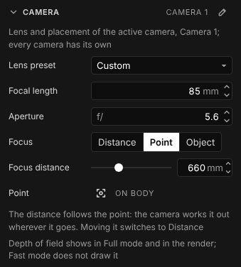 
`f1-focus-inspector.png` · `1cb9f87` · El bloque Cámara del inspector tras enfocar con un clic: *Enfoque* en *Punto* (*Distancia · Punto · Objeto*), la distancia de enfoque como deslizador con su campo al lado, deshabilitados porque la distancia sale del punto (660 mm), y la fila *Punto* con el botón de enfocar con clic y la pieza enfocada. `tools/focus-click-check.mjs --shots docs/ui`.

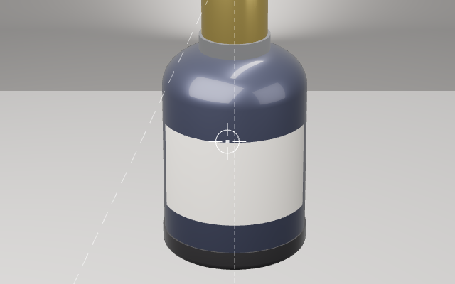 
`f1-focus-marker.png` · `1cb9f87` · El visor en *Rápido* alrededor del punto enfocado en la etiqueta de la botella del ejemplo, con la cámara seleccionada: la marca del punto (un anillo con cuatro trazos y un punto en el centro) donde cayó el clic. `tools/focus-click-check.mjs --shots docs/ui`.

 
`f1-focus-sheet.png` · `ed0e937` · Tres clics, antes de F1 a la izquierda y después a la derecha (*antes*: `319614b`), en renders finales de 480 × 270 de un damero de 1,3 mm inclinado 45° visto con 135 mm a f/1,4 a 600 mm; un anillo marca el píxel del clic. Arriba y en medio, la lente con 6° de inclinación y el clic en las esquinas: antes la banda nítida pasaba a unos 35 píxeles del anillo, después pasa por él. Abajo, la doble Gauss trazada abierta y el clic en el centro: antes la banda quedaba arriba a la izquierda del anillo, después lo cruza. Hecha con `tools/focus-sheet.mjs` de los renders de `tests/focus-measure.test.ts` (`REPACK_FOCUS_MEASURE=1`, con `rt`).

### v0.1.17 · 2026-10-17

El catálogo de luz en Sets y Luces, con sus filtros, la pregunta por los focos que hay y el tamaño de las miniaturas; flechas de paso en todos los valores y deslizadores donde convienen; la cámara de interiores: verticales rectas, la planta con el techo oculto a cámara y la panorámica 2:1. Regrabadas aquí, sin cambiar de sitio: las cuatro de la ventana de render y la cola de U5 (`render-window-image.png`, `render-window-animation.png`, `queue-drawer.png` y `results-split.png`), con la interfaz de hoy, y `sets-catalogue.png` (L6) y `scene-type-interior.png` (K1), con la sección *Luz* de L7. N2: la ventana de render con un lote de cámaras × estudios y la cola con él terminado.

#### L7 · Sets y Luces: catálogo reorganizado

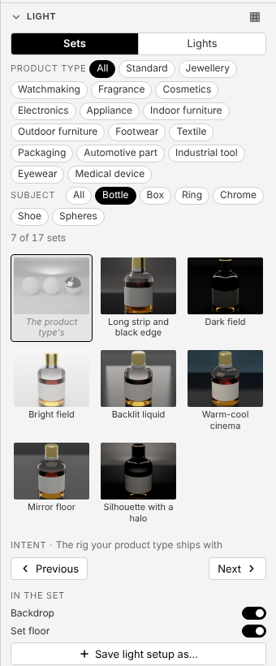 
`light-sets.png` · `71fa0a1` · La sección *Luz* en el grupo *Sets*: los filtros *Tipo de producto* y *Sujeto*, con *Frasco* elegido; *7 de 17 sets*, todas las miniaturas del mismo tamaño, y el rig del tipo de producto en vigor el primero, atenuado y marcado *Fuera de los filtros*.

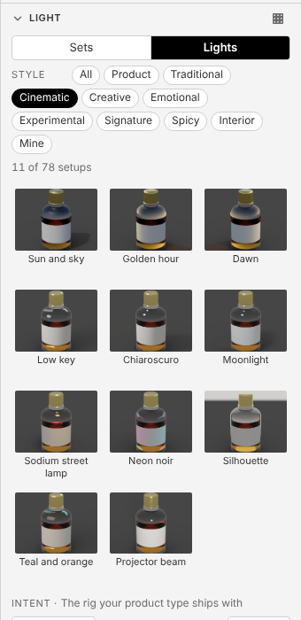 
`light-lights.png` · `71fa0a1` · El grupo *Luces* con el filtro *Estilo* en *Cinematográfico*: *11 de 78 montajes*, con miniaturas del tamaño de las de los sets.

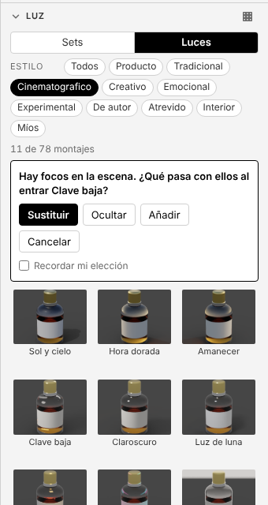 
`light-question.png` · `71fa0a1` · En español: al elegir *Clave baja* con focos en la escena, la pregunta en línea «Hay focos en la escena. ¿Qué pasa con ellos al entrar Clave baja?» con *Sustituir*, *Ocultar*, *Añadir*, *Cancelar* y *Recordar mi elección*.

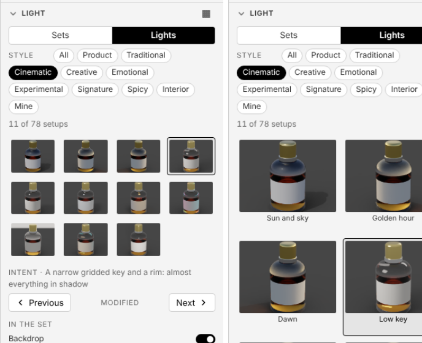 
`light-thumb-sizes.png` · `71fa0a1` · Las miniaturas pequeñas (cuatro columnas, solo la imagen) y grandes (dos columnas), elegidas con el botón de la derecha de la cabecera de *Luz*; tras *Ocultar* sobre un set, *En el set* sigue con su fondo y su suelo.

#### U15 · Flechas y deslizadores en los valores

 
`u15-light-fields.png` · `84f0673` · Un foco propio (Área) elegido: en el inspector, Ancho, Distancia, Temperatura y Potencia son campos con sus flechas ▲ ▼ a la derecha; Acimut, Elevación y Dispersión, deslizadores con su campo y sus flechas al lado (Dispersión en 180°, su máximo, con ▲ apagada); las Coordenadas X, Y, Z llevan el par compacto.

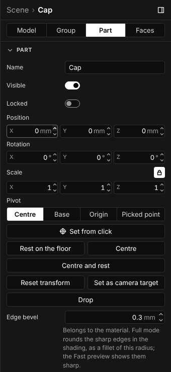 
`u15-part-triplets.png` · `84f0673` · La columna del inspector con la sección Pieza: Posición, Rotación y Escala en tripletes X, Y, Z de 102 px con el par compacto de flechas, el puntero sobre ▲ de la X de Posición; debajo, el Bisel de aristas con el par normal.

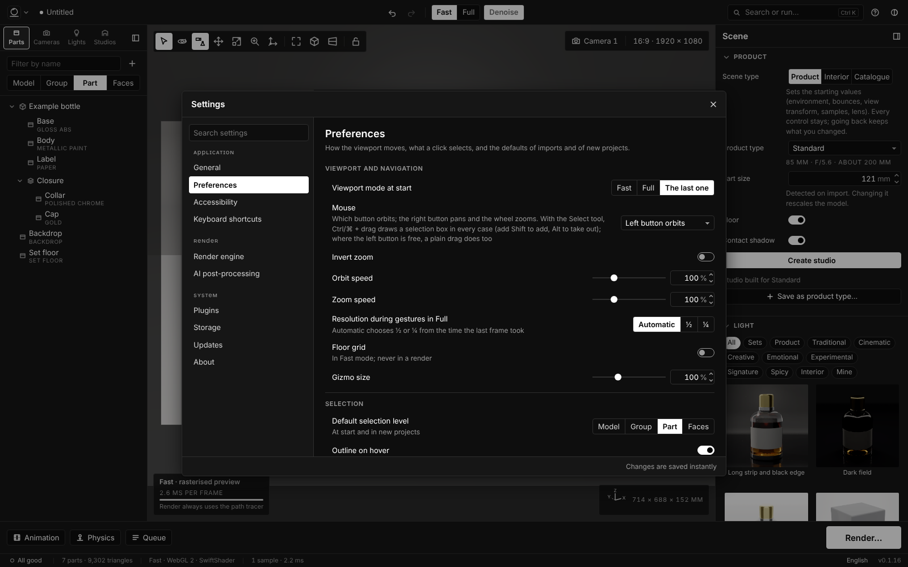 
`u15-settings-sliders.png` · `84f0673` · Ajustes ▸ Preferencias con Velocidad de órbita, Velocidad de zoom y Tamaño del gizmo convertidos en deslizadores con su campo y sus flechas (100 %).

#### N2 · Cola, pases y lotes

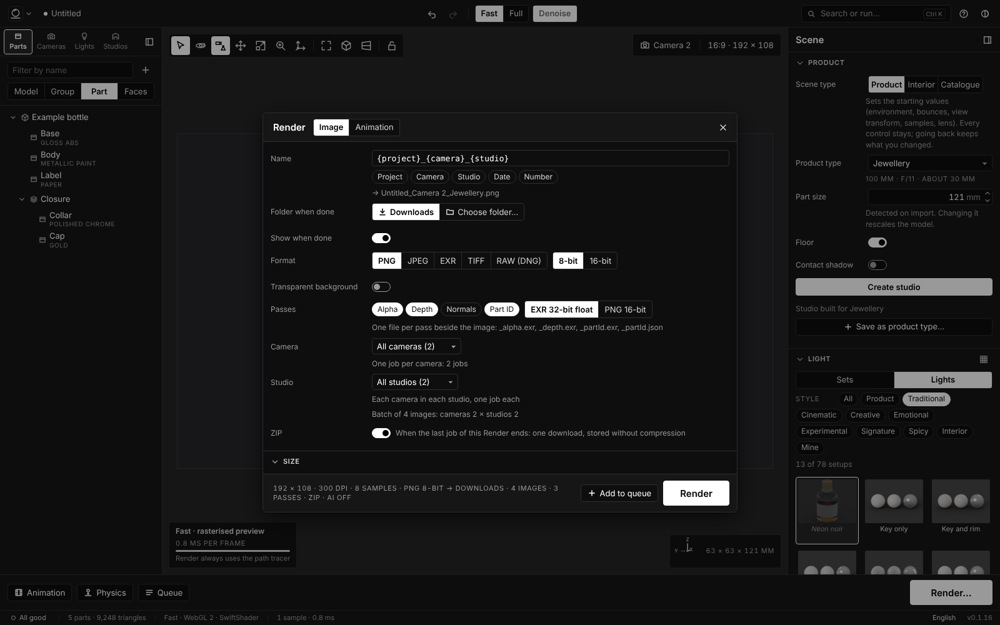 
`batch-window.png` · `8816f19` · La ventana de Render, pestaña Imagen, con un lote preparado: el nombre {project}_{camera}_{studio} con sus fichas, los pases Alfa, Profundidad y Id de pieza elegidos en EXR de 32 bits, Todas las cámaras (2) y Todos los estudios (2) con el aviso «Lote de 4 imágenes: cámaras 2 × estudios 2», y el interruptor del ZIP encendido.

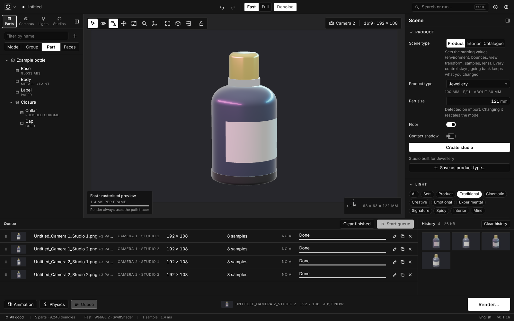 
`batch-queue.png` · `8816f19` · El cajón de la cola con el lote de 2 × 2 terminado: cuatro trabajos (cada cámara en cada estudio, en ese orden) con su estudio junto a la cámara y «+3 pases · ZIP» al final del nombre, y el historial con las cuatro imágenes.

#### K3 · Cámara de interiores

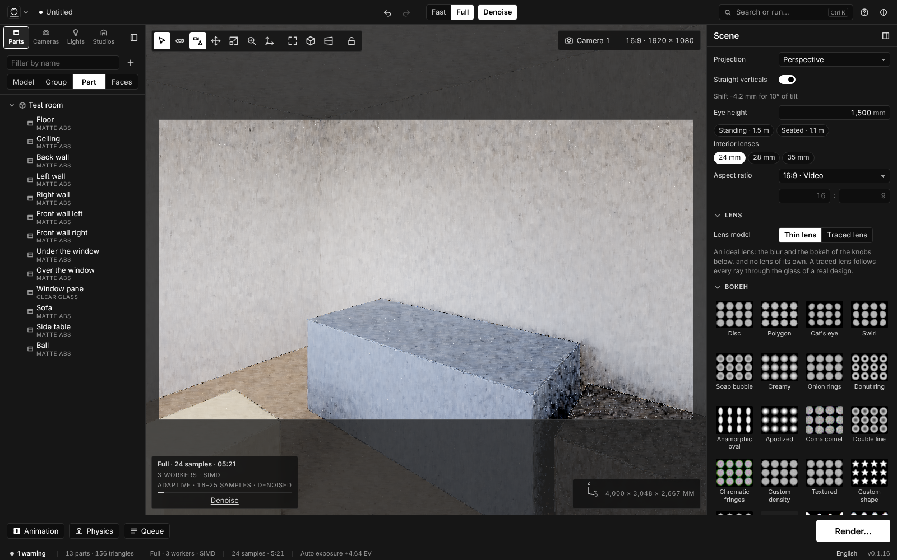 
`k3-verticals.png` · `0082860` · La habitación de prueba en Completo con la cámara a 1,5 m mirando 10° hacia abajo y las verticales rectas encendidas: la esquina de las paredes sale vertical. En la sección Cámara, la proyección, el interruptor Verticales rectas con su nota (desplazamiento de −4,2 mm para 10° de inclinación), la altura de ojo con De pie y Sentado y las ópticas de interior 24, 28 y 35 mm; la exposición automática medida en la barra de estado.

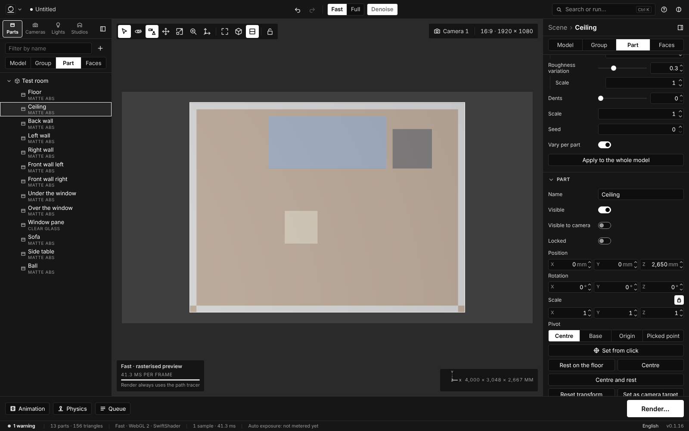 
`k3-plan-fast.png` · `0082860` · La vista Planta (ortográfica desde arriba) en Rápido con el techo elegido y Visible a cámara apagado en la sección Pieza: se ve el suelo, el sofá, la mesa y la bola por debajo del techo.

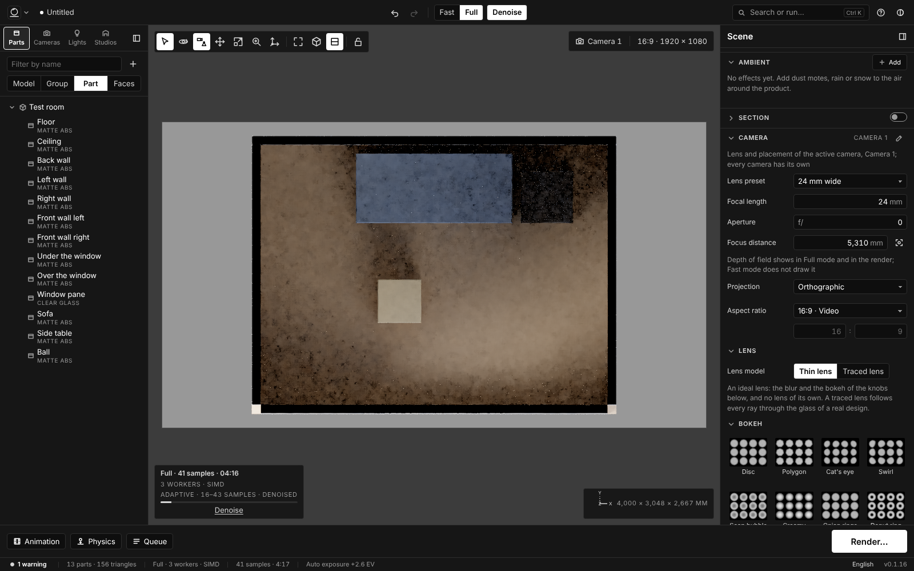 
`k3-plan.png` · `0082860` · La misma planta en Completo: el techo no se ve y la habitación sigue iluminada por la ventana con el techo dando su sombra y sus rebotes; la exposición automática medida en la barra de estado.

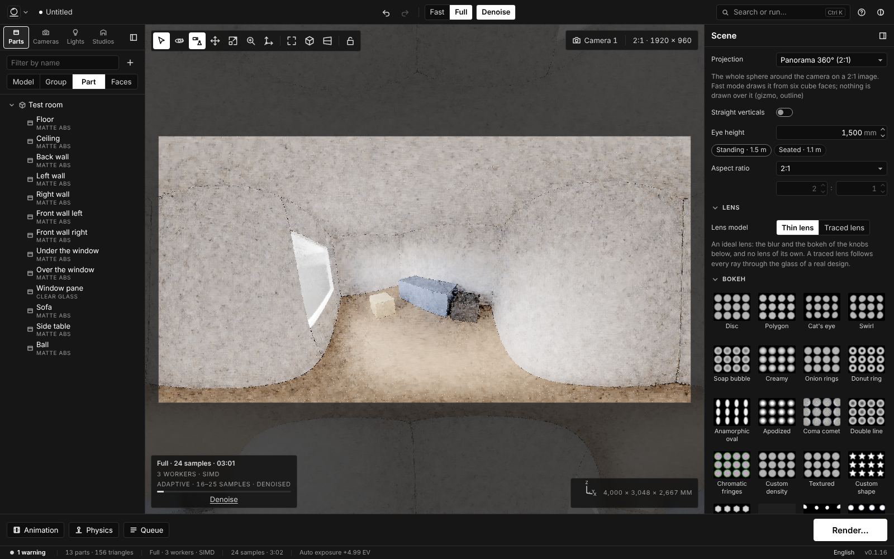 
`k3-panorama.png` · `0082860` · La proyección Panorámica 360° (2:1) en Completo desde dentro de la habitación de prueba: las cuatro paredes, el suelo y el techo en una sola imagen equirectangular, con la ventana a un lado.

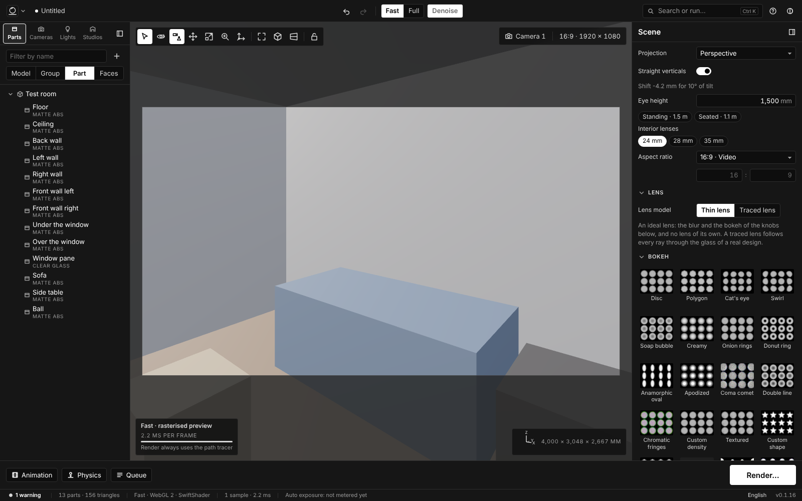 
`k3-verticals-fast.png` · `0082860` · La misma corrección en Rápido: con *Verticales rectas* las aristas verticales salen paralelas, y el inspector dice el desplazamiento que aplica (−4,2 mm para 10° de inclinación), con los presets de altura de ojo y las focales de interior.

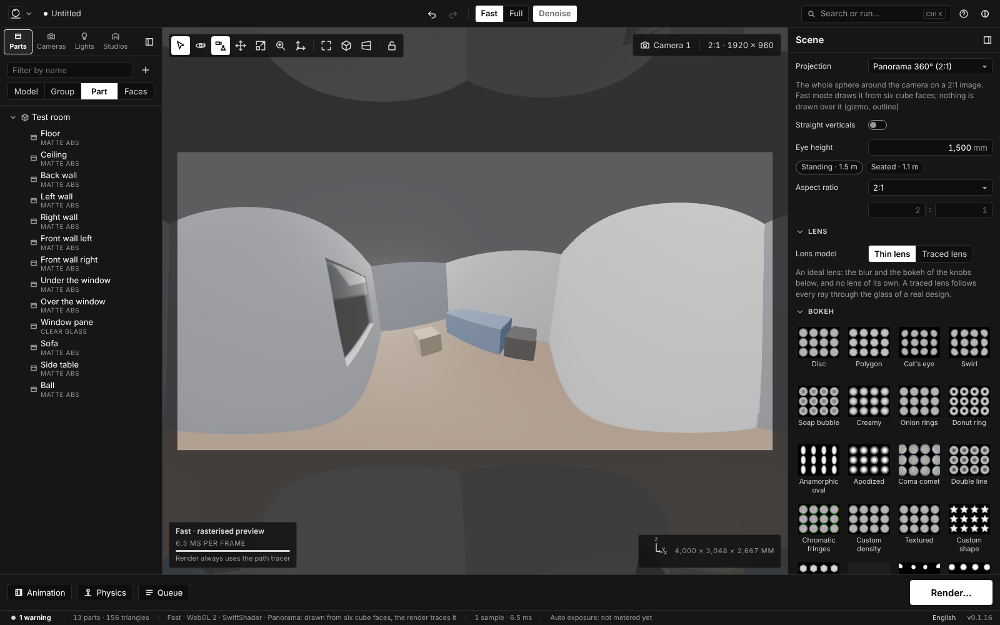 
`k3-panorama-fast.png` · `0082860` · La panorámica 360° en Rápido, dibujada desde las seis caras de un cubo con el mismo mapa que el motor; encima no se dibuja nada (contorno, *gizmo*).

### v0.1.16 · 2026-10-17

Animación y vídeo: el asistente en tres pasos con la rejilla de tipos, la curva personalizada, los fundidos entre planos y el vídeo codificado en la ventana de render.

#### N1 · Animación y vídeo al estilo KeyShot

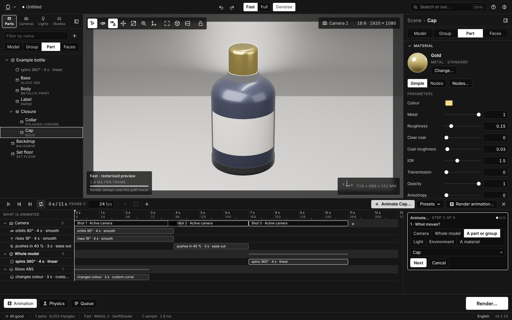 
`animation-n1-wizard.png` · `b2eeab6` · La línea de tiempo con tres pistas (la cámara con tres planos y un fundido a negro en el corte del segundo, el modelo que gira y el material Gloss ABS que cambia de color con una curva personalizada) y el asistente de «+ Animar…» en el paso 1 de 3, con «Una pieza o un grupo» y la tapa elegidas. Las animaciones salen también bajo su objetivo en el árbol de la escena.

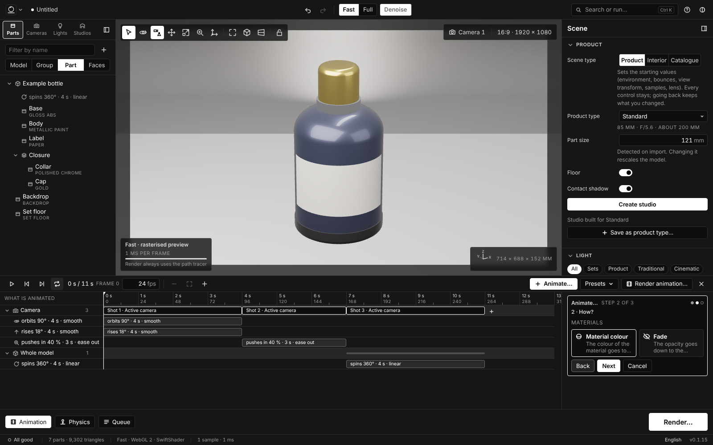 
`animation-n1-cards.png` · `b2eeab6` · El paso 2 del asistente para un material: la rejilla de tarjetas del grupo Materiales (Color de material y Fundido, cada una con su frase), con Atrás y Siguiente.

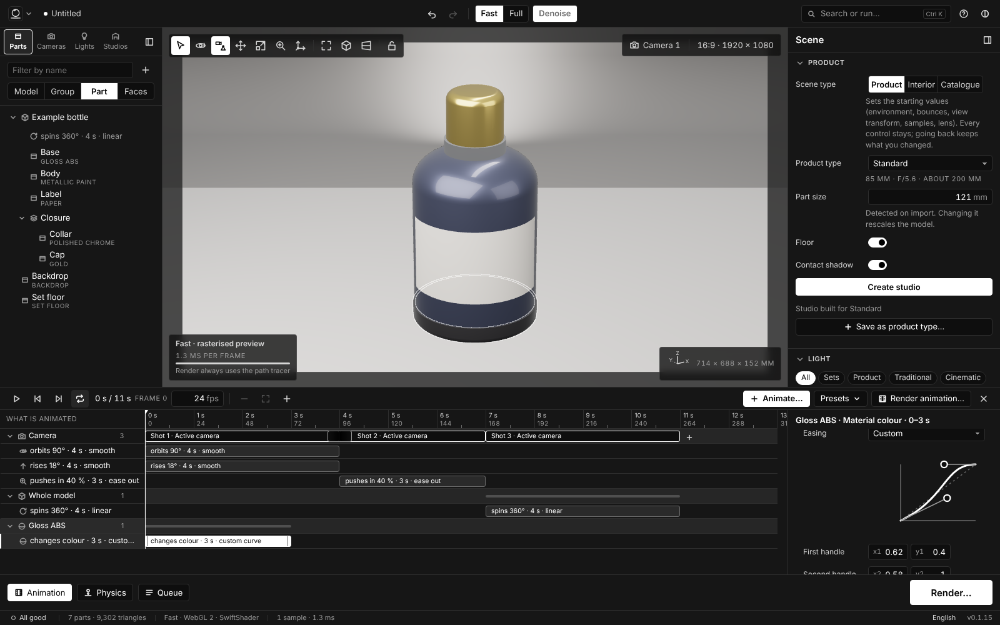 
`animation-n1-curve.png` · `b2eeab6` · Las propiedades de «Gloss ABS · Color de material · 0–3 s» con la curva Personalizada: el editor con sus dos asas, la primera arrastrada (x1 0,62, y1 0,4) y sus campos debajo; en el visor, las piezas de ese material marcadas.

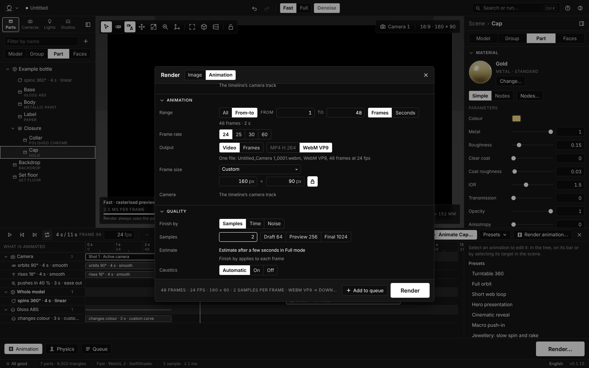 
`render-window-video.png` · `b2eeab6` · La ventana de Render en Animación con salida Vídeo: WebM VP9 elegido y MP4 H.264 deshabilitado (este Chromium no lo codifica), la línea «Un archivo: Untitled_Camera 1_0001.webm, WebM VP9, 48 fotogramas a 24 fps» y el resumen con WEBM VP9. Es lo que render-window-animation.png (U5) enseñaba aún como «próximamente».

### v0.1.15 · 2026-10-17

Tipo de escena (Producto, Interior, Catálogo), el estilo de luz Interior con siete recetas, el Doctor de interiores y el Doctor de motor.

#### K1 · Tipo de escena, luz de interior y Doctor de interiores

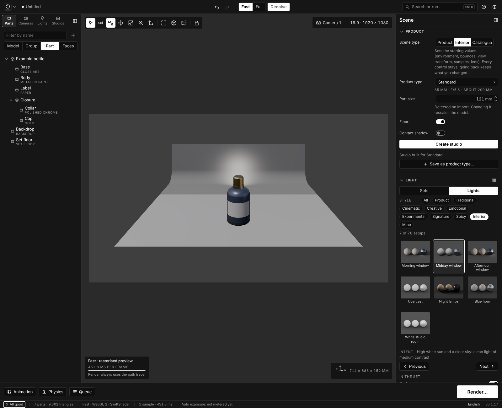 
`scene-type-interior.png` · `431e7b8` · El tipo de escena Interior elegido (Producto · Interior · Catálogo) y el estilo de luz Interior con sus siete recetas: ventana de mañana, de mediodía y de tarde, nublado, lámparas de noche, hora azul y sala blanca de estudio. La pieza se ve pequeña porque Interior pone 28 mm. *(regrabada en v0.1.17: Interior es un estilo del grupo Luces de L7)*

#### D1 · Doctor de motor

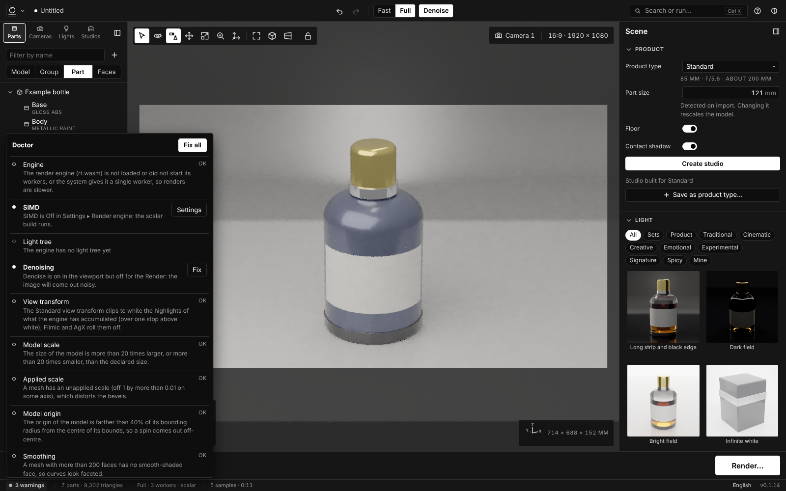 
`doctor-engine.png` · `e17f146` · El Doctor con los chequeos de motor y de escena en el popover: Motor, SIMD (con el botón Ajustes), Árbol de luces, Denoise (con Arreglar), Tono, escala, origen y suavizado, y Arreglar todo.

### v0.1.14 · 2026-10-17

Vista en sección (un plano que corta la pieza y tapa el corte) y luces IES.

#### L5 · Luces IES

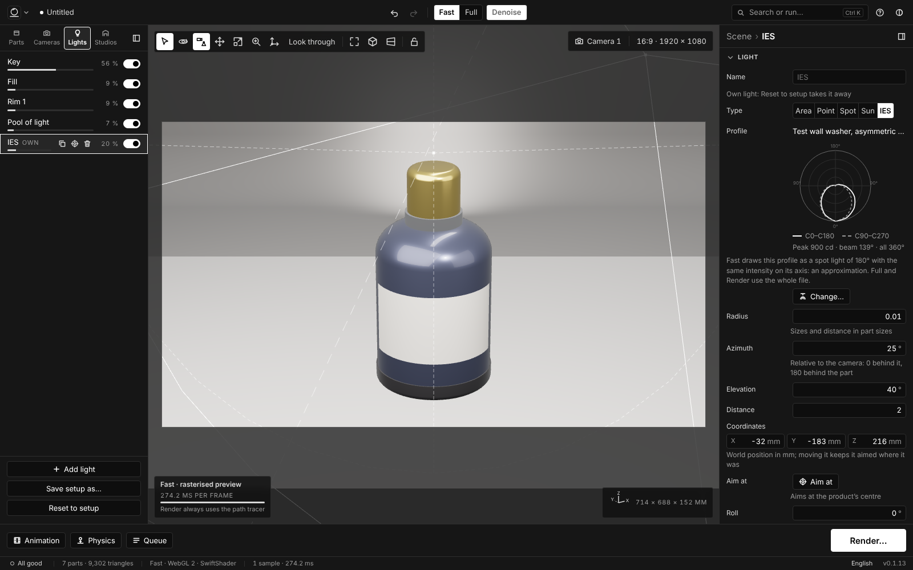 
`ies-light.png` · `6d90dc9` · Una luz IES en el inspector: nombre del perfil, gráfico polar dibujado desde el archivo (planos C0–C180 y C90–C270), pico, ángulo del haz y el aviso de que Rápido la aproxima con un foco.

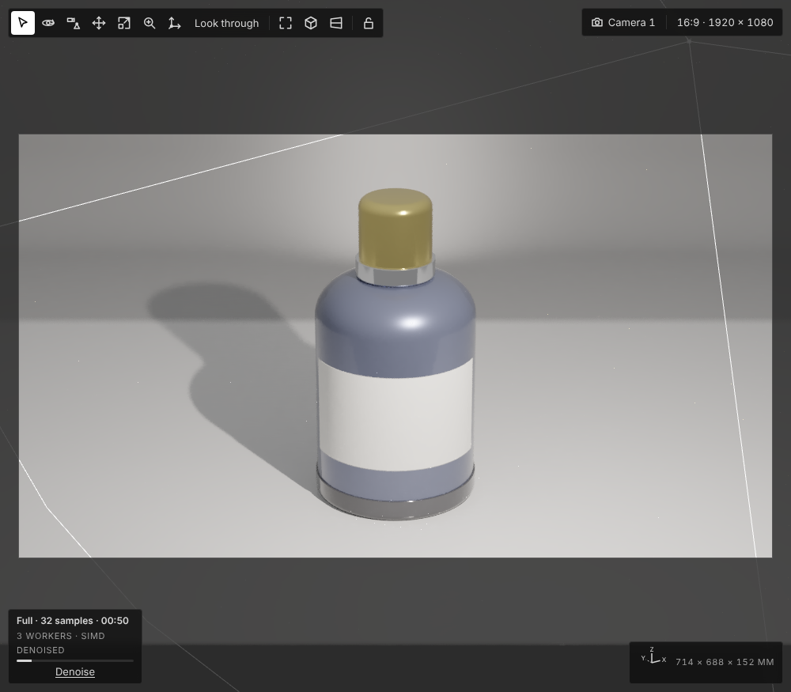 
`ies-light-full.png` · `6d90dc9` · La luz IES en modo Completo: el motor usa el perfil entero del archivo.

#### Q1 · Vista en sección

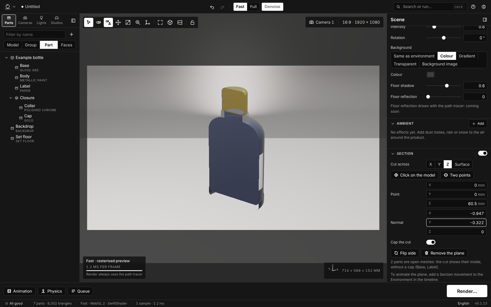 
`section-fast.png` · `3c51cd8` · La vista en sección en modo Rápido: un plano de corte quita un lado del frasco y tapa el corte con el color del material; el inspector avisa de las dos piezas abiertas sin tapa.

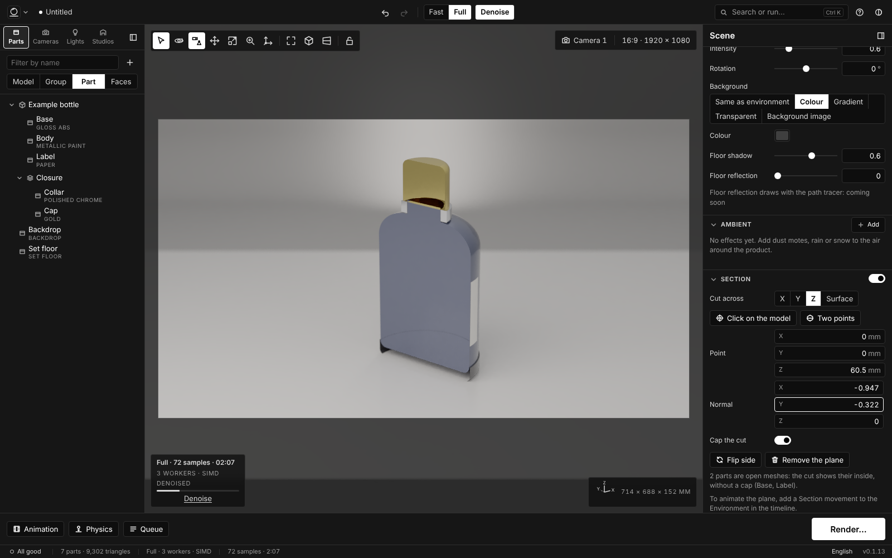 
`section-full.png` · `3c51cd8` · La misma vista en sección en modo Completo: el trazador corta y tapa el sólido, también en sombras y reflejos.

### v0.1.13 · 2026-10-16

Muestreo adaptativo y «Terminar por ruido» en la ventana de render.

#### E10 · Muestreo adaptativo y terminar por ruido

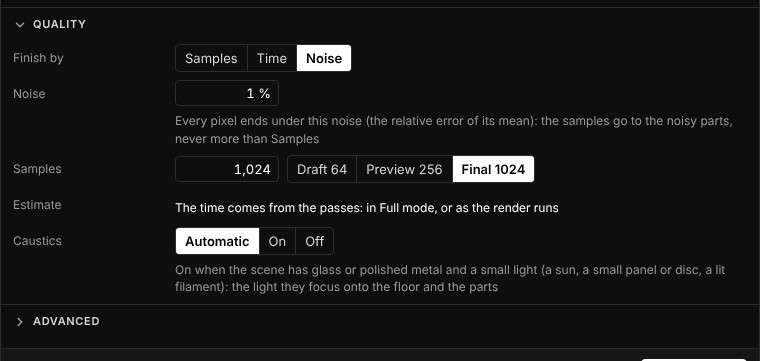 
`render-window-noise.png` · `b4718c4` · Render ▸ Calidad con «Terminar por: Ruido» al 1 %: las muestras son el tope y la estimación sale de las pasadas del visor.

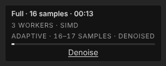 
`meter-adaptive.png` · `b4718c4` · El medidor del visor en Completo diciendo «Adaptativo · 16–17 muestras» junto a «Denoised».

### v0.1.12 · 2026-10-16

Los materiales de nodos funcionan en Completo y en los renders.

#### M3b · El motor evalúa grafos

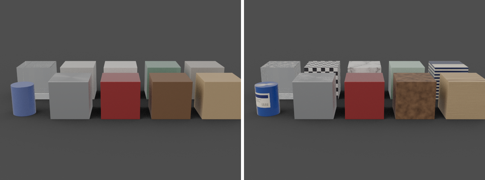 
`m3b-graphs.png` · `fbb054e` · Los diez ejemplos del editor de nodos en modo Completo: con la media de cada salida (izquierda) y con el programa del grafo que ejecuta el motor (derecha).

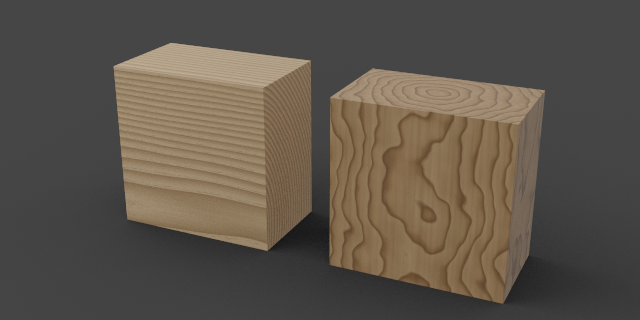 
`m3b-wood.png` · `fbb054e` · Dos maderas en el motor: la familia Madera del catálogo (roble, anillos finos y rectos) a la izquierda y el ejemplo de nodos «Madera con dos ruidos» a la derecha; todavía no se parecen.

### v0.1.11 · 2026-10-16

Partículas de ambiente mejoradas: polvo a contraluz, lluvia sin puntitos y más baratas.

Sin capturas nuevas en esta versión; lo que trajo y no tiene captura está en «Sin captura».

### v0.1.10 · 2026-10-16

Texturas de imagen, mapeado y etiquetas en Completo y en los renders.

Sin capturas nuevas en esta versión; lo que trajo y no tiene captura está en «Sin captura».

### v0.1.9 · 2026-10-16

Vista en vivo del render seleccionado en la cola.

#### U14 · Vista en vivo en la cola

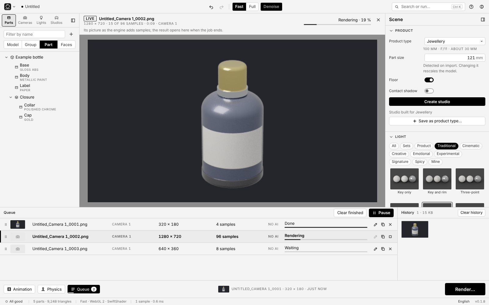 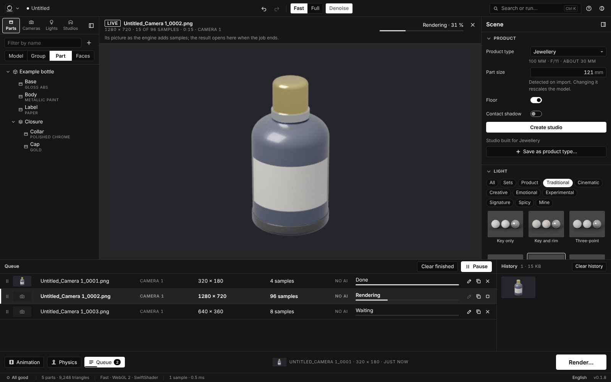 
`queue-live.png` y `queue-live-dark.png` · `ab06ce9` · La vista en vivo de la cola: el clic en el trabajo que se renderiza abre su imagen mientras el motor añade muestras, con la ficha EN VIVO, las muestras y el progreso. Tema claro y oscuro.

### v0.1.8 · 2026-10-16

La ventana con los elementos de una lente al dejar el puntero sobre ella.

#### O2b · Ventana de la lente al pasar el ratón

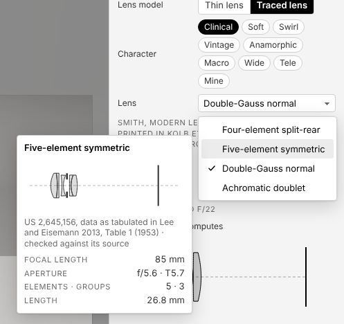 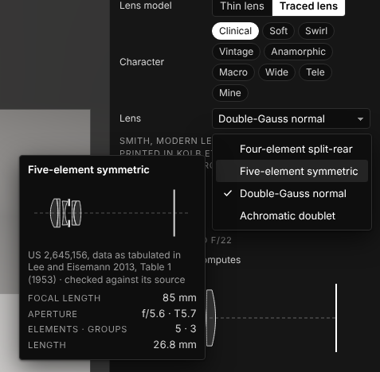 
`lens-hover.png` y `lens-hover-dark.png` · `430f1ef` · La ventana con los elementos de una lente al dejar el puntero sobre ella en la lista: «Five-element symmetric», con su corte, su fuente y los números que da el motor. Tema claro y oscuro.

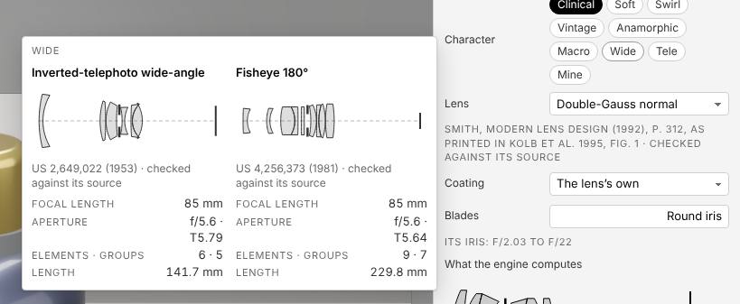 
`lens-hover-chip.png` · `430f1ef` · La ventana de las lentes de un carácter (Gran angular) al pasar sobre su chip: dos lentes lado a lado con sus cortes y números.

### v0.1.7 · 2026-10-16

Madera, tela y bisel de aristas en Completo, materiales con más realismo, lente trazada con 16 lentes, filtros de efecto en la lente, 88 miniaturas de montaje rehechas y los arreglos del reporte de errores del 14-10.

#### O3a · Filtros de efecto en la lente: difusión negra, blanca y dorada, brillo, red, estrella, rayas

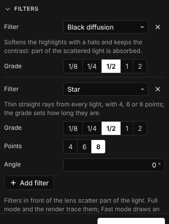 
`lens-filters.png` · `304696f` · Cámara ▸ Filtros: una difusión negra y una estrella de 8 puntas apiladas, cada una con su grado, puntas y ángulo.

#### O2 · Lente trazada

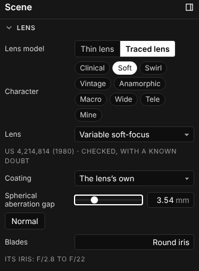 
`lens-editor.png` · `99df141` · Cámara ▸ Lente trazada: el carácter (Clínica, Suave, Remolino, Vintage…), la lente del catálogo con su fuente, el tratamiento, el hueco de aberración esférica y las láminas.

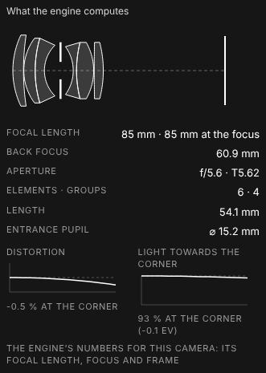 
`lens-section.png` · `99df141` · Lo que calcula el motor para la lente: su corte, focal, tiraje, f/ y T-stop, elementos y grupos, pupila de entrada y las curvas de distorsión y de luz hacia la esquina.

### v0.1.6 · 2026-10-14

Texturas y etiquetas, editor de materiales por nodos, sets de estudio, selector de bokeh, salida TIFF y RAW, proporción en la cámara, plugins con el de película, despieces y línea de tiempo nueva, cuerpos rígidos, partículas de ambiente, denoise en directo, suavizado de bordes y actualizar desde la aplicación.

#### Sin fase · Lista de cámaras con lápiz (aviso del usuario del 14-10)

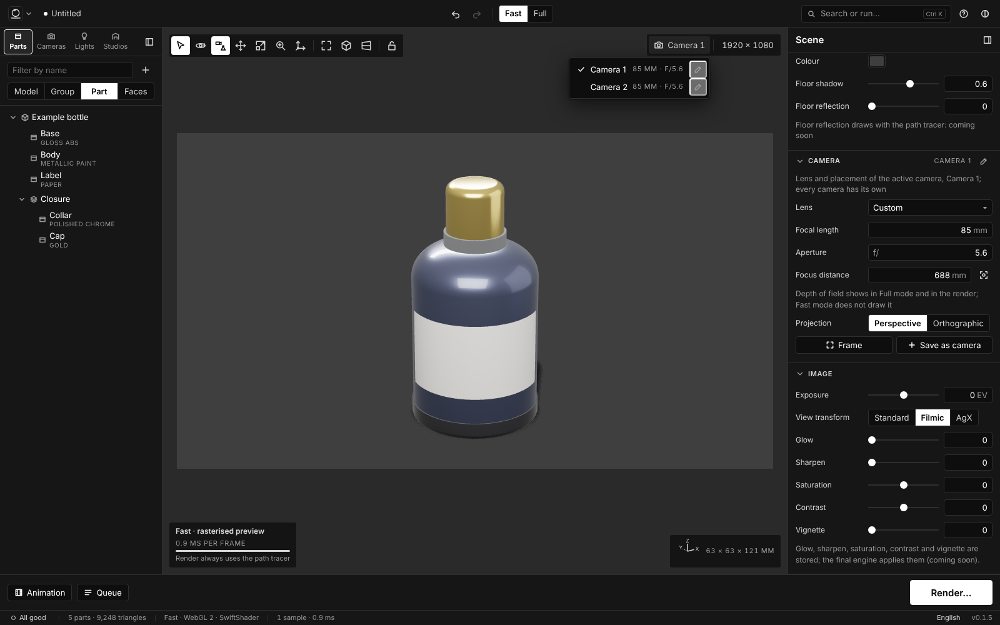 
`camera-menu.png` · `c625777` · La lista de cámaras del visor con la óptica de cada una (85 mm · f/5.6) y un lápiz por fila; al fondo, la sección Cámara que dice qué cámara edita.

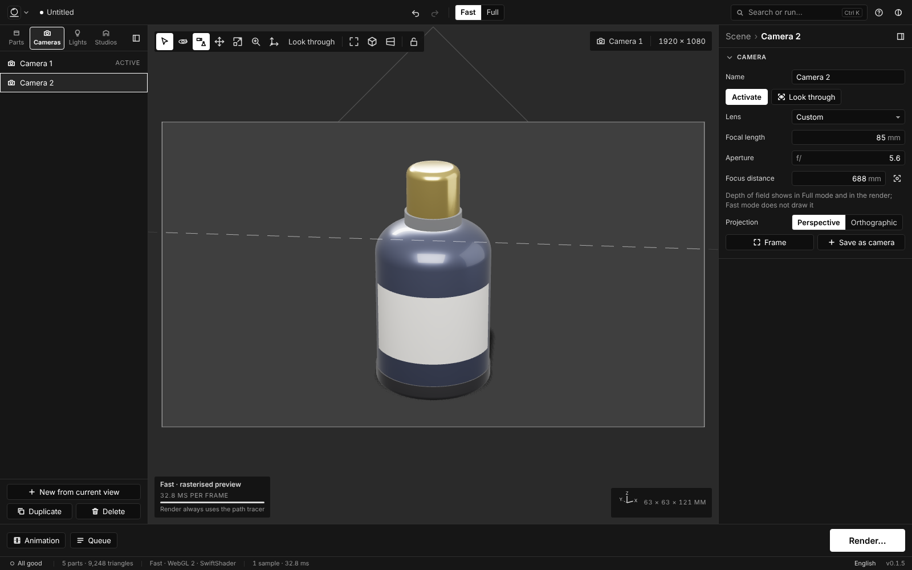 
`camera-edit.png` · `c625777` · La ficha de la Cámara 2 abierta con el lápiz: nombre, Activar, Mirar a través, óptica y posición, sin activarla.

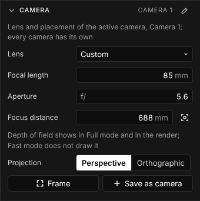 
`camera-section.png` · `c625777` · La sección Cámara del inspector de escena titulada con la cámara que edita (Cámara 1), con el mismo lápiz.

#### M2a · Texturas: importación, mapeado, etiquetas y vista previa

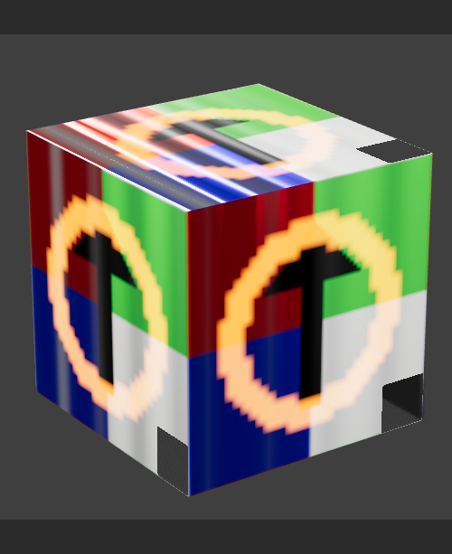 
`textures-fast.png` · `14cf9bc` · Un cubo de pruebas con las seis ranuras de textura dibujadas en modo Rápido: color con cuadrantes y una flecha, rugosidad y metal, mapa de normales, alfa con una esquina recortada y un anillo de emisión.

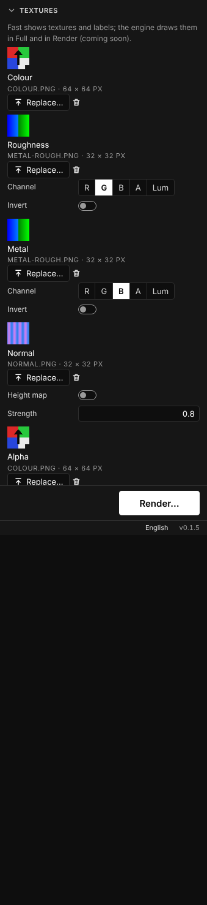 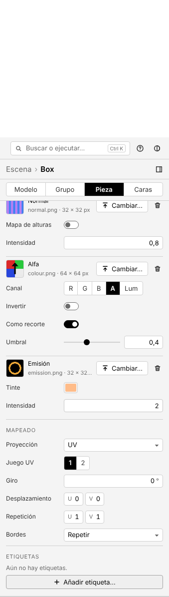 
`textures-inspector.png` y `textures-inspector-light.png` · `14cf9bc` · La sección Texturas del inspector: una ranura por mapa con su vista previa, canal, invertir, intensidad del mapa de normales, alfa como recorte con umbral y tinte de emisión. Tema oscuro en inglés; el claro en español enseña además Mapeado y Etiquetas.

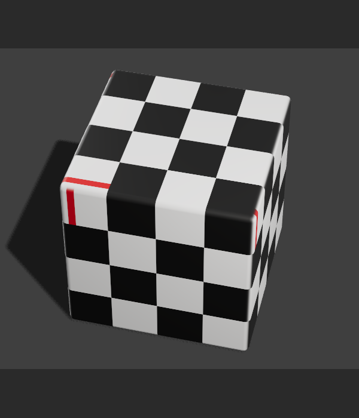 
`box-projection.png` · `14cf9bc` · Proyección de caja de una textura de cuadros sobre un cubo, sin costuras entre las caras.

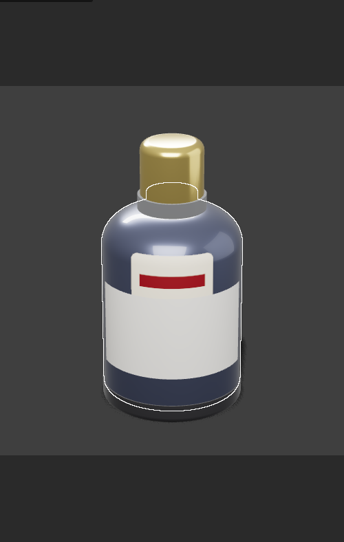 
`label-placed.png` · `14cf9bc` · Una etiqueta puesta con clic y arrastre sobre el frasco de ejemplo: una franja roja sobre papel.

#### U11 · Reducción de ruido en directo

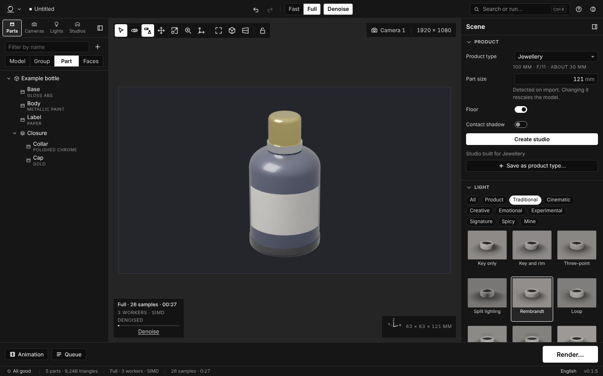 
`denoise-live.png` · `b5434b8` · El visor en modo Completo con Reducir ruido en la barra superior: la imagen limpia mientras se acumula, y «Denoised» en el medidor.

#### P5 · Actualizar desde la aplicación

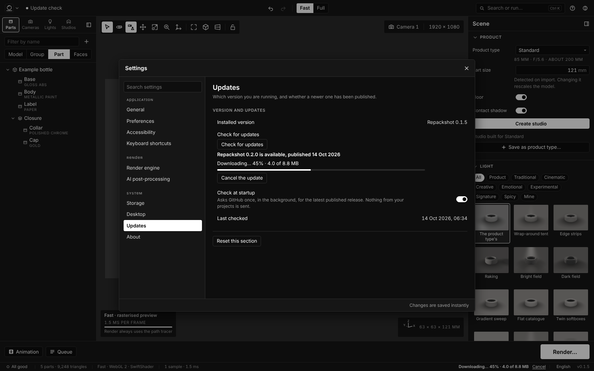 
`update-install.png` · `f93955b` · Ajustes ▸ Actualizaciones descargando la versión nueva (45 %), con «Cancelar la actualización»; el progreso también sale en la barra de estado.

#### L6 · Sets de estudio con criterio fotográfico

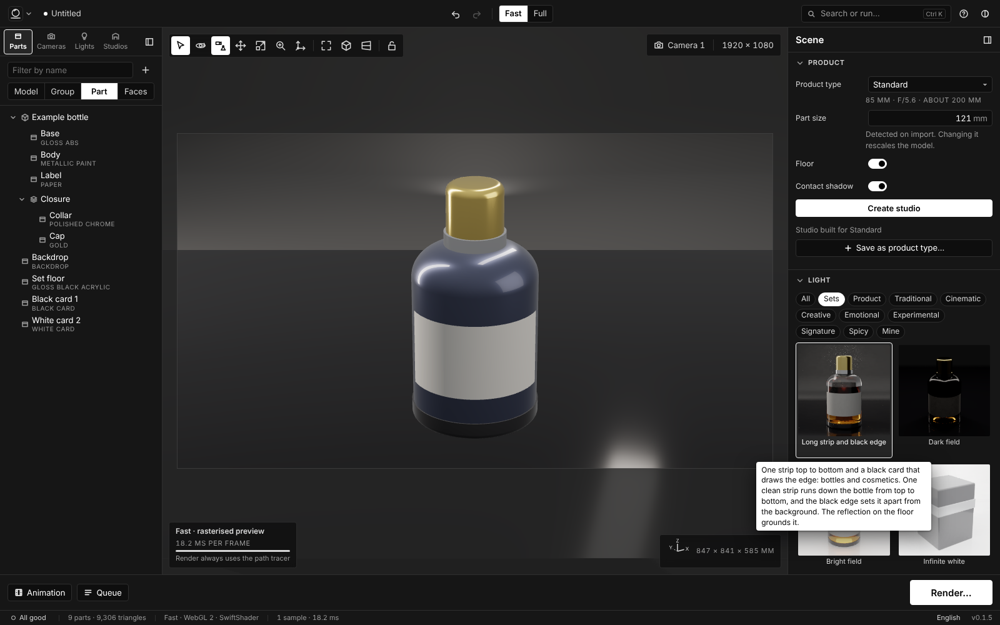 
`sets-catalogue.png` · `6ce8c67` · El catálogo de sets de estudio con sus miniaturas renderizadas por el motor, la descripción de «Tira larga y canto negro» y ese set aplicado al frasco (fondo oscuro, suelo de acrílico negro y tarjetas). *(regrabada en v0.1.17: el grupo Sets de L7, las miniaturas del tamaño de las demás)*

#### P6 · Plugins, y el plugin de película (aintfilm)

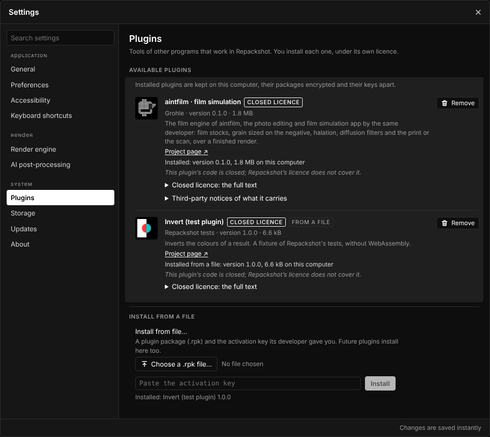 
`settings-plugins.png` · `b150270` · Ajustes ▸ Plugins: los plugins del registro (aintfilm · simulación de película, con licencia cerrada) e «Instalar desde archivo» con la clave de activación.

 
`render-plugins-film.png` · `b150270` · La ventana de render ▸ Plugins con el plugin de película: carrusel de recetas con filtros, vista previa y aplicar a los trabajos.

#### U12 · Salida en TIFF y RAW (DNG)

 
`render-format-tiff.png` · `a424a31` · La ventana de render con salida TIFF de 32 bits en coma flotante (luz lineal), junto a PNG, JPEG, EXR y RAW (DNG).

#### O1 · Lente fina mejorada y selector de bokeh

 
`camera-bokeh.png` · `0830f93` · El selector de bokeh: veinte tipos con una miniatura renderizada por el motor; los que necesitan la lente trazada dicen «próximamente». *(regrabada en v0.1.7)*

 
`camera-optics.png` · `0830f93` · Óptica avanzada: láminas, redondez, giro, perfil, obstrucción, ojo de gato, anamórfico, inclinación y desplazamiento, y los mandos «no físico». *(regrabada en v0.1.7)*

#### U13 · Proporción de la imagen en la cámara

 
`camera-aspect.png` · `3ba8740` · La sección Cámara con la proporción 4:3 elegida y el marco del visor cambiado.

 
`render-size-from-camera.png` · `3ba8740` · La ventana de render: el alto de los píxeles sigue la proporción de la cámara (4:3, 1920 × 1440) y lo dice debajo.

#### S4a · Ambiente: partículas de aire sin estado

 
`ambient-section.png` · `f200fe3` · La sección Ambiente con un efecto de nieve (153 partículas), sus mandos (cantidad, tamaño, energía, caos, viento, gravedad) y las partículas dibujadas en el visor.

 
`ambient-gallery.png` · `f200fe3` · El selector de efectos de Ambiente: motas de polvo, polen, lluvia, nieve, polvareda, ceniza, burbujas y confeti; bruma, haces de luz y niebla, «próximamente».

#### N6 · Despiece configurable y línea de tiempo clara

 
`animation-timeline.png` · `1f8f8fb` · La línea de tiempo de tres zonas: árbol de lo animado, regla con las barras y propiedades del movimiento elegido (despiece apilado en Z) con su pista en el visor.

 
`explode-types.png` · `1f8f8fb` · Despieces del frasco de ejemplo por tipo (lineal separar, lineal apilar, radial, esférico y por niveles), con cuatro fotogramas de cada uno.

#### S2 · Cuerpos rígidos: «Dejar caer», la barra de físicas y grabar

 
`physics-bar.png` · `79a3d24` · La barra de físicas bajo el visor: Iniciar, Pausar o Reanudar, Parar y Reiniciar, con el tiempo simulado y los cuerpos despiertos.

 
`physics-drop.png` · `79a3d24` · Dejar caer: un cubo, una esfera y un cilindro en el aire (izquierda) y en reposo sobre el suelo tras la simulación (derecha).

 
`physics-drop-strip.png` · `79a3d24` · Seis instantes del clip grabado de la caída, de 0 a 0,83 s.

#### M3a · Editor de materiales por nodos: modelo, editor y vista previa

 
`material-nodes.png` · `15a6d96` · El editor de materiales por nodos con el ejemplo del mármol: nodos con su vista previa, conexiones, esfera de resultado, Ejemplos y Añadir nodo.

 
`material-nodes-preview.png` · `15a6d96` · El frasco con el mármol del editor de nodos dibujado en el visor Rápido.

#### U11b · Intensidad de la reducción de ruido

 
`denoise-strength.png` · `920afb9` · Render ▸ Avanzado ▸ Reducción de ruido (Desactivado, Visor, Render o Ambos) con la Intensidad al 50 % y la calidad de cáusticas.

#### E11 · Suavizado de bordes, de menos a más coste

 
`settings-aa.png` · `920afb9` · Ajustes ▸ Motor de renderizado ▸ Suavizado de bordes: el MSAA del modo Rápido y los seis filtros de píxel del modo Completo, de Ninguno a «Fino + bordes ×4».

 
`meter-filter.png` · `920afb9` · El medidor del visor con «Filter · Standard»: el motor dice qué filtro de píxel usa.

### v0.1.5 · 2026-10-14

Cáusticas y denoise propio, focos propios y luces y cámaras en el visor, prompt y variantes de la IA, recorrido guiado y avisos del motor de ejecución de la IA.

#### X4b · Prompt propio y variantes

 
`ai-section-prompt.png` · `a40a6b4` · La sección Post-procesado IA con un prompt propio («Late afternoon light, a calm mood»), cuatro variantes, intervención y luz al 80 % y estilo Cálido al 70 %.

 
`ai-results-variants.png` · `a40a6b4` · El visor de resultados con la tira de cuatro variantes de la IA bajo la cabecera; la tercera, comparada con el render con el divisor.

 
`settings-ai-prompt.png` · `a40a6b4` · Ajustes ▸ Post-procesado IA: el prompt del sistema, con su contador y «Restablecer el predeterminado».

#### U10 · Recorrido guiado y avisos de la IA

 
`tour-tools.png` · `5f6566e` · Paso 5 de 31 del recorrido guiado: las herramientas de vista resaltadas, con la nota que las explica. *(regrabada en v0.1.15)*

 
`tour-camera.png` · `5f6566e` · Paso 10 de 31: Cámara y enfoque, con el inspector de cámara y el selector de bokeh resaltados. *(regrabada en v0.1.15)*

 
`tour-render-ai.png` · `5f6566e` · Paso 20 de 31: Post-procesado IA, plegado y apagado, en la ventana de render. *(regrabada en v0.1.15)*

 
`tour-settings-es.png` · `5f6566e` · Paso 26 de 31, en español: Ajustes ▸ Motor de renderizado. *(regrabada en v0.1.15)*

 
`ai-runtime-warning-render.png` · `5f6566e` · La sección de IA de la ventana de render avisa de que el motor de ejecución no está instalado, con Instalar (26 MB) y Ajustes…

 
`ai-runtime-warning-settings.png` · `5f6566e` · Ajustes ▸ Post-procesado IA con el mismo aviso del motor de ejecución y el botón Instalar.

 
`ai-runtime-warning-vc.png` · `5f6566e` · El aviso de que en Windows falta el entorno de Microsoft Visual C++, con Instalar el entorno, Comprobar de nuevo y Ajustes…

 
`ai-runtime-chooser.png` · `5f6566e` · El cuadro «Elige los modelos de IA que descargar» con la casilla de descargar también el motor de ejecución (CPU, 26 MB).

 
`ai-runtime-note.png` · `5f6566e` · La barra de estado con el aviso «IA: el motor de ejecución no está instalado», con Instalar y Más tarde.

#### L4 · Focos propios

 
`lights-add-menu.png` · `af98de0` · La lista de «+ Añadir luz»: área rectangular, disco y esfera, punto, foco, sol e IES…, con los glifos de luces dibujados en el visor. *(regrabada en v0.1.14)*

 
`lights-glyphs-gizmo.png` · `af98de0` · Un foco propio seleccionado con su gizmo de mover, los glifos de luces y cámaras en el visor y su inspector (tipo, acimut, elevación, coordenadas, apuntar, cono).

 
`lights-look-through.png` · `af98de0` · Mirar a través del foco: el visor ve la escena desde la luz, con el aviso de salida (Esc o «Volver a la cámara activa»).

 
`lights-spot-aimed.png` · `af98de0` · El foco apuntado al frasco en modo Rápido: el círculo de luz sobre la etiqueta y el glifo del cono.

 
`lights-spot-full.png` · `af98de0` · El mismo foco en modo Completo: el trazador dibuja su penumbra y su sombra.

#### E5b-1 · Cáusticas y *denoise* propio

 
`engine-e5b1-denoise-4spp.png` · `a75eec7` · Una escena a 4 muestras por píxel sin reducción de ruido (izquierda) y con el denoise propio del motor (derecha).

 
`engine-e5b1-bottle-caustics.png` · `a75eec7` · El frasco de vidrio a 64 muestras sin y con cáusticas (mapa de fotones progresivo).

 
`engine-e5b1-bottle-caustics-final.png` · `a75eec7` · El mismo par, sin y con cáusticas, rehecho con los ajustes finales de la fase.

### v0.1.4 · 2026-10-13

Post-procesado con IA de punta a punta en el escritorio, cielo físico propio, primitivas paramétricas y herramienta Escalar.

#### U9 · Primitivas y herramienta de escalar

 
`primitives-add-menu.png` · `69f3eca` · Menú de la aplicación ▸ Añadir con las doce primitivas paramétricas: caja, plano, disco, cilindro, pedestal, esfera, cono, toro, cápsula, tubo, escalones y fondo infinito.

 
`primitives-base-box.png` · `69f3eca` · Una caja como base bajo el frasco, en modo Rápido; el árbol lista además un toro y un cilindro ocultos y el fondo infinito detrás.

 
`primitives-pedestal.png` · `69f3eca` · Un pedestal paramétrico bajo el frasco, sobre el fondo infinito, en modo Rápido.

 
`primitives-pedestal-full.png` · `69f3eca` · El mismo pedestal en modo Completo: el trazador acumula muestras con la luz y las sombras del estudio.

 
`primitive-inspector.png` · `69f3eca` · La sección Primitiva del inspector: medidas en mm (radio, alto, bisel, segmentos) que regeneran la pieza en vivo, y «Convertir a malla».

 
`scale-tool.png` · `69f3eca` · La herramienta Escalar: el gizmo de Mover con solo asas de escala (un cubo por eje y el punto central).

 
`scale-panel.png` · `69f3eca` · Clic derecho ▸ Escalar…: panel con Uniforme, Por eje y A medida (mm de ancho, fondo y alto con la proporción bloqueada), Aplicar y Restablecer.

### v0.1.3 · 2026-10-13

Detección de las tarjetas gráficas en Windows. *(Sin etiqueta en git: se toma del commit «Release v0.1.3».)*

Sin capturas nuevas en esta versión; lo que trajo y no tiene captura está en «Sin captura».

### v0.1.2 · 2026-10-13

Arreglos de escritorio (ventana propia, datos que sobreviven a un reinicio), arrastrar un material y selección por caja, vidrio y entorno nuevos y la interfaz del post-procesado con IA. *(Sin etiqueta en git: se toma del commit «Release v0.1.2».)*

#### P3e · Escritorio: todo sobre el lanzador

 
`settings-ai-desktop.png` · `398302d` · Ajustes ▸ Post-procesado IA en el escritorio con la tarjeta gráfica real del equipo en la fila GPU.

 
`settings-desktop-paths.png` · `398302d` · Ajustes ▸ Escritorio: modo portable, carpeta de datos, qué dibuja la ventana y carpeta de registros, con su botón Abrir carpeta.

 
`settings-storage-desktop.png` · `398302d` · Ajustes ▸ Almacenamiento medido por el lanzador: espacio de modelos, historial, biblioteca y miniaturas, con Liberar y los límites del historial.

#### U7 · Arrastrar un material y selección por caja

 
`material-drag.png` · `093ce11` · Arrastrando una miniatura del catálogo (Oro) sobre el cuerpo del frasco: fantasma con el nombre del material y la pieza de destino resaltada.

 
`material-drag-tree.png` · `093ce11` · Arrastrando un material (Goma) sobre una fila del árbol de piezas: la fila de destino resaltada y el fantasma del material.

 
`box-window.png` · `093ce11` · Selección por caja de izquierda a derecha (ventana): el recuadro continuo coge solo lo que queda entero dentro.

 
`box-crossing.png` · `093ce11` · Selección por caja de derecha a izquierda (cruce): el recuadro discontinuo coge todo lo que toca.

#### M1 · Cara CAD entera

 
`material-drag-faces.png` · `093ce11` · Arrastrando un material a nivel Caras: se asigna a la superficie entera bajo el cursor (3 456 caras de Cuerpo).

 
`box-faces.png` · `093ce11` · Selección de caras con la vista en rayos X: las seis caras de una caja de CAD elegidas de una vez.

#### X4 · Interfaz del post-procesado

  
`ai-section-dark.png` y `ai-section-light.png` · `693762d` · La sección Post-procesado IA de la ventana de render con el servicio sintético de pruebas: interruptor, mandos de intervención, luz, rebotes, desgaste y estilo, prompt propio, protecciones, variantes y vista previa Antes y Después con divisor. Tema oscuro y claro. *(regrabada en v0.1.5)*

  
`ai-results-viewer.png` y `ai-results-light.png` · `693762d` · El visor de resultados con una imagen de IA: divisor Render | IA, el informe de la guarda en su propia línea y el aviso de que la IA se limitó para respetar las protecciones. Tema oscuro y claro. *(regrabada en v0.1.5)*

 
`ai-queue.png` · `693762d` · La cola con un trabajo terminado con IA (columna «IA»): dos miniaturas, la del render y la de la IA, en la fila y en el historial. *(regrabada en v0.1.5)*

#### E5 · Dieléctricos, emisores, barniz, cielo, HDRI

 
`engine-e5-glass-bottle.png` · `e1b9087` · Render del motor: un frasco de vidrio macizo con tapón dorado, con refracción y absorción de color, sobre fondo claro.

 
`engine-e5-materials.png` · `e1b9087` · Tablero de materiales del motor: cinco esferas (plástico rojo, metal rugoso, cromo, vidrio y vidrio azul).

 
`engine-e5-lamp.png` · `e1b9087` · Una lámpara con bombilla emisora que ilumina de verdad la escena (cubo rojo, esfera y suelo): los emisores alumbran.

 
`engine-e5-hdri-studio.png` · `e1b9087` · Cromo y plástico iluminados solo por un HDRI de estudio: los reflejos enseñan las ventanas del entorno.

 
`engine-e5-sky-sun.png` · `e1b9087` · Cielo de día con el sol del montaje SUN (55° de altura, 5200 K) sobre dos esferas.

 
`engine-e5-sky-golden-hour.png` · `e1b9087` · El mismo cielo con el montaje GOLDEN_HOUR: sol bajo y cálido (12°, 2900 K) desde detrás.

 
`engine-e5-sky-dawn.png` · `e1b9087` · El mismo cielo con el montaje DAWN: sol rasante (8°, 3600 K) y luz cálida.

### v0.1.1 · 2026-10-13

Buscar actualizaciones, en Ajustes. *(Sin etiqueta en git: se toma del commit «Release v0.1.1».)*

#### Sin fase · Buscar actualizaciones (el ROADMAP la nombra en U6 y U8; P5 la completa)

 
`settings-updates.png` · `47cd39d` · Ajustes ▸ Actualizaciones: versión instalada, Buscar actualizaciones, el aviso de versión nueva con Descargar y Notas, Buscar al iniciar y última comprobación; el mismo aviso en la barra de estado. *(regrabada en v0.1.6)*

### v0.1.0 · 2026-10-13

La primera versión: interfaz, importadores, motor en Rust con modos Rápido y Completo, ventana de render y cola, ajustes y escritorio.

#### U1 · La interfaz

 
`dark-studio.png` · `6a263db` · La interfaz de tres columnas en tema oscuro con el frasco de ejemplo (tipo de producto Joyería, montaje «Rembrandt»): árbol de piezas a la izquierda, visor en modo Rápido en el centro e inspector de escena con el catálogo de montajes de luz a la derecha.

 
`light-materials.png` · `3a55426` · El tema claro con el catálogo de materiales abierto sobre el cuerpo del frasco: la familia «Otros» con goma, cuero, cerámica, hormigón, papel, cartón, fibra de carbono, pintura de coche, pintura metalizada y blanco de estudio.

 
`animation-drawer.png` · `3a55426` · El cajón de animación con tres tomas, cuatro movimientos (órbita, elevación, empuje y giro del modelo) y su línea de tiempo con el cabezal.

#### U3 · Herramienta de mover y operaciones de pieza

 
`move-tool.png` · `a6897ee` · La herramienta Mover con su gizmo sobre el tapón y la sección Pieza del inspector: posición, rotación, escala, pivote, apoyar y centrar.

#### U4 · Biblioteca propia

 
`library-materials.png` · `92db14a` · La biblioteca propia en el catálogo de materiales: la familia «Mío» con dos materiales guardados y los botones Exportar e Importar biblioteca.

 
`library-save.png` · `92db14a` · Guardar material como…: el cuadro para dar nombre al material del tapón y guardarlo en la biblioteca.

 
`library-setups.png` · `92db14a` · Lo guardado en «Mío»: un tipo de producto («Fragancia, estudio A») y un montaje de luz («Editorial, borde más cálido»), con Exportar e Importar biblioteca. *(superada en v0.1.17: con L7, *Míos* es un valor del filtro Estilo del grupo Luces; ver `light-lights.png`)*

 
`library-studios.png` · `92db14a` · La pestaña Estudios con el estudio guardado «Perfume hero» (fragancia, editorial), el aviso de guardado y Exportar e Importar biblioteca.

#### E4 · El motor en el navegador

 
`viewport-fast.png` · `3a5bbc7` · El visor en modo Rápido: la vista previa rasterizada del frasco de ejemplo, a 3 ms por fotograma.

 
`viewport-full.png` · `3a5bbc7` · El visor en modo Completo: el trazador del motor acumula muestras en el navegador (143 muestras, 3 workers con SIMD).

 
`render-output.png` · `3a5bbc7` · La imagen de un render final de 1920 × 1080 hecho con el motor: el frasco de ejemplo sobre un fondo oscuro liso.

#### U5 · Ventana de render y visor de resultados

 
`render-window-image.png` · `3ccbb2f` · La ventana de Render, pestaña Imagen: nombre con plantilla, carpeta, formato (PNG, JPEG, EXR, TIFF, RAW), tamaño en píxeles o en impresión y calidad por muestras. *(regrabada en v0.1.17)*

 
`render-window-animation.png` · `3ccbb2f` · La ventana de Render, pestaña Animación: rango, fotogramas por segundo, salida en vídeo o en secuencia de fotogramas (el vídeo ya no es «próximamente») y tamaño de fotograma. *(regrabada en v0.1.17)*

 
`queue-drawer.png` · `3ccbb2f` · El cajón de la cola con tres trabajos (hecho, renderizando y en espera; uno es una pista de cámara) y el historial de resultados. *(regrabada en v0.1.17)*

 
`results-split.png` · `3ccbb2f` · El visor de resultados comparando dos renders con el divisor (cobre contra pintura metalizada), con zoom, datos y Guardar de nuevo. *(regrabada en v0.1.17)*

#### I2 · STEP e IGES

 
`import-step.png` · `a6a53b7` · Un ensamblaje STEP importado en el tema claro: el grupo «Bottle» con dos piezas, el cuerpo azul y el tapón rojo, con los colores del CAD, y el tamaño de 75 mm detectado al importar.

#### P2 · Escritorio: lanzador propio, portables e instalador

 
`desktop-linux.png` · `6b4cf0f` · La aplicación de escritorio en Linux, en tema claro: el visor en modo Completo con el motor nativo (4 hilos, AVX2) y, en el pie, los controles de render (Borrador, Vista previa y Final, formato PNG, JPEG o EXR).

#### U6 · Ventana de Ajustes y gestor de modelos

 
`settings-general.png` · `2078559` · Ajustes ▸ General: idioma (inglés o español), tema, qué abre al arrancar, unidades de la interfaz y recuperación.

 
`settings-accessibility.png` · `2078559` · Ajustes ▸ Accesibilidad en tema claro: tamaño de interfaz al 150 %, tamaño de texto, alto contraste activado, reducir movimiento, foco siempre visible, retardo de los tooltips y anuncios de progreso para lectores de pantalla.

 
`settings-engine.png` · `2078559` · Ajustes ▸ Motor de renderizado: motor, hilos, SIMD, cuándo para el modo Completo y «Medir rendimiento» (1,08 M de muestras por segundo).

 
`settings-ai-models.png` · `2078559` · Ajustes ▸ Post-procesado IA: la lista de modelos del catálogo con licencia y tamaño, y una descarga en curso con Pausar y Cancelar.

 
`settings-desktop.png` · `a45825d` · Ajustes ▸ Post-procesado IA en el escritorio: el cuadro «Elige los modelos de IA que descargar», con el recomendado para el equipo marcado.

---

## Por función

El índice para el `README.md`: las capturas por área, con la más nueva primero (el enlace salta a «Por versión»). En cada área va marcada **una propuesta para el README**; es solo una propuesta, la decisión es tuya.

### Interfaz y edición de la escena

**Propuesta para el README:** [`primitives-pedestal-full.png`](#c-primitives-pedestal-full) (v0.1.4): la interfaz entera con el visor en Completo: árbol de piezas, pedestal y fondo infinito, y el catálogo de montajes de luz.

- [`u15-light-fields.png`](#c-u15-light-fields) · v0.1.17 · U15
- [`u15-part-triplets.png`](#c-u15-part-triplets) · v0.1.17 · U15
- [`primitives-add-menu.png`](#c-primitives-add-menu) · v0.1.4 · U9
- [`primitives-base-box.png`](#c-primitives-base-box) · v0.1.4 · U9
- [`primitives-pedestal.png`](#c-primitives-pedestal) · v0.1.4 · U9
- [`primitives-pedestal-full.png`](#c-primitives-pedestal-full) · v0.1.4 · U9 **← propuesta**
- [`primitive-inspector.png`](#c-primitive-inspector) · v0.1.4 · U9
- [`scale-tool.png`](#c-scale-tool) · v0.1.4 · U9
- [`scale-panel.png`](#c-scale-panel) · v0.1.4 · U9
- [`box-window.png`](#c-box-window) · v0.1.2 · U7
- [`box-crossing.png`](#c-box-crossing) · v0.1.2 · U7
- [`box-faces.png`](#c-box-faces) · v0.1.2 · M1
- [`dark-studio.png`](#c-dark-studio) · v0.1.0 · U1
- [`viewport-fast.png`](#c-viewport-fast) · v0.1.0 · E4
- [`move-tool.png`](#c-move-tool) · v0.1.0 · U3

### Importación

**Propuesta para el README:** [`import-step.png`](#c-import-step) (v0.1.0): la única captura de importación: un ensamblaje STEP con sus colores de CAD.

- [`import-step.png`](#c-import-step) · v0.1.0 · I2 **← propuesta**

### Materiales y nodos

**Propuesta para el README:** [`material-nodes.png`](#c-material-nodes) (v0.1.6): el editor de materiales por nodos con el mármol y su esfera de resultado.

- [`m3b-graphs.png`](#c-m3b-graphs) · v0.1.12 · M3b
- [`m3b-wood.png`](#c-m3b-wood) · v0.1.12 · M3b
- [`textures-fast.png`](#c-textures-fast) · v0.1.6 · M2a
- [`textures-inspector.png`](#c-textures-inspector) · v0.1.6 · M2a
- [`textures-inspector-light.png`](#c-textures-inspector-light) · v0.1.6 · M2a
- [`box-projection.png`](#c-box-projection) · v0.1.6 · M2a
- [`label-placed.png`](#c-label-placed) · v0.1.6 · M2a
- [`material-nodes.png`](#c-material-nodes) · v0.1.6 · M3a **← propuesta**
- [`material-nodes-preview.png`](#c-material-nodes-preview) · v0.1.6 · M3a
- [`material-drag.png`](#c-material-drag) · v0.1.2 · U7
- [`material-drag-tree.png`](#c-material-drag-tree) · v0.1.2 · U7
- [`material-drag-faces.png`](#c-material-drag-faces) · v0.1.2 · M1
- [`light-materials.png`](#c-light-materials) · v0.1.0 · U1
- [`library-materials.png`](#c-library-materials) · v0.1.0 · U4
- [`library-save.png`](#c-library-save) · v0.1.0 · U4

### Luz y estudios

**Propuesta para el README:** [`sets-catalogue.png`](#c-sets-catalogue) (v0.1.6): los sets de estudio con sus miniaturas y un set ya aplicado al frasco.

- [`light-sets.png`](#c-light-sets) · v0.1.17 · L7
- [`light-lights.png`](#c-light-lights) · v0.1.17 · L7
- [`light-question.png`](#c-light-question) · v0.1.17 · L7
- [`light-thumb-sizes.png`](#c-light-thumb-sizes) · v0.1.17 · L7
- [`ies-light.png`](#c-ies-light) · v0.1.14 · L5
- [`ies-light-full.png`](#c-ies-light-full) · v0.1.14 · L5
- [`sets-catalogue.png`](#c-sets-catalogue) · v0.1.6 · L6 **← propuesta**
- [`lights-add-menu.png`](#c-lights-add-menu) · v0.1.5 · L4
- [`lights-glyphs-gizmo.png`](#c-lights-glyphs-gizmo) · v0.1.5 · L4
- [`lights-look-through.png`](#c-lights-look-through) · v0.1.5 · L4
- [`lights-spot-aimed.png`](#c-lights-spot-aimed) · v0.1.5 · L4
- [`lights-spot-full.png`](#c-lights-spot-full) · v0.1.5 · L4
- [`library-setups.png`](#c-library-setups) · v0.1.0 · U4
- [`library-studios.png`](#c-library-studios) · v0.1.0 · U4

### Cámara y lente

**Propuesta para el README:** [`camera-bokeh.png`](#c-camera-bokeh) (v0.1.6): el selector de veinte tipos de bokeh con miniaturas renderizadas por el motor.

- [`k3-verticals.png`](#c-k3-verticals) · v0.1.17 · K3
- [`k3-panorama.png`](#c-k3-panorama) · v0.1.17 · K3
- [`lens-hover.png`](#c-lens-hover) · v0.1.8 · O2b
- [`lens-hover-dark.png`](#c-lens-hover-dark) · v0.1.8 · O2b
- [`lens-hover-chip.png`](#c-lens-hover-chip) · v0.1.8 · O2b
- [`lens-editor.png`](#c-lens-editor) · v0.1.7 · O2
- [`lens-section.png`](#c-lens-section) · v0.1.7 · O2
- [`lens-filters.png`](#c-lens-filters) · v0.1.7 · O3a
- [`camera-bokeh.png`](#c-camera-bokeh) · v0.1.6 · O1 **← propuesta**
- [`camera-optics.png`](#c-camera-optics) · v0.1.6 · O1
- [`camera-menu.png`](#c-camera-menu) · v0.1.6 · sin fase
- [`camera-edit.png`](#c-camera-edit) · v0.1.6 · sin fase
- [`camera-section.png`](#c-camera-section) · v0.1.6 · sin fase
- [`camera-aspect.png`](#c-camera-aspect) · v0.1.6 · U13
- [`f1-focus-inspector.png`](#c-f1-focus-inspector) · sin publicar · F1
- [`f1-focus-marker.png`](#c-f1-focus-marker) · sin publicar · F1
- [`f1-focus-sheet.png`](#c-f1-focus-sheet) · sin publicar · F1

### Render y cola

**Propuesta para el README:** [`queue-live-dark.png`](#c-queue-live-dark) (v0.1.9): la cola con la vista en vivo del trabajo que se está renderizando.

- [`batch-window.png`](#c-batch-window) · v0.1.17 · N2
- [`batch-queue.png`](#c-batch-queue) · v0.1.17 · N2
- [`render-window-video.png`](#c-render-window-video) · v0.1.16 · N1
- [`queue-live.png`](#c-queue-live) · v0.1.9 · U14
- [`queue-live-dark.png`](#c-queue-live-dark) · v0.1.9 · U14 **← propuesta**
- [`render-size-from-camera.png`](#c-render-size-from-camera) · v0.1.6 · U13
- [`render-format-tiff.png`](#c-render-format-tiff) · v0.1.6 · U12
- [`render-output.png`](#c-render-output) · v0.1.0 · E4
- [`render-window-image.png`](#c-render-window-image) · v0.1.0 · U5
- [`render-window-animation.png`](#c-render-window-animation) · v0.1.0 · U5
- [`queue-drawer.png`](#c-queue-drawer) · v0.1.0 · U5
- [`results-split.png`](#c-results-split) · v0.1.0 · U5

### Motor y calidad

**Propuesta para el README:** [`engine-e5b1-bottle-caustics.png`](#c-engine-e5b1-bottle-caustics) (v0.1.5): el frasco de vidrio sin y con cáusticas: lo que el motor hace y una vista previa no.

- [`section-fast.png`](#c-section-fast) · v0.1.14 · Q1
- [`section-full.png`](#c-section-full) · v0.1.14 · Q1
- [`render-window-noise.png`](#c-render-window-noise) · v0.1.13 · E10
- [`meter-adaptive.png`](#c-meter-adaptive) · v0.1.13 · E10
- [`denoise-live.png`](#c-denoise-live) · v0.1.6 · U11
- [`denoise-strength.png`](#c-denoise-strength) · v0.1.6 · U11b
- [`settings-aa.png`](#c-settings-aa) · v0.1.6 · E11
- [`meter-filter.png`](#c-meter-filter) · v0.1.6 · E11
- [`engine-e5b1-denoise-4spp.png`](#c-engine-e5b1-denoise-4spp) · v0.1.5 · E5b-1
- [`engine-e5b1-bottle-caustics.png`](#c-engine-e5b1-bottle-caustics) · v0.1.5 · E5b-1 **← propuesta**
- [`engine-e5b1-bottle-caustics-final.png`](#c-engine-e5b1-bottle-caustics-final) · v0.1.5 · E5b-1
- [`engine-e5-glass-bottle.png`](#c-engine-e5-glass-bottle) · v0.1.2 · E5
- [`engine-e5-materials.png`](#c-engine-e5-materials) · v0.1.2 · E5
- [`engine-e5-lamp.png`](#c-engine-e5-lamp) · v0.1.2 · E5
- [`engine-e5-hdri-studio.png`](#c-engine-e5-hdri-studio) · v0.1.2 · E5
- [`engine-e5-sky-sun.png`](#c-engine-e5-sky-sun) · v0.1.2 · E5
- [`engine-e5-sky-golden-hour.png`](#c-engine-e5-sky-golden-hour) · v0.1.2 · E5
- [`engine-e5-sky-dawn.png`](#c-engine-e5-sky-dawn) · v0.1.2 · E5
- [`viewport-full.png`](#c-viewport-full) · v0.1.0 · E4

### Animación

**Propuesta para el README:** [`explode-types.png`](#c-explode-types) (v0.1.6): los despieces del frasco por tipo, cuatro fotogramas de cada uno.

- [`animation-n1-wizard.png`](#c-animation-n1-wizard) · v0.1.16 · N1
- [`animation-n1-cards.png`](#c-animation-n1-cards) · v0.1.16 · N1
- [`animation-n1-curve.png`](#c-animation-n1-curve) · v0.1.16 · N1
- [`animation-timeline.png`](#c-animation-timeline) · v0.1.6 · N6
- [`explode-types.png`](#c-explode-types) · v0.1.6 · N6 **← propuesta**
- [`animation-drawer.png`](#c-animation-drawer) · v0.1.0 · U1

### Física y ambiente

**Propuesta para el README:** [`physics-drop.png`](#c-physics-drop) (v0.1.6): antes y después de «Dejar caer»: tres cuerpos en el aire y en reposo sobre el suelo.

- [`physics-bar.png`](#c-physics-bar) · v0.1.6 · S2
- [`physics-drop.png`](#c-physics-drop) · v0.1.6 · S2 **← propuesta**
- [`physics-drop-strip.png`](#c-physics-drop-strip) · v0.1.6 · S2
- [`ambient-section.png`](#c-ambient-section) · v0.1.6 · S4a
- [`ambient-gallery.png`](#c-ambient-gallery) · v0.1.6 · S4a

### Interiores

**Propuesta para el README:** [`scene-type-interior.png`](#c-scene-type-interior) (v0.1.15): el tipo de escena Interior con las siete recetas de luz de ventana, lámparas y hora azul.

- [`k3-verticals.png`](#c-k3-verticals) · v0.1.17 · K3
- [`k3-plan.png`](#c-k3-plan) · v0.1.17 · K3
- [`k3-plan-fast.png`](#c-k3-plan-fast) · v0.1.17 · K3
- [`k3-panorama.png`](#c-k3-panorama) · v0.1.17 · K3
- [`scene-type-interior.png`](#c-scene-type-interior) · v0.1.15 · K1 **← propuesta**

### IA

**Propuesta para el README:** [`ai-results-viewer.png`](#c-ai-results-viewer) (v0.1.2): el resultado con IA comparado con el render con el divisor y el informe de la guarda.

- [`ai-section-prompt.png`](#c-ai-section-prompt) · v0.1.5 · X4b
- [`ai-results-variants.png`](#c-ai-results-variants) · v0.1.5 · X4b
- [`settings-ai-prompt.png`](#c-settings-ai-prompt) · v0.1.5 · X4b
- [`ai-runtime-warning-render.png`](#c-ai-runtime-warning-render) · v0.1.5 · U10
- [`ai-runtime-warning-settings.png`](#c-ai-runtime-warning-settings) · v0.1.5 · U10
- [`ai-runtime-warning-vc.png`](#c-ai-runtime-warning-vc) · v0.1.5 · U10
- [`ai-runtime-chooser.png`](#c-ai-runtime-chooser) · v0.1.5 · U10
- [`ai-runtime-note.png`](#c-ai-runtime-note) · v0.1.5 · U10
- [`settings-ai-desktop.png`](#c-settings-ai-desktop) · v0.1.2 · P3e
- [`ai-section-dark.png`](#c-ai-section-dark) · v0.1.2 · X4
- [`ai-section-light.png`](#c-ai-section-light) · v0.1.2 · X4
- [`ai-results-viewer.png`](#c-ai-results-viewer) · v0.1.2 · X4 **← propuesta**
- [`ai-results-light.png`](#c-ai-results-light) · v0.1.2 · X4
- [`ai-queue.png`](#c-ai-queue) · v0.1.2 · X4
- [`settings-ai-models.png`](#c-settings-ai-models) · v0.1.0 · U6
- [`settings-desktop.png`](#c-settings-desktop) · v0.1.0 · U6

### Doctor

**Propuesta para el README:** [`doctor-engine.png`](#c-doctor-engine) (v0.1.15): el Doctor con los chequeos de escena y de motor, y su Arreglar todo.

- [`doctor-engine.png`](#c-doctor-engine) · v0.1.15 · D1 **← propuesta**

### Ajustes, escritorio y plugins

**Propuesta para el README:** [`desktop-linux.png`](#c-desktop-linux) (v0.1.0): la aplicación de escritorio con el motor nativo (4 hilos, AVX2) en el visor Completo.

- [`u15-settings-sliders.png`](#c-u15-settings-sliders) · v0.1.17 · U15
- [`settings-plugins.png`](#c-settings-plugins) · v0.1.6 · P6
- [`render-plugins-film.png`](#c-render-plugins-film) · v0.1.6 · P6
- [`update-install.png`](#c-update-install) · v0.1.6 · P5
- [`settings-desktop-paths.png`](#c-settings-desktop-paths) · v0.1.2 · P3e
- [`settings-storage-desktop.png`](#c-settings-storage-desktop) · v0.1.2 · P3e
- [`settings-updates.png`](#c-settings-updates) · v0.1.1 · sin fase
- [`settings-general.png`](#c-settings-general) · v0.1.0 · U6
- [`settings-engine.png`](#c-settings-engine) · v0.1.0 · U6
- [`desktop-linux.png`](#c-desktop-linux) · v0.1.0 · P2 **← propuesta**

### Accesibilidad y recorrido

**Propuesta para el README:** [`tour-camera.png`](#c-tour-camera) (v0.1.5): un paso del recorrido guiado de 31 pasos sobre la interfaz real.

- [`tour-tools.png`](#c-tour-tools) · v0.1.5 · U10
- [`tour-camera.png`](#c-tour-camera) · v0.1.5 · U10 **← propuesta**
- [`tour-render-ai.png`](#c-tour-render-ai) · v0.1.5 · U10
- [`tour-settings-es.png`](#c-tour-settings-es) · v0.1.5 · U10
- [`settings-accessibility.png`](#c-settings-accessibility) · v0.1.0 · U6

---

## Sin captura

Funciones del `CHANGELOG.md` que no tienen captura en `docs/ui/`, o la tienen solo a medias, para hacerlas más adelante. Casi todo lo que falta es lo que cambia el motor y no la interfaz (no hay botón que enseñar: hace falta una imagen renderizada, con `rt` o con el visor en Completo) o lo que solo existe en Windows. Varias hojas de contacto ya existen pero escriben en `out/`, que no se versiona (`tools/ambient-sheet.mjs`, `tools/lens-sheet.mjs`, `tools/lens-filters-sheet.mjs`).

| Versión | Fase | Qué falta |
| --- | --- | --- |
| v0.1.16 | N1 | El **fundido a negro o a blanco** en el visor y en un fotograma renderizado, una pieza que **se funde** (translúcida en *Rápido*, con su cobertura en *Completo*), el **pivote** de un giro y el **arco solar**: `tools/video-check.mjs` comprueba el fundido del visor pero no lo captura. Tampoco hay un fotograma del vídeo, ni MP4, que el Chromium de las pruebas no codifica. |
| v0.1.15 | K1 | Las siete filas nuevas del **Doctor de interiores** con el tipo Interior (escala y unidades, abertura para el sol y el cielo, vidrio de ventana, óptica demasiado angular, altura de ojo, recorte cercano, normales de las paredes). `tools/scene-type-check.mjs` las comprueba pero solo deja `scene-type-interior.png`, que enseña el control y las recetas. |
| v0.1.14 | Q1 | El movimiento **Sección** de la línea de tiempo (desplaza el plano a lo largo de su normal) y las dos acciones de la paleta. Las dos capturas son del inspector y del visor. |
| v0.1.14 | L5 | **Luces IES**: hay el inspector con el gráfico polar y el visor en Completo, pero falta un render que enseñe lo que hace el perfil frente a un foco corriente del mismo nivel (en *Rápido* el perfil se aproxima con un foco, en *Completo* y en el render se usa el archivo entero). |
| v0.1.13 | E10 | **Muestreo adaptativo**: hay el campo «Ruido» de la ventana de render y el medidor («Adaptativo · mín–máx muestras»), pero ninguna imagen del reparto de muestras por bloques de 8 × 8 ni de la comparación, a igual tiempo, con el muestreo uniforme. |
| v0.1.11 | S4b | **Polvo que brilla a contraluz**, **lluvia sin puntitos** y partículas más baratas. Las capturas de ambiente son de S4a (el selector y la nieve en *Rápido*); la hoja de presets en dos luces (`tools/ambient-sheet.mjs`) escribe en `out/`. |
| v0.1.10 | M2b | **Texturas de imagen, mapeado y etiquetas en *Completo* y en los renders**: `textures-fast.png` es el visor *Rápido*; falta la misma escena en *Completo* (con los *mipmaps*, el relieve del mapa de normales y la etiqueta con su papel). |
| v0.1.7 | E6 | **Madera** con anillos, poros y nudos (salvo la de `m3b-wood.png`), **tela** hilo a hilo y **bisel de aristas** en *Completo*. |
| v0.1.7 | E9 | Materiales rugosos que ya no pierden luz (E9a), **medios dispersores** (leche, cera, jabón, zumos; E9b) y **dispersión cromática** del vidrio con el número de Abbe (E9c). Tampoco están los campos nuevos del inspector del vidrio (*Dispersión interna*, *Número de Abbe*) ni los nueve materiales nuevos. |
| v0.1.7 | O2 | **Lente trazada**: hay el inspector y el corte de la lente, pero no lo que la lente hace a la imagen (bokeh, distorsión, viñeteo, remolino) renderizado por el motor con cada carácter; esa hoja (`tools/lens-sheet.mjs`) escribe en `out/`. |
| v0.1.7 | O3a | **Filtros de efecto en el motor** (difusión, brillo, red, estrella, rayas): `lens-filters.png` es el inspector; falta el efecto sobre una imagen (`tools/lens-filters-sheet.mjs` escribe en `out/`). |
| v0.1.7 | L6, E9 | Las **88 miniaturas de montaje** rehechas con el motor de esta versión: se ven al fondo de muchas capturas, pero `sets-catalogue.png` enseña solo el estilo *Sets* y ninguna el catálogo entero. |
| v0.1.7 | B1 | La extensión **`.repack`** y los **intentos de la IA contados** en la fila de la cola («IA · mosaico 2 de 4 · intento 2 de 4»). |
| v0.1.6 | E12 | **Elección de luz por punto** (cambio de motor sin interfaz): una escena con varias luces, antes y después. |
| v0.1.6 | L6 | El fondo **Degradado** (su selector asoma en `section-fast.png`, pero no su efecto) y los sets aplicados uno por uno: solo hay el catálogo y un set (`sets-catalogue.png`). |
| v0.1.6 | E11 | El efecto de los **filtros de píxel y las muestras extra en los bordes** sobre una imagen (de *Ninguno* a *Fino + bordes ×4*); hay el bloque de Ajustes y el medidor. |
| v0.1.6 | S2 | El clip **Simulación** que cada cuerpo que cae deja en la línea de tiempo. |
| v0.1.6 | M2a | La sección **Texturas** de la hoja de importación. |
| v0.1.5 | U10 | La página del instalador de Windows con el motor de ejecución de la IA: no se puede ejecutar el instalador en este entorno. |
| v0.1.4 | X3c | La **primera imagen real de la IA** en una tarjeta gráfica: no hay GPU, y las capturas `ai-*` usan el servicio sintético de pruebas. |
| v0.1.4 | E5c | El **cielo físico propio** y el selector *Modelo ▸ Físico · Clásico*: los `engine-e5-sky-*` son del cielo anterior (E5, v0.1.2) y no se han rehecho. |
| v0.1.2 | P3c | La **ventana propia de Windows** (WebView2) con su barra de título, su icono y la pregunta de guardar al cerrar: nunca se ha capturado en un Windows real. |
| v0.1.2 | E5 | El inspector de **Entorno** (*Cielo*, *Plano*, *Archivo HDRI*, imagen de fondo con *Cargar HDRI…* y *Cargar imagen…*): los `engine-e5-*` son renders del motor, no la interfaz (la parte baja de Entorno, el fondo, asoma en `section-fast.png` y `section-full.png`). |
| v0.1.2 | P3a | *Completo · compartido con el render* en el medidor y el ajuste *Mientras se renderiza*. |
| v0.1.0 | I3 | La **hoja de importación** (unidades y eje detectados) y el resto de importadores: OBJ, STL, glTF y GLB, FBX, 3DM, 3MF, PLY, DAE y USD. Solo hay STEP. |
| v0.1.0 | E3 | Las **curvas de tono** (lineal, ACES, fílmica, AgX y estándar) comparadas sobre la misma imagen. |
| v0.1.0 | U3 | Duplicar, enlazar, agrupar, patrones lineales y circulares, y el menú contextual de pieza. |
| v0.1.0 | U2 | Guardar y abrir proyecto y la pregunta por los cambios sin guardar. |
| v0.1.0 | P2 | El **instalador de Windows** y su paso de modelos de IA: no se puede ejecutar aquí. |

---

## Huérfanas

Capturas que no son una función por sí mismas: un diagnóstico de píxeles o una referencia de otro programa. No están en «Por versión» ni en «Por función». Las hojas de contacto y las tiras que sí enseñan una función (`explode-types.png`, `physics-drop-strip.png`, `m3b-graphs.png` y los pares de `engine-e5b1-*`) se quedan en su versión.

 
`textures-reference.png` · `14cf9bc` · v0.1.6 · Render de referencia del mismo cubo de pruebas hecho con el GLTFLoader y el MeshStandardMaterial de three.js, para comparar con `textures-fast.png` (M2a, v0.1.6). No es una pantalla de Repackshot.

 
`engine-e5b1-bottle-glints-4x.png` · `a75eec7` · v0.1.5 · Tres recortes apilados de la base del frasco a 4× (antes, después y después con denoise) para ver los destellos sueltos de las cáusticas (E5b-1, v0.1.5). Es un diagnóstico de píxeles, no una imagen para enseñar.
