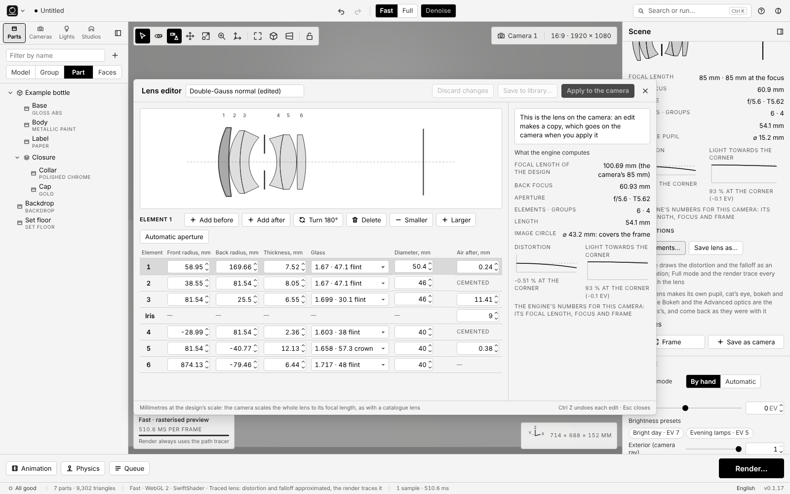

# Interface — specification for whoever builds it

This document describes the Repackshot interface in enough detail to
build it from this file alone, plus `ARCHITECTURE.md` and the catalogues in
`src/data/`. It is the deliverable of phase **U1** of the roadmap, assigned to
**Opus**. The design decisions are made; whatever remains open is
stated explicitly.

The captures in `docs/ui/`, grouped by version and by feature, are in
[`GALERIA.md`](GALERIA.md).

What it aims for: **the same power as a commercial product renderer,
with half the interface**. A single idea organises everything:

> **On the left, what is in the scene. In the centre, the image. On the
> right, what you are editing.** And at the bottom, the one button that really
> matters: *Render*.

---

## 1 · Aesthetics: black and white, sober, minimalist

**Absolute rule: the interface chrome is achromatic.** No element
of the interface carries colour: no blue accents, no green/red traffic
lights, no coloured icons. Only white, black and neutral greys (`hue = 0`,
`saturation = 0`). The only colour on screen is the **content**: the
viewport render and the thumbnails of materials and light setups. That
asymmetry is deliberate: with the chrome silent, the eye judges the colour of
the image without interference, which is what is done in a photography
studio.

Where others use colour, here **contrast, weight and space** are used:

| Need | Achromatic solution |
| --- | --- |
| Primary button (*Render*, *Create studio*) | Inverted fill: black on white in the light theme, white on black in the dark theme |
| Selection (part, thumbnail, tab) | 1.5 px border in the ink colour + soft inverted background |
| Doctor error / warning | Filled dot + text at weight 600; never red |
| "Active" state of a toggle | Inverted fill of the toggle itself |
| Link or secondary action | Thin 1 px underline, no colour |
| Hover | Background one step lighter (dark) or darker (light) |

**Two themes, both achromatic.** **Dark** by default: the viewport is the
protagonist and an image is judged better against a dark, neutral
surround. **Light** theme as an alternative, respecting `prefers-color-scheme` at
startup and with a manual switch in the header menu. Both are
defined as tokens in `:root` and `:root[data-theme]`; no colour is
written in a component.

```css
:root {                       /* light theme */
  --bg-0: #ffffff;  --bg-1: #f4f4f4;  --bg-2: #e9e9e9;  --bg-3: #d9d9d9;
  --ink-0: #000000; --ink-1: #333333; --ink-2: #5f5f5f; --ink-3: #9a9a9a;
  --line: #d0d0d0;  --line-strong: #000000;
  --viewport-bg: #8c8c8c;     /* neutral grey, 18 % perceptual reflectance */
}
:root[data-theme="dark"] {
  --bg-0: #0e0e0e;  --bg-1: #161616;  --bg-2: #1f1f1f;  --bg-3: #2a2a2a;
  --ink-0: #ffffff; --ink-1: #d6d6d6; --ink-2: #9a9a9a; --ink-3: #6b6b6b;
  --line: #2e2e2e;  --line-strong: #ffffff;
  --viewport-bg: #262626;
}
```

(The values are the starting point; they can be refined, but always with
`saturation = 0`. A test in the suite checks that no colour in the CSS
has saturation.)

**Typography.** A single family: `Inter, system-ui, -apple-system, "Segoe
UI", Roboto, sans-serif`, loading no network fonts (the application has to
work offline). Sizes: 13 px body, 12 px field
labels, 11 px auxiliary text in spaced capitals (`letter-spacing:
0.06em`), 15 px section titles. **Tabular numerals**
(`font-variant-numeric: tabular-nums`) in every numeric field, so the
digits do not dance when they change.

**Icons.** Inline SVG, monochrome, 1.5 px stroke, 16 px box (20 px
in the viewport bar). No icon fonts or emoji. Every icon carries
an `aria-label`. If a concept has no clear icon, text is used: a
button with the word *Render* is understood better than any glyph.

**Spacing.** 4 px grid. Panels with 12 px inner padding;
sections separated by a 1 px line (`--line`), not by boxes.
4 px corners on controls, 0 on panels. No drop shadows except
on floating menus and the command palette (a soft neutral shadow).

**Motion.** 120 ms transitions on hover and expansions, none on
value changes. `prefers-reduced-motion` turns them all off.

---

## 2 · Layout

Desktop, 1280 px wide at minimum. Five fixed regions:

```
┌──────────────────────────────────────────────────────────────────────┐
│ HEADER  44 px                                                        │
├──────────┬──────────────────────────────────────────┬────────────────┤
│ SCENE    │ VIEWPORT                                  │ INSPECTOR      │
│ 260 px   │ (takes everything that is left)           │ 340 px         │
│          │                                           │                │
├──────────┴──────────────────────────────────────────┴────────────────┤
│ RENDER BAR  56 px (expandable: Animation · Queue)                    │
├──────────────────────────────────────────────────────────────────────┤
│ STATUS  24 px                                                        │
└──────────────────────────────────────────────────────────────────────┘
```

- The side panels can be **collapsed** (a button in their header and the
  `Tab` key collapses both at once: *image mode*). Collapsed, they leave
  a 36 px rail with their icons to reopen them.
- The side widths can be dragged between 220 and 480 px; they are
  remembered in `localStorage` (wrapped in `try/catch`).
- Below 1100 px the side panels become drawers overlaid on the
  viewport; there is never horizontal page scrolling. Mobile is not a
  target, but nothing should break.

### 2.1 · Header

From left to right:

1. **Application menu** (three-line icon + "Repackshot"): New,
   Open project (`Ctrl/⌘ O`), Save project (`.repack`,
   `Ctrl/⌘ S`, to the same file if it was already saved; Open also reads the
   `.repack.json` files from before v0.1.6), Save project
   as… (`Ctrl/⌘ ⇧ S`), Import model, **Add ▸** (phase U9: under the
   heading *Primitive*, the twelve shapes of the catalogue —*Box*, *Plane*,
   *Disc*, *Cylinder*, *Pedestal*, *Sphere*, *Cone*, *Torus*, *Capsule*,
   *Tube*, *Steps*, *Infinity sweep*—, each with its icon and a
   tooltip that says where it is born),
   Export image, separator, Language (English / Spanish), Theme (Dark /
   Light / System), **Settings…** (`Ctrl/⌘ ,`), separator and **Help ▸**
   (phase U10): *Guided tour*, *Guide* (the six-step one in §4.6),
   *Keyboard shortcuts* and *About*.
2. **Project name**, editable on click (plain text, no box
   until it is edited). A dot in front when there are unsaved changes.
3. Centre: **Undo / Redo** with the name of the action in the
   tooltip ("Undo: Assign Gold to Body").
4. To the right of the centre: the **viewport mode**, a two-position
   segment **Fast · Full** (shortcut `Ctrl/⌘ ⇧ R`). *Fast* is the
   rasterised preview: it responds instantly and is for placing
   lights, painting materials and framing. *Full* is the real engine
   simulating everything in the viewport itself, also while the
   camera moves (it lowers the resolution during the gesture and converges again
   on release). The tooltip says it in one sentence. While the engine is not
   loaded (no `rt.wasm`), *Full* appears disabled with the reason
   in auxiliary text (*Full: the engine is not built*), and *Render* says
   so too and does not render: the preview never passes itself off as
   a render. **Render always uses the full engine**, whatever mode the
   viewport is in: the switch only decides what is seen while
   working.

   To its right, in the same area (the one the *Fast and Full* step of the
   guided tour rings), is the **Denoise** switch
   (phase U11, shortcut `D`): a one-position button, inverted when
   on, that denoises the *Full* viewport **live**, while the
   samples accumulate. It is the same state as the
   *Denoise* button of the meter and as the *Viewport* part of
   *Advanced ▸ Denoise* (*Both* ↔ *Render*, *Viewport* ↔
   *Off*): a single truth, the project's, undoable (*Undo:
   Stop denoising the viewport*) and saved with it, also
   when the render window is editing a job of the queue. The
   tooltip says it in one sentence. In *Fast* it appears disabled with
   the help *Applies to Full mode*, and `D` does nothing but say so.
   Turning it on denoises what has accumulated at that moment (even with
   the viewport already converged) and turning it off shows the noisy image on the
   next frame; neither restarts the
   image. While accumulating, the clean image refreshes as often
   as a denoise costs (§2.3, meter) and camera gestures
   continue at reduced resolution, without denoise.
5. Right: **Search or run…** (`Ctrl/⌘ K`), a 240 px field that opens
   the command palette; **Guide** icon; **Theme** icon.

Nothing else. No icon ribbon or workspace tabs.

### 2.2 · Scene (left)

Tabs in the panel header, with icon and short text: **Parts ·
Cameras · Lights · Studios**.

**Parts**: tree of the model. Each row: expand triangle, level icon
(model / group / part), name, and on the right, on hover, three actions as icons: eye (hide), target (frame), padlock
(lock). Click selects; `Ctrl` click adds; `Shift` click extends;
double click frames the part in the viewport. Each part shows under its
name, in auxiliary text, the material it carries. Dragging a material
(a thumbnail from the catalogue or from *Mine*, or the sphere of the
material card, §2.4) onto a row assigns it to that row and to everything
hanging from it (a part, a group, the model): the row is marked with a
dashed border and the viewport outlines what the drop would reach. It is a
single undo entry (*Undo: Assign Gold to Body*), `Alt` on
dropping gives the part its own copy of the material, `Esc` cancels and, if the target
carries different materials, an inline question comes first (§4.1). Context menu
(right button): Isolate, Hide, Show all, Rename, Rest on the floor,
Centre, Delete.

Above the tree, a **filter** field by name with a **`+`** button to
its right (phase U9: it opens the same *Add ▸ Primitive* as the header) and,
below, the **level selector** of the selection (see §4.1).

The full **context menu** of a row (phase U3, with the actions of
`SPEC.md` §3.1): Frame · Move (activates the gizmo) · **Scale…**
(phase U9: the inline panel of §2.3, next to the row) · Rest on the
floor · Centre · Centre and rest · **Drop** (phase S2) ·
**Drape over the part** (phase S9) · Reset transform ·
Set pivot ▸ (centre, base, origin, picked point) · Set as
camera target · **Keep in focus** (F1: the camera in view switches to
*Focus ▸ Object* on the row or the part, at the level of the selection) ·
separator · Hide · Isolate · Show all ·
Lock · separator · Duplicate · Duplicate linked · Pattern ▸ (linear,
circular) · Group · Ungroup · Move to group ▸ · separator ·
Material ▸ (Unlink, Link with…, Copy, Paste, Select by
material) · Geometry ▸ (Flip normals, Smoothing…, Separate by
CAD faces, Separate by material, **Convert to mesh**, phase U9: enabled
only if the selection has primitives) · separator · Rename · Delete.
In U1 the ones already in §2.2 exist and the rest are added in U3 without
changing the structure of the menu.

**Drop** (phase S2; the same menu in the viewport, the button of the
*Physics* section and of the *Part* section of the inspector, and the palette,
*Drop the selection*) simulates the selection at once: what is
selected becomes *Dynamic* and falls onto the floor and whatever is under it
(the rest of the scene, still), the **Physics** drawer opens (§2.5) and the
simulation stops by itself when everything is at rest. A group or a model falls
as one body unless it has *As parts*. It is disabled with the
selection locked. The whole fall is **one** undo entry
(*Undo: Drop 3 parts*). There is no *Part* menu in the header
in this version: its place is this context menu.

**Drape over the part** (phase S9; the same menu in the viewport, the buttons of the *Part*
section and of the cloth's *Physics* section, and the palette, *Drape cloth over the
selection*) lays a sheet of cloth over the selection —a plane named *Cloth*, of fine cotton
and the catalogue's *Cotton*, square, its side 1.2 times the longer side of the selection's
footprint plus 1.2 times its height, a little above its top— with the role *Cloth*, opens the **Physics** drawer and
runs it alone: it falls and drapes over the selection and whatever is under it, and stops
by itself when it settles. Adding it, its role and the run are **one** undo entry
(*Undo: Drape cloth over Box*). Disabled with nothing visible selected.

**Cameras**: list of saved cameras with the active one marked. Buttons:
*New from current view*, *Duplicate*, *Delete*. Click activates the
camera in the viewport.

**Lights**: the list of lights of the active setup (Key, Fill,
Rim, Top…) plus the **own lights** (marked *own*), with their
relative power on a thin bar and a switch each. Click
selects the light and the inspector edits it. A **+ Add light** button with a menu:
*Area · rectangle*, *Area · disc*, *Area · sphere*, *Point*, *Spot*,
*Sun* and *IES…* (phase L5: it opens a profile file, see below),
each with its icon and a tooltip of what it gives; the same menu is in *Add ▸* of the header
(under the primitives) and in the viewport's right click on empty space, and each type
in the palette (*Add light: spot*…). A new light appears
in front of and above the part, on and selected (phase L4). Actions
per row, on the row of the selected light (on hover they would move
under the click that selects the row): **duplicate**, **aim at…** (the centre
of the product, a point, a part) and **delete**. Since the selection is the
light, *aim at the selection* is on the other side: the context menu of a
part has **Aim a light here ▸** with the list of lights. Below,
**Save setup as…** (name; it goes to the *Mine* tab of the catalogue with a
rendered thumbnail) and **Reset to setup** when the rig is
modified (it removes the own lights).

**IES light** (phase L5). *IES…* opens the file dialog (`.ies`; in the
browser, the file picker; on the desktop, the system dialog)
and, with a profile the engine can read, creates a light of type *IES* (in front of and
above the part, on and selected, one undo entry:
*Add IES light <profile name>*); dropping an `.ies` on the window
does the same and the palette has it (*Add light: IES profile…*). With a
file that is no good (photometric type B or A, with `TILT=INCLUDE`, cut short,
with the counts wrong, with angles that do not increase, with negative candelas…) nothing
is added and a notice says why, with the numbers from the file and what to
do ("export it as type C", "with TILT=NONE"). In the inspector, under the
type (*Area · Point · Spot · Sun · IES*; *IES* is only offered by a light that
has a profile, and switching to *Point* or *Spot* and back keeps it):

- **Profile**: its name (the luminaire description from the file or, if it
  has none, the file name) and, in auxiliary text, the peak in cd, the beam angle
  (twice the angle at which it falls to half) and the symmetry of the file.
- **Polar plot**, drawn from the file the engine reads: the intensity
  over the peak against the angle from the axis (0° down, 180° up), in the
  planes C0–C180 (solid; C0 on the right) and C90–C270 (dashed), with
  rings at 25, 50, 75 and 100 %; a round profile has a single curve. In
  theme inks, no colour.
- **Change…**: another file for the same light, which keeps its place, its
  aim and its level (one undo entry: *Change the IES profile of
  <light>*).
- **Multiplier** (× 1.00 on entry), instead of the power in watts: ×2
  doubles the light. Below, the lumens (the flux of the peak point times the
  part of the sphere that the profile fills).
- A note: *Fast draws this profile as a spot light of N° with the same
  intensity on its axis: an approximation. Full and Render use the whole
  file.* (the meter of each light says what the engine does not do in Fast, rule
  10). If the text of the profile could not be read, another note says that the light is
  drawn as a point.
- Bulb radius, position, **roll** (the horizontal 0° angle of the profile:
  turning the light turns the pattern), colour, *visible in reflections*, *visible to
  camera*, *casts shadows* and on/off, like any light.

The light's row in the tab carries *IES* (its name) and, in the tooltip, the
profile and that *Fast* approximates it. The viewport glyphs draw its beam (the
cone of the beam angle), and *Look through* frames that cone, like a spot.
**No profile is shipped**: each person brings their own.

**Studios**: saved combinations of camera + light setup + environment
+ material set, as in KeyShot but without a separate screen: *Save
as studio* takes the current scene; clicking a studio restores it.

### 2.3 · Viewport (centre)

The viewport **is** the render: there is no "preview" mode distinct from the
"render" mode. What is seen is what will come out, at fewer samples.

Layers over the viewport, always with a semi-transparent theme background and without
covering the part:

- **Top left, view bar**: Select (`V`), Orbit
  (`O`), **Lights and cameras** (phase L4, to the left of *Pan*: so
  *Scale* stays to its right), Pan (`P`), **Scale (`S`)** (phase
  U9, next to *Pan*), Zoom (`Z`), Move (`M`), separator, Frame
  all (`F`), Views (menu: three-quarter, front, side, top,
  back), Perspective / Orthographic, separator, Lock camera. With
  *Move* or *Scale* the axes switch *Global · Local* appears
  (`G`/`L`). With *Select*, *Move* or *Scale* and the *Faces* level,
  next to the tools appears the text button **X-ray** (the selection box
  also takes hidden faces). With a light or a saved camera selected,
  the text button **Look through** appears
  (`Ctrl/⌘ ⇧ L`), which while looking says *Back to the active camera*.
- **Top right**: name of the active camera (click: the list of
  cameras, with the active one marked, the optics of each in small type, *85 mm
  · f/5.6*, and a **pencil** at the end of each row that opens that camera's
  card in the inspector: name, *Activate*, *Look through*, optics and
  position; the *Cameras* tab opens with it marked; `→` from the
  row goes to the pencil and `←` goes back) and the aspect ratio of the active camera with
  the current output resolution (*16:9 · 1920 × 1080*; click: opens the
  render bar). In the list, each camera's aspect ratio follows its
  optics (*85 mm · f/5.6 · 4:3*).
- **The viewport frame** (the image that is rendered, with the outside
  dimmed) is **the frame of the camera being viewed**: the active one, or the one
  being looked through (*Look through*), with **its** aspect ratio (U13). Changing the
  aspect ratio of the active camera changes the frame instantly; each saved
  camera is drawn in the viewport with the pyramid of its own aspect ratio.
  With an animation running the frame is still that of the active
  camera: the output has a single size and the Doctor warns if a shot
  uses a camera with another aspect ratio.
- **Bottom left, quality meter**: active mode and engine,
  accumulated samples, time, and a small progress indicator. In
  *Fast* it literally says *Fast · rasterised preview*; in
  *Full* it says *Full · 128 samples · 00:12* and, during a camera
  gesture, *Full · ¼ resolution*. A second line says *3
  workers · SIMD* in *Full* (*Native · 16 threads · AVX2* on the
  desktop) and *x ms per frame* in *Fast*. While a
  *Render* runs, the viewport stays live and says so with what it uses: *Full ·
  sharing with Render · 4 of 16 threads* (or *1 of 3 workers*); if in
  *Settings* pausing it was chosen, *Full · paused while Render
  runs*. If the engine does not answer, refuses the view or the watchdog
  had to restart it, a note under the bar says so (*Waiting
  for the engine · 5 s*; *The engine refused the view: <its reason> · trying
  again in 2 s*; *The view had stopped and was started again*),
  with the engine's words in the tooltip: never a silent "0 samples".
  **A number is never invented.** In *Full* (E5b-1), one more
  line says what the engine says about the image: *Denoised*
  when what is seen is the image filtered by the denoise (and then
  the samples are those of that image) and *Caustics · 16 384 photons per
  sample* when the engine renders them, and **Adaptive · 16–512 samples**
  (E10) when the viewport samples adaptively (*Finish by Noise*):
  the samples of the pixel with the fewest and of the one with the most in what is accumulated, those
  of the engine (the first line still says those of the image that is seen: with
  *Denoised*, those of the filtered image, which runs one pass or more
  behind); and the **Denoise** button
  (pressed or not) turns the viewport's denoise on or off: the same
  switch as *Denoise* in the top bar (§2.1, shortcut `D`),
  the viewport part of *Advanced ▸ Denoise* (*Both* ↔
  *Render*, *Viewport* ↔ *Off*), undoable. Since U11 the denoise is
  **live**: a separate lane (a thread of the launcher, which takes one of
  the viewport's threads while it works; on the web, the viewport's
  workers by bands between their tiles) denoises the latest
  pass with the viewport's light setting, the clean image comes out as soon as it
  is ready and the next one then starts on the newest pass: the
  viewport refreshes it at least every `max(2 × what a denoise costs,
  0.5 s)` and never shows a clean one older than one denoise. The
  samples in the meter are those of the clean image that is seen. For
  browser checks the meter also carries, in `data-*` attributes, how many clean images it has shown, when the last one was, what
  the last denoise cost (on the web) and the samples of the newest
  pass.
- **Bottom right**: orientation axes (three thin strokes X Y Z,
  monochrome) and the size of the part in mm.
- **On hover over a part**: its outline lights up (1 px silhouette in
  ink) and a small label with its name follows the cursor. Click
  selects; `Esc` deselects.

**Empty state** (no model): drop zone with a dashed border and
two buttons: *Import model* (glTF, OBJ, STL, FBX, 3DM, STEP, IGES, 3MF,
PLY, DAE, USD; in U1 only glTF works and the rest say *coming soon*) and
*Load example part*. Dragging a file onto any point of the
viewport also imports. The *Standard* studio is already built behind:
the part appears lit, resting and framed without touching anything.

**Import sheet** (phase I3): when a file is dropped or chosen, the
inspector shows an inline sheet with the options of `SPEC.md` §5
(units, up axis, centre, rest, frame, add or replace,
group by, keep materials, split parts, tessellation quality) with
the detected values already set and a primary button *Import*. `Enter`
imports with the default values. Since M2a the sheet has a
**Textures** section: *N images kept · X MB*, one line for each image that
is not kept with the reason (*it is larger than 16 MB*, *it is not a PNG or JPEG*, *it
was not among the files chosen with the model*, *the project already holds 64
MB of textures*) and for each map without a slot (*ambient occlusion map,
no slot*), *The file brings no texture images* when there are none, or
*With the Default material, no texture is imported*, and a note
with the limits. A model is chosen or dropped **with its files**
(images, `.mtl`, `.bin`): they are not imported on their own, the model's reader
finds in them what it names (*Import model…* allows choosing several).

**Label tool** (phase M2a): after *Add label…* the viewport
says *Press on a part with Paint where the label goes and drag out its
width · Esc cancels*: pressing on a part that carries the material
sets the centre of the label (flat from the surface normal,
upright, with the model's up where the surface allows it), dragging
sets its width (from the centre, in its plane) and releasing finishes; a
click without dragging gives it a quarter of the part's longer side. The whole
placement is one undo entry (*Undo: Add label
logo.png to Paint*). On a part that does not carry the material, a notice
(*That part does not carry Paint*). **Move label**: dragging over the
part slides the label across the surface under the cursor, keeping
size and roll (one entry per drag), until `Esc` or the button. While
the tool is active, the press is its own: it neither orbits, nor
the gizmo, nor selects.

**Move tool** (phase U3): with a selection and the
*Move* tool (`M`) active, a gizmo on the pivot with handles for translation
(arrows per axis and planes), rotation (rings) and scale (cubes), in
local or global axes (`L`/`G` or the switch in the view bar),
increments with `Shift`, and the inspector fields updating
live. Dragging is a single undo entry. Lights and saved
cameras move and turn with the same gizmo, without scale cubes (phase
L4): on their position, in global axes or their own (right, up,
back), with the **aim handle** (a line to its target with a dot at the
end): moving a light does not change where it aims, turning it turns where it aims
(and a panel around its axis), the handle moves its target; the same for a
camera with its own (*Undo: Move light Spot*, *Undo: Move camera Camera 2*).
A locked camera has no gizmo.

**Lights and cameras in the viewport** (phase L4): achromatic glyphs in the ink
of the theme, mostly dashed (the selected one, solid): the outline
of the panel with a mark toward where it lights, the sphere, the point with a
star, the cone of the spot (and its inner cone), the arrow of the sun and the
pyramid of each saved camera (not the active one). The *Lights and cameras* button
shows them all while working with them (the *Lights* or
*Cameras* tab open, a light or a camera selected, or looking through
one); with *Parts* and a part, none, so that a panel of the setup that
crosses the product does not look like part of it. Off (remembered), only the
selected one. On hovering over a glyph, a label with its name and the
hand cursor; a click selects it in front of the part behind it
(`Ctrl/⌘` or `Alt` on the selected one removes it), double click looks
through, right click: *Look through*, *Duplicate*, *Aim at… ▸* and
*Delete* (on a camera, *Activate* and *Delete*). The selection box does not
take them and *Scale* does not give them a gizmo.

**Look through** (phase L4): the viewport looks from the selected
light or camera (from a light, toward its target, with the optics of the active
camera; a spot sets the focal length to its cone), in *Fast* and in
*Full*, with a notice under the bar: *Looking through Spot ·
orbit, pan and zoom move it · Esc returns* and the link *Back to the
active camera*. Orbit, Pan and Zoom (the tools, the mouse and the
wheel) move that object (the light aims where the viewport looks), live and
in one undo entry per gesture (*Undo: Move Spot from its
view*); the active camera does not move. A locked camera does not move
(*… locked: unlock it to move it*). `Esc`, the button or the link
return to the active camera; deleting what is being looked through does too.

**Scale tool** (phase U9, `S`): the same gizmo on the
pivot, but **with only the scale handles**: a thin axis per direction with
a larger cube at its end (scale on that axis; the whole axis can
be grabbed, and carrying the pointer one cube length beyond doubles the
scale) and a dot in the centre (uniform scale, to the right or up it
grows). No arrows, rings or planes. Local or global axes as with
*Move*, 10 % increments with `Shift`, the inspector's scale fields
live, one drag is one undo entry (*Undo:
Scale Box*), a click where there is no handle selects and `Ctrl/⌘` + drag
draws the selection box as with *Move*; `Esc` returns to *Select*.
The button's tooltip explains it.

**Right click ▸ Scale…** (phase U9, on a part in the viewport or on a row
of the tree): its own **inline panel** next to the point or the row (never
a browser dialog; `Esc` or a click outside closes it) with a
segment *Uniform · Per axis · Custom*: *Uniform* one field in %, *Per
axis* X, Y and Z in %, *Custom* the width, depth and height in mm (the
interface units) with a **proportion** padlock, closed by
default (changing one drags the other two; an axis with no thickness, such as the
height of a plane, is not touched). Below, in auxiliary text, the pivot and the axes
it acts with (*About the pivot (Centre) · Global axes*), and the
buttons **Apply** (one undo entry), **Reset scale** (each
node returns to the scale it entered the scene with, about its own
pivot) and *Cancel*. It acts on the selection at the current level (the part,
the group or the model on which the menu was opened), about its
pivot, in the axes of *Move* and *Scale*.

**Context menu on empty space** (phase U9): a right click on the viewport
where there is no part opens *Add ▸ (Primitive)*, *Frame selection or
all* and *Show all*.

**Where a primitive is born** (phase U9, `SPEC.md` §3.1): with a product in
the scene, the *Box* and the *Pedestal* are born **as a base**: under the
product, resting on the floor, at 1.4 times its footprint (the sides of the
box; the radius of the pedestal over the point of the product farthest from its
axis), and the product rises to rest on top, all in a single undo
entry (*Undo: Add Box under Example bottle*). The *Plane* and the
*Disc* lie on the floor under the product; the *Infinity sweep*
**fits to the active camera**: turned in Z toward it, with the wall behind
the product at 1.75 times its depth (or further back, so that the backlight and
the rear lights of the setup stay between the product and the paper), as wide as 1.3 times what the
framing covers where it touches it, taller than the highest the framing
reaches on the wall, with the floor out to in front of what the framing sees
of it and a curve of 0.3 times its height (the whole output framing, with
the optics and the format of the camera, falls on the sweep); and the rest
of the shapes rest on the floor **beside** what is there (at +X), at the
catalogue proportions relative to the product. With no product, the first one
is born at the origin at the declared part size (200 mm in a new
project) and framed; the following ones, beside it. They carry the neutral
*Studio white* material from the catalogue, shared. Planes and the infinity sweep
stay one thousandth of the size above the studio floor so as not to
flicker against it.

**Dragging a material** (the same source as in §2.2) onto a part
in the viewport assigns it **at the current selection level**, just as a click
at that point would select it: with *Part*, the part; with *Group*,
its assembly (the part if it has none); with *Model*, the whole model; with
*Faces*, the whole face under the cursor (the CAD face, or the surface that
continues, §4.1). While dragging, a ghost thumbnail, above and to
the right of the pointer, carries the name of the material and says *Copy* if
`Alt` is pressed; what the drop would reach is highlighted (outline on
parts, tint on faces; visible even if *Outline on hover* is
off) and the cursor says whether it can be dropped. Dropping assigns with **a single
action** and one undo entry; `Esc`, dropping outside or leaving the
window cancel, and a click without moving on the thumbnail still assigns to the
selection. A catalogue preset or an item of *Mine* enters with the
instance the scene already has (the same as a click); the selection's
sphere **links** the target with its instance (the parts that carry it
share the changes); with `Alt`, any of the three gives an **own
copy**. If the target carries different materials, an inline question is asked
before overwriting (§4.1). A finger does not drag; the pen does what the
mouse does.

**Box selection** (tools *Select* and *Move*, the latter
where there is no gizmo handle under the pointer): **`Ctrl/⌘` +
drag** with the left button draws a rectangle that **replaces**
the selection; with `Shift` as well (`Ctrl/⌘ ⇧` + drag) it **adds**, and with
`Alt` (`Ctrl/⌘ Alt` + drag) it **removes**. Left to right is a
**window** (takes what lies entirely inside; solid outline), right to
left is a **crossing** (takes what it touches; dashed
outline); both in ink, no colour. It acts at the current level (§4.1):
*Model*, *Group* and *Part* test the projected geometry of each
node (hidden parts do not count, and what covers what is not looked at: a
part behind another is taken too); *Faces* takes the whole faces of **one part** (the selected one or,
if there is none, the one at the centre of the box) that **can be seen** inside the
rectangle, and the **X-ray** button in the view bar (only at that level)
takes them even when others cover them. A drag of a few pixels is
a click (with its keys), `Esc` cancels, the box only draws the
rectangle (the selection changes on release) and, like any selection, leaves no
undo entry. The camera loses nothing: with no key, the left
button still orbits, and `Shift` or `Alt` + drag without `Ctrl/⌘`
belong to the camera as always; with *Select* and *Move*, `Ctrl/⌘` +
drag no longer pans (the right button, the wheel and the
*Pan* tool remain). With the scheme *Alt + left button orbits*
or *Middle button orbits* (§2.9) the left button is free and **a plain
drag** draws the box: `Shift` adds, with the middle one `Alt`
removes and with *Alt + left* removing is `Ctrl/⌘ Alt`. The pen is a
mouse; a finger still orbits. The tooltip of *Select* explains it, and
it works the same in *Fast* and in *Full*. **Clicks** do not change: with no
key it replaces, `Shift` adds, `Ctrl/⌘` toggles, `Alt` removes (except
with *Alt + left button orbits*, where `Alt` belongs to the camera), and a
click on empty space clears.

### 2.4 · Inspector (right)

It is **contextual**: it edits what is selected, and when nothing is
selected it edits the scene. A header with a **breadcrumb** that says
what is being edited (*Scene* · *Body* · *3 parts* · *Key*) and,
with a part selected, the **level selector** (§4.1).

The content is organised in **collapsible sections** with a title in
spaced capitals, a separator line and the expansion state
remembered. Every control applies **instantly**; there are no *Apply* buttons
except the two that build things: *Create studio* and *Render*.

**With the scene selected (nothing selected):**

1. **Product** — **Scene type** (K1; above the product type): a
   segmented control *Product · Interior · Catalogue* (`SCENE_TYPES`, the
   intent of each in its help) with a note below: "Sets the starting values
   (environment, bounces, view transform, samples, optics). All the
   controls are still there; on switching back, what you changed stays". Changing it is
   one undo entry and **removes or moves no control** (the capture
   `docs/ui/scene-type-interior.png` shows it with *Interior*): it rewrites
   the starting values of `INTERIORS.md` §3.1 that exist today (the
   environment, the bounces, the caustics, the contact shadow, the
   view transform, the samples, finish by noise and the denoise, the focal length),
   *Interior* also puts the *Midday window* recipe on the lights of the
   untouched product type (C1; lights that were chosen or edited stay), and
   on returning to *Product* it leaves what was not touched as it was. With
   *Interior* the *Light* section opens in the *Lights* group with its style;
   on leaving it the style goes back to *All*. Product type (a dropdown with the 16
   `STUDIO_PRESETS`, *Standard* the first and active by default, with its
   label and, below in auxiliary text, the focal length and aperture it brings; plus the
   own types from the *Mine* tab and *Save as product type…*). Part size in mm (detected on import,
   editable). *Floor* and *Contact shadow* switches. The
   primary button **Create studio**: builds the lights, floor, camera and engine settings
   of the preset and, if the type is a set (L6: 15 of the 16), its
   decoration and its look (backdrop, cards, floor, pool of light); the
   example and an imported model arrive already dressed with the set in force. If a studio already exists, it asks for inline confirmation (not
   modal): "Replace the current studio · Yes / No".
2. **Light** — The **catalogue of setups**, in **two groups** (L7), *Sets ·
   Lights*, a full-width segmented control at the top of the section:
   - **Sets**: what builds something besides the lights (backdrop, floor,
     cards, pool of light: the decoration of L6). They are the 16 sets and
     *The product type's own* (`PRESET`) when the type in force is a set
     (15 of the 16; with *Outdoor furniture*, which keeps its sun, it is in
     *Lights*): 17 entries.
   - **Lights**: what only places lights (some also choose a sky,
     an exposure and the environment intensity, like the seven recipes of
     *Interior* and the sun of *Cinematic*, but they put nothing in the
     scene): the 71 setups from before and the 7 recipes, 78 entries.

   The group is decided by what the entry does when applied
   (`core/setup-groups.ts`, with `hasDecoration` of `core/sets.ts`), not by
   its style; no key and no order changes. Each group has its
   **filters**, rows of *chips* like those of a plugin's recipes
   (P6b, the same component, `ui/components/filter-chips.ts`): the name
   of the filter, *All* and its values, combined (AND). **Sets**: *Product
   type* (the 16; a type leaves the set that is its own rig, and the own
   rig of the type in force; *Outdoor furniture* leaves none) and
   *Subject* (*Bottle, Box, Ring, Chrome, Shoe, Spheres*, the hero of
   each set). **Lights**: *Style* (the nine styles from before except *Sets*,
   *Interior* last, and *Mine*, the own setups of the library,
   with their usual cards). Below, the count (*7 of 17 sets*,
   *78 setups*) or, if the filters leave nothing, *No set matches these
   filters.* / *No setup matches these filters.* The entry in force
   that the filters leave out stays in the grid, first, dimmed and
   with *Outside the filters* in its help. Group, filters and style are
   remembered per person (the settings `layout`, like the style from
   before); a document from before L7 opens *Sets* if its style was *Sets*
   or *All*, and *Lights* with its style if not.

   The **thumbnail grid** (`public/thumbs/setups/thumb_<key>.png`,
   256 × 256, rendered by the engine: §6) carries the label below and marks the
   active one with a selection border; **all the same size**, 4:3, in both
   groups (L7: sets no longer go in two square columns). To the
   **right of the header** of the section, an icon button changes the
   size, cycling: *small* (four columns, only the image; the
   name goes in the help and in the accessible label), *medium* (three, the
   size all the setups had, *Dark field* included; the
   default) and *large* (two). The label breaks into as many lines as
   needed: nothing is cut. The size is remembered per person. The **help**
   of a set's thumbnail says its intent and its **photographic reason**
   (`why`, two sentences); that of a setup, its intent. Below, the
   **intent** of the active setup in one sentence. *Previous /
   next* arrows within what the group and filters leave.

   **With lights in the scene**, choosing a set or a setup (also an
   own one, and from the palette) **asks what happens to them** —except if they are
   the lights of the untouched product type (those it puts, with no light added
   or edited since): those are replaced without asking (C1)—, inline
   above the grid: "There are lights in the scene. What happens to them when
   *Rembrandt* comes in?" (or "The lights were edited…" if they were modified),
   with **Replace** (deletes them: the usual behaviour), **Hide** (keeps them
   switched off; the *Lights* list turns them on one by one), **Add** (keeps them
   on and adds the new ones), *Cancel* and the checkbox
   **Remember my choice**, which saves it in *Settings ▸ Preferences ▸
   Lights*. It is one undo entry with the answer in its name
   (*Light setup: Rembrandt (hide the lights there were)*). The kept
   lights become own lights, named after where they came from
   ("Key · Rembrandt"), and *Reset setup* removes them. A set that
   comes in replaces the decoration of the previous set whatever the
   answer; a *Lights* setup with *Hide* or *Add* leaves the
   decoration, the pool and the look of the set as they were (and *In the set*
   keeps its rows, without *Use the set’s camera*). With no lights in the
   scene, or choosing the setup in force again, it does not ask.
   The seven
   **Interior** recipes (*Morning window*, *Midday window*, *Afternoon window*,
   *Overcast*, *Night lamps*, *Blue hour*, *White studio room*)
   each bring their world, their
   exposure and the environment intensity (unlike the setups of
   the other styles, choosing one does change the brightness), and none brings
   decoration: *In the set* does not appear.
   With a **set** in force, below: **Use the set’s camera** (only if it
   suggests one; the help says which, "8° high, 85 mm"; disabled with
   the camera locked; one undo entry) and **In the set**: one row
   per piece of its decoration (each card, the set's backdrop, the set's
   floor) with its name and a switch that hides or shows it
   (`scene/setVisible`, undoable); a colour or gradient background with no
   sweep is a row that sets the set's background or returns that of the product
   type (`env/set`). A background that the set makes a sweep (`SWEEP`, or
   any background with a pool of light) is a piece, never that row: after
   *Reset setup* there is nothing left to switch on (`setBackground`). The
   pool of light is a light: it appears in *Tune lights* with its name.
   Secondary dropdown **Tune lights**: list of lights with power
   (in % of the total), size, temperature in K and angle; changing something
   here does not change setup, it marks it as *modified*. Button
   **Place by reflection**: the cursor changes and the next click on
   the part places the selected light so that its reflection falls there
   (in U1 the mode and the mechanics are enough; the exact calculation belongs to the
   engine phase).
3. **Environment** — Type: *Studio dome* (procedural, default),
   *Sky* (procedural sun and sky), *Flat* (plain colour), *HDRI
   file*. With *HDRI file*, a *Load HDRI…* button (`.hdr`, `.exr`) and
   below it the name and size of the file, or *No HDRI loaded: the studio dome
   lights*; dropping a `.hdr` or `.exr` on the window does the
   same. With *Sky*, *Model* (*Physical · Classic*, segmented, with a
   help on each option: *Physical* is the E5c sky of our own, fitted to
   our simulation of the atmosphere, and the default; *Classic*, the
   Preetham one of E5), *Haze* (turbidity, from 1 to 10; the classic one clamps it to 1.7
   at least) and, if the setup has no sun light, *Sun azimuth* and
   *Sun elevation*; if it has one, a note says that the setup's sun
   places that of the sky. Intensity, rotation (hidden
   with *Sky*: its sun places it). Background: *Same as environment*,
   *Colour* (swatch), *Gradient* (L6: *Top* and *Bottom*, two swatches;
   set by the gradient-background sets), *Transparent*, *Background
   image*; with the latter,
   *Load image…* (PNG, JPEG, WebP), its name and size, *Fit*
   (*Fill · Fit · Stretch*, inside the output frame) and the colour,
   which shows around the fitted image or in its place while there is
   none. A file that cannot be read is reported in a toast that
   says what is wrong with it. Floor shadow and floor reflection
   (intensity).
4. **Ambient** (phase S4a) — The particle effects of the air. In the
   header, **Add**, which opens a **gallery of cards** in the section itself
   (name and intent of each preset: *Dust motes*, *Pollen*,
   *Rain*, *Snow*, *Dust cloud*, *Ash*, *Rising bubbles*,
   *Falling confetti* and, since S3, *Water drops*; *Haze*, *Light shafts* and *Ground fog* dimmed and
   disabled, *coming soon*, and *Cancel*). Below, the **list** of
   effects (empty: a sentence that invites adding one): name, particles
   it asks for (or *Asks for N particles; the engine evaluates M* if it exceeds the cap),
   an eye to switch on/off and a bin; a click edits that effect, and the
   viewport draws the box of its region. The edited effect: **Effect**
   (preset dropdown; changing it is one undo entry) and
   **Name**, a line with its particles, and the **eight photographer
   controls**, always visible: *Amount* (particles/m³ or a count),
   *Size* (mm), **Shape** (S3b, decision S3 ◆5: outside *Advanced*, right
   after the size; a list, S3: *Point · Flake · Streak · Drop ·
   Mix*, five do not fit as buttons in the width of the inspector) and, with
   *Mix*, below it a weight per shape (*Points*, *Flakes*, *Streaks*,
   *Drops*, 0..4, slider and value) and a line with the share each one gets
   (*Point 20 % · Flake 20 % · Streak 20 % · Drop 40 %* on choosing
   *Mix* for the first time; with no weight at all, *Give some shape a weight*);
   *Energy* (m/s), *Chaos* (%), *Wind* (m/s) and
   *Wind direction* (°), *Gravity* (× g), *Variation* (%) and
   *Seed* with *Shuffle*. With an effect that leaves something on the parts (S3c:
   *Rain* and *Water drops*, drops; *Dust motes*, *Pollen*, *Dust cloud* and
   *Ash*, dust; *Snow*, snow; the bubbles and the confetti, nothing), after
   the seed the switch **On the parts**, one undo entry
   (*Undo: Rain: On the parts*, with the name of the effect), off by default and saved with the
   project; its help says what *Start* in the physics bar does with that
   effect (rain: the drops settle and splash, grow and merge, let go past
   their size, gather the drops on their way and leave a rivulet, hang at the
   edges and drip, and leave the surfaces wet; dust settles
   where the part is flat enough and the rain that runs down carries it away;
   snow piles up where it is held) and that the recording is a clip of the scene's
   *Physics*. When on, if the render engine does not draw the
   wetness of the parts (it lacks bit 8: an older engine), a note below
   says so: *the render will show them dry and clean*; S3d: if it draws it but not
   the drops in the air (it has bit 8 and not bit 9: an S3c engine), with a
   drops effect, another one: *drips and splashes will show only once they
   land*; S3f: if it draws them but not their shapes (bit 8 and not bit 10: an
   S3c or S3d engine), with a drops effect, another one: *the render engine in
   use draws the drops on the parts round* (`ambient.wetShapesOldEngine`); S3e:
   if it draws them but not the studio floor's (bit 8 and not bit 11), with
   *Studio ▸ Floor* on, another one: *the floor will show dry and clean*
   (`ambient.wetFloorOldEngine`); and if it does not draw the dust's grains (bit
   8 and not bit 13), with a dust effect: *the render engine in use draws the dust
   on the parts as a layer, without its grains* (`ambient.wetMotesOldEngine`).
   **Advanced**, collapsed: region (*Around
   the scene* with a margin in mm, or *Own box* with centre and size),
   height band, *Amount by* (*Density · Count*) and, depending on the
   shape: with drops, *Drop length* (×, from the centre
   of the body to the tip, in body radii) and *Tip* (% of the body); with
   drops or streaks, *Shape variation* (%); each is one undo
   entry. Size variation, fall speed ± variation, spin
   (flake, or a mix with flakes), streak length (streak, or a mix with
   streaks), wind as a vector, turbulence
   (scale and speed), cloud (centre, radius, softness), material (*The
   effect’s own* or one from the catalogue), tint variation and tints (up to
   4), *Freeze at* (s), *Visible to camera*, *Visible in reflections* and *Casts
   shadows*, and the own cap (*The engine’s (N)* by default). A note
   reminds that *Fast* draws up to 50 000 particles per effect and
   *Full* and *Render* all of them, lit like the product. Since S4b, in
   *Full* and *Render* dust, pollen and dust cloud light up
   when backlit (their forward lobe, with no control of its own: it comes with the
   preset's material) and rain and bubbles leave no caustics; the
   *Fast* points do not change. Since S3, *Fast* draws the drops as
   drops (the engine's outline, turned about its axis and stretched to its
   length) and a mix with each shape its own (the shape of each particle is
   given by the engine, `rt_particles_shapes`).
   
   
   
5. **Section** (phase Q1) — The section view (`SPEC.md` §3.1): a plane
   that removes one side of the part and caps the cut. It is **collapsed** by default,
   with the **switch in the header** (the first time it is switched on it makes a plane
   through the centre of the product, facing the camera; *Section on*
   is one undo entry). Inside: **Cut across**, segmented *X · Y ·
   Z · Surface*; two buttons that arm the next click in the viewport,
   **Click on the model** (the plane passes through the point and is perpendicular to the
   chosen axis, or to the surface normal; the side facing
   the viewer is removed) and **Two points** (two clicks: the plane contains the line
   and the direction of the view, and what lies to the left of the
   line from the first to the second is removed); while one is armed the viewport says so
   in the strip at the top (*Section: click on the model to cut across
   Z · Esc cancels*), pressing the button again or `Esc` disarms it, a click that
   makes no plane is reported and another is awaited, and the click that makes the plane leaves
   **one** entry (*Set the section plane*; the first of the two
   points is only remembered and leaves none). With a plane there are **Point**
   and **Normal** as numbers (the normal is normalised and one that is nothing
   is not accepted), **Cap the cut**, **Flip side** and **Remove the plane**;
   with no plane, a sentence says how to make one. A note lists the cut
   parts that are open meshes (the cut shows their inside, without a
   cap), another says how to animate it (a *Section* movement on the
   Environment in the timeline, §2.5) and another that *Fast* draws the cap
   of a glass as transparent glass and *Full* and *Render*
   refract through it. The backdrop, the floor and the cards of a set are not
   cut. **Why here and not in the viewport bar**: it is an object of the
   scene, saved with the project, animated and seen in Full and in
   Render, like the environment and the ambient; the bar's tools are
   for navigation and transformation and leave nothing in the project. The
   guided tour (§4.7) lists neither *Ambient* nor *Section*, and gains no step.
   The palette (§3) has *Section view on or off* and *Section
   view: flip side*. Captures: `docs/ui/section-fast.png` and
   `docs/ui/section-full.png`; the browser check is
   `tools/section-check.mjs` (order of the sections, each way of
   placing it, `Esc`, undo and redo, save and open, *Full*, and the
   achromatic chrome in both themes).
6. **Camera** — It edits the **active camera**, and says so: the header carries
   its name (*Camera 1*) and a pencil that opens that camera's card
   (name, *Activate*, *Look through*); a note reminds that each
   camera has its own optics and position. Lens preset (8
   `LENS_PRESETS`), focal length in mm (draggable field), below it the switch
   **Keep the size of what is in focus** (C2, see below), aperture (f/),
   **Focus** (F1, `src/ui/panels/insp-focus.ts`), a
   Perspective / Orthographic switch, **Aspect ratio** (U13), *Frame*, and
   *Save as camera*. **Focus** is a segmented control *Distance ·
   Point · Object* (each segment with its help) and, below, the **focus
   distance** as a slider with its field beside it (the usual `slider`,
   in the interface units; the field will have the up and down arrows
   of U15). The slider is **logarithmic** and spans the
   depth of the scene from the camera: from half of the nearest corner of the
   product's box along the view axis to twice the farthest one,
   at least a decade, and always with the distance inside
   (decided). With *Distance* it is edited (one undo entry
   per gesture, *Camera: Focus distance*). With *Point* and
   *Object* it shows the distance the camera works out for the point or the
   object where they are now (the playhead included), and **moving it switches the camera to
   *Distance*** from there, in the same undo entry (decided); below, in *Point*, the button ***Focus
   with a click*** (focus icon, pressed while picking; undo
   *Focus with a click*) and *On “part”* (or *Nothing picked yet*); in
   *Object*, ***Pick what to focus on*** (target icon) and *On “name”*; and
   a note: the distance follows the point (or the object) wherever the
   camera goes. Pressing *Point* or *Object* returns to the point or object the
   camera was keeping; if there is none, it starts picking it (the segment
   appears pressed meanwhile, with the viewport notice *Click on the part
   to focus there* or *Click on what stays in focus…*; `Esc`
   cancels). Pressing *Distance* leaves the distance it was focused at
   (undo *Focus: Distance*) and keeps the point or object to
   return to. The click of *Focus with a click* comes from the exact pixel: the engine's
   primary ray for that pixel in the view as it is (`rt_scene_pick`:
   the camera looked through, the frame, the playhead pose, the traced
   lens with its distortion), cast against the viewport geometry on
   both faces; without `rt.wasm`, the preview's pick. If the part of the point
   or the object is deleted, the camera returns to *Distance* with the last
   distance and a notice says so (*The focus of Camera 1 was on Cap,
   which is gone: it stays at 612 mm*). With the camera **selected** (its
   pyramid, or the pencil of this header), the viewport marks its
   focus point with a small glyph in the same style as those of lights and cameras:
   a ring with four marks in *Point* and four corners in *Object*,
   with a dot in the centre, where the point is at the playhead.
   **Keep the size of what is in focus** (C2, `core/focal.ts`; capture
   `docs/ui/c2-focal-switch.png`) is a switch just below the
   focal length, off on a new camera. Off (as on a camera), changing
   the focal length leaves the camera where it is and changes the framing; on, the
   camera moves closer or further along its axis so that the focused plane
   (the distance of *Distance*, the point of *Point*, the object of *Object*)
   keeps its size in the image: the perspective changes, not the size. The
   auxiliary line below says which one is active and what the other is like
   (*Off: changing the focal length leaves the camera where it is and the
   framing changes, as on a camera. On, …*), and in three cases it changes:
   with the camera **locked** (*it stays where it is and the framing changes;
   unlock it…*), with the **orthographic** and with the **panoramas** (*the
   focal length does not change the framing, so there is nothing to keep*). Each step of
   the focal length arrows (pressing and holding is a single step), each
   drag of the field and each typed value is **one undo entry**
   (*Camera: Focal length*), with the camera movement inside; the switch,
   another (*Camera: Keep the size of what is in focus*). The interior
   lenses (K3) follow it; choosing a *Lens preset* frames the part,
   as before. **Aspect ratio** is a list (*3:2 · 35 mm photo*,
   *4:3*, *16:9 · Video*, *1:1 · Square*, *5:4*, *4:5 · Portrait*,
   *9:16 · Tall*, *21:9 · Ultrawide*, *2:1*, *65:24 · Panoramic* and
   *Custom*) and, below, the `w : h` fields, which can be edited with
   *Custom* (with a preset they show its terms, disabled; choosing *Custom*
   starts from the ratio there was). Each change is one undo
   entry (*Camera: Aspect ratio*; dragging a term is a single
   gesture). Changing it does not reposition the camera: *Frame* fits it to the
   new image.
   **Interior camera** (K3, `interiorCameraFields` in
   `src/ui/panels/insp-scene.ts`): the Perspective / Orthographic switch
   becomes the **Projection** list (*Perspective · Orthographic ·
   Panorama 360° (2:1) · Fisheye*); with a panorama, a note says
   that Fast mode draws it with six cube faces and that nothing is drawn
   over it, and the *fisheye* adds **Field of view** (60°–360° across the
   diagonal of the frame). **Straight verticals** (switch; off except
   in *Interior*) with its note below: *Shift −4.2 mm for 10° of
   tilt*, *The camera is level: nothing to correct* or, on a
   panorama, *The panorama renders level*. **Eye height**
   (field in mm) with the chips *Standing · 1.5 m* and *Seated · 1.1 m*
   (*Camera: eye height Standing*), and **Interior lenses**: chips *24 mm
   · 28 mm · 35 mm*, the active one marked. Everything is one undo entry; with
   the camera locked, disabled. The viewport's views gain *Elevation* and
   *Plan* (orthographic).
   
   Below (O1, `src/ui/panels/insp-lens.ts`), the dropdowns of the optics:
   - **Lens** (open; O2, `src/ui/panels/insp-traced.ts`): *Lens model*
     (*Simple lens · Traced lens*; O4: the *thin lens* is now called
     **simple lens**, and the project still saves it as `thin`),
     with the label above and the two buttons full width (in Spanish
     they did not fit side by side). With the simple lens, a note says what it is (an ideal
     lens, with the bokeh of the controls below). Changing model
     **deletes nothing**: the chosen bokeh and the simple lens's *Advanced
     optics* stay on the camera and come back unchanged when returning to it; the
     traced lens comes in as the default one (the double Gauss). With
     a traced one: *Character*, a row of
     chips (*Clinical · Soft · Swirl · Vintage · Anamorphic · Macro · Wide ·
     Tele · Mine*) that filters the *Lens* list (the catalogue lenses of that
     character, by their generic name); *Mine* shows the own
     lenses in rows with *Rename* and *Delete*, and choosing one
     puts it on the camera. The *Lens* list is the interface's own (O2b:
     a button with a dropdown arrow that opens the interface's
     menu, with the lens in use marked; arrows, Enter and Esc; not a browser
     `select`, which does not tell the page which entry
     the pointer is over). Below, the lens **source** (the patent or
     book, the year and what has been checked), and its own controls: *Lens behind*
     (only the anamorphic adapter: the lens it goes on), *Coating*
     (*The lens’s own · Uncoated · Single layer · Multi-layer*), the variable
     gap of the soft lens with *Normal*, *Blades* (the same control as
     in *Advanced optics*) and the range of its iris (*Its iris: f/2
     to f/22*). **What the engine computes**: the lens **section** in SVG
     (the glass in grey, the iris in place, the sensor on the right;
     scaled to the focal length and focused, as it is traced) and the engine's numbers
     for that camera: *Focal length* (at infinity and at the focus), *Back focus*,
     *Aperture* (the f/ in use and the T-stop), *Elements · groups*,
     *Length*, *Entrance pupil* and, on an anamorphic, *Squeeze at the
     focus*; and two small curves, *Distortion* and *Light towards the corner*, with
     their value at the corner. While the engine answers it says *Asking the
     engine…*; without an engine, *The engine is not available here*; if it forms no
     image, it says so; with the lens tilted, one more row, *Tilt of
     the lens*: the angle the engine turns the lens to give the requested
     plane. **More options** (collapsed; it was *Advanced*, O4): first
     **Tilt and shift**, the same block as in the simple lens's *Advanced
     optics* (below), with the traced lens's own tilt
     and a note (*the traced lens turns until its plane is the one the
     simple lens would have; away from the centre its own field curvature bends it a
     little*); with the anamorphic adapter, which has
     cylinders and does not tilt, the block says that instead of the controls;
     then **Iris** (*Roundness*, *Rotation*, *Obstruction*: the same
     values as *Advanced optics*, now by hand also with a traced
     lens, which uses them in its iris) and, under **NOT PHYSICAL**,
     *Distortion*, *Vignetting*, *Spherical character*, *Breathing*,
     *Chromatic aberration* and *Swirl*. **Edit elements…** (O2c) opens
     the **lens editor** (§2.11) on a copy of the lens; with the
     anamorphic adapter or the mirror lens the button is disabled and says
     why. A lens with edited elements says so under the source
     (*Edited lens: its name*; choosing a lens from the list puts back
     the catalogue one), and an edit left open without applying does too (*An
     edit of this lens is open in the lens editor*). **Save lens
     as…** asks for a name in place and saves it in *Mine* (an
     edited lens, with its elements). Two notes: Fast mode
     draws the distortion and the vignetting as an approximation (and the meter adds
     *Traced lens: distortion and falloff approximated, the render traces it*;
     the outline, the gizmo and the glyphs go with it, and the clicks, the box
     and the gizmo pick what is seen under the cursor),
     and with a traced lens the lens makes its own pupil, its cat's eye,
     its bokeh and its fringes: **the Bokeh and the Advanced optics do not
     apply** (they belong to the simple lens, O4). Each change is one
     undo entry (*Camera: Lens model*, *Camera: Lens*, *Camera:
     Coating*…).
     
     
     

     **Elements window** (O2b, `src/ui/components/lens-peek.ts`,
     the logic in `src/ui/lens-peek.ts`): when the pointer rests for a moment
     (300 ms: crossing the list opens nothing) on a lens of the open
     list, or when the keyboard reaches it, a window opens beside the
     list at the height of the entry with the **section** of that
     lens (the same drawing, `components/lens-section.ts`, as the
     *What the engine computes* section), its **name**, its **source** (the patent or
     book, the year, what has been checked) and the numbers **the engine** gives
     for it with the camera's focal length, aperture, focus and frame: *Focal length*, *Aperture* (f/ and T-stop),
     *Elements · groups*,
     *Length* and, on the anamorphic adapter, *Squeeze at the focus*. On
     a **character** chip it opens the window of the lenses of that character
     (up to four, in two columns, with the name of the character on top);
     *Mine* opens no window. The engine is asked about the lens pointed at
     (the page's `rt.wasm`, or `/api/lens/info` on the desktop), without
     blocking anything: while it answers the card says *Asking the
     engine…*; without an engine (the web version without `rt.wasm`) it says *The engine is
     not loaded: no section or numbers for this lens* and leaves only the
     name and the source (rule 10: no number that is not the engine's); if
     it forms no image with that lens and those settings, it says so. Each lens is
     asked about only once for each focal length, focus, aperture and frame of the
     camera, so passing over again does not ask again; the lens in use
     is drawn with what the section has already asked. The window closes when
     the pointer or the focus leaves, with Esc (which does nothing else) and on
     choosing the lens or pressing the chip; it takes neither the focus nor the pointer (clicks
     go through it), it is linked to the entry with `aria-describedby`
     and does not leave the browser window (on a short screen it is
     clipped).
     
     
   - **Bokeh** (open; **only with the simple lens**, O4: with a traced
     lens it does not appear): a 4-column grid with the 17 types of the simple
     lens from `src/data/bokeh.json`, each with its **thumbnail rendered by
     the engine itself** (`public/thumbs/bokeh/`, `tools/bokeh-thumbs.mjs`:
     twelve defocused points of light on black) and the name below; the
     description of the type goes in the tooltip and, for the chosen one, in a note.
     The three of the traced lens (O2: coma comet, focus
     breathing, variable spherical aberration) are **not in the grid** (O4:
     they belong to its lenses in *Lens ▸ Traced lens*, and in the options of the
     simple lens nothing of the traced one is mixed in); the
     diffraction one appears disabled with *Coming soon* (*Needs wave
     optics*). No path applies a bokeh to a camera with a traced lens
     or takes it out of one: all go through the `applyBokeh` command
     (`src/ui/lens-commands.ts`), which with a traced lens does not touch the
     camera and warns *Bokeh is an option of the simple lens: this camera
     has a traced lens, which makes its own*. A type
     with variants (straight or curved polygon, small or large
     obstruction, dust, scratches or mesh, the stars and the heart, 7 or 19
     holes) shows *Variant* and its thumbnail in the cell. Moving a
     control by hand unmarks the type and the note says *Custom*. *Plain
     disc* removes all the optics (the usual simple lens). Each
     choice is one undo entry (*Camera: Bokeh type*).
     
   - **Advanced optics** (closed; **only with the simple lens**, O4):
     *Blades* (0 is *Round iris*,
     from 3 to 18), *Roundness*, *Rotation*, *Profile* and its *Intensity*,
     *Obstruction*, *Cat's eye* (darkens the corners like the edges
     of a real lens; the tooltip says so), *Anamorphic* (*None · 1.33× ·
     2×*; the image comes out already desqueezed, and the tooltip warns that the
     oval bokeh gathers more light at the same aperture), the
     **Tilt and shift** block and under the
     **NOT PHYSICAL** mark *Chromatic aberration* and *Swirl*. A note reminds
     that all this shows in Full mode and in the render.
     

     **Tilt and shift** (O4, `src/ui/panels/insp-tilt.ts`; the
     same block in the simple lens's *Advanced optics* and in the traced lens's *More
     options*, each model with its own tilt):
     *Tilt*, a slider from 0° to 12° (how far the plane of
     focus turns about the focus point; at 0° it is square to the view);
     *Plane runs to*: a **dial** (drag the needle; Shift
     snaps from 15° to 15°; with the focus, the arrows turn 15° and Shift +
     arrows 1°), **four shortcuts** (*Up: like the floor*, *Down: like
     the ceiling*, *Left: like a wall on the right*, *Right: like a
     wall on the left*; with the tilt at 0, a shortcut sets it to 2°
     toward that side) and the angle in degrees (0 right, 90 up). It is the
     photographer's reading of the stored pair (signed tilt and axis):
     toward which side of the image the plane runs away and how much, never a
     negative number. **Through two points…**: arms the viewport; the first click on the
     product (*Click on the first point that must come out sharp*) and
     the second (*…the plane of focus will pass through both*) set the
     tilt **and the focus distance** so that both come out
     sharp, in **a single undo entry** (*Tilt the plane of
     focus through two points*): of the planes that pass through both, the least
     tilted (two points at the same depth only focus). If no
     tilt reaches (more than 12°), the points are in line with the
     view or the plane would pass behind, a notice says so and awaits another
     second point; Esc or pressing again releases it. *Square* removes the
     tilt. **Show the plane** draws the plane of focus in the viewport:
     a translucent square with its grid and its outline, in the interface's
     ink (greys), around the product and in perspective (a
     trapezoid when the plane lies back), with the focus point; it also appears
     while the pointer or the focus is on these controls and while
     the two points are chosen (with the first one marked), in Fast and in
     Full. *Shift* H and V in mm (moves the frame without changing
     the perspective; Fast mode shows it) belongs to the camera, whatever
     its lens; K3's *Straight verticals* add theirs when
     rendering, without writing into these fields, and the drawn plane and *Through
     two points* are those of the level camera that is rendered. A note reminds that
     Fast mode does not blur: the plane appears in the viewport while it is set and
     Full mode and the render focus on it. Each change is one undo entry
     (one drag of the slider or of the dial, a single one).
     
     
   - **Filters** (closed if the camera has none; O3a): the stack of
     effect filters in front of the lens, up to three, in order. With
     none it says *No filters*. **Add filter** puts a *Black diffusion*
     of grade 1/2 (or a *Star* if there is already a black diffusion);
     with three, the button turns off and says *Three filters at most*. Per
     filter: *Filter* (list of the eight types) with the sentence of what it
     does photographically below, a **×** to remove it, *Grade*
     (*1/8 · 1/4 · 1/2 · 1 · 2*) and, depending on the type, *Tint* (colour
     swatch and *Own tint* to return to the type's), *Points* (*4 · 6 ·
     8*) and *Angle*. Each change is one undo entry (*Camera:
     Add filter*, *Camera: Grade*…). A note says that Full
     mode and the render trace them and that Fast draws an
     approximation; with filters, the Fast mode meter adds
     *Filters: approximation, the render is the engine’s*.
     
     Below the stack, **Front glass** (S3; the subsection opens
     also if it is on): a switch *Front glass on*
     and, when on, *Drops* (%, the part of the glass they cover; those that
     touch merge), *Drop size* (mm), *Dust* (%), *Seed* with
     *Other drops* (shuffle) and *Distance* (*Automatic*, where the front
     element is, or in mm from the centre of the lens, up to 200: a
     window in front of the camera). Each change is one undo entry
     (*Camera: Front glass on*, *Camera: Drop size*…). A
     note says that Full mode and the render trace it and that Fast
     draws an approximation (S3b, decision S3 ◆9: the drops as soft
     discs with a dark edge, the dust as a tint or motes, made from the
     drops and motes the engine places, `rt_scene_glass`); with the glass
     on, the Fast mode meter adds *Front glass:
     approximation of the engine’s N drops and M motes* (without `rt.wasm`,
     *Front glass: Fast draws it with the engine*). With a
     panoramic camera, another note says that it has no front element and the glass
     does nothing.
     **Drops and dust** (S3b), segmented *By hand · From the scene*, one undo entry
     (*Camera: Drops and dust*). *By hand* are the controls above
     (a still picture). *From the scene* removes *Drops*, *Drop size* and
     *Dust* (the *Seed* and the *Distance* stay) and says: that
     *Start* in the physics bar simulates the rain and the dust of the
     scene's effects falling on the glass (the drops settle, merge,
     slide down according to the camera's up and carry the dust away; the
     dust stays where the glass faces up) and that the recording is
     a *Physics* clip of the camera; which effects feed it (*Fed by:
     Rain*, or that none: *add Rain, Water drops, Dust motes,
     Pollen, a Dust cloud or Ash*); what the recording holds at the playhead
     (*Recorded: 97 frames, 215 drops and 0 motes at the playhead*, the
     engine's numbers; with no recording, *the glass is dry until a
     simulation runs*), and, if the scene has changed since it was recorded (another
     simulation key: the camera, the effects, the seed), *Start again
     to bring the glass up to date*.
     If the render engine does not read the glass drop by drop (it lacks bit 7,
     S3c: an older engine, like a desktop launcher from before) and the
     scene feeds the glass (on, *From the scene*, with some effect
     that feeds it and a camera that is not panoramic), a note says so:
     *the render will show this glass clean*; *By hand*, it does not (that one is drawn by
     any engine).
     
     
7. **Image** — Exposure (EV), view transform (Standard /
   Filmic / AgX), glow, sharpen, saturation, contrast, vignette. All with
   slider and value.
   K3: **Exposure mode**, segmented *By hand · Automatic*; in
   automatic the field is renamed **Brightness (EV)** (the compensation
   over what is metered, 0 when switched on) and a note says what was metered (*Metered
   from the engine’s image: +4.64 EV*, or *not metered yet* until Full mode
   or the render give an image; the status bar repeats it).
   **Brightness presets**: chips *Bright day · EV 7* and *Evening lamps ·
   EV 5*, which set the exposure by hand (*Exposure: Bright day*).
   **Exterior (camera ray)**, slider 0.05–1 (1, no effect, the
   default): darkens what the camera sees of the environment, through the
   windows too, without darkening the room.

**With one or several parts selected:**

1. **Material** — Card of the current material: spherical thumbnail,
   name, category, and a *Change…* button that unfolds the **catalogue**:
   category tabs (`MATERIAL_CATEGORIES`), a 4-column grid of spheres
   with the name below, text filter. Click assigns to the
   selection at the chosen level (§4.1); **dragging also works**: the
   thumbnail is dropped onto a part in the viewport (§2.3) or a row of the
   tree (§2.2), and `Alt` on dropping gives an own copy. The sphere of the
   material card is dragged the same way (except that of the default neutral
   material, which is nothing to distribute) and **links** the target with
   that instance. At the *Faces* level the catalogue appears when a face is
   selected (until then, the inspector says *Click on a face…*) and
   the drop lands on the face under the cursor. Below, the
   **parameters** of the material's family: colour, metal, roughness,
   clear coat, IOR, transmission, opacity, anisotropy, subsurface; glass
   (colour, roughness, IOR, transmission, *Absorption distance* in mm,
   *Walls*: *Solid · Thin wall*, and below them, E9, *Internal
   scattering* in mm —how far the light travels inside between two bounces; 0,
   clear—, *Scattering colour* —what each bounce keeps of
   each colour— and *Direction*, from −0.9 to 0.9, with the help "forwards /
   backwards"; the help of *Internal scattering* says that Fast mode
   approximates it; and, E9c, *Abbe number*, from 0 to 100 —the chromatic
   dispersion of solid glass: the lower, the more it splits the colours; 0,
   none—, whose help also says that Fast approximates it); wood
   (two colours, ring density per 100 mm, *Scale*, *Ring
   contrast*, variation, noises, *Pores*, *Knots*, *Knot size* in
   mm, *Size variation* and *Knot darkness*: since M3d the
   Fast view shows them all, baked as the *Wood* node
   bakes them —a slice through the front of the parts, projected onto every
   face—, and they no longer carry the "·" dot; since M3e the knots are not in the
   bake but on top, on each part where Full mode puts them (the
   E6 layer, also in a node material with the *Wood* node); Full
   mode and the renders paint the wood in three dimensions; the
   knots, on bamboo, MDF and ebony, are disabled and their help
   says why); fabric (two thread colours, weave type, *Threads per cm*
   (2–200, physical), relief, fuzz: the weave, its density and its relief
   are painted by Full mode and the renders, with their "·" dot; since M3e
   the Fast view also weaves them, baked by the *Fabric* node, when
   a thread spans at least 2.5 texels of the 512² bake on the parts
   of the material —a coarse weave or a small part: on one of 120 mm,
   canvas, mesh, carbon and knit—, with the fuzz on top; otherwise it
   shows its mean colour, without moiré; the help of the "·" dot and the note of
   the family say so); emitter (type, temperature,
   power).
   Only those the family uses are drawn. A *Make it my own material* button
   separates the instance from the preset when edited (the name becomes
   "Gold (edited)").
   Above the parameters, a **Simple · Nodes** row and the **Nodes…** button
   (phase M3a). *Nodes* converts the material into its minimal graph (one
   undo entry); *Nodes…* does the same if needed and opens the
   **material editor** (§2.10). In *Nodes* mode the parameters give way
   to a few lines saying how many nodes the graph has, how
   *Fast* draws it and what it approximates, and what *Full* and *Render* do (the
   engine runs the graph at each point; an older one, the mean value of
   each output; phase M3b). Going back to
   *Simple* from a graph that is not the minimal one asks inline (§4.3):
   *Go back to Simple? Simple keeps only the output's own values:
   N nodes and their connections go (Undo brings them back)* · **Back to
   Simple** · *Cancel*. The part's context menu has, under
   *Material ▸*, the entry **Edit with nodes…**, and the command palette
   *Open the material editor*.
2. **Textures** (phase M2a) — A note says that *Fast*, *Full* and
   *Render* draw the textures and labels in the same place (the engine
   paints them since M2b). One row per **slot**: *Colour*,
   *Roughness*, *Metal*, *Normal*, *Alpha*, *Emission*, each with the
   preview of its image (a striped square without an image), its name and
   below it the file and its size in pixels (or *No image*), **Load…**
   (*Replace…* with an image; the system dialog on the desktop, the
   file picker in the browser; PNG or JPEG) and the bin
   (*Remove*). The help of each slot says what the image does (*multiplies
   the base colour*…). With an image, its own controls: *Channel* (*R · G · B · A · Lum*) and
   *Invert* on roughness, metal and alpha (and on a height map);
   *Height map* and *Strength* (with a height map, in mm of the
   white) on normal; *As cut-out* and its *Threshold* on alpha; *Tint* and
   *Strength* on emission. A slot with its own mapping (from the file) says
   so, with *Use the shared one*. With any image, the **Mapping** block
   (the shared one): *Projection* (*UV · Box · Planar · Cylindrical · Spherical*),
   *Axis* (planar, cylindrical, spherical), *UV set* (*1 · 2*, in UV),
   *Size* in the interface units with *Fit to part* (not
   in UV or spherical; a note says what it is, and in cylindrical that it is
   the circumference), *Rotation*, *Offset* and *Repeat* (U and V),
   *Edges* (*Repeat · Stretch the edge · Mirror*); if any part of the
   material has no UVs, with *UV* a note says so and suggests *Box*.
   Then, **Labels**: one row per label, the top one first, with
   its image, its name and its size in mm, *Bring forward* and *Send
   back*, the bin, **Move label** (activates the viewport tool;
   pressed while it is) and, collapsible, *Width*, *Rotation*, *Reach*
   (with its note), *Roughness*, *Varnish* and *Paper relief*; *No labels
   yet* if there are none; a note when the material is shared by several
   parts (*It shows on the 3 parts that share this material*) and another
   when there are more than Fast draws (six). At the foot,
   **Add label…**: chooses the image and activates the tool. Everything is
   a store action: a drag of a field, one undo entry
   (*Undo: Mapping of Gold*, *Load tex.png into Colour of
   Paint*, *Add label logo.png to Paint*).
3. **Wear** — Three quick buttons (*New · Used · Old*), the 9
   basics of `WEAR_PRESETS` in a row of chips, the master control, and
   a slider per type (only those of `WEAR_FAMILY_TYPES` for the current
   family) that unfolds its controls when activated. Scale, seed, *vary
   per part*, and *Apply to the whole model*.
4. **Part** — Name, visible, **visible to camera** (K3: off, the
   camera does not see it and it still gives light, reflections and shadow; *Hide Ceiling from the
   camera*; it is what removes the ceiling from a plan), locked, position / rotation / scale
   (three fields per row, draggable), *Rest on the floor*, *Centre*,
   *Drop* (phase S2), edge bevel radius (mm), smoothing. The
   bevel belongs to the material (the note under the field says so: *Belongs to the material.
   Full mode rounds the sharp edges in the shading, as a fillet of this
   radius; the Fast preview shows them sharp*): the engine draws it since E6
   (`ARCHITECTURE.md` §5.2 septies); three.js cannot do it
   cheaply and the *Fast* view does not try.
5. **Physics** (phase S2; `SPEC.md` §3.1) — **Role**, segmented:
   *Static · Dynamic · Cloth · Liquid*, with *Liquid*
   disabled and a tooltip saying *coming soon* (*Cloth* since S9); with several nodes of
   different roles, none marked. If the part falls with a dynamic
   group that does not fall *as parts*, a note says so (*Falls with Cap,
   as one body*). **Density** in kg/m³, draggable; below it, in
   auxiliary text, where it comes from (*From the material (Metal): 7 800 kg/m³*, *Without a
   material: 1 000 kg/m³ (water)* or *Its own density*, with the button *Use
   the material’s*). **Friction** (0–2) and **Bounciness** (0–1),
   with slider and value (U15). With a group or a model, the **As parts** switch
   and its note. A note says that the mass is the density times the volume of
   the convex hull, and the **Drop** button. Each change is a
   store action and a drag a single undo entry
   (*Undo: Physics of Body*). At the *Faces* level, the section edits
   the part of the face.
   **With the role *Cloth*** (phase S9), the cloth's fields in place of density,
   friction, bounciness and *As parts*: **Fabric** (a list of the presets with their
   weight: *Silk · 60 g/m²* … *Neoprene · 1,500 g/m²*; changing it puts back the preset's
   weight and thickness), **Weight** in g/m², draggable, with where it comes from (*From the
   fabric (Silk): 60 g/m²* or *Its own weight*, and *Use the fabric’s*), **Stiffness** (×,
   0.1–10, slider and value: on the fabric's stretch, shear and bending alike), **Thickness** (mm: the
   distance at which it collides), **Anchors** segmented (*None · Top edge · Box*; with *Box*,
   two rows *From* and *To* of three % fields, X Y Z of the cloth's extent), **Pressure** (×,
   0–3, enabled only for a closed shell; open, the note says so), **Self-collision** and
   **Keep area** switches, **Resolution** (mm, 0 automatic, with what it makes now: *Now:
   2,048 triangles, 13.3 mm*), **Face** (*The whole part is cloth* or *48 triangles of the part
   are cloth; the rest holds them*, with *Use the selected faces* at the *Faces* level and
   *The whole part*), a note and the **Start** and **Drape over the part** buttons. Each change
   is a store action (`physics/cloth`), a drag a single undo entry.
   

**With a primitive selected** (phase U9), before *Material*, the
**Primitive** section: *Shape* (the name, as text), and one field per
measure in the catalogue, draggable, in mm (the interface units) or as a
whole number: width, depth, height, radius, bevel radius and its segments,
segments, tube radius, inner radius, steps; with the words of
each shape where it has them (*Ring radius* of the torus, *Outer radius*
of the tube, *Total height* of the capsule, *Curve radius* and *Curve segments* of
the infinity sweep). Changing a measure regenerates the mesh at once
with a store action; a drag is a single undo entry
(*Undo: Change Height of Box*) and the part keeps its footing
(the centre of the base of its box does not move: a base that grows, grows
upward). Measures outside what a shape allows are clamped (a
bevel does not exceed half the shorter side). A note says that the measures
are along the part's axes and that its scale multiplies them, another how many
linked copies change with it, and the **Convert to mesh** button
freezes it (the section disappears; undo brings it back). On the *Infinity
sweep*, in addition, **Fit to camera** turns and sizes it again
for the current active camera and output format, in one undo
entry (*Undo: Fit Infinity sweep to the camera*).

**With a light selected:** name (empty: the default one, in grey),
the note *Own light* on the own ones, role (if it comes from a setup), type
(*Area · Point · Spot · Sun*), shape (area: rectangle, square, disc,
ellipse, sphere), size (width and height; diameter on the sphere) or radius
(point and spot), **position** (azimuth and elevation relative to the camera, and
distance; and **Coordinates** X, Y, Z in the interface units, which
move the light without changing where it aims), **aim at** (button with menu:
the centre of the product, a point…, a part…; below, what it aims at now),
roll (non-round panels), spread (area) or cone angle and
**soft edge** in % (spot), sun disc, temperature or colour, power in
watts (W/m² on the sun) with the equivalent in lumens (lux on the sun) in
auxiliary text and what the watts mean, *visible in reflections*, *visible to
camera*, *casts shadows*, on/off; buttons *Place by reflection*,
*Place on surface*, *Look through*, *Duplicate*, *Delete* (phase
L4). Azimuth, elevation, roll, spread, cone, soft edge and sun disc
come with slider and value (U15, §4.4).

**The *Mine* tab** in each catalogue (materials, light setups, product types,
studios): what the user has saved, with thumbnail, rename
and delete on hover, and the *Export library* and
*Import library* (JSON) buttons at the foot. Phase U4.

**With a camera selected:** the same as the Camera section of the
scene, with its **Aspect ratio** (that of *that* camera: editing it does not touch the
size of the render window while it is not the active one), plus name,
*Activate* and, if it is not the active one, *Look through* (phase L4).

### 2.5 · Bottom bar: Animation · Physics · Queue · Render

Always visible, 48 px. The render configuration **does not live here**:
it lives in the **render window** (§2.7), which opens with the
*Render…* button. The bar keeps three things:

- On the left, the **Animation**, **Physics** (phase S2) and
  **Queue** drawers (they open a 240 px drawer above the bar; the *Physics* one, only
  as tall as it needs). *Physics* shows, while a simulation runs, how many
  bodies are still awake. *Queue* shows a counter of pending jobs
  and, while one is running, a thin progress bar on its lower
  edge with the name of the job and the time remaining in the tooltip.
- In the centre, in auxiliary text, the last result (*Jewellery_Camera 1
  · 1920 × 1080 · 2 min ago*); a click opens it in the results viewer
  (§2.8).
- On the right, **Render…** (primary button, the largest on the
  screen; `Ctrl/⌘ ⏎`), which opens the render window. `Ctrl/⌘ ⇧ ⏎`
  renders directly with the last settings, without opening the window.

**Animation drawer** (N6): a timeline of **three zones**, like the
animation space of KeyShot and the strips of Blender or After Effects
(copying nothing), so that it is clear **what** is animated (left),
**when** (centre) and **how** (right). It is at least 300 px tall;
the U1 version with shots and cards is superseded.

- **Header** (transport): *Play / Pause* (`Space`), *Back to
  start* (`Home`), *Go to the end* (`End`), **Loop** (on, at the end
  it starts again; off, it stops at the end); the playhead in `s`
  and its total (*2 s / 7 s*), the frame (*Frame 48*); the **fps**
  (numeric field); the timeline **zoom** (*Zoom out*, *Fit the
  whole animation*, *Zoom in on the timeline*: when zoomed the tracks scroll
  horizontally under the tree, which does not move); on the right **+ Animate…**
  (primary button, contextual: *Animate Cap…* with a part selected in
  the scene, *Animate…* with nothing), **Presets ▾** (`SEQUENCE_PRESETS`, which
  replace the animation in one go; undo brings it back),
  *Render animation…* (the render window in *Animation* mode) and
  close.
- **Left, the tree of what is animated** (*what*). One row per target,
  in this order: the **camera track** (always, even without shots),
  the model, its groups and parts in the order of the scene tree, the
  lights, the environment and the **materials** (N1: the colour or the fade of a
  material; clicking its row selects the parts that carry it); each with its icon, its name, how many
  animations it holds, a triangle to collapse it and a **+** on hover
  (*Animate Cap…*). Below, its animations, each with the icon
  of its type and its **short sentence** (*orbits 90° · 4 s · smooth*;
  *comes apart from its centre by 1.5 × size · 3 s · smooth*; the full sentence
  in the help). **Clicking an animation** selects it (`Ctrl/⌘` adds or
  removes it, `Shift` adds it): the viewport **highlights its target** with the
  outline of the part under the pointer and draws its **track**. **Clicking a
  target** selects it in the scene (the part, the group, the model, the
  light) together with all its animations. Conversely, **selecting a part in
  the scene** puts in bold the rows of what moves it (its
  animations, those of its groups and those of the model; not those of an exploded
  view of which it is an exception). **Context menu** of an animation:
  *Duplicate* (`Ctrl/⌘ D`), *Reverse*, *Split at the playhead* (only an
  animation that plays once and forwards, with the playhead
  inside, of a type that adds up —turns, distances, exploded view at
  once— or multiplies —scale, push-in—: the two halves follow one another),
  *Pin the selection in this exploded view* (in an exploded view) and *Delete*
  (`Del`). Of a target: *Animate…*, *Select*, *Collapse /
  Expand* and *Delete its animations*. With nothing animated, a note says
  how to start.
- **Centre, the timeline** (*when*). At the top the **ruler**: the
  seconds with their frame number below, with intermediate marks;
  a click or drag on it moves the **playhead** (frame by frame),
  a line with its triangle that crosses all the tracks, and the viewport
  shows that instant. Each row of the tree has its track at the same
  height: the **camera track** with its **segments** (*Shot 1 · Camera 1*;
  with no shots, a dashed one, *Active camera*), whose right edge is
  dragged to change the duration of the shot and whose context menu
  chooses the shot's camera or removes it, with a **+** at the end to add
  another; **clicking a segment** opens on the right the **shot properties**
  (N1): header *Shot 2 · Camera 1 · 4–7 s*, *Camera of the shot*,
  *Duration*, **Change of camera** (*Cut · Fade to black · Fade to
  white · Cross-fade*, the last one disabled, *coming soon*: two
  cameras at once) with the **Fade length** and a note on what it does
  (on the first shot: the animation starts on the colour), and *Remove the
  shot*; the selected segment carries a thick border. A fade is drawn over the
  cut, half on each shot and with its length in frames (never more
  than half of either), as a mark that rises to the colour at
  the cut and falls afterwards (pure black or white, with a grey edge); the
  name of the shot starts after the mark; that of a target, a faint strip from its first to its last
  animation (collapsed, the bars of all of them, thin); that of an animation,
  its **bar** with the short sentence (repeats, with dashed
  marks; reversed, with an arrow on the left). A bar is
  **dragged to move it** (all the selected ones at once) and **stretched
  by either end**; the **magnet** takes it to the edges of
  the other bars, to the playhead, to the shot cuts and to whole
  seconds when it is within 6 px (a dashed line shows where
  it snapped), and otherwise to whole frames; with `Shift`, no magnet. A
  drag is a single undo entry. When selected, the bar is inverted
  (ink background); with a collision (two of the same kind on the same
  target at once), a dashed border and a mark in the tree; if
  the part selected in the scene moves it, a strong border. A click on the empty space of
  a track clears the animation selection.
- **Right, the properties** (*how*) of the selected animation. At the top
  a one-line **header** —*target · type · amount ·
  start–end*: "Cap · Spherical exploded view · 1.5 × size · 0–3 s"— and the
  full sentence. Then, in collapsible sections:
  - **Movement**: the controls of the type (the amount with its unit, the
    shot of a camera animation; N1: the **Colour** of a tint or of a
    material colour; on a spin or tumble of a part or group, the
    **Pivot** —*Its own origin · Another part · A point*— with the part or
    the point; on a **fade**, the *Final opacity* in % and the note that
    reversed it appears). On an **exploded view**: *What comes
    apart* (the model or a group), **Type** (*Linear · Radial ·
    Spherical*), in linear **How** (*Separate · Stack*), in linear and
    radial the **Axis** or the **Direction** (*X · Y · Z · Own*, with its
    three components), **Hierarchy** (*Parts · One level · All levels*),
    **Distance** with its unit (*× size · mm*; changing the unit
    keeps the length), **Spacing** (*Even · By distance*; not in
    stack), **Proportional to the part size**, **Centre** (*Of the
    whole · A part · Pivot · A point*, with the part or the point),
    **Order** (*At once · By distance · By depth*) with its
    **Overlap** in % and **Keep the orientation**.
  - **Exceptions** (on an exploded view): the pinned parts, each with its
    × to free it, and **Pin the selection** (the parts selected in the
    scene); with none, *None: every part moves*.
  - **Time**: *Start*, *Duration*, *End* (changing it changes the
    duration), *Repeat* (× n) and **Reverse** (on an exploded view, *Reverse:
    assemble*).
  - **Curve**: the **time curve** (`EASING_KINDS`) or, on an exploded view,
    the **Smoothness** (0 % linear, 50 % smooth, 100 % very smooth), with a
    **preview** of the curve that follows every change. With
    **Custom** (N1), instead of the preview, the **curve
    editor**: the curve from (0, 0) to (1, 1), the dashed diagonal and the
    **two handles** with their arm, which are dragged (a drag is one undo entry)
    or moved with the arrows when they have the focus (← → the x,
    ↑ ↓ the y, `Shift` ten times more), and below their numbers, *First handle*
    x1 y1 and *Second handle* x2 y2, to type them; the x of each handle stays
    between 0 and 1 and the y between −0.25 and 1.25.
  - *Duplicate* and *Delete*.

  With several selected, how many and *Duplicate · Reverse · Delete*. With
  none, what to do and the **presets** in their list. **+ Animate…** opens
  here the **wizard** in **three steps** (N1), one in view at a time, with
  *Step 1 of 3* and three dots at the top, and *Back* · *Next* (on the last,
  *Add*) · *Cancel* at the bottom: **1 · What moves?** with the target already
  set (*Camera · Whole model · A part or group · Light · Environment · A
  material*, and the list of parts, lights or materials); **2 · How?**, a
  **grid of cards** (icon, name and the sentence of the type) grouped the
  way `SPEC.md` §3.7 groups the types —*Parts*, *Camera*, *Light and environment*,
  *Materials*—, only with the types of the target and its group first
  (*Exploded view* only for the model or a group with two or more parts; the
  *Path*, reserved, never); double click on a card goes to the next
  step; **3 · How much and for how long?** (the amount with its unit or
  the colour, start, duration, curve and, on a camera with shots, the shot),
  and *Add* leaves the new animation selected.
- **Viewport**: with an animation selected its target is highlighted and
  its track is drawn in the theme ink, over everything else: the **arc** of an
  orbit (a ring around the target with the angle it sweeps and a
  dot where the camera is), that of a rise, the **arrow** of a
  pan, a **vector per part** of an exploded view (from where it is to
  where it arrives, with a dot where it is at the playhead), the **axis** and the
  turn of a *spin* or a *tumble*; a type it does not know gets only its
  target highlighted. The playhead moves the preview: also the fades (a
  translucent copy of each part that fades), the material colours and
  the sun of the solar arc, and the camera track's **fade to colour**, which
  covers the frame with its colour by the measure of the instant while it
  plays or the playhead is not at 0 (at 0 the scene is shown as it
  is edited).
- **Keyboard**, with the focus in the drawer (a click in the tree or in the
  tracks puts it there): `Space` plays or pauses, `Home` / `End`,
  `←` / `→` one frame (`Shift`: ten), `↑` / `↓` the animation above
  or below (N1), `Del` deletes the selected animations and `Ctrl/⌘ D`
  duplicates them. In a field, the field keeps its keys. The tree is a
  named `tree` that keeps the focus and announces the active row with
  `aria-activedescendant`; the ruler is for the pointer (hidden from assistive
  technology); the presets are buttons inside a list.
- **In the scene tree** (N1, as in KeyShot): under each part or
  group, its animations (those of the whole model, under the model), each
  with the icon of its type and its short sentence in secondary ink, and the full
  sentence in the help; a click opens the drawer with it selected.
- In the **context menu of a part** (scene tree and viewport):
  **Animate Cap…** (the wizard with it as the target) and **Pin in the
  exploded view** / **Free from the exploded view** (in the exploded views that
  contain it; disabled if there is none).
- The video is rendered from the **render window** in *Animation*
  mode (§2.7), with the same *Render* and *+ Add to
  queue* buttons as an image.

N1 captures (`tools/video-check.mjs`): `docs/ui/animation-n1-wizard.png`
(the timeline with three tracks —the camera one with a fade, the model and
a material— and the wizard at step 1), `docs/ui/animation-n1-cards.png`
(step 2, the grid of types for a material) and
`docs/ui/animation-n1-curve.png` (the custom curve with a handle moved).

**Physics drawer, the physics bar** (phase S2; `SPEC.md` §3.1 and §3.7):
**▶ Start** (simulates the parts whose role is *Dynamic* and, S3b, the
front glass of the active camera if the scene feeds it) · **⏸ Pause**,
which becomes **▶ Resume** while paused · **■ Stop** · **↺
Reset**; then, what the simulator says —**simulated time**
(*Simulated 0.42 s*) and **awake bodies** (*2 of 3 awake*)— and the
**state**: *Stopped* by default, *Starting…*, *Running*, *Paused*,
and at the end how it ended (*It stopped by itself: everything is at rest*, *Stopped where
it was*, *Stopped after 30 s of simulated time*, *The simulator needs the engine*).
Nothing runs until something is started or dropped. Before the
simulator says anything, no time and no bodies: they are not invented. Below, a
note: how to start, and while it runs, that the viewport shows it in *Fast*
(the *Full* mode waits for it to stop).

- **Pause** freezes the simulation where the viewport shows it (whatever the
  simulator sends meanwhile waits for *Resume*); **Stop** confirms
  the pose that is seen; all bodies going to sleep, or 30 s simulated, stop
  it and confirm the last frame.
- **Every simulation is recorded**: on starting, each body has a
  **Simulation** clip on the timeline (*Animation* drawer) that grows
  frame by frame at the project's fps while it runs, with the
  playhead behind it; it stays where it stops. On the timeline (N6) its
  row in the tree says *falls as simulated · 0.83 s*; the bar
  moves in time and stretches to slow it down, and its properties are
  those of time (start, duration, end, repeat, reverse) and a note:
  no amount and no curve. *Animate…* does not offer it and it cannot be split: only
  a simulation creates it. There is no record button.
- **Reset** removes the clips of the last simulation and returns the
  parts to where they were, as another undo entry (*Undo:
  Reset the simulation*); it is enabled while those clips remain in the
  project. Undoing while it runs abandons it without confirming anything.
- A new simulation while another runs stops the first (which confirms
  its pose) and starts from there.
- **The front glass** (S3b). With the active camera's glass on *From the
  scene* and some effect that rains or drops dust, *Start* simulates it with
  the bodies (or alone, with none *Dynamic*); *Drop* simulates only what
  it drops. The bar adds what the engine says of the last frame
  (*Glass: 215 drops · 0 motes*) and does not count it as bodies; a
  simulation with glass does not stop by itself when the bodies fall asleep (it keeps
  raining): *Stop* or its 120 s simulated stop it. Its recording is a
  **Simulation** clip of the *Camera* (*gets the rain and dust of the scene on its front glass, as
  simulated · 4 s*), in the same undo
  entry; *Reset* removes it too.
  
- **Cloth** (S9). *Start* runs the parts whose role is *Cloth* with the *Dynamic* ones (which
  push them) or alone; *Drop* does not, *Drape over the part* runs its sheet alone. The bar
  adds what the engine moves (*Cloth: 1,089 vertices*: the vertices of its sheets, split to
  their resolution); a run with cloth stops by itself when the bodies sleep and the cloth has
  settled. Its recording is a **Simulation** clip of each cloth part (*Cloth drapes as
  simulated · 2.4 s*), which does not move the part: it says which frame of its cloth the part
  shows, in *Fast* and in *Full*; *Reset* removes it. With an engine that does not simulate
  cloth (one built before S9) the rest runs and the bar says *Cloth left out: this engine
  does not simulate it* (a toast says to rebuild it); a run of cloth alone says *This engine
  does not simulate cloth: rebuild it (npm run engine:build)*.
  
  
- **The parts** (S3c). With some effect *On the parts*, *Start* wets,
  dusts and snows the visible parts that the simulation does not move (the
  *Dynamic* ones not: they would be wet where they were), with the bodies or alone;
  *Drop* does not. The bar adds what the engine says (*Parts: 1,443 drops
  · 0 drips · 12 in the air*: the drops on the parts in the last
  frame, those that have dripped so far and, S3d, those in the air
  in the last frame, drips and splashes falling); as with the glass, it does not stop by itself when the bodies
  fall asleep: *Stop* or its 120 s simulated stop it. Its recording is a clip
  **Simulation** of the *Scene* (*The parts get the rain, dust and
  snow of the scene’s effects, as simulated*), which moves
  nothing: it says which frame the parts show, and *Reset* removes it. The
  *Fast* mode draws the frame at the playhead (the drops as water
  caps, the wet film brighter and the porous parts darker, the dust and the
  snow on top; S3d: the drops in the air as water spheres; S3f: each drop
  with its shape, a deformed cap: stretched along its path with a rounder head
  and a thinner tail as it runs, bulging downhill when it is held on a slope,
  with a neck for a moment after two merge, stretched downwards as it hangs and
  pinches off; S3e: a part the run moves wet where it is, the studio floor's
  cells over the shadow-catching floor —dust and snow where they cover it, darker
  and glossier where wet—, the dust's grains where it is thick) and the meter
  adds what is really there (S3d): what (*Rain*, *Dust*, *Snow* or together:
  *Rain and dust*), on how many parts (those that have something) and, with rain, the
  drops on them and in the air: *Rain on 7 parts: 1,443 drops, 12 in the
  air*, *Dust on 3 parts*, or *Nothing on the parts yet* before anything
  settles; *Full* and the render, with an engine that has bit 8 (the drops in the
  air, with bit 9; their shapes, with bit 10).
  
  
  

Captures (`tools/physics-check.mjs`): `docs/ui/physics-bar.png` (the bar
paused, in the middle of a fall), `docs/ui/physics-drop.png` (three
primitives before and after *Drop*) and
`docs/ui/physics-drop-strip.png` (six instants of the recorded clip). S9
(`tools/cloth-check.mjs`): `docs/ui/cloth-bar.png`, `docs/ui/cloth-drape.png`,
`docs/ui/cloth-inspector.png` and `docs/ui/cloth-sheet.png` (four fabrics of the contact sheet
`out/cloth-sheet.html`, `tools/cloth-sheet.mjs`, rendered by the engine).

**Queue drawer**: list of jobs in order (thumbnail, name, camera,
size, *Finish by*, AI yes or no, state and progress), draggable to
reorder; with a batch studio, its name follows the camera's (*Camera 1 · Studio A*),
and the name carries at the end what the job adds (*+3 passes · ZIP*, with the passes in
the tooltip); per job: *Edit* (reopens the render window with its
settings), *Duplicate*, *Remove* (*Stop* the one being rendered: it ends *Stopped* and the
queue goes on with the next); at the top *Clear finished* and a button
that follows the state of the queue: **Pause** while it runs (stops the job
in progress and frees the engine at once; the job goes back to *Waiting*),
**Resume** after a pause (goes on with what was paused, and the paused job
starts over: a render is not resumed halfway) and **Start queue** if
not, disabled when nothing is waiting. A *Resume* pressed
while the paused job is still stopping is not lost. The
finished ones stay in the list with their thumbnail; a click opens the results
viewer. **Studios that came with the project** (N2b): for each studio that the
jobs carry inside the project and that is not in the library (a project opened on
another machine or another profile), a line between the header and the list: *The studio “Studio
A” came with the project; it is not in your library* with the button **Add to my
library**, which saves it in *Mine* with its id (the notice *Saved “Studio A” to Mine*)
and removes the line. Without adding it, the jobs render just the same, with the copy.

**Live view** (U14, request: "when I go to the queue I want to be able to
see a real-time preview of a selected render"). A click (or `⏎`) on the
row of a job that **is rendering** opens its image **while it is being made**: the
results viewer in *in progress* mode (§2.8), over the viewport, with the drawer
open below; the chosen row is marked (hover background and an ink bar
on the left) and its tooltip says *Watch it render*.
A click on one that is **waiting** opens the same with a line in place of the image:
*This job has not started yet: its picture appears here as soon as it renders*; when the queue reaches it, the image appears by itself. A **finished** one
still opens its result, and a job that ends with the live view
open on it **becomes its result** in the viewer (like *Show when
done*). A stopped or failed one says so (*This job was stopped before it
finished*, *The render failed: <reason>*); one removed from the queue takes
its view with it. At most **one new image every half second** is shown (on the
desktop, one per launcher pass: more spaced out on a large render), and
only while the view is open on that job and the tab is visible:
closing it (*Close*, `Esc`) or choosing another job makes the engine stop
producing them.
Capture (`tools/queue-live-check.mjs`): `docs/ui/queue-live.png` and
`docs/ui/queue-live-dark.png`.

### 2.6 · Status bar

24 px, auxiliary text: on the left the **Doctor** (a filled dot and
"2 warnings", or a hollow dot and "All good"); a click opens its popover.
Then: parts · triangles · engine and device · samples and time of the
viewport and, in *Fast* with some *Ambient* effect (S4a), *Particles N
of M* (those it draws of those the engine evaluates) or, without `rt.wasm`,
*Particles: regions only (the engine is not built)*; with a
panoramic camera in *Fast* (K3), *Panorama: drawn from six cube faces,
the render traces it*; with auto exposure (K3), *Auto exposure
+4.64 EV* (what the page meters from the engine's image) or
*Auto exposure: not metered yet*. On the
right: language and version.

**Runtime note** (phase U10, desktop only): if at startup
an AI model is installed and the runtime is not
(`AI-POST.md` §7.1: it is missing, its download is paused, it does not start, or on
Windows the Microsoft Visual C++ environment is missing), a discreet line on
the right, **once per session** and never a window: *AI: the inference runtime
is not installed* with *Install* (downloads the build chosen
by the rule, or opens Microsoft's page if what is missing is Visual
C++), *Later* (removes it until the next startup) and, in the text, a
link to *Settings ▸ AI post-processing ▸ Inference runtime*. A runtime that
is already downloading (marked by the installer) is not a notice. It is the
same line as that of the updates, in the same place.

**Doctor popover**: the list of `DOCTOR_CHECKS` with state, a sentence
saying what is happening and a *Fix* button per row, plus *Fix all* at the top.
The scene checks (scale, origin, smoothing, bevel, clipping) are
implemented over the data model. A check from U13 is
**Animation aspect ratio**: it warns of the shots whose camera
has another aspect ratio than the output size (*Shots with another aspect
ratio than the animation (1920 × 1080): 1. The first uses Camera 2
(4:3).*) and its fix sets the cameras of those shots to the aspect ratio of the
output size.

**The engine checks** (D1) appear in the same rows, with the title from the
catalogue (*Engine*, *SIMD*, *Denoising*, *View transform*, *Fireflies*, *Output
format*, *Time budget*) and the sentence of what the engine says (*The engine runs on one
worker: this system gives it no more, so a render uses one core.*; *SIMD is Off in
Settings ▸ Render engine: the scalar build runs.*; *Denoise is on in the
viewport but off for the Render: the image will come out noisy.*; *7 fireflies after 64 samples…*; *A
budget of 5 s reaches only 1 of the 64 samples of a Draft at the speed
measured here. About 5 min would.*). The action of each row is one of
four: **Fix** when the project can change (one undo
entry, *Doctor: Denoising*); **Settings** when what holds it back is a row
of *Settings* (*Threads*, *SIMD*): it opens the window at that row, highlighted, and closes
the popover, because the Doctor does not change the application settings;
*Not fixable here* when neither the project nor the settings fix it (`rt.wasm` is
missing, the system has no simd128, the engine has no denoiser, fireflies that
only more samples remove); and *OK* if it is healthy. A check that cannot be
told right now appears disabled with its reason instead of *Not available yet: needs
the engine*: *The engine is still loading*, *Needs the engine, which is not
running*, *Needs the Full viewport: it reads the image the engine accumulates*,
*Measuring: the Full viewport reads the image once it has a few samples*, *Not
measured yet: the Full viewport, or Settings ▸ Render engine ▸ Measure performance,
measures the speed*, *Light tree*: *The engine has no light tree yet* and
*Persistent data*: *Does not apply to this engine*. *Fix all* does in one
undo entry (*Doctor: fix all*) what the project can and leaves
the others with their explanation. Capture (`tools/doctor-engine-check.mjs`):
`docs/ui/doctor-engine.png`, the popover with *SIMD* *Off*, the
denoise only in the viewport and a 5 s budget.

**Interior Doctor** (K1): with the scene type *Interior*, seven more
rows at the end of the list, each with its *Fix* (and they join *Fix all*);
with another type they are not there. *Scale and units* (the size of a piece of furniture
or a room, a file in metres read as millimetres), *Opening for the sun and sky*
(the camera inside a closed space with sun or sky and
no glass), *Window glass* (a thick or refractive pane: the fix makes it
thin), *Lens too wide* (under 18 mm: 24 mm), *Eye height*
(outside 0.3 to 2.2 m: 1.5 m), *Near clipping* (that of a camera inside
the room reaches the nearest wall) and *Wall normals*
(a closed surface or a flat wall facing the wrong way: it flips
them). In *Interior* the Doctor's scale check does not compare with
the size of the product type.

---

### 2.7 · Render window, KeyShot style

It opens with **Render…** or `Ctrl/⌘ ⏎`. It is a floating window of about
760 × 640 px centred over the application, with the viewport visible behind it
(dimmed 40 %), moved by dragging its title bar and
closed with `Esc` or the ×, keeping the settings. The settings belong
to the project (`state.render`) and are remembered. The whole window is
achromatic, like the rest of the chrome.

**Title bar**: *Render* and an **Image · Animation** segment that
decides what is going to be rendered. Below, three collapsible sections.

**1 · Output**

- **Name**: template with insertable chips (`{project}`,
  `{camera}`, `{studio}`, `{date}`, `{n}`) and the preview of the resulting
  name in auxiliary text (*Bottle_Camera 1_0001.png*). `{studio}` is the saved
  studio of the job in a batch (N2) and, in any other, the product type;
  the keys of the chips are the same in every language (`{project}`,
  `{camera}`, `{studio}`, `{date}`, `{n}`), only what each chip says changes.
- **Folder when done**: where it is saved. In the browser, *Downloads*
  by default or **Choose folder…** (with the browser's file system
  access where it exists; the permission is remembered and the
  folder is shown by its name); where it does not exist, the picker says
  *This browser can only download* and *Downloads* is used. On the
  desktop (P2), a normal path. *Show when done* switch.
- **Format**: PNG (8 or 16 bits), JPEG (quality, slider with its field), EXR, **TIFF** (8, 16
  or 32-bit float) and **RAW (DNG)** (U12); *Transparent background* when
  the format allows it (PNG, EXR and TIFF; JPEG and DNG do not, and the switch
  says why). Each format
  that needs an explanation carries **a help line** under the
  selector, the same as the tooltip of the button: *EXR: linear
  32-bit float, for compositing*; *TIFF: uncompressed, 8/16-bit
  sRGB or 32-bit linear*; *Linear floating-point DNG: a raw developer opens it
  like a camera raw*. The bit depth appears to the right of the
  selector only where it is chosen: PNG offers *8-bit* and *16-bit*; TIFF,
  *8-bit*, *16-bit* and *32-bit float* (linear, with the exposure of the
  render and no curve, like the EXR); RAW (DNG) offers nothing to choose and
  says *32-bit float*. TIFF carries the DPI of the window as its
  resolution; the 8 and 16-bit TIFF and the DNG are read as sRGB and as
  linear sRGB primaries, with no ICC profile. The file name ends in
  `.tif` or `.dng`. When it finishes, the results viewer and the thumbnails
  use an **8-bit PNG copy** of the same render (Chromium and Firefox do not
  show TIFF or DNG, as they do not show EXR), and *Save again* writes
  the file, not the copy. The summary at the foot says so: *TIFF 32-bit
  float → Downloads*. Capture: `docs/ui/render-format-tiff.png`
  (`tools/render-format-check.mjs`). An old or foreign configuration with a format
  that this version does not write opens as PNG.
- **Passes** (N2): four chips that switch on and off, *Alpha*, *Depth*,
  *Normals* and *Part ID* (each with its sentence in the tooltip), and, with any
  on, the segment for the files' format: *EXR 32-bit float* (the
  default) or *PNG 16-bit*. A note says which files come out beside the image
  (*One file per pass beside the image: _alpha.exr, _depth.exr, _partId.exr,
  _partId.json*). In *Animation* the chips are disabled (*Passes are for
  images: an animation writes its frames only*).
- **Camera**: dropdown with *Active (Camera 1)*, each saved camera and
  **All cameras** (one job per camera).
- **Studio** (N2): dropdown with *The scene as it is*, each saved studio (those of
  the *Studios* tab and those of an old project) and **All studios (N)**
  (disabled without saved studios, which says so: *Save a studio in the Studios
  tab to render with it*, and when editing a queue job, which belongs to a
  studio). With *All cameras* and *All studios* the window says it is a
  **batch** (*Batch of 4 images: cameras 2 × studios 2*) and, if the template would give the same
  name to two files, it warns (*4 files would have the same name (Bottle.png):
  add {camera}, {studio} or {n} to the name*). In *Animation* it is disabled. The studio
  is put on a copy of the project when rendering: the open scene does not change. N2b:
  the job keeps in the project a copy of the studio, which is what it renders; when
  editing a job whose studio is no longer in the library but is in the project, the
  list names it *Studio A (in the project)* (without a copy either: *(no longer saved)*).
- **ZIP** (N2): switch *Pack the files in one ZIP* with a note (*When the last
  job of this Render ends: one download, stored without compression*); without it,
  each file is saved as before. The summary at the foot adds what there is (*4 images ·
  3 passes · ZIP*).
- **Size**: dropdown of presets (`RESOLUTION_PRESETS` and
  *Custom*), **width × height in pixels** with a proportion
  padlock, and **print size** in mm, cm or inches with its
  **resolution in DPI**. The pixels rule: changing the print
  size recalculates the pixels at the current DPI, changing the DPI
  recalculates the print size. The DPI is written into the file
  (PNG and JPEG) so that the printer reads the right size. Print
  presets: A4, A3, Letter, 10 × 15 cm at 300 DPI.

  **The aspect ratio belongs to the camera** (U13). On an image, the size follows
  the aspect ratio of the **active camera**: the width is kept and the height comes
  from it (with 4:3, a width of 1920 gives a height of 1440). With the padlock
  closed, typing one side makes the other follow that ratio; with the
  padlock open, a size that breaks it **rewrites it on the camera**
  (*Custom*, with those pixels as `w : h`, or the preset in the list if the
  size is exactly one), and typing both sides at once, or choosing a
  size preset with another aspect ratio, does the same with either padlock
  state. A discreet line under the pixels says which rules (*The height follows
  Camera 1's aspect ratio, 4:3*; with the padlock open, *A size you type becomes
  Camera 1's aspect ratio*) and, right after
  changing it, what has happened (*Camera 1's aspect becomes 4:3*). It is all
  a single undo entry, that of the window (*Render settings*),
  which returns camera and size. A job for another camera with another
  aspect ratio (*Camera: a specific one*, or *All cameras*) comes out with the
  width of the window and the height of **that** camera. When editing a job
  of the queue the window shows its size as it is and touches no
  camera.
- **Region** (*coming soon*): a box drawn in the viewport.

**2 · Quality**

- **Finish by**: segment **Samples · Time · Noise**. *Samples*: field with
  shortcuts *Draft 64 · Preview 256 · Final 1024* and a free value. *Time*:
  `hh:mm:ss` field with its arrows (one minute per step, §4.4). In *Advanced*, the option *Whichever comes first* with
  both fields. **Noise** (E10): the *Noise* slider with its field (U15; 0.5–5 %, default
  1 %, in tenths: *1.5 %*), with the note *Every pixel ends under this noise
  (the relative error of its mean): the samples go to the noisy parts,
  never more than Samples*, and the *Samples* field below, in view, as a cap; the
  engine samples adaptively (`RNDR.adaptive`, `RNDR.noise_threshold`) and
  the render ends when no 8 × 8 block exceeds the threshold (or all reach
  the cap). The *Full* viewport that follows the output's samples samples
  the same way (and starts over when the threshold changes).
- **Estimate** in auxiliary text, from the samples per second that the
  engine measures in the viewport (*≈ 4 min on this machine*); if the engine
  has not measured yet, it says *Estimate after a few seconds in Full
  mode*. Never an invented number. For *Noise* (E10) the time comes from
  the **last pass of the *Full* viewport** that samples at the same threshold: what it
  has already taken plus what the engine expects it to need (the work that the last
  decision says remains, at the pace of the last pass), scaled to the
  pixels of the output (*≈ 3 min to 1 % on this machine, from the last
  pass of the Full view*); without that, *The time comes from the passes: in Full
  mode, or as the render runs*. While the render runs, the progress of
  the queue is the part of the time that the engine says it has taken.
- **Caustics** (E5b-1): segment **Automatic · On · Off**
  (default *Automatic*) with a note on what each does:
  *Automatic* switches them on when the scene has glass or polished metal and
  a small light (a sun, a small panel or disc, a lit filament; points and spots
  do not yet send photons);
  *Off*, the shadow of solid glass stays dark. The *Full* viewport follows the
  same switch.
- **Advanced** (collapsed): max bounces, indirect clamp,
  seed, **Caustic quality** (*Low · Medium · High*, with the note of
  its photons per sample and its first radius, and that more photons are a
  finer caustic and more time per sample, also in *Full*),
  **Denoise** (*Off · Viewport · Render · Both*, default
  *Both*, with the note that it is the engine's filter guided by
  albedo, normals, depth and part, which never blends two parts; its
  *Viewport* part is the *Denoise* switch of the top bar and
  of the meter, U11, and the final render always uses the full filter),
  with its **Strength** below (phase U11b; slider with its field since U15; 0–100 %, default 100 %, hidden
  with denoise *Off*): the image delivered is the mix
  `noisy × (1 − s) + filtered × s`, per channel and in linear light, done in the
  engine; it holds both for the render and for the *Full* viewport (a single
  control, saved in the project and undoable), and with 0 % nothing is filtered.
  Changing it restarts the viewport's image, like any engine setting. And,
  when the render is filtered, **Also save without denoise**
  (a second file with "-noisy" in the name).

**2 bis · Animation** (in place of *Size*, with a *Frame size* row in
pixels only, and above *Quality*, when
the segment is on *Animation*; the size of an animation is **its own**:
it does not follow the camera, a video has a single size, and on returning to
*Image* the width is kept and the height comes from the active camera. The
Doctor warns —*Animation aspect ratio*— when a shot's camera
has another aspect ratio than that size, and its fix gives those cameras the
aspect ratio of the output): **range** (*All* or from–to in
frames or seconds), **fps** (24, 25, 30, 60), resulting duration,
**output** *Video* (MP4 H.264 or WebM VP9) or *Frames*
(PNG or JPEG sequence numbered `0001`), *Finish by* applied
**to each frame**, and the estimate of the total. The camera is the camera
track of the timeline. **Video** (N1): only what this system
encodes, asked at startup (*Asking this system which videos it can
encode…* meanwhile); with no codec, *Video* is disabled
with *This system cannot encode video: the frames can always be
rendered*. With *Video*, the container segment: **MP4 H.264** and **WebM
VP9** (*WebM VP8* where VP9 is not available), the one not encoded here
disabled with *This system cannot encode MP4 H.264* in its help; and
a note: *One file: Bottle_Camera 1_0001.webm, WebM VP9, 48
frames at 24 fps* (or, if the chosen container is not encoded here,
*This system cannot encode …*), with *A video has an even size:
1920 × 1080* when the size is odd. The *Output* format is still
that of the frames; the summary at the foot says that of the video (*WebM VP9 →
Downloads*). Capture: `docs/ui/render-window-video.png`.

**3 · AI post-processing** (X4; `AI-POST.md` §4): collapsed and off by
default, in the body of the window (`ui/panels/ai-post.ts`).

- **Switch** with its auxiliary line: the model in use, with the data
  from the Settings manager (*Z-Image-Turbo · Q4 · Apache-2.0 · downloaded*).
  If there is no model (or the inference engine is missing), turning it on
  opens *Settings ▸ AI post-processing ▸ Models*; if the service says it
  cannot (`AiUnavailableReason`), it is disabled with the reason in
  a note (no WebGPU, little memory, a model that the installed runtime does not load,
  *coming soon* while the version has no pipeline). In *Animation* it is
  disabled (*AI post-processing is for single images; for animations it is coming soon*). Manage models…
  and the default intervention from Settings, below.
- **Through an API** (X7, `AI-POST.md` §8): with *Settings ▸ AI
  post-processing ▸ Model by API ▸ Run the model ▸ Through an API*, the aux line
  says *Through an API · <API> · <host>*; with the endpoint incomplete or no key
  for its host, the switch opens *Settings* at that row (*The API endpoint is
  not complete yet…*, *No API key is stored for this host yet…*), and *Manage
  models…* becomes *API settings*. Turning the switch on for a host never
  allowed asks first, **in place** under the switch (a `confirm` box, no
  window): *Send renders to <host>? While the AI is on, each render, in tiles of
  the image, leaves this computer for <host> (<API>) to be processed there.
  Your projects and your key stay here.* — **Allow and send** (remembered for
  that host, and the switch goes on) · **Not now** (it stays off; with the
  switch already on, it goes off for the job). Until it is answered nothing is
  sent, not even the preview. Captures: `docs/ui/ai-api-consent.png`,
  `docs/ui/ai-api-section.png`.
- **Runtime notice** (phase U10, `ui/panels/ai-runtime-notice.ts`):
  with a model installed and no inference runtime (or with its download
  paused, or with it not starting, or without Microsoft Visual C++ on Windows), a
  box under the switch says so with its title and its sentence and the
  buttons that fix it: **Install · 26 MB** (the same flow as the
  runtime row in Settings: the launcher downloads the build the
  rule chose), *Resume*, *Pause* while it downloads (with a bar), **Install
  Microsoft Visual C++ runtime…** and *Check again*, and *Settings…*.
  With the section collapsed, its title carries the mark *Needs the runtime* so that
  it is seen. The launcher shows everything (it is asked every few seconds,
  and every 0.4 s while something downloads); if the launcher rejects a button, it says so
  in the box. With no model nothing is said of the runtime (first
  choose a model), and with a runtime that starts neither.
- **Configurator** (only with the switch on), on the left: six
  controls from 0 to 100 with their sentence —*Intervention*, *Light*, *Bounces*,
  *Wear and micro-detail*, the *Style* list (`AI_STYLES`) and *Style
  strength*—, the **protections** as six fixed chips with a padlock (no
  switch or button: *Geometry · Materials · Resolution · Depth
  of field · Framing · Text and logos*) and **Another variation**, which changes
  the seed. Each change is a store action, undoable; dragging a
  control is **one** undo step. In a queue job being edited,
  the controls change the job's draft.
- **What each control acts on** (X6): under each control's sentence, a line in
  auxiliary text: Intervention, *Asks the model for an img2img strength of 0.30
  and scales every cap of the guard* (the number follows the control); Light,
  Bounces, Wear and Style strength, *none at 0, as the model made it at 50, twice
  at 100* in their band; Style, *A colour grade the guard applies itself, the
  same with any model, plus the words for the model*.
- **Preview**, on the right (below in a narrow window; it stays in
  view while the controls are scrolled), with the sliding **divider** of U5
  (*Before · After*). Since X6 it is first the **stored example**
  (`AI-POST.md` §4): the reference scene rendered by the Full engine and
  passed through the guard with the test model, at the nearest stored step
  of the controls, which changes **as a slider moves** (also while it is
  dragged: it calls no model). Below it, *Example: reference scene, Full
  engine, test model; your render will differ*, the values it was made at
  and those of the person's that differ (*Made at Intervention 50 · Light 50
  · … — yours: Bounces 40, Wear and micro-detail 20, Style strength 30*), and
  **what the guard did** as a short list in plain words (*The guard let all
  of the AI’s change through*; *Light: the guard held the change of light at
  its limit over 34 % of the picture*; *To keep the colour of “Paper”, the
  guard let 71 % of its colour change through*; *The AI was limited to 60 %
  to respect the protections: the stronger attempts changed the focus*).
  Then **Preview my scene (Full engine)**: a frame of the job's own scene from
  its camera at 384–512 px, drawn by the Full engine with the job's samples
  and time, with the AI applied: the size, the guard's report line (the
  same as the viewer's) and the same plain words, *≈ 9 s per preview of your
  scene on this computer* —**measured** around the pipeline call, with no figure until the
  first—. That result stays (*Your scene · Full engine · the model*) until a
  control, the scene, the camera or the size changes; then the example comes
  back and the button says *Preview my scene again (Full engine)*. The
  option *Use the full engine for the preview* is gone. The frame's passes
  (`AI-POST.md` §7.4) are computed once and reused while only the controls
  change. Captures: `docs/ui/ai-x6-example-dark.png`,
  `ai-x6-example-light.png`, `ai-x6-style.png`, `ai-x6-mine.png`,
  `ai-x6-example-es.png`.
- **Where it comes from** (X3c): in the desktop application, from the launcher's
  pipeline (`src/io/ai-post.ts`): the switch can be turned on when
  `/api/ai/runtime` says that the runtime and the active model are
  ready (if not, the reason: no runtime, no model, a model this runtime does not
  load), and the preview sends its frame and its passes to the launcher. On
  the web, until X3d, the switch says *coming soon*; with `?ai=synthetic`
  the synthetic service of `src/ai/synthetic.ts` runs (no model,
  deterministic) for captures, demos and tests. Turning the switch off
  gives back the model's memory (if no job uses it). Captures:
  `docs/ui/ai-section-dark.png` and `docs/ui/ai-section-light.png`.
- **Your prompt** (X4b), under the six controls and above the protections: a
  multi-line field, empty by default, up to 400 characters (counter
  *n / 400*), with the note *Describe the light or the mood; the geometry, the
  materials and the focus stay protected*. It belongs to the job: it is saved in the
  project, each queue job carries its own and it is undone **all at once per
  visit to the field** (saved when typing stops and on leaving it; everything in
  a visit is one undo entry, never one per key). It is added at the end
  of the prompt generated from the scene, which comes after the *system prompt*
  from Settings; the fixed negative stays separate. If the model about to run does not
  take a text prompt (`textPrompt` in `ai-models.json`, or the manifest
  of an imported one), the field appears disabled and the line below says so
  (*… does not take a text prompt: what is written here is not sent*). With a
  model that reads few tokens (SD 1.5: 77) the line says how many it uses
  (*≈ 64 of the 77 tokens this model reads*) or what is left out
  (*Too long for this model (77 tokens); left out: your prompt, the end of
  the scene’s description*), with the prudent estimate of `AI-POST.md` §4.
- **Variants** (X4b), next to *Another variation*: a number from 1 to 8, **1 by
  default**, undoable (one drag, one entry). Below, *One render, then 4
  AI images with the seeds 12 to 15; the preview shows the first ·
  ≈ 2 min of AI on this computer* (the time is N × what was measured per pixel on the last
  job with AI on this computer; with no measurement, *the AI’s time is measured with the
  first render with AI*). Changing the number does not redo the preview, which is still
  a single image. The summary at the foot says *AI on · 4 variants*.
  Capture: `docs/ui/ai-section-prompt.png`.

**4 · Plugins** (P6; `ui/panels/plugins.ts`), after *AI post-processing*:
one block for each installed plugin with the `render.plugins` slot, drawn
**only from its manifest** (ARCHITECTURE §9): the interface knows no
plugin. Collapsed at first while none is installed; with no plugins,
one line: *No plugin is installed: plugins are installed in Settings ▸
Plugins* and **Manage plugins…**, which opens that section. In a queue
job being edited, the section is not shown (there is no result to
work on).

- **Header**: the plugin's logo (from its package, on a black tile in both
  themes: it is content, the colour is its own), the name, *version 0.1.0*, the
  **Closed licence** chip and, below, its `notice` line with **Project
  page ↗**. For the film one: *Preview of a photo editing and film simulation
  app by the same developer, in development*.
- **Recipe**, below the header and full width (decision 8;
  `ui/panels/plugin-recipes.ts`): a **horizontal carousel**, like the film strip of
  the mobile app, with one card per recipe in the order and by the
  categories **of the plugin**: the image on top, **its public name** below (the
  film one shows no manufacturers' or film brands: its rule D112)
  and the category as a small label; the first card is *No recipe ·
  The controls alone* (the plugin's own starting point). It scrolls sideways
  with the wheel or the trackpad (one card per step; at an end the wheel
  goes back to the window) and with **← →** (also ↑ ↓, Home and End),
  which choose the neighbouring card; a click chooses one. The chosen one carries an
  ink outline; the carousel snaps to the cards and fades at the
  end where there is more. Each choice is a store action, undoable.
  The image of each card is **the plugin's base image** (the test scene its
  package carries: for the film one, the bottle beside the lit lamp of
  `rt --write-film-thumb`) through that recipe with the default controls,
  at 160 × 100 and enlarged by CSS; until it arrives, a grey striped
  placeholder (*Its picture is being made*). They are made **once** on this
  computer (IndexedDB, per plugin version and recipe), one at a time and only
  when no preview is waiting; meanwhile, *Recipe pictures
  12 of 128, made once on this computer*. **Above the carousel, its
  filters** (P6b), those of the plugin, like the film search of the
  aintfilm app: one row of chips per filter, with its name, **All** and
  its values (for the film one: **Type** —*Colour* (colour negative),
  *B&W*, *Slide*, *Cine*—, **ISO** in the app's three bands —*≤ 100*,
  *200–400*, *≥ 800*, cut at 100 and 400— and **Group** —*Films*, *A film’s colour*,
  *Grain*, *Diffusion*, *Lens*—; the app's row of brands is not
  there: they are manufacturers' names). A filter chooses one value (or *All*); the
  filters combine (all at once) and a recipe that says nothing about one (a
  grain has no ISO) is only in its *All*. Below, the count: *23 of 127
  recipes* (*None of the 127 recipes matches these filters*). The chosen
  recipe stays chosen even if the filters leave it out: its card goes
  **first**, dimmed, with *Not in the filters* in place of its category;
  *No recipe* is always there. Each filter is a store action, undoable, and
  is saved with the plugin's settings (`filters`); changing it does not redo the
  preview. **Below the carousel, a thin slider** of the same width
  to move through the recipes, tied to the scrolling in both directions:
  dragging it scrolls the carousel card by card (on release it snaps to
  the card) and scrolling the carousel moves it; a mark on its track says
  where the chosen card is; it takes focus with the keyboard and ← → move one
  card (*Move through the recipes*); with nothing to scroll, it is not shown. Below,
  the chosen one with its category (*CN-01 · Films · colour negative*). On the
  left, **the manifest's controls** by groups, each group with
  its title: slider with its numeric field (and its unit; a slider with a
  `minLabel` says *Recipe* at its left stop: there the plugin keeps the
  recipe's value), list or switch, each with its sentence when it
  has one. **Restore defaults** at the end. Each change is a store
  action (`RenderSettings.plugins`), undoable; dragging is **one**
  step; it is saved with the project.
- **Preview**, on the right (below in a narrow window): **the current
  result** —the one open in the results viewer, otherwise the last; for a
  result made by a plugin, its origin— at **480 px** wide through the
  plugin in its worker, with the *Render · the plugin* divider of U5. It is redone
  **300 ms** after the last change (on release, for a slider) and the one
  in progress is cancelled by the next. Below: the size, what the plugin
  received (*linear light of the EXR* or *8-bit picture*) and from which result;
  **the plugin's line**: what the plugin itself says about that preview
  (for the film one: *Negative per pixel 75 µm · Grain Gaussian · Stages 5 ·
  Engine wasm 0.1.0*), nothing the interface computes or invents; and *The plugin
  took 1.1 s*, measured around its render. With no results, **the plugin's base
  image** through it (*Test scene · the plugin*; *the plugin’s test scene*)
  with the line *No result yet: the preview shows the plugin’s test scene;
  Apply needs a finished render*; a plugin with no base image says *Render an
  image first: a plugin works on a finished result*.
- **Apply**: the result at its size through the plugin (*Applying at 1920 ×
  1080…*, with **Cancel**, which stops the worker) and **a new result** in the
  history next to its origin, like the AI image: PNG (JPEG for a
  JPEG result) with the origin's DPI, saved where the origin was saved,
  named *<origin>_<plugin>.png* with its provenance (`provenance: { plugin,
  version, recipe, controls }`). It opens in the viewer compared with its origin,
  which says *Made with aintfilm · film simulation 0.1.0, recipe CN-01, from
  Bottle_Camera 1_0001.png*; a plugin with a seed also saves
  `seed: { control, seed0, frame, rule: 'seed0+frame' }`.
- **Apply to render jobs** (switch, decision 9), below
  *Apply*: with it, **every image the queue renders** also goes through the
  plugin, with the recipe and controls of that job, and is saved next to the engine's
  (*<name>_<plugin>.png*); in an animation, **each frame with its own
  seed**, `seed + frame` (the index of the frame in the animation, 0
  for the first: a stretch rendered separately carries the same grain), so that
  the grain is that of a film frame by frame and not a fixed layer; a still
  image uses the seed as it is. The first image of the job is also saved
  in the history with its provenance. If the plugin is not installed or
  fails, it says so once (*aintfilm · film simulation was not applied to
  …: …. The engine’s image was saved.*) and the render stays as it was.
  Undoable and saved with the project like the rest. Capture:
  `docs/ui/render-plugins-film.png` (the film package built from the
  aintfilm checkout, with its owner's logo).

**Window footer**: on the left, the summary on one line
(*1920 × 1080 · 300 DPI · 256 samples · PNG → Downloads · AI
off*); on the right **+ Add to queue** (secondary) and
**Render** (primary). *Render* puts the job in the queue **in first
position and starts it now**, closes the window and lets the progress be seen on
the *Queue* button; it is "render only this one". *+ Add to queue* puts it
last without starting, leaves the window open to add more (notice
*Added to queue · 3 jobs*) and is the way to prepare batches. In the
window, `⏎` is *Render* and `⇧ ⏎` is *+ Add to queue*.

### 2.8 · Results viewer

When a job finishes, its image opens in a layer over the viewport
(not in another window) with: the image at its size or fitted, zoom and
pan, the name and the data (size, samples, time,
camera), and the buttons *Save again*, *Open folder* (where it
exists) and *Close*. If the job carried AI post-processing, **both
images** are kept (the engine's and the AI's) and the viewer
shows a vertical **sliding divider**: on the left the engine's
render, on the right the AI's, with a handle that is dragged (and the
← → keys), labels *Render* · *AI* in the corners and the buttons
*Render only*, *AI only*, *Split*; both can be saved. The
results stay in the project's history (*Queue* drawer,
finished) and in the browser's storage until they are deleted.

**With AI (X4).** An image job with post-processing on saves
first the engine's image (always) and then the AI's beside it
(`…_AI.png`, in the job's format); the result keeps both and the
**guard's report**. The viewer opens *Render* against *AI* with the divider
(labels *Render · AI*, buttons *Render only · AI only · Split*) and a
line of its own under the title and the button bar, across the full width of the
header: *Checked: geometry ✓ · materials ✓ (ΔE max 1.8) · resolution ✓ ·
focus ✓* (geometry gathers edges, pixels outside the allowed
regions and high-band detail; ΔE max is the largest mean ΔE₀₀ of a
material) and, on the same line, *The AI was limited to 23 % to respect the
protections* if the guard had to lower the intervention. It is always a single
line: if it does not fit it ends in an ellipsis and the hover notice
holds it whole, with what was run. The button bar shares a line with the
title while both fit; if not, it goes below (and its buttons wrap), without ever
narrowing the title; *Close* stays in the corner (X3c;
`tools/ai-post-check.mjs` measures it at 1600, 1280 and 960 px in both languages). If the guard **rejects** it, the
result keeps the engine's image unchanged, the report says which
protection was broken and there is no second image. The two are saved separately
(*Save render again*, *Save AI image*); *Compare with…* puts
another result in place of the AI. The queue and the history show the **two
thumbnails**. The history keeps the AI image as the result's second file:
IndexedDB on the web and `<data>/results/<id>.ai.<ext>` on the
desktop (`PUT/GET /api/store/results/<id>/ai` of the launcher). Captures:
`docs/ui/ai-results-viewer.png`, `docs/ui/ai-results-light.png` and
`docs/ui/ai-queue.png`.

**On the desktop (X3c).** The final render with AI leaves its linear image and its
passes in the launcher, which does the AI without the pixels going back and forth; the
AI image arrives as linear light and is written **with the exposure and the curve
of the render itself**, in the job's format (8 or 16-bit PNG, JPEG, EXR, TIFF or DNG),
so with Intervention 0 it is the same file byte for byte. While the AI
works, the queue row says where it is —*AI · loading the model*, *AI ·
tile 2 of 4 · attempt 1 of 4*, *AI · checking · attempt 1 of 4*— and the bar
measures the pipeline, no longer the render (B1: the guard repeats at most `MAX_ATTEMPTS`
= 4 times, and each attempt has its quarter of the bar, so the bar does not
approach the end at each retry; after a retry, a second line
in the row, *Attempt 1 did not pass: <guard's reason>*; the whole state and reason
in the row's tooltip). *Stop* or *Pause* at that moment stop the
AI at once and **the engine's image stays in the history** (notice *AI
post-processing stopped: the engine’s image is kept in the history*); with *Pause*, the
job goes back to waiting and *Resume* does it whole. Browsers do not
show EXR, TIFF or DNG: the AI thumbnail of a job in one of them
comes from an 8-bit copy, but the viewer only compares *Render | AI* when the
AI is PNG or JPEG (the history keeps the file as it is; a copy for viewing
the AI image is pending).

**Variants (X4b).** A job with several variants makes a single render and one
AI pass per variant, with the next seed each time; they are saved as
`…_AI.png`, `…_AI_2.png`, `…_AI_3.png`…, each with its report. Meanwhile
the queue row says *AI · variant 2 of 4 · tile 3 of 4* and the bar measures the
variants together; *Stop* halfway keeps the render and the finished variants
(*… the render and the 2 finished AI images are kept in the history*). A
variant the guard rejects stays with its report and no image (its own notice), and
if one fails the earlier ones are kept. In the viewer, **a strip of thumbnails**
—a line of its own between the header and the image, *Variants* and one thumbnail per
variant with its number, the chosen one marked, the rejected one without an image and disabled—
chooses the one the divider compares with the render (labels *Render · AI 3*), without
losing the zoom or the divider, and the report line becomes its own (*Variant 3 ·
Checked: …*). Buttons *Save render again*, *Save this variant* and
*Save all* (each with its own name). The queue and the history put **×4** over
the thumbnails and the queue's AI column says *AI × 4*. In the history, on the web
they go in the same IndexedDB record; on the desktop, `<data>/results/<id>.ai.<n>.<ext>`
(`PUT/GET /api/store/results/<id>/ai/<n>`; the `<id>.ai.<ext>` of an earlier
result is read as variant 1). `tools/ai-post-check.mjs` (j) also measures the strip:
a line of its own, no overlaps, at 1600, 1280 and 960 px. Capture:
`docs/ui/ai-results-variants.png`.

**In progress (U14).** The same place shows a queue job **while it
renders** (§2.5, *Live view*): the header with the **Live** chip, the
name of the file that will come out, a data line with what the engine says
(*1280 × 720 · 15 of 96 samples · 0:14 · Camera 1*; with *Finish by
time*, *15 samples · 0:14 of 1:00*; with *Finish by noise* (E10),
*adaptive · 16–212 samples · noise 2.4 % of 1 % · 0:14 · ≈ 40 s left*,
the engine's numbers; before the first image, only the
size and the camera), on the right the row's state with its progress
(*Rendering · 19 %*, *Frame 3 of 48*, *AI · tile 2 of 4 · attempt 1
of 4*) and its bar, a note (*Its picture as the engine adds samples; the
result opens here when the job ends*) and *Close* (`Esc`). Below, the image at the
render's aspect ratio, as large as fits, over the neutral checkerboard where
the render is transparent. The image is the engine's reduced by an integer
factor to what fits (at most 960 × 600 screen pixels; in boxes of more than 2 × 2 pixels, the mean of four of them) and is enlarged
smoothly: it is for seeing how it arrives, not for judging its pixels (that is for the results
viewer when done, with zoom). On the web, the pool's accumulation as
it stands, each tile with its samples (on the first pass they appear tile by
tile; the numbers are the samples all the pixels already have); on the
desktop, the pass the launcher has just published, reduced in the
launcher (`fit=`). No zoom or comparison: they arrive with the result.

### 2.9 · Settings window

It opens with **Settings…** in the application menu or `Ctrl/⌘ ,`. It is one of
the three windows of the application (§4.3): floating, about
**960 × 680 px** centred, the rest dimmed 40 %, moved by its
title bar and closed with `Esc` or the ×. Achromatic like all the
chrome. The last section opened is remembered.

**Changes apply instantly.** There is no *OK* or *Cancel*:
the footer says *Changes are saved instantly*. The settings belong to the
application on this machine (not to the project) and do not enter undo; the
project defaults set here (render, import)
apply to **new** projects, and never change the open one.

**Left column** (232 px): at the top a **Search settings** field
(`Ctrl/⌘ F` inside the window) that filters by name and keywords
in both languages and shows the results with their path
(*Render engine ▸ Threads*); below the sections grouped, with the
group title in auxiliary small caps:

| Group | Section | What is there |
| --- | --- | --- |
| **Application** | **General** | Language; theme (Dark · Light · System); on start (*Standard mode with the example* · *Empty project* · *Last project*); interface units (mm, cm, m, inches); automatic recovery (a copy every N minutes in storage, *coming soon* until U2); confirm before closing with unsaved changes |
| | **Preferences** | *Viewport and navigation* (the viewport always starts in *Fast*): mouse scheme (*Left button orbits* · *Alt + left button orbits* · *Middle button orbits*; the auxiliary line also says how the selection box is drawn in each), invert zoom, orbit and zoom speed, resolution during gestures in Full (Automatic · ½ · ¼), floor grid, gizmo size. *Selection*: default level, outline on hover. *Import defaults*: units if the file does not say, up axis, CAD tessellation quality, open the import sheet (*Always* · *Only when unsure*). *Lights* (L7): *A setup over lights* (*Ask* · *Replace* · *Hide* · *Add*), what a set or a setup does with the lights there are; the question's *Remember my choice* writes it here. *Render defaults for new projects*: name template, folder, format, DPI, *Finish by* |
| | **Accessibility** | Interface size (90–150 %), text size, **high contrast** (stronger borders and auxiliary text, still achromatic), **reduce motion** (System · On · Off), focus always visible, tooltip delay, announce render progress to screen readers, underline access letters in menus |
| | **Keyboard shortcuts** | The full list of §3, grouped and searchable; changing a shortcut: *coming soon* |
| **Render** | **Render engine** | Engine (*Native, all threads* on desktop · *Browser, WebAssembly*); threads (*Automatic* or a number; in the browser, workers); SIMD (Automatic · Off); Full mode viewport limit (stop at N samples or after N seconds, to save battery); **while a render runs** (*Keep the viewport live (shared)*, the default: the render uses three quarters of the engine and the viewport continues with the rest · *Pause the viewport (fastest render)*); **particles per effect** (S4a: the cap of each *Ambient* effect; *Automatic* = 100 000 in the browser, 1 000 000 native); **Edge smoothing** (E11, below); **Measure performance** (renders the example scene for 10 s and shows the samples per second measured, with threads and SIMD; never an invented number); engine information (version, build, CPU, SIMD extensions, threads) |
| | **AI post-processing** | Three parts, in this order: **Active model**, **Models** and **Hardware** (detail below); on desktop, four: **Inference runtime** between *Models* and *Hardware*. Where the pipeline does not exist (the web, until X3d; the service says so, `NOT_BUILT`), a line at the top in auxiliary text: *Post-processing arrives in a coming version; you can already download, import and prepare models* |
| **System** | **Plugins** | The plugins of the registry (`src/data/plugins.json`) and those installed from a file, each with its logo, name, publisher, version, size, summary, the **Closed licence** chip and **Project page**; *Install*, *Update to X*, *Remove*; the activation key asked for in its row; **Install from file…** (detail below) |
| | **Storage** | Space used by category (models, results history, library, cache) with a bar and *Free up* per row; history limit (number and size); ask the browser for persistent storage; on desktop, the data folder with *Open folder* |
| | **Desktop** | Only in the desktop application: portable mode (yes or no and where the data is), browser that draws the window, logs folder |
| | **Updates** | Above *About*, on web and desktop: installed version; **Check for updates** with the result in its row (*You have the latest version* · *Repackshot X is available* with the main button and **Release notes** · *Couldn’t check* with the real reason); **Check at startup** (on by default): at startup it checks once in the background and, if there is a new version, says so in a line of the status bar with the same main button, *Release notes* and *Later*, never in a window; *Last checked*. The source is GitHub's releases (`src/data/update-feed.ts`). **The main button** is **Install and restart** on desktop (P5): it asks about unsaved changes (§4.3), the launcher downloads this copy's package and its `SHA256SUMS.txt`, checks the sum, installs it and the application restarts itself with the new version (detail in `ARCHITECTURE.md` §5.5). On the web it is still **Download** (opens the release page) and the row says so: *Download opens the release page. To update from inside the application, use the desktop version.* It is also *Download* where the launcher does not know how to update itself (an earlier one) or the release carries no package or sums. **While installing**, the row (and the status bar line, with *Settings* closed) says where it is: *Downloading… 45 % · 3.2 of 7.1 MB* with a thin bar (grey, no colour), *Verifying…*, *Installing… the application will restart*, with **Cancel the update** until it starts changing files; closing *Settings* does not stop it (the state belongs to the launcher and is followed on page reload). **Failures** appear in the row with their reason and **Try again**: the download, a sum that does not match (*it was not installed*), no space on the disk, the package that could not be unpacked or put in place (*nothing was changed*) and *this copy is neither installed nor portable* (then the button is *Download*). On starting again, a notice says *Repackshot was updated to version X* |
| | **About** | Version, licence (PolyForm Noncommercial 1.0.0, summary and full text), **third-party licences** with their text (three.js, rhino3dm, occt-import-js with the link to its source code, stable-diffusion.cpp and ggml —MIT, the desktop AI inference runtime, X3c—, and the downloaded AI models with theirs), credits (the public literature the engine follows) |

**Right column**: section title, a sentence on what is adjusted
there and the rows in blocks with a subtitle and a thin line between
blocks. Each row: name, an auxiliary line if needed, and the
control on the right (segment, switch, numeric field of §4.4 or,
for percentages with a natural range, slider with its field,
dropdown). A row with a value different from the factory one carries a
dot and, on hover, an inline *Reset*; at the foot of each section,
*Reset this section*. What does not exist yet is shown,
disabled, with *coming soon*.

**Render engine ▸ Edge smoothing** (phase E11). Two lists,
each ordered from least to most cost, with no cost figures (the order and
a help sentence; rule 10). They are application settings, not
project settings: they are not undone and do not travel in the `.repack`; on desktop
they are saved with the others in the launcher's `settings.json`.

- **Fast mode**: segment *None · MSAA 2× · MSAA 4× · MSAA 8×*, default
  4×. The auxiliary line says what the device gives: *This device draws
  up to N×; drawing now: M×* (or that it has no
  multisampling); an option above its maximum draws with the maximum
  (its tooltip says so). It changes instantly, without restarting anything.
- **Full mode and render**: a numbered vertical list, one option per
  row with its name and its sentence: **1 None** (every sample through the
  centre of the pixel: jagged edges, the cheapest), **2 Standard** (a
  box of one pixel: what an RSB that names no filter renders), **3 Soft**
  (a tent of two pixels), **4 Fine** (Blackman–Harris of three pixels,
  the usual production one; **default**: it costs the same rays as
  *Standard*), **5 Fine + edges ×2** (twice the samples where the part,
  the material or the depth change), **6 Fine + edges ×4**. It holds
  for the *Full* viewport and for all renders from that moment;
  changing it restarts the viewport's image. Gesture frames
  (reduced resolution) use the filter but not the extra edge
  samples. The arrows move through the list.

In *Full*, the meter line that says what the engine does to the
image adds **Filter · Standard** (or whichever) when it is not the
factory one, *Fine*; in *Fast*, **MSAA 2×** or **No multisampling** when
it does not draw with 4×.

**Mouse and selection box.** The *Mouse* row (Preferences ▸ Viewport and
navigation) says in its auxiliary line which button orbits (the right one
pans and the wheel zooms) and how the selection box is drawn
(§2.3): *with the Select tool, `Ctrl/⌘` + drag draws a
selection box in every case (add `Shift` to add, `Alt` to
remove); where the left button is free, a plain drag
too*. The sentence takes three or four auxiliary lines depending on the
language, without overflowing the row, and the tooltip of *Select* fits in its
280 px.

**AI post-processing ▸ Active model**: the model in use (name,
quantisation, licence, size) and its configuration: device
(*GPU* · *CPU*, and on desktop which GPU), precision when there are several,
working resolution (long side 1024, 1536 or 2048, in tiles
above that), steps, **default intervention** (0–100, that of the render
window), seed (*fixed* or *new each time*), offload the text encoder to RAM, and in *Advanced* the guard's tolerances
(`AI-POST.md` §3.2; the factory ones are set by X1), which the guard uses on each
request (C1). An inline notice if the
model does not fit in the detected memory.

**AI post-processing ▸ System prompt** (X4b): general words for
all images (it is an application setting, not a project setting: it is not undone
and does not go in the `.repack`), in a multi-line field with the lead's
default (*Photorealistic product photograph. Keep the image exactly as rendered…*, in
English: the models' text encoders perform better in it), counter
*n / 2000*, **Restore default** (disabled while it is the default) and the
auxiliary line *General words for every image, sent before the scene’s
description and each job’s own prompt. The guard’s protections do not depend on them.* It is saved when typing stops or on leaving the field;
it may be left empty (none). With an active model that reads few tokens, a
line says what it receives: *Light SD 1.5 reads at most 77 tokens: it gets the short
form of this prompt* (while the text is the default; *The short form*
unfolds below), *≈ 40 of the 77 tokens … reads* or *Too long for …:
the end of this prompt is left out, after the scene’s description and the
job’s prompt*. On desktop it goes in the data folder's `settings.json`, like
all the settings (P3e). Capture: `docs/ui/settings-ai-prompt.png`.

**AI post-processing ▸ Model by API** (X7, `AI-POST.md` §8,
`ui/panels/settings-api.ts`), after *Active model*:

- **Run the model**: *On this computer* · *Through an API* (`ai.source`, per
  installation). Aux: *On this computer with the downloaded models, or through
  an API chosen below. The guard checks every image either way, with the same
  protections.*
- **API**: a list, *Generic HTTP image-to-image*, *Stability AI · Stable
  Diffusion 3.5*, *OpenAI · image edits*.
- **Endpoint**: for a preset, its summary in the monospace style (*POST
  https://api.stability.ai/v2beta/stable-image/generate/sd3 · Multipart form ·
  image*), the note *Written from the service’s public API documentation and
  not tried against the live service yet…* with a link to the documentation,
  and for a service without strength or seed, the note that the guard limits
  how much changes. For the generic endpoint, a form in two columns: *URL*,
  *Method*, *Key header*, *Before the key*, *More headers* (one a line, *Name:
  value*), *Body* (*JSON* · *Multipart form*), *Answer* (*JSON with the image* ·
  *The image itself*), *Template* (monospace, with the list of placeholders
  under it), *Image at*, *Longest side*, *Sides a multiple of*, *Fixed sizes*,
  and *Start again from the example*. Under it, what is missing (one warning
  line each: *Use https: plain http only reaches this computer*, *Unknown
  placeholder: …*) or *Renders go to <host>*.
- **API key**: *Stored for <host>: ••••7f3a* or *No key stored for <host>*, a
  password field (*Paste the key*), **Save key** (the field empties at once) and
  **Remove key**; the aux line says it is kept only on this computer and sent
  only to its host; under it, where it is: *Stored in the data folder of this
  computer, readable only by your user* (desktop) or *Stored in this browser’s
  local storage for this site: anyone who uses this browser profile, or a page
  of this site, can read it. Prefer a key you can revoke, with a spending limit.*
  (web).
- **Send the depth and edges too** (off), **Time limit of a call** (10–600 s,
  120), **Tries of a call** (1–5, 2; the aux line says which failures try again
  and that each try is a call the service may charge).
- **Allowed hosts**: each host allowed with **Revoke**; *None yet: you are
  asked before the first render is sent*; for the endpoint's own host when it is
  not allowed, **Allow <host>…**, which asks the same question in place.

Captures: `docs/ui/settings-ai-api.png`, `docs/ui/settings-ai-api-preset.png`.

**AI post-processing ▸ Models**: the list of `src/data/ai-models.json`
(the same models the installer offers) and the imported ones. Per row:
name, architecture, quantisation, licence (with *Not for commercial
use* if so), size, *Recommended for your computer* when it applies,
state (*Not downloaded* · *Downloading 42 % · 1.2 GB of 6.4 GB · 3 min*
· *Paused* · *Verifying* · *Ready* · *In use* · *Damaged*) and actions
*Download*, *Pause* / *Resume*, *Cancel*, *Use*, *Delete*.
The model's licence is shown and accepted **before** the first
download. Downloads resume where they stopped (also after
closing the application) and each file is checked against its `sha256` before
being marked *Ready*. **Import model…** as `AI-POST.md` §5 describes.
If the installer left models chosen to download, they appear here
downloading from the first startup. **First start of a portable**
(phase U10): the chooser (*Choose the AI models to download*) also offers
**the inference runtime** that the rule chooses for this computer
(*Also download the inference runtime (Vulkan · 29 MB): it is what
runs the models*), ticked and untickable; with the box ticked it downloads
with the first model whose *Download* button is pressed, as in the
installer.

**AI post-processing ▸ notice** (phase U10): at the top of the section, the same
runtime box as in the render window (without the *Settings…* button),
before the active model.

**AI post-processing ▸ Inference runtime** (desktop only, X3b): the build of
stable-diffusion.cpp that applies (`src/data/ai-runtimes.json`) with its name and the mark *Not tested on a real computer
yet* while `verified` is empty; why it is that one (*Vulkan, because a
graphics card to use was found* · *CPU, because no…* · *as Run on says*) and on which
device it runs, as the engine itself said (`--list-devices`); its state (*Not
downloaded · 26 MB* · *Downloading 42 % · 11 MB of 26 MB* with a bar · *Paused* · *Checking the
sha256* · *Unpacking* · *Installed · stable-diffusion.cpp version unknown, commit d637cfb*,
and *loaded: <engine>/<model>* while the model is in memory); licence and
release version and what the computer needs (on Windows, the Visual C++ environment; on Linux, glibc 2.38);
actions *Download*, *Pause*, *Resume*, *Delete* (with confirmation) and *Install from a
file…* (a zip downloaded with the browser, which installs only if its `sha256` is the pinned one);
inline notices if the last attempt failed, if it does not start on this computer (with the reason, e.g. the
missing DLL) or if there is no `curl` to download with. If a Windows build does not start because
the **Microsoft Visual C++ 2015–2022** environment is missing (X3c: the launcher checks it, its DLLs neither in
the engine folder nor in `System32`), the notice says so and **Install Microsoft
Visual C++ runtime…** appears, which opens Microsoft's official page in the system browser (we do not
redistribute its DLLs), and **Check again**. Below, **Run on**: *Automatic* (Vulkan
with a graphics card, the CPU without one) · *Vulkan (graphics card)* · *CPU*. Nothing in this row is
estimated: the launcher says everything.

**AI post-processing ▸ Hardware**: what was detected (GPU and its dedicated VRAM,
RAM, cores, WebGPU yes or no and the maximum buffer size) and the
recommendation that comes from the rule of `AI-POST.md` §2.4, with the row of
the table that decides it. If detection fails, it says so and nothing is
recommended. On desktop, with no cards in the list, *Graphics card*
and the *GPU* row distinguish *No graphics card found*
(the launcher asked and there is none) from *The graphics cards could not be read: see the logs*
(no source answered, `gpuDetection: failed`).

**Plugins** (P6, `ui/panels/settings-plugins.ts`): at the top, where they are kept
(*Installed plugins are kept on this computer, their packages encrypted and their
keys apart*, or that they only last this session where there is no lasting
storage). Then, **Available plugins**: one row per plugin of the registry
(and for each one installed from a file, with the chip *From a file*):
the logo (that of its package, once installed: before, a neutral icon),
the name with the **Closed licence** chip, *Publisher · version 0.1.0 · 1.8 MB*
(the size the registry pins), the summary, **Project page ↗**, the
state (*Not installed* · *Downloading 42 % · 0.7 MB of 1.8 MB* · *Checking
the package…* · *Waiting for the activation key* · *Installed: version
0.1.0, 1.8 MB on this computer* · *Not installed: the download is not the package the
registry pins (its SHA-256 differs)*…) and the sentence, on all: *This plugin’s code
is closed; Repackshot’s licence does not cover it*. When installed,
below, **its full licence** and **the third-party notices** of what it carries,
in dropdowns that are read from the package (decrypted in memory) when opened. On
the right **Install**, **Update to X** (when the registry carries another
version) and **Remove** (it asks: *Its package and its activation key are deleted
from this computer; projects keep its settings*). Install downloads,
checks the registry's size and `sha256` and the package header, and
asks for the key: from `keyUrl` if the registry carries it; if not (or if it fails), a
box in the row with *This plugin is activated with a key from its
developer. Type or paste it to finish the install*, the field
(*Paste the activation key*), **Activate** and *Cancel*; a key that does not
open the package and something that is not a key are told apart. An
update tries the key it already has first.

**Plugins ▸ Install from a file**: **Choose a .rpk file…** (the name
and size of the chosen one beside it), the key field and **Install**; below,
the result (*Installed: Invert (test plugin) 1.0.0* or the reason). The
tool stays in view for the plugins to come. Capture:
`docs/ui/settings-plugins.png`.

**Last project** (*General ▸ On start*): the header asks
*Open the last project, “X”?* with *Open* and *Not now*; if the file
was moved or permission is missing, a notice says so. In *Hardware* there is also the
processor and *Detect again*. On desktop, *Threads* and *SIMD* say
that the native engine uses the threads the launcher started with. In
portables, the model chooser appears above *Models* the first
time (capture `docs/ui/settings-desktop.png`).

**Direct links**: any part of the interface can open
Settings at a section (*Manage models…* in the render window,
the viewport meter when the engine is missing), and `?settings=<section>`
in the URL does it for captures.

### 2.10 · Material editor (phase M3a)

It opens with **Nodes…** in the material inspector, with *Material ▸ Edit
with nodes…* in a part's context menu or with the palette, on the
selection's material (if the selection does not have a single material a
notice says so). A material in *Simple* mode first becomes *Nodes* (its
minimal graph: the output alone, one undo entry; a wood or a
fabric, M3c, its *Wood* or *Fabric* node connected to the output). It is a floating
window like the render one, about **1040 × 660 px** and centred the
first time, but **without dimming** what is behind: the viewport keeps painting what
the graph does. It is moved by its title bar, resized by its bottom right
corner (minimum 560 × 360) and remembers where it was and its
size between sessions; a double click on the bar centres it again.
`Esc` (with nothing selected) or the × close it. Achromatic like all the
chrome: colour is only in the node spheres, the material's,
the colours of values and the ramps' bar, which are content.


**Title bar**: *Material editor*, the name of the material,
**Simple · Nodes** (as in the inspector, with the same question on returning
to Simple), **Examples ▾** (the ten example graphs, with their description
in the tooltip; one replaces the graph, one undo entry),
**+ Add node** (`⇧ A`), **Frame** (`F`) and the ×.

**Canvas** (left): a plane of dots that zooms with the wheel
(around the cursor, 25 %–200 %, the percentage at the bottom right) and pans
with the middle button, or with `Space` or `Alt` and the left one. The
first time the graph is framed. Each **node** is a card: its name
at the top (the *Material output* in negative; *Maths* and *Mix* with
the operation: *Maths · Sine*), its **sphere** of 64 × 64 (what its
first output gives on a 100 mm sphere seen from the front: a number in
grey, a colour in sRGB, a vector by the fractional part of each
coordinate, a normal as ½ + n/2; that of the output, the shaded
material), and one row per socket: first the outputs, on the right, and
then the inputs that its parameters show, on the left, with their
value if they are not connected (a number or a colour swatch). The
**sockets** have one shape per type: **circle** number, **diamond** colour,
**square** vector, **triangle** normal; hollow without a connection, filled
with one. The spheres are computed by a worker with the same interpreter as
the *Fast* preview; while they arrive, the slot stays grey.
- *Click* on a card selects it (`⇧` or `Ctrl/⌘` add or remove);
  dragging it moves it with the rest of the selection (one undo entry
  per drag). Dragging on empty space selects what the
  box touches.
- **Connecting**: drag from an output to an input, or from a free
  input to an output. While dragging, the socket under the cursor is
  marked if it accepts it and dimmed if not; dropping on one that does not accept it does not
  connect and a notice says why (*A colour cannot go into a normal
  input*, *That link would close a loop*). A connected input is grabbed with the mouse
  and its connection is dropped on another input (it moves, one undo entry)
  or on empty space (it disconnects). A new connection to an input already
  connected replaces the previous one.
- *Double click* or *right click* on empty space opens **Add node** at that
  point: a search field (by name, description and keywords,
  in both languages: *perlin*, *noise*, *height*) over the nodes by
  category (*Input, Texture, Colour, Vector, Maths, Surface*);
  arrows and `⏎` choose. *Right click* on a card: *Duplicate*,
  *Disconnect the inputs*, *Delete* (the output cannot be duplicated or
  deleted).
- **Wood** and **Fabric** (M3c, *Texture* category; *oak*, *grain*,
  *denim*, *knit* also find them): the patterns of the *Wood* and *Fabric*
  families with their parameters, their keys and their units (rings
  per 100 mm, pores and knots in mm, threads per cm). Inputs: *Point* (unconnected,
  the point of the part in mm), *Normal* and *Roughness*. Outputs:
  *Colour*, *Roughness*, *Anisotropy*, *Normal* (bent by the relief of
  pores, knots or weave) and *Height (mm)*; the *Fabric*, in addition, *Sheen*. Its
  sphere is that of the family on a 100 mm ball (the pith along
  its x axis); the knots only show with the *Rings* figure.

**Panel** (right, 280 px): the material on a 128 px sphere; **In
Fast**, the lines that say how the preview draws it (*Drawn
from 512 × 512 maps made in the mesh’s UVs* / *through its
cylindrical projection: what the graph gives* / *Reads 3D coordinates: …a slice through the
front of the part…*) and what it approximates (*Fast blends the faces of the
box projection; the engine takes the face the normal is closest to*;
*Fresnel and facing are taken at 60° from the normal*; *Curvature is left out
(0): the engine measures it*; *No map for clear coat: its mean value*), and that of
*Full* and *Render* (*the engine runs the graph at every point (its
images filtered, Fresnel and facing from the real view, the curvature at the
part’s sharp edges); subsurface is not read. An older engine renders the mean value of each output*, M3b). Below, the **selected node**: its name and its
description, its **parameters** (dropdowns, sliders and numeric
fields with their unit, switches, colour; the image of an *Image
texture* with *Load…* and *Remove*, by the same path and limits as the
slots of M2a; the stops of a *Colour ramp* with their position, their
colour and their ×, *Add a stop* in the largest gap, and a bar showing
it) and its **inputs**: the free ones with their editable value, the
connected ones with *From Node · socket* and a × that disconnects, those that read
a source from the point with which (*The surface’s normal*, *The mesh’s UVs*, *The part’s
coordinates (per 100 mm)*, *The point on the part (mm)*); *Duplicate* and
*Delete*. With several nodes, *N nodes selected* and the two buttons;
with none, a note on how to use it.


**Footer**: *N nodes · M links · program of K instructions, F + V
registers* (what the compiler says), or why it does not compile (*The graph
is too large: its program passes 2048 instructions*); on the
right, the shortcuts.

**Keyboard**, with the focus in the editor: `Del`/`Backspace` deletes the
selection, `Ctrl/⌘ D` duplicates it, `Ctrl/⌘ A` selects all, `⇧ A`
opens *Add node*, `F` or `Home` frame, `Esc` deselects and, with no
selection, closes; `Ctrl/⌘ Z` and `Ctrl/⌘ ⇧ Z` are the application's undo and redo. The other loose keys do not reach the viewport's
tools while the focus is in the editor. With the focus outside, the application
has its own: the editor is not modal. The guided tour has a step
for *Nodes…*.

### 2.11 · Lens editor (phase O2c)

Requested (`TODO.md` §1.5): “a lens editor where, besides the current
options, the elements can be edited, the size or the distances between each
element changed, a new one added, one turned 180º”. It opens
with **Edit elements…** in *Camera ▸ Lens ▸ Traced lens*, on the
lens of that camera. It is a floating window like the material editor
(§2.10), about **1060 × 680 px** (less on a small screen),
centred and **without dimming** what is behind it; it is moved by its title bar and
`Esc` or the × close it. Achromatic: the section is ink on the background, the
glass in grey and the chosen element darker.



- **The copy.** The catalogue lens is never edited: the first
  edit makes a **copy** with the name of the lens and *(edited)*, which
  belongs to the camera until it is applied (it is saved with the project). Each
  edit is **one undo entry** (*Lens editor: turn an
  element 180°*…); dragging a field is one gesture, one entry. Undoing
  the first leaves the window on the camera's lens, with no copy.
- **Title bar.** *Lens editor*, the **name** of the lens (a
  field: renaming it is an edit), **Discard changes** (back to the
  camera's lens, one entry), **Save to library…** (saves it
  in *Mine* with the iris and the controls of the camera, asking for
  a name) and **Apply to the camera** (puts it on the camera as an own
  lens, one entry). Save and apply are only enabled when the
  engine has checked **that** lens and nothing is wrong with it.
- **The section**, at the top: the engine's (as in *Camera ▸ Lens*: scaled to
  the camera's focal length and focused), with the number of each element on top
  and the chosen one darker; a click on an element chooses it. When the
  lens has something wrong and the engine is not asked, the section that remains is
  that of the last good lens, dimmed.
- **The tools of the chosen element** (*Element 3*):
  **Add before** and **Add after** (a weak biconvex singlet of a
  common crown glass, radii ±4 times the design's focal length, 4 % of it
  thick and as wide as the narrowest of its neighbours; in the middle of
  the air if it fits, with air on both sides also at the edges, or
  separating the lens; never inside a cemented group), **Turn 180°**
  (its radii swap and change sign, in place; a cemented
  group turns whole), **Delete** (those behind stay where they
  were; the lens keeps at least one element), **Smaller** and **Larger**
  (its aperture by 10 %) and **Automatic aperture** (the engine
  sizes it to the beam again).
- **The list**: one row per element (its number; cemented ones say so
  in *Air after, mm*) and one for the iris, with *Front radius, mm*, *Back radius, mm*
  (positive bulges towards the subject; `0` or `∞` is flat),
  *Thickness, mm*, *Glass* (the list of the glasses of the catalogue's lenses:
  index and Abbe number at the d line, crown or flint), *Diameter, mm* (the
  clear aperture; *auto* when the engine sets it, with its value) and *Air
  after, mm* (the distance to the next; the last has none: the back focus belongs to the
  engine). The fields are the usual ones (§4.4: drag, arrows, double
  click to type).
- **On the right**, whether it can be applied: *Checked by the engine: ready
  to apply*, *Asking the engine…*, *This is the lens on the camera*
  (before editing) or **why not** (*This lens cannot be applied: it can still be
  edited* and the list: a negative air gap after an
  element, an element with no thickness, two surfaces that cross inside
  their aperture or two elements that collide, an aperture wider than
  its sphere, the image inside the lens, and what the engine says: no real
  image, no light along the axis). With no engine (the web without `rt.wasm`): the lens is
  edited, and applied once the engine has checked it. Below, **what the engine
  computes**, up to date after every edit: *Focal length of the design* (that of
  the lens as written, the one that changes when editing it, and the camera's,
  to which the engine scales it), *Back focus*, *Aperture* (f/ and T-stop),
  *Elements · groups*, *Length*, *Image circle* (whether it covers the
  frame) and the *Distortion* and *Light towards the corner* curves.
  A lens that focused by moving some gaps and has lost one says so:
  it now focuses by moving as a whole.
- **Footer**: measures are millimetres at the design's scale (the camera
  scales the whole lens to its focal length); `Ctrl/⌘ Z` undoes each edit.
  With the focus in the editor, loose keys are its own (`Del` in a field
  does not delete a part); those with `Ctrl/⌘` still belong to the
  application.


## 3 · Command palette and keyboard

`Ctrl/⌘ K` opens the **palette**: a centred field with a list below.
It searches at once for actions ("Create studio", "Rest on the floor"),
materials ("gold", "oak"), light setups ("rembrandt"), saved cameras and
studios, and product types. Each result says its category
in auxiliary text and, if it has a shortcut, shows it on the right. Enter runs;
arrows navigate; `Esc` closes. It is the fastest way to do anything
and the safety net when a control cannot be found.

Focus (F1) has four actions in the palette, for the camera in
view: *Focus on a point (click on it)* and *Focus on an object (click
on it)* start the pick, *Keep the selection in focus* switches to
*Object* with the selection and *Focus by distance* returns to
*Distance* with the distance it was at.

The focal length switch (C2) has its own: *Focal length: keep the size
of what is in focus (on or off)*, for the camera in view, in one
undo entry, with a notice saying how it ends up (*Camera 1: changing the
focal length keeps the size of what is in focus*).

Initial shortcuts (all visible in the control's tooltip and in *Keyboard
shortcuts* in the menu):

| Key | Action |
| --- | --- |
| `Ctrl/⌘ K` | Command palette |
| `Ctrl/⌘ Z` / `Ctrl/⌘ ⇧ Z` | Undo / Redo |
| `Ctrl/⌘ I` | Import model |
| `Ctrl/⌘ O` | Open project |
| `Ctrl/⌘ S` | Save project (to the same file) |
| `Ctrl/⌘ ⇧ S` | Save project as… |
| `Ctrl/⌘ ⇧ R` | Viewport: *Fast* or *Full* |
| `D` | *Denoise* the *Full* viewport, live (phase U11) |
| `Ctrl/⌘ ⏎` | Render window |
| `Ctrl/⌘ ⇧ ⏎` | Render with the last settings, without opening the window |
| `F` | Frame selection (or all) |
| `V` `O` `P` `Z` | View tools |
| `M` | Move tool |
| `S` | Scale tool (phase U9) |
| `L` / `G` | Local / global axes of move and scale |
| `Ctrl/⌘ ⇧ L` | Look through the selected light or camera (phase L4); again or `Esc`, go back |
| `H` / `⇧ H` / `Alt H` | Hide selection / Isolate / Show all |
| `1` `2` `3` `4` | Selection level: Model · Group · Part · Faces |
| `Tab` | Fold and unfold the side panels |
| `Esc` | Return from *Look through*; leave *Move* or *Scale*; deselect; close palette or menu |
| `Del` | Delete the selection |

---

## 4 · Behaviours that make the difference

### 4.1 · Selection by levels

It is the central piece of material assignment. Four levels,
**mutually exclusive**: **Model** (everything imported as a unit), **Group**
(an assembly: a node with children), **Part** (a mesh) and **Faces** (a
selection of faces within a part). The selector appears in the inspector header and above the
tree, as a four-position segment with shortcuts `1`–`4`.

- On clicking in the viewport, the level decides what is selected: with
  *Group*, a click on a nut selects the whole assembly.
- On assigning a material, it applies to everything the level covers.
- If the target already contains **different** materials, before
  overwriting an inline question is asked, with an inventory: "Body contains 3
  materials (Gold, Glass, Rubber). · Replace all · Keep existing and
  apply only where there is none · Cancel".
- In *Faces* a click takes **the whole face** under the cursor: the CAD face
  if the part comes from STEP or IGES and, if not, the surface that continues
  (it grows from the picked triangle by continuity, `SPEC.md` §3.2). A plain click
  replaces the face selection; `Ctrl/⌘` click toggles the
  whole face; `Alt` click removes it; `Shift` makes the picked
  triangle **loose**: `Shift` click adds it, `Ctrl/⌘ ⇧` click toggles it
  and `Alt ⇧` click removes it. The level's tooltip says so. *Separate by CAD faces* (part menu) splits
  the part into a new one per CAD face.
- With *Select* (or *Move* or *Scale*), a click in the viewport, at any level:
  with no key it replaces the selection, `Shift` adds, `Ctrl/⌘` toggles,
  `Alt` removes; a click on empty space clears it.
- **Box** (§2.3): `Ctrl/⌘` + drag (with `Shift` it adds, with `Alt`
  it removes), left to right a window and right to left a
  crossing, at the current level: models, groups or parts by their
  projected geometry; whole faces of one part, those that can be seen (or all with
  *X-ray*).
- Dropping a material on something (§2.2, §2.3) reaches the same as
  a click at the current level would, and the rule above about different
  materials holds the same: an inline question is asked before
  overwriting.

### 4.2 · Photographer's language

The controls speak of **focal length, aperture, softbox, strip, colour
temperature, exposure**; never of nodes, samples per pixel or bounces except
in *Custom* of the render bar. Each catalogue shows an **intent**
sentence ("One large source: one shadow, one highlight"), not a
list of parameters.

### 4.3 · Almost nothing modal

Every confirmation is **inline**, in the place where it was pressed, with two
or three buttons and `Esc` to cancel. The floating elements are
menus, the palette, the Doctor popover and **three windows**, opened only
on request: the **render window** (§2.7), because a render is a
decision with many parameters made all at once, as in KeyShot,
the **Settings** window (§2.9: sections grouped in a column on
the left, changes instantly) and the **material editor** (§2.10,
phase M3a: a graph needs a canvas, and the viewport stays live behind).
No other window; nothing opens by itself.

**The question about unsaved changes** (only if the project has them)
is the same for everything that would discard them —closing the window,
*New*, *Open* and *Install and restart*— and has three buttons plus
*Cancel*: **Save** (where the project is, without a dialog), **Save
as…** (with the dialog) and **Don’t save** (in the update, **Quit without
saving**). *Save* and *Save as…* go on only if the project was
really written: a cancelled dialog or a file that cannot be
written stay where they were. `Esc` and *Cancel* do nothing. It appears under the
project name (close, new, open), in the row of *Settings ▸
Updates* or above the status bar button (update), which
is where it was pressed; in *Settings* `Esc` cancels the question, not the window.
If during the download the project changed, on closing the window to
restart it asks again (under the project name, with the
same question); if it has not changed since it was answered, it does not.

### 4.4 · Numeric fields

A single `NumberField` component: value with unit (mm, °, K, f/, EV, s),
**draggable** horizontally to change it (with `Shift` fine, `Ctrl`
coarse), ↑↓ arrows ±1 step, double click to type, Enter confirms,
`Esc` restores. Sliders always accompanied by the field. No value
is applied halfway: a drag generates a single undo entry.

**Step arrows** (phase U15). Every numeric field carries at its right
end, inside the frame, two stacked buttons **▲ ▼** (the 1.5 px *chevron*s of
the icon set, in `ink-2`; in `ink-0` with a `soft` background on
hover). A click raises or lowers one step; with `Shift`, a tenth of a
step, and with `Ctrl`/`⌘`, ten steps, just like dragging and the keyboard
arrows. **Held**, it repeats: the first step on press, the second at
400 ms and then one every 50 ms (`STEP_REPEAT_DELAY_MS`, `STEP_REPEAT_MS`);
`Shift` or `Ctrl` pressed during the repeat change the step of the
following ones. **One press, however long, is a single gesture and a single
undo entry**, like a drag, and notifies `onHold`/`onRelease` at the
start and on release (the costly part, the AI preview, waits until it is
released). The value stays at its minimum and maximum, and the arrow that can no longer
move it turns off; on reaching there the repeat stops, and the press
goes on ending wherever the button is released, inside or outside it. A disabled
field turns off both (also one that a row disables:
*coming soon* in Settings, the aspect ratio terms; `setDisabled`). The arrows **are not
tab stops** and do not take the focus: the *spinbutton* has it, which
continues with the keyboard; they are called *Increase* and *Decrease* (`strings.ts`)
for assistive technology, and a click without a pointer (that of a screen
reader) is one step. They do not drag the field or open editing with a double
click; if a value was being typed, a press takes it first and
raises or lowers from it. They take the height of the field (26 px, one line) without
making the row grow; nothing animates with *Reduce motion*.

**Compact variant** ◆. A field with an inline label (the X, Y, Z
of a triplet, U and V, H and V) and a slider's field carry a thinner
pair (10 px instead of 14) and a tighter margin, so that the value
keeps the room it had before the arrows (in a 102 px triplet,
47 px of value). It is the default proposal; the alternative,
arrows that only appear on hover or with focus, moves the value or
covers the unit, and is left to the lead.

**Slider or field: the rule** (U15). A value with a **bounded natural
range** —a factor from 0 to 1, a percentage, an angle in a fixed range,
an opacity— is a **slider with its field and its arrows beside it**
(`slider()`). A **physical or unbounded magnitude** —a distance in mm, a
size, a power, a colour temperature, a count, a time, a
seed— stays a **field with arrows**. What would leave the row
cramped or broken is not converted: fields in pairs or triples with an
inline label (the azimuth and elevation of the studio lights, the
curve handles) and what rescales the window under the thumb (*Interface
size* and *Text size*) remain fields. What was
converted in U15 (◆ the lead confirms the list): in the inspector, *Friction*
and *Bounciness* (physics), the bokeh *Rotation*, *Tilt* and *Tilt axis* (advanced
optics), the *Angle* of a filter, the part's *Smoothing angle*, the
*Angle* of a circular pattern, the *Rotation* of a texture and of a label, and on an own light *Azimuth*, *Elevation*,
*Roll*, *Spread*, *Cone angle*, *Soft edge* and *Sun disc*; in
the render window, the JPEG *Quality*, the *Noise* of *Finish by
noise* and the *Strength* of the denoise; in Settings, *Orbit speed*,
*Zoom speed*, *Gizmo size* and *Default intervention*. The timeline had none to
convert (times, counts and the handles). The camera's *Focus distance* is not touched here
(phase F1 rebuilds it). The render window's **time field**
(`hh:mm:ss`) is now a `NumberField` of seconds, with its arrows (one
minute per step; `Shift`, 6 s; `Ctrl`, 10 min) and is typed as a time,
`mm:ss` or seconds.

### 4.5 · Undo everything

Every state change goes through the store and is undoable, including
camera changes made by orbiting (grouped by gesture). The Undo tooltip
says what it undoes.

### 4.6 · A guide that does not cover

The *Guide* (menu or header icon) adds a 3-line strip above
the inspector with the current step and *Next / Close* buttons, and draws
an **arrow** pointing to the control it speaks of, without hiding or moving
anything. Six steps: import or load the example → choose product type and
create studio → assign a material → choose a light setup → frame
and focus → render.

### 4.7 · Guided tour

A layer of its own —never browser windows— that walks the screen
zone by zone (phase U10, `ui/tour.ts` and `ui/panels/tour.ts`). It appears **by itself
on first startup** and from *Help ▸ Guided tour* (or the palette:
*Guided tour*), and **can always be skipped**. It dims everything but the
zone of the step, surrounds it with a ring (white inside, black outside,
visible over any content) and puts beside it a card with the step
number, a title, a short text, **progress dots** (one
per step), **Skip tour · Back · Next** (*Done* on the last)
and the key hint. It is modal: the layer keeps the pointer and all
the keys, so that nothing underneath changes (`Del` does not delete, `F`
does not frame): `→` and `Page Down` advance, `←` and `Page Up` go back, `Esc` skips,
`Enter` and `Space` press the button with the focus and `Tab` only cycles through
the card's buttons. Achromatic in both themes; `es` and `en`.

The steps, in this order: **welcome**; **application menu**;
**parts** (the tree) and **selection levels**; **view tools**
(Select with the `Ctrl` box, Move, Scale, Orbit, Pan,
Zoom; in an empty project the bar is shown anyway for the duration of the
tour) and **Fast and Full**; the inspector: **product and studio**,
**light and setups**, **environment and sky**, **camera and focus with a click**,
**materials** (with the catalogue open and the first part selected; with no
part, the inspector itself); the **Lights**, **Cameras** and
**Studios** tabs; **Add ▸ Primitive**; **Render…**, the **render window**,
the **queue** and **AI post-processing**; the **results** (the history of the
*Queue* drawer, where the viewer opens) and **Settings** one section per step
(with the name and description of the section itself; *Desktop* only in
the desktop application); and the close. 30 steps on the web, 31 on
desktop. The zones are located by the `data-guide` attributes in the code (those of
the guide and the new ones: `app-menu`, `parts-tab`, `levels`, `tools`,
`add-primitive`, `scene-panel`, `inspector`, `section-<id>` in each section
of the inspector and of the render window, `render-window`, `rw-actions`,
`history`, `settings-content`).

A step whose zone is not in view **puts it there**: it opens the tab, the side
panel (in a narrow window, only the one needed), the render window or
Settings at its section, the *Queue* drawer, the material
catalogue, and selects what the step needs (the selection is not
undoable and does not touch the project); and **on finishing it leaves everything as it was**
(tab, panels, drawer, windows, remembered Settings section,
catalogue and selection). A step whose zone does not appear within 0.7 s is skipped in
the direction it was going (it never hangs). The card goes **beside the
zone** without covering it (to the right of what is in the left
half, to the left of what is in the right half, below or above
a bar), **outside the window** of render or Settings when there is room
and, if the zone is the whole window, **inside it, where it covers no
control** (button, field or switch), as close as possible to its
bottom right corner; if the whole section is controls, in that corner.

What is remembered: *Skip*, *Done* and `Esc` count as seen, and then
it no longer appears by itself (it does from *Help*). It is saved in the settings document
(`layout.tourSeen`: the data folder on desktop, never the
browser's storage there; the web's in `localStorage` like
the rest). It does not appear by itself under automation (`navigator.webdriver`: browser
checks and captures): `?tour=0` never launches it,
`?tour=1` launches it now and `?tour=auto` does what the first startup does even if
there is automation. On the first startup of a portable it waits for the model
chooser to close.

---

## 5 · What phase U1 builds, exactly

**Deliverable**: the complete interface described above, functional over an
**in-memory data model** (`src/core/store.ts`, see
`ARCHITECTURE.md` §4) and a **preview viewport** with three.js
(`src/render/preview.ts`). No path tracer, no real importers
(the procedural example is enough), no saving to disk beyond
downloading the `.repack.json` and the PNG capture of the viewport.

What **must** really work in U1:

- Part tree with the example part (several parts: body, cap,
  base, label… generated procedurally, grouped into an assembly
  so that *Group* makes sense), selection synchronised between tree,
  viewport and inspector, selection levels, hide / isolate / frame.
- Product type + *Create studio*: applies focal length, aperture, exposure,
  background, floor and shadow of the preset, and builds the rig with `studioRig()`.
- Catalogue of light setups with its 72 thumbnails, filter by style,
  intent, previous / next; on choosing one, the viewport rig changes
  (`setupRig()`): the lights must be seen to move and change their colour.
- Catalogue of materials with its 86 presets and their spheres (see §6),
  assignment by level with confirmation inventory, parameters per
  family that are reflected in the viewport (colour, metal, roughness, clear coat,
  transmission, emission; wood and fabric as a flat-colour approximation
  in U1), wear as state (the sliders exist and are saved;
  the viewport does not paint it yet and the panel says so in an auxiliary line).
- Camera: optics, focal length, aperture, perspective / orthographic, views,
  frame, saved cameras.
- Environment: procedural dome (floor → horizon → zenith gradient with the
  values of `src/data/environment.ts`), flat colour, transparent;
  intensity and rotation. *Sky* and *HDRI file* may remain
  present as options but marked *coming soon* in auxiliary text (U1; since
  E5 they work, with the background image).
- Image: exposure and view transform applied to the viewport; the rest
  saved in the state.
- Animation: in U1, shots, moves with a sentence, presets, wizard and
  block timeline; playing moves the camera and the parts in
  the viewport with `ease()`; *Build video* disabled with the tooltip
  "coming soon". N1 replaces it with the KeyShot-style track
  timeline described in §2.5.
- Render bar: all the state; **Render** really produces a
  capture of the viewport at the chosen resolution (render to an off-screen
  canvas) and downloads it as PNG or JPEG; the queue accumulates jobs and
  runs them in series with that same mechanism.
- Doctor: the scene checks implemented over the model (plausible
  scale according to the product type, origin and rest on the floor,
  smoothing, bevel, camera clipping, visible lights, animation
  aspect ratio); the engine ones (D1) read what the engine says and appear as
  *unavailable* with their reason while they do not know it.
- Command palette, shortcuts, undo / redo, themes, language (all
  the strings in `src/ui/strings.ts` in `es` and `en`, English by default),
  panel folding, empty state with file drag (dragging
  may, in U1, load only GLB/glTF with three's `GLTFLoader`; OBJ and STL
  are listed and warn *coming soon*).
- Six-step guide with arrows.

**Preview viewport** (`src/render/preview.ts`): three.js with
`WebGLRenderer` (antialias, sRGB `outputColorSpace`, ACES tone mapping
with exposure tied to the state), `MeshPhysicalMaterial` for the
materials, `RectAreaLight` (with `RectAreaLightUniformsLib`) for the
area lights placed with `polar(toWorldAzimuth(az), el, dist ·
size)` and aimed at the origin, colour from `specColor`, intensity
proportional to the resolved energy divided by the area; a
`DirectionalLight` for the sun type; environment and background from an
equirectangular texture generated in a canvas with the dome gradient
(`PMREMGenerator` for the environment); floor with `ShadowMaterial` or a material
of the background colour; soft shadows; `OrbitControls` with the target at the
centre of the part. It exposes the `RenderEngine` interface of
`ARCHITECTURE.md` §5 and reports its real state to the viewport meter. Performance
matters: 60 fps with the example part on a laptop.

---

## 6 · Thumbnails

- **Light setups** (L6): the 88 `thumb_<key>.png` (256 × 256) and
  `setup_<key>.png` (64 × 64, their average) of `public/thumbs/setups/`
  are rendered by our engine (`node tools/setup-thumbs.mjs`): each set
  on its hero (`BOTTLE` the example glass bottle with liquid,
  `BOX` a box with an aluminium band, `RING` a gold torus,
  `CHROME` a chrome torus, `SHOE` a leather capsule, `SPHERES` three
  spheres, matte, glossy and metal) and each earlier setup on the hero
  of its style, with the *Standard* type, the reference camera (or the set's),
  96 samples, denoise and a fixed seed. `manifest.json` keeps the
  hash of each scene and of each PNG; the suite checks that the code still builds those scenes.
- **Materials**: in U1 they are generated **in the browser** with the
  viewport itself: a sphere with the material on the theme background, rendered at
  96 × 96 on a canvas when each category is opened and cached in memory (and in
  `localStorage` as a data URL, wrapped in `try/catch`).
- **Product type**: no thumbnail; label and intent are enough.

---

## 7 · Acceptance criteria for U1

What whoever receives the PR reviews, in this order:

1. `npm run qa` green (types, tests, build) and `npm run screenshot` leaves
   a capture of the state with the example part and the studio created.
2. **No colour in the chrome**: the test `tests/ui-achromatic.test.ts`
   walks `src/ui/**/*.css` and fails if any colour (`#rgb`, `#rrggbb`,
   `rgb()`, `hsl()`) has non-zero saturation. Thumbnails and
   the viewport are outside because they are content.
3. The 72 setup thumbnails and the 86 material spheres are seen and
   chosen; changing setup moves the viewport lights; changing material
   changes the part.
4. A complete flow without the mouse except in the viewport: `Ctrl K` → "example" →
   `Ctrl K` → "jewellery" → `Ctrl K` → "create studio" → `Ctrl K` → "gold" →
   `Ctrl ⏎`. It downloads a PNG.
5. The confirmation inventory appears on assigning a material to a
   group with different materials, and does not appear when they are the same.
6. Undo reverts, in order, everything above; Redo repeats it.
7. The two themes and the two languages are switched live without reloading and
   without any string being left in a single language (test
   `tests/strings.test.ts`: same keys in `es` and `en`).
8. With the panels collapsed (`Tab`) the viewport takes the whole width and the
   rails allow returning.
9. With no model, the empty state accepts a dragged `.glb`.
10. No file name contains "keyshot" in any combination of
    capitals (the `.gitignore` would ignore it silently).

---

## 8 · What is not part of U1

Path tracer, importers beyond glTF (OBJ, STL, FBX, 3DM,
STEP, IGES, 3MF, PLY, DAE, USD and the import sheet), move *gizmo*
and the complete part context menu (U3), own lights and
saving setups (L4), the *Mine* library (U4), whole CAD face, fuzz,
visible wear, dark field by environment, procedural sky, file
HDRI, exact placement by reflection, video, render passes, labels
and image textures (phase M2a in the interface and the preview, M2b in the
engine; both done), section view. All of it is in `ROADMAP.md` with its
phase and its executor. In the interface, each of those gaps is marked
with the word *coming soon* in auxiliary text, never with a control that
looks like it works and does nothing.
